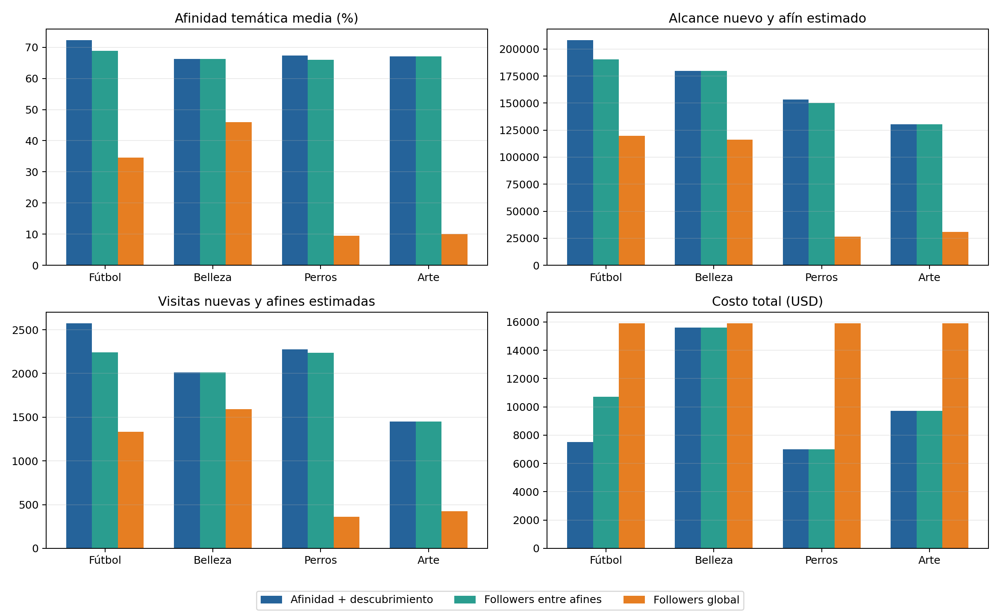
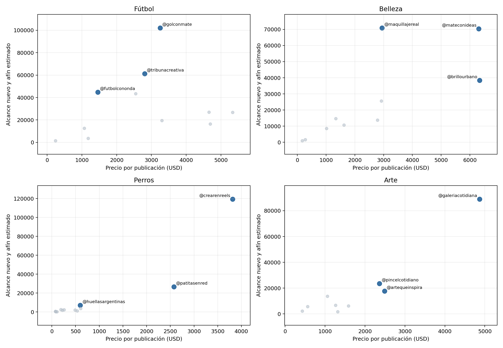

# Decisión revisada para las cuatro campañas

## Qué se corrigió

La selección anterior convertía la región temática modal de Kohonen en un filtro
obligatorio. Eso podía excluir a un creador con alta afinidad individual cuando
las otras variables lo ubicaban en otra zona del mapa. La revisión separa las
dos preguntas:

1. Kohonen describe perfiles multivariados y ayuda a interpretar similitudes.
2. La campaña selecciona directamente según el tema y el objetivo del cliente.

## Regla de selección

1. Un creador es elegible si al menos **50 %** de
   su contenido corresponde al tema de la campaña.
2. Se estima el alcance argentino afín como `alcance argentino × afinidad`.
3. Se estima el alcance nuevo y afín como el valor anterior multiplicado por el
   porcentaje de alcance a no seguidores.
4. Se ordenan los elegibles por alcance nuevo y afín y se conservan los primeros
   **3**. Ante empate se priorizan más visitas al perfil y
   luego menor precio.

Los productos entre porcentajes son proxies descriptivos. Suponen que la mezcla
temática y las tasas generales del creador se mantienen en la publicación de la
campaña. No predicen ventas ni adopciones.

## Sensibilidad al umbral temático

El corte de 50 % significa que el tema ocupa la mayoría del contenido. Para
comprobar que la conclusión no dependa de ese único número, se repitió la
selección con cortes de 40 %, 50 % y 60 %. Los tres candidatos se conservan en
las cuatro campañas.

| Campaña | Umbral 40 % | Umbral 50 % | Umbral 60 % |
| --- | --- | --- | --- |
| Fútbol | @golconmate, @tribunacreativa, @futbolcononda | @golconmate, @tribunacreativa, @futbolcononda | @golconmate, @tribunacreativa, @futbolcononda |
| Belleza | @maquillajereal, @mateconideas, @brillourbano | @maquillajereal, @mateconideas, @brillourbano | @maquillajereal, @mateconideas, @brillourbano |
| Perros | @crearenreels, @patitasenred, @huellasargentinas | @crearenreels, @patitasenred, @huellasargentinas | @crearenreels, @patitasenred, @huellasargentinas |
| Arte | @galeriacotidiana, @pincelcotidiano, @artequeinspira | @galeriacotidiana, @pincelcotidiano, @artequeinspira | @galeriacotidiana, @pincelcotidiano, @artequeinspira |

## Comparaciones

Se usan tres listas del mismo tamaño:

- **Afinidad + descubrimiento:** la propuesta revisada.
- **Followers entre afines:** controla el tema y luego ordena por followers.
- **Followers global:** representa la práctica actual de la agencia, sin filtro
  temático.

## Fútbol: Ropa de entrenamiento para fútbol

Objetivo del cliente: **Aumentar ventas**. Como el dataset no contiene
ventas, consultas ni adopciones, la selección maximiza el alcance nuevo y afín
como indicador principal. Las visitas al perfil se muestran como señal secundaria
de intención, no como una conversión observada.

| Puesto | Creador | Afinidad | Alcance nuevo y afín estimado | Visitas nuevas y afines estimadas | Precio | Región Kohonen |
| ---: | --- | ---: | ---: | ---: | ---: | --- |
| 1 | @golconmate | 82.2 % | 102,045 | 1,090.9 | USD 3,251 | coincide |
| 2 | @tribunacreativa | 61.1 % | 61,261 | 730.2 | USD 2,806 | coincide |
| 3 | @futbolcononda | 73.5 % | 44,797 | 750.8 | USD 1,457 | no coincide |

| Estrategia | Afines | Afinidad media | Alcance nuevo y afín | Visitas nuevas y afines | Costo total |
| --- | ---: | ---: | ---: | ---: | ---: |
| Afinidad + descubrimiento | 3/3 | 72.2 % | 208,103 | 2,571.9 | USD 7,515 |
| Followers entre afines | 3/3 | 68.9 % | 190,328 | 2,239.4 | USD 10,713 |
| Followers global | 1/3 | 34.6 % | 119,686 | 1,335.2 | USD 15,897 |

La región de Kohonen se informa para interpretar el perfil. No decide la
elegibilidad ni el orden de los candidatos.
## Belleza: Productos de belleza

Objetivo del cliente: **Aumentar ventas**. Como el dataset no contiene
ventas, consultas ni adopciones, la selección maximiza el alcance nuevo y afín
como indicador principal. Las visitas al perfil se muestran como señal secundaria
de intención, no como una conversión observada.

| Puesto | Creador | Afinidad | Alcance nuevo y afín estimado | Visitas nuevas y afines estimadas | Precio | Región Kohonen |
| ---: | --- | ---: | ---: | ---: | ---: | --- |
| 1 | @maquillajereal | 66.7 % | 70,888 | 499.8 | USD 2,947 | coincide |
| 2 | @mateconideas | 61.6 % | 70,430 | 1,152.2 | USD 6,311 | coincide |
| 3 | @brillourbano | 70.4 % | 38,433 | 359.7 | USD 6,335 | coincide |

| Estrategia | Afines | Afinidad media | Alcance nuevo y afín | Visitas nuevas y afines | Costo total |
| --- | ---: | ---: | ---: | ---: | ---: |
| Afinidad + descubrimiento | 3/3 | 66.2 % | 179,750 | 2,011.7 | USD 15,592 |
| Followers entre afines | 3/3 | 66.2 % | 179,750 | 2,011.7 | USD 15,592 |
| Followers global | 2/3 | 46.0 % | 116,177 | 1,590.1 | USD 15,897 |

La región de Kohonen se informa para interpretar el perfil. No decide la
elegibilidad ni el orden de los candidatos.
## Perros: Refugios que promueven adopciones

Objetivo del cliente: **Generar consultas y adopciones**. Como el dataset no contiene
ventas, consultas ni adopciones, la selección maximiza el alcance nuevo y afín
como indicador principal. Las visitas al perfil se muestran como señal secundaria
de intención, no como una conversión observada.

| Puesto | Creador | Afinidad | Alcance nuevo y afín estimado | Visitas nuevas y afines estimadas | Precio | Región Kohonen |
| ---: | --- | ---: | ---: | ---: | ---: | --- |
| 1 | @crearenreels | 67.0 % | 119,502 | 1,708.9 | USD 3,814 | no coincide |
| 2 | @patitasenred | 62.6 % | 26,696 | 450.9 | USD 2,574 | coincide |
| 3 | @huellasargentinas | 72.6 % | 7,182 | 117.8 | USD 599 | coincide |

| Estrategia | Afines | Afinidad media | Alcance nuevo y afín | Visitas nuevas y afines | Costo total |
| --- | ---: | ---: | ---: | ---: | ---: |
| Afinidad + descubrimiento | 3/3 | 67.4 % | 153,380 | 2,277.6 | USD 6,987 |
| Followers entre afines | 3/3 | 66.0 % | 150,016 | 2,235.6 | USD 6,993 |
| Followers global | 0/3 | 9.5 % | 26,321 | 359.2 | USD 15,897 |

La región de Kohonen se informa para interpretar el perfil. No decide la
elegibilidad ni el orden de los candidatos.
## Arte: Materiales de arte

Objetivo del cliente: **Aumentar ventas**. Como el dataset no contiene
ventas, consultas ni adopciones, la selección maximiza el alcance nuevo y afín
como indicador principal. Las visitas al perfil se muestran como señal secundaria
de intención, no como una conversión observada.

| Puesto | Creador | Afinidad | Alcance nuevo y afín estimado | Visitas nuevas y afines estimadas | Precio | Región Kohonen |
| ---: | --- | ---: | ---: | ---: | ---: | --- |
| 1 | @galeriacotidiana | 61.0 % | 89,034 | 804.9 | USD 4,867 | no coincide |
| 2 | @pincelcotidiano | 70.2 % | 23,527 | 345.4 | USD 2,362 | coincide |
| 3 | @artequeinspira | 70.2 % | 17,765 | 297.6 | USD 2,489 | coincide |

| Estrategia | Afines | Afinidad media | Alcance nuevo y afín | Visitas nuevas y afines | Costo total |
| --- | ---: | ---: | ---: | ---: | ---: |
| Afinidad + descubrimiento | 3/3 | 67.2 % | 130,327 | 1,447.8 | USD 9,717 |
| Followers entre afines | 3/3 | 67.2 % | 130,327 | 1,447.8 | USD 9,717 |
| Followers global | 0/3 | 10.0 % | 30,929 | 424.8 | USD 15,897 |

La región de Kohonen se informa para interpretar el perfil. No decide la
elegibilidad ni el orden de los candidatos.

## Lectura correcta de Kohonen

La región modal y su estabilidad siguen siendo evidencia útil para describir
perfiles híbridos y comprobar que la interpretación del mapa no depende de una
sola semilla. No se usan como etiqueta verdadera ni como condición de entrada a
una campaña. Una discrepancia entre afinidad individual y región es información
para explicar, no un motivo automático de exclusión.
