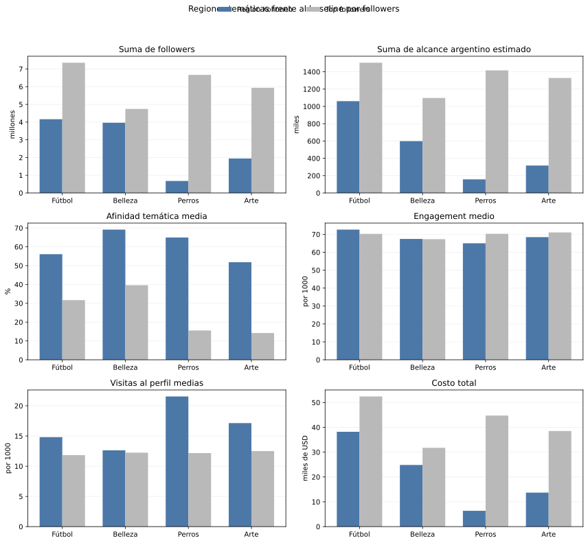
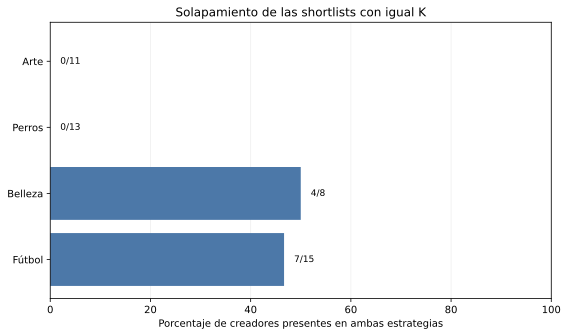

# Síntesis regional para las cuatro campañas

## Criterio

Cada creador se asigna a su región temática modal en las diez semillas de la
configuración final de Kohonen. Se usa la región completa, no la neurona de
máxima afinidad. Los casos estables y fronterizos forman el conjunto primario;
los inestables permanecen visibles, pero con una advertencia explícita.

La tabla maestra conserva las 31 variables numéricas originales en sus unidades,
los conteos de región de las diez semillas, los scores de PC1-PC2 y el índice de
Oja. No se calcula un puntaje compuesto ni se ordena a los creadores como
mejores o peores. `followers` se usa únicamente para construir el baseline
global de igual tamaño que cada conjunto regional.

## Integración de modelos

| Campaña | Creadores | Estables | Fronterizos | Inestables | PC1 medio | PC2 medio | Oja medio |
| --- | ---: | ---: | ---: | ---: | ---: | ---: | ---: |
| Fútbol | 17 | 13 | 2 | 2 | +1.07 | +0.83 | +1.07 |
| Belleza | 8 | 6 | 2 | 0 | +1.99 | -0.87 | +1.99 |
| Perros | 13 | 12 | 1 | 0 | -2.30 | -1.07 | -2.30 |
| Arte | 12 | 5 | 6 | 1 | -0.35 | +0.58 | -0.35 |

PC1 y PC2 explican juntas **49.90 %** de la varianza. El índice de
Oja de la corrida representativa tiene correlación **0.999999962**
con PC1. Por eso Oja confirma ese eje, pero no se cuenta como una segunda señal
independiente para seleccionar candidatos.

## Perfiles regionales

El siguiente gráfico usa las mismas 15 variables estandarizadas de PCA,
Kohonen y Oja. Cada valor es la media z-score de una región; no es una tasa ni
un score comercial.

### Fútbol

- Afinidad temática media: **53.1 %**.
- Variables relativamente altas: `topic_football_pct:1.009;sponsored_posts_pct:0.523;non_follower_reach_pct:0.365`.
- Variables relativamente bajas: `topic_dogs_pct:-0.474;profile_visits_per_1000:-0.292;topic_makeup_pct:-0.274`.
- Candidatos regionalmente estables: INF005 (@tribunacreativa), INF011 (@vidaperruna), INF017 (@tacticavisual), INF021 (@golconmate), INF027 (@pasionalbirroja), INF030 (@lookdecancha), INF033 (@futbolentrepases), INF034 (@makeupconsejos), INF036 (@crearenreels), INF040 (@galeriacotidiana), INF041 (@jugadayestilo), INF045 (@futbolsinvueltas), INF050 (@reelconideas).
- Candidatos fronterizos: INF020 (@manosalaobra), INF025 (@reelargentino).
- Creadores inestables, conservados con advertencia: INF014 (@brochasycolor), INF037 (@pasiondepotrero).
### Belleza

- Afinidad temática media: **69.1 %**.
- Variables relativamente altas: `topic_makeup_pct:1.898;average_reach:0.890;price_usd:0.812`.
- Variables relativamente bajas: `profile_visits_per_1000:-0.786;content_tutorial_pct:-0.673;topic_dogs_pct:-0.623`.
- Candidatos regionalmente estables: INF001 (@mateconideas), INF002 (@brillourbano), INF006 (@glamencasa), INF010 (@maquillajereal), INF022 (@bellezasimple), INF042 (@brilloytendencia).
- Candidatos fronterizos: INF032 (@tallerurbano), INF038 (@cosmeticaconsciente).
- Creadores inestables, conservados con advertencia: ninguno.
### Perros

- Afinidad temática media: **64.9 %**.
- Variables relativamente altas: `topic_dogs_pct:1.480;profile_visits_per_1000:0.833;average_watch_time_seconds:0.747`.
- Variables relativamente bajas: `average_reach:-0.735;price_usd:-0.701;sponsored_posts_pct:-0.684`.
- Candidatos regionalmente estables: INF003 (@huellasyconsejos), INF015 (@guiadehuellas), INF018 (@estiloydetalle), INF019 (@perrosfelices.ar), INF023 (@clubdelasmascotas), INF026 (@colorenmovimiento), INF028 (@ideasconhuella), INF031 (@mundoanimal.ar), INF035 (@adoptafelicidad), INF039 (@huellasargentinas), INF043 (@consejoscaninos), INF047 (@patitascontentas).
- Candidatos fronterizos: INF007 (@patitasenred).
- Creadores inestables, conservados con advertencia: ninguno.
### Arte

- Afinidad temática media: **48.9 %**.
- Variables relativamente altas: `content_review_pct:0.461;monthly_posts:0.245;sponsored_posts_pct:0.233`.
- Variables relativamente bajas: `topic_dogs_pct:-0.518;content_entertainment_pct:-0.422;topic_football_pct:-0.287`.
- Candidatos regionalmente estables: INF008 (@artealpaso), INF024 (@artequeinspira), INF029 (@canvasycafe), INF044 (@arteentusmanos), INF048 (@creatividadaldia).
- Candidatos fronterizos: INF004 (@pincelcotidiano), INF009 (@futbolcononda), INF012 (@trazosyreels), INF013 (@canchaaldia), INF016 (@rinconcreativo), INF049 (@entrelienzos).
- Creadores inestables, conservados con advertencia: INF046 (@brochasymates).

## Comparación con el baseline por followers

Para cada campaña, `K` es la cantidad de candidatos regionales estables o
fronterizos. El baseline toma los `K` creadores con más followers de todo el
catálogo. De este modo ambas estrategias tienen el mismo tamaño y la diferencia
no se explica por comparar conjuntos de distinta cantidad.

| Campaña | K | Solapamiento | Afinidad regional / baseline (%) | Alcance argentino regional / baseline | Engagement regional / baseline (por 1000) | Costo regional / baseline (USD) |
| --- | ---: | ---: | ---: | ---: | ---: | ---: |
| Fútbol | 15 | 7/15 (46.7 %) | 56.1 / 31.7 | 1,060,925 / 1,504,350 | 72.6 / 70.3 | 38,197 / 52,440 |
| Belleza | 8 | 4/8 (50.0 %) | 69.1 / 39.6 | 598,344 / 1,097,439 | 67.4 / 67.3 | 24,834 / 31,741 |
| Perros | 13 | 0/13 (0.0 %) | 64.9 / 15.6 | 156,762 / 1,416,823 | 65.0 / 70.3 | 6,371 / 44,743 |
| Arte | 11 | 0/11 (0.0 %) | 51.8 / 14.2 | 316,311 / 1,328,395 | 68.5 / 71.1 | 13,698 / 38,520 |

Las sumas de followers, alcance y alcance argentino son volúmenes descriptivos
no deduplicados: el dataset no permite conocer cuánta audiencia comparten dos
creadores. El costo es la suma de `price_usd` de los integrantes de cada
shortlist.

### Fútbol

- Afinidad temática: **56.1 %** regional frente a **31.7 %** por followers (+24.4 puntos porcentuales).
- Suma de alcance argentino estimado: **1,060,925** frente a **1,504,350** (-29.5 %).
- Engagement medio: **72.6** frente a **70.3** por 1000 (+3.4 %).
- Costo total: **USD 38,197** frente a **USD 52,440** (-27.2 %).
- Sólo en la shortlist regional: INF027 (@pasionalbirroja), INF030 (@lookdecancha), INF033 (@futbolentrepases), INF034 (@makeupconsejos), INF041 (@jugadayestilo), INF050 (@reelconideas), INF020 (@manosalaobra), INF025 (@reelargentino).
- Sólo en el baseline: INF001 (@mateconideas), INF002 (@brillourbano), INF010 (@maquillajereal), INF042 (@brilloytendencia), INF032 (@tallerurbano), INF038 (@cosmeticaconsciente), INF006 (@glamencasa), INF004 (@pincelcotidiano).
### Belleza

- Afinidad temática: **69.1 %** regional frente a **39.6 %** por followers (+29.5 puntos porcentuales).
- Suma de alcance argentino estimado: **598,344** frente a **1,097,439** (-45.5 %).
- Engagement medio: **67.4** frente a **67.3** por 1000 (+0.2 %).
- Costo total: **USD 24,834** frente a **USD 31,741** (-21.8 %).
- Sólo en la shortlist regional: INF006 (@glamencasa), INF022 (@bellezasimple), INF032 (@tallerurbano), INF038 (@cosmeticaconsciente).
- Sólo en el baseline: INF021 (@golconmate), INF036 (@crearenreels), INF045 (@futbolsinvueltas), INF005 (@tribunacreativa).
### Perros

- Afinidad temática: **64.9 %** regional frente a **15.6 %** por followers (+49.4 puntos porcentuales).
- Suma de alcance argentino estimado: **156,762** frente a **1,416,823** (-88.9 %).
- Engagement medio: **65.0** frente a **70.3** por 1000 (-7.5 %).
- Costo total: **USD 6,371** frente a **USD 44,743** (-85.8 %).
- Sólo en la shortlist regional: INF003 (@huellasyconsejos), INF015 (@guiadehuellas), INF018 (@estiloydetalle), INF019 (@perrosfelices.ar), INF023 (@clubdelasmascotas), INF026 (@colorenmovimiento), INF028 (@ideasconhuella), INF031 (@mundoanimal.ar), INF035 (@adoptafelicidad), INF039 (@huellasargentinas), INF043 (@consejoscaninos), INF047 (@patitascontentas), INF007 (@patitasenred).
- Sólo en el baseline: INF001 (@mateconideas), INF021 (@golconmate), INF002 (@brillourbano), INF010 (@maquillajereal), INF036 (@crearenreels), INF045 (@futbolsinvueltas), INF042 (@brilloytendencia), INF005 (@tribunacreativa), INF032 (@tallerurbano), INF038 (@cosmeticaconsciente), INF040 (@galeriacotidiana), INF011 (@vidaperruna), INF006 (@glamencasa).
### Arte

- Afinidad temática: **51.8 %** regional frente a **14.2 %** por followers (+37.6 puntos porcentuales).
- Suma de alcance argentino estimado: **316,311** frente a **1,328,395** (-76.2 %).
- Engagement medio: **68.5** frente a **71.1** por 1000 (-3.6 %).
- Costo total: **USD 13,698** frente a **USD 38,520** (-64.4 %).
- Sólo en la shortlist regional: INF008 (@artealpaso), INF024 (@artequeinspira), INF029 (@canvasycafe), INF044 (@arteentusmanos), INF048 (@creatividadaldia), INF004 (@pincelcotidiano), INF009 (@futbolcononda), INF012 (@trazosyreels), INF013 (@canchaaldia), INF016 (@rinconcreativo), INF049 (@entrelienzos).
- Sólo en el baseline: INF001 (@mateconideas), INF021 (@golconmate), INF002 (@brillourbano), INF010 (@maquillajereal), INF036 (@crearenreels), INF045 (@futbolsinvueltas), INF042 (@brilloytendencia), INF005 (@tribunacreativa), INF032 (@tallerurbano), INF038 (@cosmeticaconsciente), INF040 (@galeriacotidiana).

## Candidatos propuestos y trade-offs

Se proponen tres perfiles complementarios dentro del conjunto regional primario.
No se suman variables ni se asignan pesos. Los tres perfiles exigen afinidad
temática al menos mediana dentro de su conjunto regional. El perfil de alcance
maximiza el alcance argentino estimado. El perfil equilibrado exige además
respuesta al menos mediana y costo no mayor a la mediana, y entre quienes
cumplen elige el mayor alcance restante. El perfil de especialización y
eficiencia elige el menor costo entre los restantes.

Para fútbol, belleza y arte se usa engagement por 1000 como respuesta observada.
Para perros se usan visitas al perfil por 1000, porque están más próximas a una
acción de consideración o consulta. Ninguna de las dos variables mide ventas o
adopciones. Los tres perfiles son opciones para objetivos distintos, no un
podio ni un ranking general.

### Fútbol

| Perfil | Creador | Estabilidad | Alcance argentino | Afinidad | Respuesta observada | Precio | Formato dominante |
| --- | --- | --- | ---: | ---: | ---: | ---: | --- |
| Alcance | INF021 (@golconmate) | estable | 207,994 | 82.2 % | 69.2 | USD 3,251 | entretenimiento (51.9 %) |
| Equilibrio | INF041 (@jugadayestilo) | estable | 23,664 | 79.2 % | 71.6 | USD 1,067 | entretenimiento (63.3 %) |
| Especialización y eficiencia | INF027 (@pasionalbirroja) | estable | 3,529 | 71.0 % | 62.6 | USD 239 | tutorial (40.9 %) |

- **Alcance — INF021 (@golconmate):** afinidad al menos mediana; máximo alcance argentino estimado. Registra 207,994 de alcance argentino estimado, 82.2 % de afinidad, 69.2 de engagement por 1000 y un costo de USD 3,251. Su respuesta queda 3.3 % por debajo de la mediana regional y su precio 15.9 % por encima de esa mediana.
- **Equilibrio — INF041 (@jugadayestilo):** afinidad y respuesta al menos medianas, costo no mayor a la mediana; máximo alcance argentino restante. Registra 23,664 de alcance argentino estimado, 79.2 % de afinidad, 71.6 de engagement por 1000 y un costo de USD 1,067. Cumple simultáneamente los umbrales de afinidad, respuesta y costo; cede escala frente al perfil de alcance.
- **Especialización y eficiencia — INF027 (@pasionalbirroja):** afinidad al menos mediana; menor costo entre los candidatos restantes. Registra 3,529 de alcance argentino estimado, 71.0 % de afinidad, 62.6 de engagement por 1000 y un costo de USD 239. Su costo queda 92.7 % por debajo de el del perfil de alcance y conserva 1.7 % de su alcance argentino estimado.
### Belleza

| Perfil | Creador | Estabilidad | Alcance argentino | Afinidad | Respuesta observada | Precio | Formato dominante |
| --- | --- | --- | ---: | ---: | ---: | ---: | --- |
| Alcance | INF006 (@glamencasa) | estable | 51,469 | 74.1 % | 62.4 | USD 2,922 | entretenimiento (40.1 %) |
| Equilibrio | INF022 (@bellezasimple) | estable | 28,118 | 77.8 % | 69.9 | USD 2,784 | entretenimiento (75.9 %) |
| Especialización y eficiencia | INF038 (@cosmeticaconsciente) | fronterizo | 23,212 | 75.5 % | 65.8 | USD 1,016 | tutorial (57.9 %) |

- **Alcance — INF006 (@glamencasa):** afinidad al menos mediana; máximo alcance argentino estimado. Registra 51,469 de alcance argentino estimado, 74.1 % de afinidad, 62.4 de engagement por 1000 y un costo de USD 2,922. Su respuesta queda 2.7 % por debajo de la mediana regional y su precio 2.4 % por encima de esa mediana.
- **Equilibrio — INF022 (@bellezasimple):** afinidad y respuesta al menos medianas, costo no mayor a la mediana; máximo alcance argentino restante. Registra 28,118 de alcance argentino estimado, 77.8 % de afinidad, 69.9 de engagement por 1000 y un costo de USD 2,784. Cumple simultáneamente los umbrales de afinidad, respuesta y costo; cede escala frente al perfil de alcance.
- **Especialización y eficiencia — INF038 (@cosmeticaconsciente):** afinidad al menos mediana; menor costo entre los candidatos restantes. Registra 23,212 de alcance argentino estimado, 75.5 % de afinidad, 65.8 de engagement por 1000 y un costo de USD 1,016. Su costo queda 65.2 % por debajo de el del perfil de alcance y conserva 45.1 % de su alcance argentino estimado. Sí es fronterizo, por lo que conviene validar su región cuando se actualicen los datos.
### Perros

| Perfil | Creador | Estabilidad | Alcance argentino | Afinidad | Respuesta observada | Precio | Formato dominante |
| --- | --- | --- | ---: | ---: | ---: | ---: | --- |
| Alcance | INF039 (@huellasargentinas) | estable | 18,721 | 72.6 % | 16.4 | USD 599 | entretenimiento (75.8 %) |
| Equilibrio | INF023 (@clubdelasmascotas) | estable | 6,044 | 76.7 % | 22.2 | USD 256 | entretenimiento (30.9 %) |
| Especialización y eficiencia | INF043 (@consejoscaninos) | estable | 2,863 | 82.0 % | 22.7 | USD 75 | tutorial (49.5 %) |

- **Alcance — INF039 (@huellasargentinas):** afinidad al menos mediana; máximo alcance argentino estimado. Registra 18,721 de alcance argentino estimado, 72.6 % de afinidad, 16.4 de visitas al perfil por 1000 y un costo de USD 599. Su respuesta queda 18.9 % por debajo de la mediana regional y su precio 133.7 % por encima de esa mediana.
- **Equilibrio — INF023 (@clubdelasmascotas):** afinidad y respuesta al menos medianas, costo no mayor a la mediana; máximo alcance argentino restante. Registra 6,044 de alcance argentino estimado, 76.7 % de afinidad, 22.2 de visitas al perfil por 1000 y un costo de USD 256. Cumple simultáneamente los umbrales de afinidad, respuesta y costo; cede escala frente al perfil de alcance.
- **Especialización y eficiencia — INF043 (@consejoscaninos):** afinidad al menos mediana; menor costo entre los candidatos restantes. Registra 2,863 de alcance argentino estimado, 82.0 % de afinidad, 22.7 de visitas al perfil por 1000 y un costo de USD 75. Su costo queda 87.5 % por debajo de el del perfil de alcance y conserva 15.3 % de su alcance argentino estimado.
### Arte

| Perfil | Creador | Estabilidad | Alcance argentino | Afinidad | Respuesta observada | Precio | Formato dominante |
| --- | --- | --- | ---: | ---: | ---: | ---: | --- |
| Alcance | INF024 (@artequeinspira) | estable | 60,465 | 70.2 % | 67.9 | USD 2,489 | entretenimiento (35.0 %) |
| Equilibrio | INF012 (@trazosyreels) | fronterizo | 10,367 | 60.6 % | 73.8 | USD 431 | review (33.6 %) |
| Especialización y eficiencia | INF016 (@rinconcreativo) | fronterizo | 37,812 | 64.1 % | 67.2 | USD 1,056 | entretenimiento (44.2 %) |

- **Alcance — INF024 (@artequeinspira):** afinidad al menos mediana; máximo alcance argentino estimado. Registra 60,465 de alcance argentino estimado, 70.2 % de afinidad, 67.9 de engagement por 1000 y un costo de USD 2,489. Su respuesta queda igual a la mediana regional y su precio 96.9 % por encima de esa mediana.
- **Equilibrio — INF012 (@trazosyreels):** afinidad y respuesta al menos medianas, costo no mayor a la mediana; máximo alcance argentino restante. Registra 10,367 de alcance argentino estimado, 60.6 % de afinidad, 73.8 de engagement por 1000 y un costo de USD 431. Cumple simultáneamente los umbrales de afinidad, respuesta y costo; cede escala frente al perfil de alcance. Sí es fronterizo, por lo que conviene validar su región cuando se actualicen los datos.
- **Especialización y eficiencia — INF016 (@rinconcreativo):** afinidad al menos mediana; menor costo entre los candidatos restantes. Registra 37,812 de alcance argentino estimado, 64.1 % de afinidad, 67.2 de engagement por 1000 y un costo de USD 1,056. Su costo queda 57.6 % por debajo de el del perfil de alcance y conserva 62.5 % de su alcance argentino estimado. Sí es fronterizo, por lo que conviene validar su región cuando se actualicen los datos.

## Decisión explícita para una campaña de fútbol

Bajo el supuesto de una campaña genérica de ropa de entrenamiento que busca
incorporar público nuevo, se prioriza **descubrimiento calificado dentro de la
región de fútbol**, no alcance masivo sin filtro. La razón es el problema de
partida: la estrategia por followers ya aporta visibilidad, pero no garantiza
afinidad. Frente a ese baseline, la shortlist regional aumenta la afinidad
media de **31.7 %** a **56.1 %**,
reduce el costo total **27.2 %** y mantiene un
engagement medio **3.4 %** mayor, aunque resigna
**29.5 %** del alcance argentino estimado.

Dentro de esa región, el perfil equilibrado **INF041 (@jugadayestilo)**
es la opción por defecto: es estable en las diez semillas, tiene **79.2 %**
de afinidad con fútbol, **67.2 %**
de alcance proveniente de no seguidores, **71.6**
de engagement por 1000 y cuesta **USD 1,067**.
No se afirma que vaya a producir más ventas porque el dataset no contiene
conversiones.

La prioridad cambia si cambia el objetivo declarado: para notoriedad masiva se
prefiere **INF021 (@golconmate)**, que maximiza
el alcance argentino; para una pieza educativa de menor presupuesto se prefiere
**INF027 (@pasionalbirroja)**, cuyo
formato dominante es tutorial y tiene el menor costo entre los candidatos
restantes de alta afinidad. Estas alternativas son decisiones condicionadas,
no un ranking universal.

## Alcance de esta etapa

Esta síntesis define conjuntos de candidatos y hace visibles sus perfiles y su
estabilidad. La comparación muestra diferencias observadas de composición,
alcance, afinidad, interacción, formato y costo. No estima ventas, adopciones ni
retorno de inversión porque el dataset no contiene esas variables objetivo.
Tampoco elige automáticamente un ganador: la estrategia apropiada depende del
objetivo declarado para cada campaña.

El procedimiento para incorporar creadores, campañas, variables o una nueva
actualización mensual está en [`../mantenimiento.md`](../mantenimiento.md).

## Archivos reproducibles

- `generated/creadores_por_campana.csv`: unión por creador de estabilidad,
  variables originales, PCA y Oja;
- `generated/resumen_regiones.csv`: tamaños, estabilidad, ejes y medias/medianas;
- `generated/perfiles_estandarizados.csv`: perfil z-score completo de cada región.
- `generated/shortlists_comparadas.csv`: comparación individual con igual `K`;
- `generated/comparacion_followers.csv`: resultados agregados por estrategia.
- `generated/candidatos_finales.csv`: tres perfiles reproducibles por campaña.
