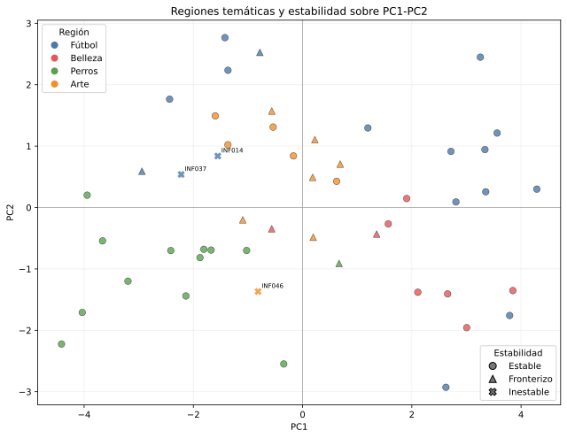
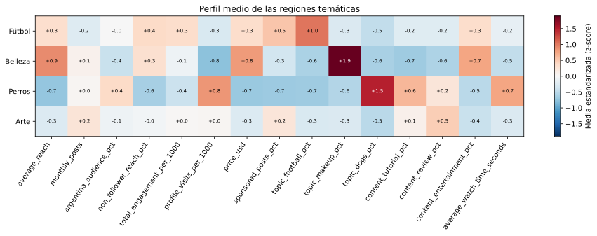

# Síntesis regional para las cuatro campañas

## Criterio

Cada creador se asigna a su región temática modal en las diez semillas de la
configuración final de Kohonen. Se usa la región completa, no la neurona de
máxima afinidad. Los casos estables y fronterizos forman el conjunto primario;
los inestables permanecen visibles, pero con una advertencia explícita.

La tabla maestra conserva las 31 variables numéricas originales en sus unidades,
los conteos de región de las diez semillas, los scores de PC1-PC2 y el índice de
Oja. No se calcula un puntaje compuesto ni se ordena a los creadores como
mejores o peores. `followers` queda como dato auxiliar para la comparación
posterior con la estrategia actual de la agencia.

## Integración de modelos

| Campaña | Creadores | Estables | Fronterizos | Inestables | PC1 medio | PC2 medio | Oja medio |
| --- | ---: | ---: | ---: | ---: | ---: | ---: | ---: |
| Fútbol | 17 | 13 | 2 | 2 | +1.07 | +0.83 | +1.07 |
| Belleza | 8 | 6 | 2 | 0 | +1.99 | -0.87 | +1.99 |
| Perros | 13 | 12 | 1 | 0 | -2.30 | -1.07 | -2.30 |
| Arte | 12 | 5 | 6 | 1 | -0.35 | +0.58 | -0.35 |

PC1 y PC2 explican juntas **49.90 %** de la varianza. El índice de
Oja de la corrida representativa tiene correlación **0.999999962**
con PC1. Por eso Oja confirma ese eje, pero no se cuenta como una segunda señal
independiente para seleccionar candidatos.

## Perfiles regionales

El siguiente gráfico usa las mismas 15 variables estandarizadas de PCA,
Kohonen y Oja. Cada valor es la media z-score de una región; no es una tasa ni
un score comercial.

### Fútbol

- Afinidad temática media: **53.1 %**.
- Variables relativamente altas: `topic_football_pct:1.009;sponsored_posts_pct:0.523;non_follower_reach_pct:0.365`.
- Variables relativamente bajas: `topic_dogs_pct:-0.474;profile_visits_per_1000:-0.292;topic_makeup_pct:-0.274`.
- Candidatos regionalmente estables: INF005 (@tribunacreativa), INF011 (@vidaperruna), INF017 (@tacticavisual), INF021 (@golconmate), INF027 (@pasionalbirroja), INF030 (@lookdecancha), INF033 (@futbolentrepases), INF034 (@makeupconsejos), INF036 (@crearenreels), INF040 (@galeriacotidiana), INF041 (@jugadayestilo), INF045 (@futbolsinvueltas), INF050 (@reelconideas).
- Candidatos fronterizos: INF020 (@manosalaobra), INF025 (@reelargentino).
- Creadores inestables, conservados con advertencia: INF014 (@brochasycolor), INF037 (@pasiondepotrero).
### Belleza

- Afinidad temática media: **69.1 %**.
- Variables relativamente altas: `topic_makeup_pct:1.898;average_reach:0.890;price_usd:0.812`.
- Variables relativamente bajas: `profile_visits_per_1000:-0.786;content_tutorial_pct:-0.673;topic_dogs_pct:-0.623`.
- Candidatos regionalmente estables: INF001 (@mateconideas), INF002 (@brillourbano), INF006 (@glamencasa), INF010 (@maquillajereal), INF022 (@bellezasimple), INF042 (@brilloytendencia).
- Candidatos fronterizos: INF032 (@tallerurbano), INF038 (@cosmeticaconsciente).
- Creadores inestables, conservados con advertencia: ninguno.
### Perros

- Afinidad temática media: **64.9 %**.
- Variables relativamente altas: `topic_dogs_pct:1.480;profile_visits_per_1000:0.833;average_watch_time_seconds:0.747`.
- Variables relativamente bajas: `average_reach:-0.735;price_usd:-0.701;sponsored_posts_pct:-0.684`.
- Candidatos regionalmente estables: INF003 (@huellasyconsejos), INF015 (@guiadehuellas), INF018 (@estiloydetalle), INF019 (@perrosfelices.ar), INF023 (@clubdelasmascotas), INF026 (@colorenmovimiento), INF028 (@ideasconhuella), INF031 (@mundoanimal.ar), INF035 (@adoptafelicidad), INF039 (@huellasargentinas), INF043 (@consejoscaninos), INF047 (@patitascontentas).
- Candidatos fronterizos: INF007 (@patitasenred).
- Creadores inestables, conservados con advertencia: ninguno.
### Arte

- Afinidad temática media: **48.9 %**.
- Variables relativamente altas: `content_review_pct:0.461;monthly_posts:0.245;sponsored_posts_pct:0.233`.
- Variables relativamente bajas: `topic_dogs_pct:-0.518;content_entertainment_pct:-0.422;topic_football_pct:-0.287`.
- Candidatos regionalmente estables: INF008 (@artealpaso), INF024 (@artequeinspira), INF029 (@canvasycafe), INF044 (@arteentusmanos), INF048 (@creatividadaldia).
- Candidatos fronterizos: INF004 (@pincelcotidiano), INF009 (@futbolcononda), INF012 (@trazosyreels), INF013 (@canchaaldia), INF016 (@rinconcreativo), INF049 (@entrelienzos).
- Creadores inestables, conservados con advertencia: INF046 (@brochasymates).

## Alcance de esta etapa

Esta síntesis define conjuntos de candidatos y hace visibles sus perfiles y su
estabilidad. Todavía no elige un ganador ni compara formalmente con el top por
`followers`. La etapa siguiente debe usar estos mismos conjuntos para una
comparación de igual cantidad de creadores y mostrar los trade-offs de alcance,
afinidad, respuesta, formato y costo.

## Archivos reproducibles

- `generated/creadores_por_campana.csv`: unión por creador de estabilidad,
  variables originales, PCA y Oja;
- `generated/resumen_regiones.csv`: tamaños, estabilidad, ejes y medias/medianas;
- `generated/perfiles_estandarizados.csv`: perfil z-score completo de cada región.
