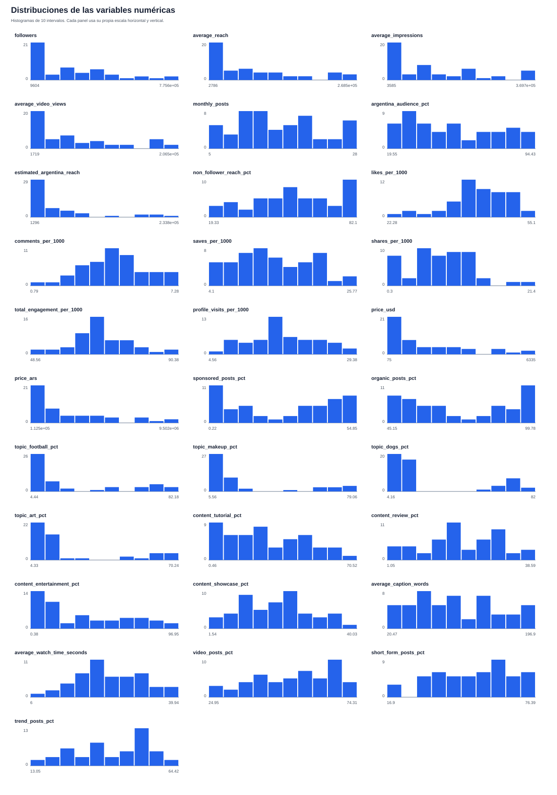
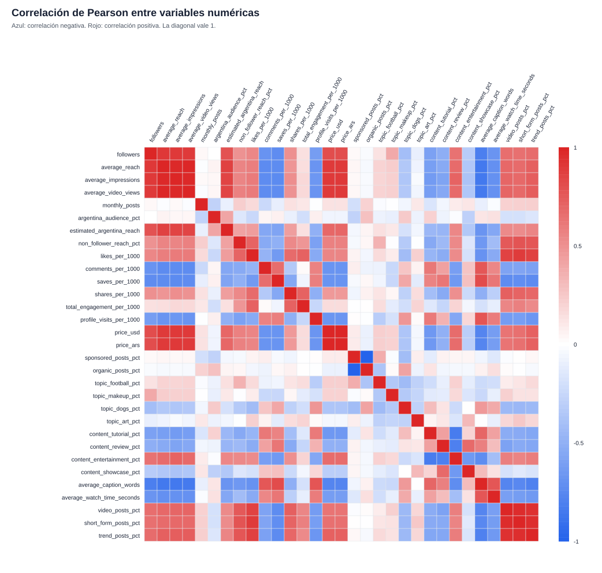
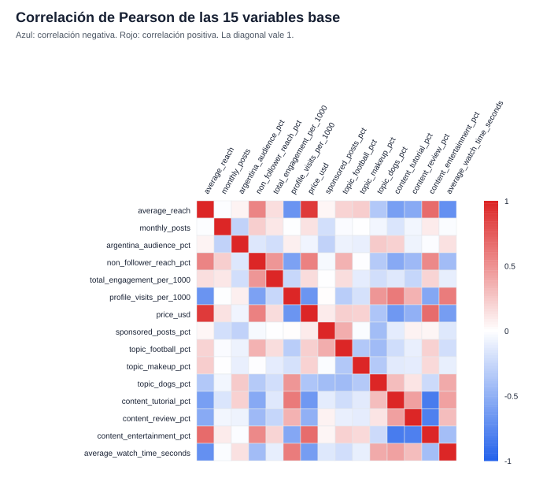
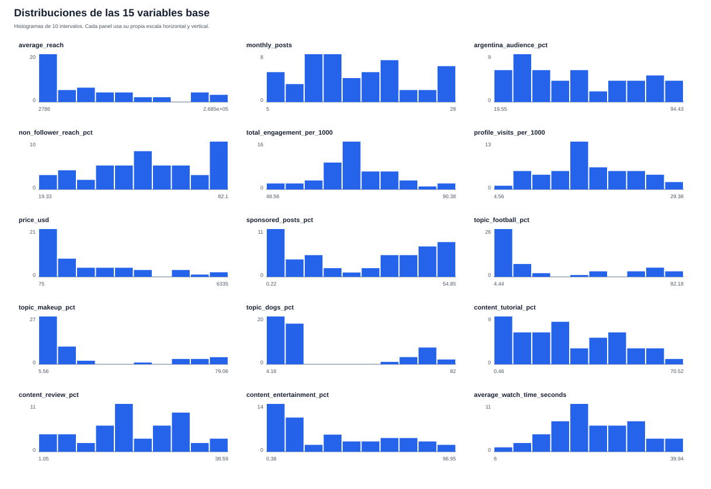

# EDA del catálogo de creadores

Este informe describe el conjunto de datos antes de implementar PCA, Kohonen u
Oja. Su objetivo es detectar problemas de calidad, escalas incompatibles y
redundancias, y proponer una primera selección de variables para discutir.

El informe se regenera ejecutando, desde `tp4/`:

```bash
python3 scripts/analyze_creators.py
```

Fuente analizada: `datos/creadores.csv`. SHA-256: `f86ab396e86c242801a4cd9e3dea14903695446e52f7ef4cb55fbc30bf03e86d`.

## Alcance y protocolo

- Se analizaron todas las observaciones disponibles, porque todavía no se está
  ajustando ni evaluando un modelo supervisado.
- `creator_id` y `name` se trataron como identificadores.
- Las otras columnas se validaron como numéricas.
- Los posibles outliers se marcaron con la regla exploratoria de 1,5 IQR. No se
  eliminaron ni modificaron datos.
- Las asociaciones lineales se midieron con correlación de Pearson.
- No se aplicaron transformaciones, estandarización ni reducción de dimensión.

## Estructura y calidad

- Filas: **50** creadores.
- Columnas: **33** en total, **31** numéricas y
  **2** identificadores.
- Celdas vacías: **0**.
- Filas duplicadas: **0**.
- Identificadores `creator_id` repetidos: **0**.
- Nombres repetidos: **0**.

No se detectaron faltantes ni duplicados. Esto permite avanzar sin imputación,
pero no elimina la necesidad de revisar redundancias y distribuciones.

## Escalas y distribuciones

Las variables operan en escalas muy diferentes. Seguidores, alcance y precios
llegan a cientos de miles o millones de unidades, mientras que otras columnas
son porcentajes o tasas por 1000. Por eso los métodos basados en distancia o
varianza requerirán estandarización.

Resumen de variables representativas:

| Variable | Mínimo | Mediana | Media | Máximo | Desvío | Outliers IQR |
| --- | --- | --- | --- | --- | --- | --- |
| followers | 9604 | 1.985e+05 | 2.216e+05 | 7.756e+05 | 2.083e+05 | 0 |
| average_reach | 2786 | 5.494e+04 | 8.161e+04 | 2.685e+05 | 8.165e+04 | 0 |
| estimated_argentina_reach | 1296 | 2.1e+04 | 4.398e+04 | 2.338e+05 | 5.883e+04 | 5 |
| total_engagement_per_1000 | 48.56 | 68.06 | 68.26 | 90.38 | 8.049 | 3 |
| price_usd | 75 | 1062 | 1701 | 6335 | 1728 | 0 |
| sponsored_posts_pct | 0.22 | 32.12 | 27.44 | 54.85 | 19.47 | 0 |
| average_caption_words | 20.47 | 99.11 | 102.7 | 196.9 | 49.26 | 0 |
| average_watch_time_seconds | 6 | 22.92 | 24.19 | 39.94 | 7.778 | 0 |



Las mayores asimetrías en valor absoluto son:

- `estimated_argentina_reach`: asimetría 1.97.
- `topic_makeup_pct`: asimetría 1.38.
- `topic_art_pct`: asimetría 1.32.
- `price_usd`: asimetría 1.17.
- `price_ars`: asimetría 1.17.
- `topic_dogs_pct`: asimetría 1.09.
- `topic_football_pct`: asimetría 1.04.
- `average_reach`: asimetría 0.96.

La estandarización iguala media y desvío, pero no elimina asimetrías ni el
efecto de observaciones extremas. Antes de aplicar una transformación, hay que
discutir si está justificada y si forma parte del preprocesamiento permitido.

Variables con más observaciones marcadas por la regla de 1,5 IQR:

- `topic_makeup_pct`: 11 observaciones fuera de 1,5 IQR.
- `topic_art_pct`: 11 observaciones fuera de 1,5 IQR.
- `estimated_argentina_reach`: 5 observaciones fuera de 1,5 IQR.
- `total_engagement_per_1000`: 3 observaciones fuera de 1,5 IQR.
- `likes_per_1000`: 1 observación fuera de 1,5 IQR.
- `comments_per_1000`: 1 observación fuera de 1,5 IQR.
- `shares_per_1000`: 1 observación fuera de 1,5 IQR.

Estos puntos no deben eliminarse automáticamente: un creador grande o muy
especializado puede ser un caso comercial válido y relevante.

## Identidades y redundancias exactas

| Relación | Error máximo | Tolerancia | Resultado |
| --- | --- | --- | --- |
| estimated_argentina_reach = average_reach * argentina_audience_pct / 100 | 0.4985 | 0.5 | Verificada |
| total_engagement_per_1000 = likes + comments + saves + shares | 1.421e-14 | 1e-09 | Verificada |
| price_ars = 1500 * price_usd | 9.313e-10 | 1e-06 | Verificada |
| sponsored_posts_pct + organic_posts_pct = 100 | 0 | 1e-09 | Verificada |
| topic_football_pct + topic_makeup_pct + topic_dogs_pct + topic_art_pct = 100 | 1.421e-14 | 1e-09 | Verificada |
| content_tutorial_pct + content_review_pct + content_entertainment_pct + content_showcase_pct = 100 | 1.421e-14 | 1e-09 | Verificada |

Estas relaciones implican que no conviene introducir simultáneamente todas las
columnas involucradas sin una justificación. Repetir una magnitud aumenta su
peso relativo en PCA y en las distancias de Kohonen.

En los grupos de porcentajes que suman 100, una columna puede reconstruirse a
partir de las otras. La propuesta inicial usa `topic_art_pct` y
`content_showcase_pct` como categorías de referencia omitidas. Eso evita una
dependencia lineal exacta, pero la elección es convencional y debe discutirse.

## Correlaciones

Se encontraron **26** pares con `|r| >= 0,85`. Los veinte
más intensos son:

| Variable A | Variable B | r |
| --- | --- | --- |
| price_usd | price_ars | 1 |
| sponsored_posts_pct | organic_posts_pct | -1 |
| average_reach | average_video_views | 0.9973 |
| average_impressions | average_video_views | 0.9884 |
| average_reach | average_impressions | 0.9874 |
| video_posts_pct | short_form_posts_pct | 0.9708 |
| short_form_posts_pct | trend_posts_pct | 0.9608 |
| video_posts_pct | trend_posts_pct | 0.9515 |
| followers | average_reach | 0.9181 |
| average_impressions | price_ars | 0.9145 |
| average_impressions | price_usd | 0.9145 |
| followers | average_impressions | 0.9117 |
| average_video_views | price_ars | 0.9082 |
| average_video_views | price_usd | 0.9082 |
| average_reach | price_ars | 0.907 |
| average_reach | price_usd | 0.907 |
| followers | average_video_views | 0.9064 |
| likes_per_1000 | short_form_posts_pct | 0.9012 |
| likes_per_1000 | trend_posts_pct | 0.8762 |
| average_reach | estimated_argentina_reach | 0.8748 |



Los principales bloques son:

- seguidores, alcance, impresiones y vistas de video;
- alcance, vistas y precio;
- `price_usd` y `price_ars`, que además son la misma magnitud convertida;
- publicaciones patrocinadas y orgánicas, que son complementarias;
- publicaciones con video, formato breve y participación en tendencias.

La correlación ayuda a detectar información repetida, pero no decide por sí
sola qué columna conservar. La selección también debe mantener la semántica
necesaria para interpretar campañas.

## Variables acordadas para la primera variante

La primera variante de PCA usará estas 15 variables. La selección
mantiene dimensiones de alcance, frecuencia, audiencia, interacción, costo,
saturación comercial, tema, tipo de contenido y profundidad de consumo.

| Variable base | Justificación |
| --- | --- |
| average_reach | Alcance único medio por publicación. |
| monthly_posts | Frecuencia de publicación. |
| argentina_audience_pct | Afinidad geográfica de la audiencia. |
| non_follower_reach_pct | Capacidad de descubrimiento fuera de la base actual. |
| total_engagement_per_1000 | Interacción total comparable por alcance. |
| profile_visits_per_1000 | Conversión de alcance en interés por el perfil. |
| price_usd | Costo de una publicación patrocinada. |
| sponsored_posts_pct | Nivel de saturación comercial. |
| topic_football_pct | Especialización temática en fútbol. |
| topic_makeup_pct | Especialización temática en maquillaje. |
| topic_dogs_pct | Especialización temática en perros. |
| content_tutorial_pct | Profundidad educativa del contenido. |
| content_review_pct | Contenido orientado a evaluación de productos. |
| content_entertainment_pct | Contenido orientado a entretenimiento. |
| average_watch_time_seconds | Profundidad de consumo audiovisual. |

Decisiones confirmadas:

- `followers` se reserva como baseline de comparación y no entra inicialmente
  al modelo. `average_reach` representa mejor la exposición efectiva. Después
  se colorearán o etiquetarán resultados con `followers` para compararlos con
  la estrategia actual de la agencia.
- La primera variante usa engagement total y conserva sus cuatro componentes
  como auxiliares. Más adelante se ejecutará una segunda variante que reemplace
  el total por likes, comentarios, guardados y compartidos. No se usarán el
  total y sus cuatro componentes juntos. La representación final se decidirá
  según cuánto cambien PCA y los perfiles encontrados.
- Se conserva `price_usd` y se descarta su conversión exacta a ARS.
- Se conserva `sponsored_posts_pct` y se descarta su complemento orgánico.
- Se omiten `topic_art_pct` y `content_showcase_pct` sólo para romper las sumas
  exactas; se reconstruyen como el complemento de las otras tres categorías.
- `video_posts_pct`, `short_form_posts_pct` y `trend_posts_pct` quedan como
  auxiliares. Entre sí tienen correlaciones de 0,95 a 0,97: incluir las tres
  haría que el mismo estilo breve, audiovisual y de tendencia pesara tres veces.
  Además, la selección ya representa descubrimiento con
  `non_follower_reach_pct`, entretenimiento con `content_entertainment_pct` y
  profundidad con `average_watch_time_seconds`. Si luego falta una variable de
  formato, la primera candidata será `short_form_posts_pct`.
- `estimated_argentina_reach` queda como métrica derivada de interpretación,
  no como entrada simultánea a `average_reach` y `argentina_audience_pct`.

## Revisión específica de las variables elegidas

Dentro de las 15 variables permanecen estas asociaciones con `|r| >= 0,70`:

| Variable A | Variable B | r | Motivo para conservar ambas |
| --- | --- | --- | --- |
| average_reach | price_usd | 0.907 | El precio crece con el alcance, pero costo y exposición cumplen roles distintos. |
| content_tutorial_pct | content_entertainment_pct | -0.8392 | Son estilos opuestos dentro de una composición, ambos relevantes para campañas. |
| content_review_pct | content_entertainment_pct | -0.8141 | Son estilos opuestos dentro de una composición, ambos relevantes para campañas. |
| average_reach | average_watch_time_seconds | -0.7126 | Distinguen escala de audiencia y profundidad de consumo. |





No hay redundancias exactas dentro de la selección. Las correlaciones restantes
responden a relaciones comerciales o a las composiciones del dataset. Se
conservan porque las variables tienen significados distintos que se necesitan
para interpretar campañas. El análisis PCA posterior muestra cuánto de esa
información se resume en las mismas componentes y queda documentado en
`docs/pca-creadores/README.md`.

## Variables auxiliares para interpretar

Aunque no entren inicialmente al modelo, deben conservarse junto a los
resultados:

- `creator_id` y `name`, para identificar observaciones;
- `followers`, para el baseline exigido por el enunciado;
- `estimated_argentina_reach`, para expresar alcance local en cuentas;
- `price_ars`, para comunicar costo local sin duplicarlo en el entrenamiento;
- `topic_art_pct` y `content_showcase_pct`, reconstruibles como complementos;
- las cuatro interacciones individuales, para explicar la composición del
  engagement y construir la variante comparativa acordada;
- `video_posts_pct`, `short_form_posts_pct` y `trend_posts_pct`, para describir
  el formato de las regiones sin darle tres veces ese peso al entrenamiento.

## Conclusiones del EDA

El dataset está completo y es pequeño, pero contiene escalas incompatibles,
variables derivadas, composiciones cerradas y bloques con correlación muy alta.
No conviene pasar las 31 variables numéricas directamente a los modelos.

El EDA descriptivo permitió cerrar la selección de 15 variables. Los análisis
posteriores usan únicamente z-score; no fue necesario agregar una
transformación logarítmica. PCA incluye varianza explicada, cargas, scores y
biplot, y la comparación de representaciones de engagement confirmó el total
como entrada definitiva para PCA, Kohonen y Oja.

## Archivos generados

- `generated/resumen_variables.csv`: estadísticos por variable.
- `generated/resumen_variables_seleccionadas.csv`: estadísticos de las 15
  variables base.
- `generated/relaciones_exactas.csv`: controles de identidades algebraicas.
- `generated/correlaciones.csv`: matriz completa en formato largo.
- `generated/correlaciones_altas.csv`: pares con `|r| >= 0,85`.
- `generated/correlaciones_seleccionadas.csv`: matriz de correlación de las 15
  variables base.
- `generated/distribuciones.svg`: histogramas por variable.
- `generated/distribuciones_seleccionadas.svg`: histogramas del conjunto base.
- `generated/correlaciones.svg`: mapa de correlaciones.
- `generated/correlaciones_seleccionadas.svg`: mapa de correlaciones del
  conjunto base.
