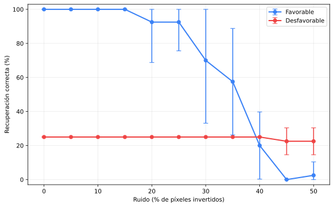
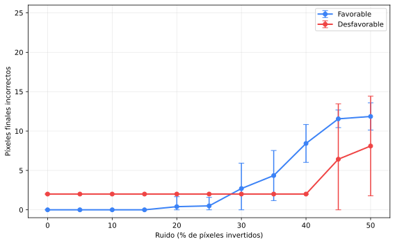
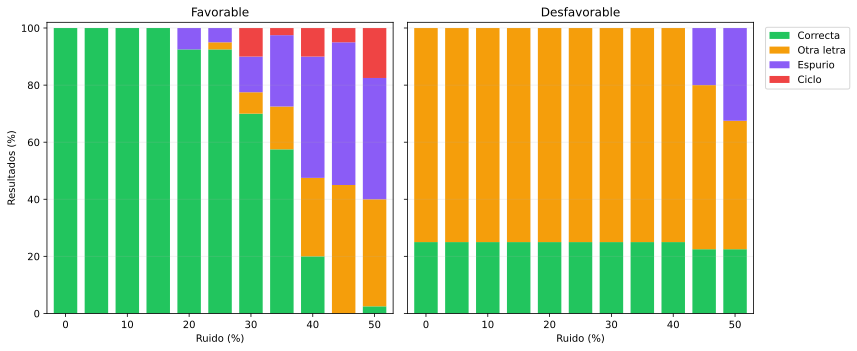
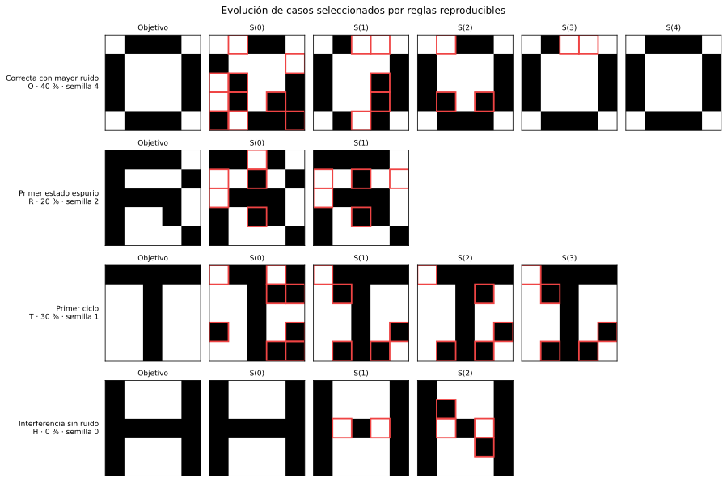
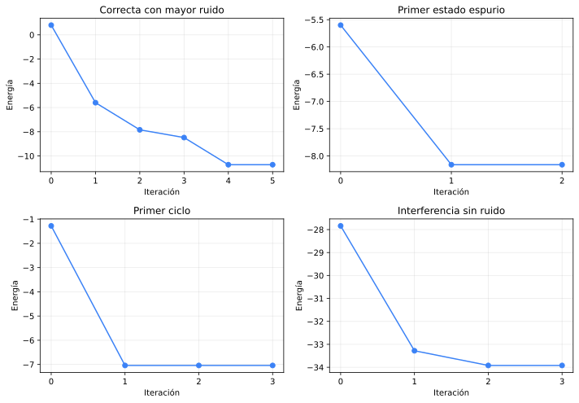

# Experimento controlado de Hopfield con letras 5×5

## Objetivo

Validar la implementación con patrones pequeños e interpretables y estudiar si
la cercanía a la ortogonalidad se relaciona con una recuperación más robusta
ante ruido. El experimento no ajusta hiperparámetros de Hopfield: el nivel de
ruido y el conjunto almacenado son condiciones de evaluación.

## Diseño reproducible

- patrones: las 26 letras definidas explícitamente como matrices bipolares 5×5;
- tamaño de grupo: 4;
- combinaciones evaluadas: 14950;
- niveles de ruido: 0 %, 5 %, 10 %, 15 %, 20 %, 25 %, 30 %, 35 %, 40 %, 45 %, 50 %;
- semillas: 0, 1, 2, 3, 4, 5, 6, 7, 8, 9;
- máximo de iteraciones: 100, usado sólo como resguardo;
- ruido: inversión sin reemplazo de exactamente `round(nivel × 25)` posiciones.

Para evitar elegir por una única corrida, cada punto agrega cuatro letras y
10 semillas. Las barras representan un desvío estándar entre
semillas, acotado al rango válido de la métrica para evitar extremos fuera de
0–100 % o de 0–25 píxeles. Cuando la variabilidad es cero, la barra coincide
con el marcador y por eso no tiene longitud visible. La semilla no se
interpreta como una variable ordenada.

## Selección de grupos

El orden es lexicográfico: primero se minimiza el producto interno absoluto
medio, luego el máximo y finalmente la cantidad de pares que alcanzan ese
máximo. No se construye un score ponderado.

- grupo favorable **ORTV**: media
  1.33, máximo
  3, repetido
  1 vez/veces;
- grupo desfavorable **HMNW**: media
  18.33, máximo
  21, repetido
  2 vez/veces.

Se conservan sólo los diez extremos de cada lado en la tabla generada; el
ranking completo se recalcula de forma determinista al ejecutar el script.

## Resultados iniciales

Sin ruido, la recuperación correcta fue
**100.0 %** para el grupo
favorable y **25.0 %**
para el desfavorable. Con 50 % de ruido fue
**0.0 %** y
**22.5 %**, respectivamente.

El 25 % sin ruido del grupo desfavorable no representa una recuperación parcial
uniforme: sus transiciones son **H→N, M→N, N→N, W→N**. Por lo tanto, una
sola letra funciona como atractor dominante. Su porcentaje agregado en niveles
altos de ruido no debe interpretarse como una mejora ni como robustez del grupo.

## Casos representativos

Los casos no se eligieron por su apariencia. Se aplicaron cuatro reglas antes
de graficar: mayor ruido todavía recuperado, menor ruido con estado espurio,
menor ruido con ciclo y primera interferencia sin ruido. Los desempates usan
letra y semilla en orden ascendente.

- **Correcta con mayor ruido**: O, 40 % de ruido, semilla 4, resultado `correct`.
- **Primer estado espurio**: R, 20 % de ruido, semilla 2, resultado `spurious_fixed`.
- **Primer ciclo**: T, 30 % de ruido, semilla 1, resultado `cycle`.
- **Interferencia sin ruido**: H, 0 % de ruido, semilla 0, resultado `other_stored`.

Los bordes rojos señalan celdas distintas del objetivo. `S(0)` es la consulta
ruidosa y los estados siguientes muestran la evolución de la red.

Estas curvas describen robustez y modos de fallo; no se elige un "nivel óptimo"
de ruido. Antes de extrapolar al caso QR se deben inspeccionar los resultados
por letra y las trayectorias de energía de casos representativos.

## Archivos generados

- `generated/ranking_extremos.csv`: diez mejores y diez peores grupos;
- `generated/corridas.csv`: una fila por letra, ruido y semilla;
- `generated/resumen.csv`: medias y desvíos agregados por semilla;
- `generated/resumen_por_letra.csv`: resultados sin ocultar diferencias entre
  patrones;
- `generated/casos_representativos.csv`: reglas y corridas mostradas;
- cinco gráficos SVG agregados, sin imágenes redundantes por corrida.
