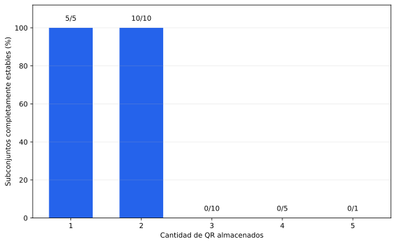
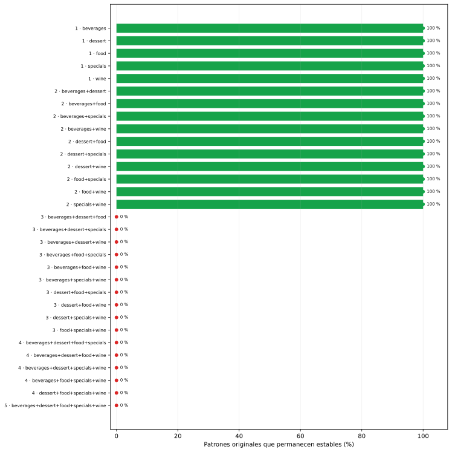
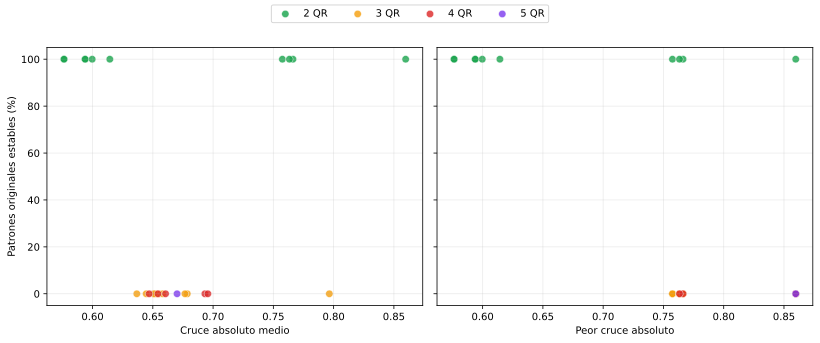

# Capacidad de Hopfield con subconjuntos de QR

## Diseño experimental

Se enumeran exhaustivamente los 31 subconjuntos no vacíos de
los cinco QR: cinco individuales, diez pares, diez ternas, cinco conjuntos de
cuatro y el conjunto completo. Para cada subconjunto se construye una nueva red
con la misma regla de Hebb y la misma actualización sincrónica usadas en el
experimento principal. Luego se consulta cada patrón almacenado sin modificarlo.

El experimento es determinista: no agrega ruido, no inicializa pesos al azar y
no necesita semillas. El límite de 100 iteraciones es sólo
un resguardo de ejecución. En total se evalúan 80 consultas
originales. Un subconjunto se considera completamente estable únicamente si
la primera actualización deja sin cambios a todos sus patrones. Este criterio
es más estricto que converger luego a algún patrón almacenado: comprueba que
cada original sea efectivamente un punto fijo de la memoria.

Para cada combinación también se calculan la media y el máximo de los productos
internos absolutos normalizados entre pares. En los conjuntos de un único QR no
hay productos fuera de la diagonal, por lo que esas celdas quedan vacías.

## Resultado

| QR almacenados | Subconjuntos estables | Consultas estables |
|---:|---:|---:|
| 1 | 5/5 (100 %) | 5/5 (100 %) |
| 2 | 10/10 (100 %) | 20/20 (100 %) |
| 3 | 0/10 (0 %) | 0/30 (0 %) |
| 4 | 0/5 (0 %) | 0/20 (0 %) |
| 5 | 0/1 (0 %) | 0/5 (0 %) |

El corte es exacto para estos cinco datos: todos los patrones individuales y
los diez pares son completamente estables, mientras que ninguna de las diez
ternas ni de las combinaciones mayores conserva un patrón original como punto
fijo. El mayor tamaño para el que funciona **algún** subconjunto es
**2** y el mayor tamaño para el que funcionan **todos** es
**2**. En este caso ambos criterios coinciden.

Esto permite decir que la capacidad efectiva observada es de dos QR para esta
familia concreta, con esta codificación, regla de aprendizaje y dinámica. No es
una capacidad universal de una red de 1369 neuronas.

## Relación con la interferencia

El par con mayor producto interno absoluto es
**food+wine**, con valor normalizado
0.860, y aun así
sus dos patrones son estables. Al mismo tiempo, todas las ternas fallan, incluso
las que tienen cruces medios menores. En este conjunto, el peor par aislado no
alcanza para explicar el fallo: al agregar un tercer patrón se acumulan términos
cruzados en la matriz de pesos y desaparecen los puntos fijos deseados.

El gráfico permite inspeccionar todos los subconjuntos y no debe interpretarse
como una relación causal estimada con sólo cinco QR. La hipótesis inicial de que
los subconjuntos menos correlacionados serían necesariamente más estables no se
puede sostener dentro de cada tamaño: aquí la separación observada corresponde
por completo a almacenar hasta dos patrones o almacenar tres o más.

## Control de la dinámica

Hubo **0** consultas con algún aumento de energía entre
actualizaciones. Las tablas conservan estado final, cantidad de iteraciones,
error de píxeles y energía para cada consulta, de modo que el criterio de
capacidad no depende solamente del gráfico agregado.

Los 15 subconjuntos completamente estables —los cinco individuales y
los diez pares— se usan en el
[barrido de robustez con ruido](../hopfield-qr-robustez/README.md). Los
restantes siguen documentados como evidencia de la limitación de capacidad,
pero agregarles ruido no mediría recuperación alrededor de memorias estables.

## Archivos generados

- `generated/consultas_por_subconjunto.csv`: las 80 consultas;
- `generated/resumen_por_subconjunto.csv`: métricas de las 31 combinaciones;
- `generated/resumen_por_tamano.csv`: agregación determinista por cantidad;
- `generated/capacidad_por_tamano.svg`: proporción de conjuntos estables;
- `generated/estabilidad_por_subconjunto.svg`: resultado de cada combinación;
- `generated/estabilidad_vs_interferencia.svg`: comparación con el Gram.
