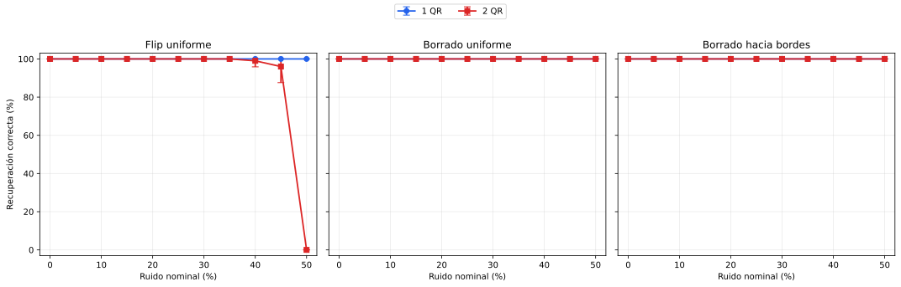
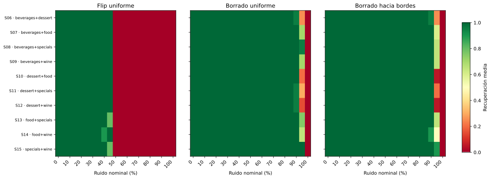
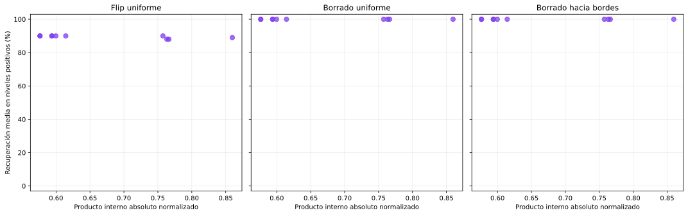

# Robustez frente al ruido con uno y dos QR

## Diseño experimental

El [barrido de capacidad](../hopfield-qr-capacidad/README.md) mostró que los
cinco conjuntos individuales y las diez duplas son los únicos subconjuntos
completamente estables sin ruido. Sobre esas 15 memorias se aplican los tres
deterioros ya definidos: flip uniforme, borrado uniforme y borrado hacia los
bordes. Se usan los niveles
0 %, 5 %, 10 %, 15 %, 20 %, 25 %, 30 %, 35 %, 40 %, 45 %, 50 % y las
semillas 0, 1, 2, 3, 4, 5, 6, 7, 8, 9.

Para cada QR, tipo, nivel y semilla se reutiliza exactamente la misma consulta
deteriorada en el conjunto individual y en todas las duplas que contienen ese
QR. Este pareo permite que la comparación mida el efecto de guardar un segundo
patrón y no el de haber elegido posiciones de ruido diferentes.

El 0 % corresponde a 25 consultas deterministas. Los niveles
positivos producen 7500 corridas: 25 consultas objetivo por
condición, tres ruidos, diez niveles y diez semillas. Las métricas se calculan
primero dentro de cada semilla y luego se informa su media y desvío estándar
entre las diez realizaciones. No se busca un nivel óptimo: el ruido es una
variable de deterioro, no un hiperparámetro de la red.

## Uno frente a dos patrones almacenados

| Ruido | 1 QR a 30 % | 2 QR a 30 % | 1 QR a 50 % | 2 QR a 50 % |
|---|---:|---:|---:|---:|
| Flip uniforme | 100.0 % | 100.0 % | 100.0 % | 0.0 % |
| Borrado uniforme | 100.0 % | 100.0 % | 100.0 % | 100.0 % |
| Borrado hacia bordes | 100.0 % | 100.0 % | 100.0 % | 100.0 % |

Las barras representan el desvío entre semillas. Cuando el desvío es cero,
coinciden con el marcador. La comparación incluye los cinco QR individuales y
las veinte apariciones de objetivos dentro de duplas, sin seleccionar una
combinación después de observar su resultado.

Con flip uniforme, almacenar un solo QR mantiene
100 % de recuperación hasta el
50 %. En las duplas la recuperación es 100 % hasta 35 %, baja a
99 % al 40 % y a
96 % al 45 %, y cae a
0 % al 50 %. En ese último nivel,
15 % converge al otro QR
almacenado, 78 % a puntos fijos
espurios y 7 % entra en ciclos.

Los porcentajes nominales no representan el mismo daño efectivo. Al 50 %, el
flip modifica 684 píxeles, mientras que
el borrado uniforme modifica en promedio
348.3 y el borrado hacia los bordes
356.5. Los borrados sólo afectan una
posición seleccionada cuando era negra; por eso su 100 % de recuperación no
debe compararse como si las consultas tuvieran 684 cambios.

## Diferencias entre duplas

- **Flip uniforme:** los promedios quedan entre 88.0 % y 90.0 %; 7 duplas alcanzan el máximo y 2 quedan en el mínimo.
- **Borrado uniforme:** las diez duplas obtienen 100.0 %.
- **Borrado hacia bordes:** las diez duplas obtienen 100.0 %.

Los extremos anteriores se informan como descripción del barrido exhaustivo,
no como selección de una única dupla representativa. El mapa conserva las diez
combinaciones y permite ver si la degradación ocurre en el mismo nivel.

## Similitud y robustez

Cada punto es una de las diez duplas. El eje vertical promedia por igual los
diez niveles positivos configurados, por lo que sirve como resumen descriptivo
de toda la curva y no como una métrica optimizada. Con sólo diez pares, el
gráfico se usa para inspeccionar la asociación y no para afirmar una ley general
entre producto interno y tolerancia al ruido.

Antes de la caída general del 50 %, las únicas desviaciones fueron:
**food+specials a 45 % (80 %), food+wine a 40 % (90 %), specials+wine a 45 % (80 %)**. Se concentran entre las duplas de
mayor similitud, aunque el orden no es perfectamente monótono. La evidencia es
compatible con una menor robustez al aumentar la interferencia, pero diez pares
no alcanzan para convertir esa observación en una relación general.

## Control de las corridas

Se recuperaron correctamente **7290 de 7500** consultas
deterioradas. Hubo **0** corridas con algún aumento de energía.
La tabla completa conserva resultados, errores, iteraciones y energías finales;
no se guardan imágenes ni trayectorias redundantes para cada una de las 7.500
corridas.

## Archivos generados

- `generated/consultas_sin_ruido.csv`: las 25 líneas de base;
- `generated/corridas_ruido.csv`: las 7500 corridas individuales;
- `generated/resumen_por_cantidad.csv`: comparación entre uno y dos QR;
- `generated/resumen_por_subconjunto.csv`: curvas de los 15 subconjuntos;
- `generated/resumen_robustez_duplas.csv`: resumen de las diez duplas;
- `generated/recuperacion_uno_vs_dos.svg`: curvas con diez semillas;
- `generated/mapa_robustez_duplas.svg`: todas las duplas y niveles;
- `generated/robustez_vs_similitud.svg`: relación descriptiva con el Gram.
