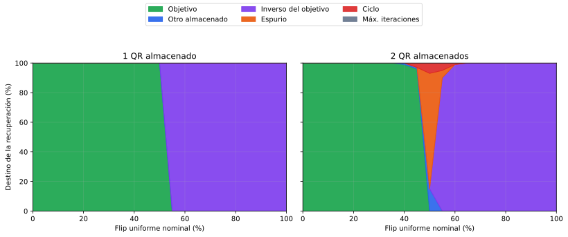
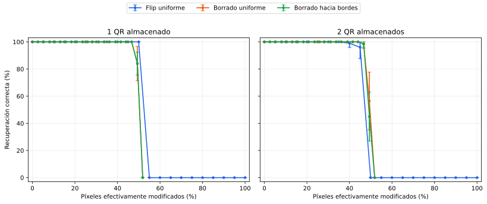

# Robustez frente al ruido con uno y dos QR

## Diseño experimental

El [barrido de capacidad](../hopfield-qr-capacidad/README.md) mostró que los
cinco conjuntos individuales y las diez duplas son los únicos subconjuntos
completamente estables sin ruido. Sobre esas 15 memorias se aplican los tres
deterioros ya definidos: flip uniforme, borrado uniforme y borrado hacia los
bordes. Se usan los niveles
0 %, 5 %, 10 %, 15 %, 20 %, 25 %, 30 %, 35 %, 40 %, 45 %, 50 %, 55 %, 60 %, 65 %, 70 %, 75 %, 80 %, 85 %, 90 %, 95 %, 100 %. Para los
niveles aleatorios se usan las semillas 0, 1, 2, 3, 4, 5, 6, 7, 8, 9.

Para cada QR, tipo, nivel y semilla se reutiliza exactamente la misma consulta
deteriorada en el conjunto individual y en todas las duplas que contienen ese
QR. Este pareo permite que la comparación mida el efecto de guardar un segundo
patrón y no el de haber elegido posiciones de ruido diferentes.

El 0 % corresponde a 25 consultas deterministas. Cada uno de
los 19 niveles entre 5 % y 95 % usa diez semillas.
El 100 % se ejecuta una vez porque deteriorar todos los píxeles produce la
misma consulta con cualquier semilla; repetirla diez veces no aportaría
variabilidad. En total se conservan 14325 corridas con ruido. Las
métricas se calculan primero dentro de cada semilla y luego se informa su media
y desvío estándar. No se busca un nivel óptimo: el ruido es una variable de
deterioro, no un hiperparámetro de la red.

## Uno frente a dos patrones almacenados

| Ruido | 1 QR a 50 % | 2 QR a 50 % | 1 QR a 75 % | 2 QR a 75 % | 1 QR a 100 % | 2 QR a 100 % |
|---|---:|---:|---:|---:|---:|---:|
| Flip uniforme | 100.0 % | 0.0 % | 0.0 % | 0.0 % | 0.0 % | 0.0 % |
| Borrado uniforme | 100.0 % | 100.0 % | 100.0 % | 100.0 % | 0.0 % | 0.0 % |
| Borrado hacia bordes | 100.0 % | 100.0 % | 100.0 % | 100.0 % | 0.0 % | 0.0 % |

Las barras representan el desvío entre semillas. Cuando el desvío es cero,
coinciden con el marcador. La comparación incluye los cinco QR individuales y
las veinte apariciones de objetivos dentro de duplas, sin seleccionar una
combinación después de observar su resultado.

Con flip uniforme, almacenar un solo QR mantiene
100 % de recuperación hasta el
50 %. A partir de 55 %, el 100 %
converge al patrón inverso. Esto es esperable: con más de la mitad de los bits
invertidos, la consulta queda más cerca de `-xi` que de `xi`, y la simetría de
la regla de Hebb hace que ambos sean puntos fijos. No es un error de
implementación.

En las duplas la recuperación es 100 % hasta 35 %, baja a
99 % al 40 % y a
96 % al 45 %, y cae a
0 % al 50 %. En ese nivel,
15 % converge al otro QR,
78 % a puntos fijos espurios y
7 % entra en ciclos. Al 55 %,
90 % ya converge al inverso;
desde 65 %, ese destino representa
100 % de las corridas.

El gráfico separa recuperación correcta, otro patrón almacenado, inverso del
objetivo, estado espurio y ciclo. Esa separación es importante por encima de
50 %: informar solamente "falló" ocultaría la transición sistemática al
inverso.

## Ruido nominal y daño efectivo

Los porcentajes nominales no representan el mismo daño efectivo. Un flip del
50 % modifica 684 píxeles. En cambio, el
borrado sólo modifica una posición si originalmente era negra; incluso al
100 % cambia en promedio 710 de los
1369 píxeles. Por eso se incluye otra lectura con el porcentaje realmente
modificado en el eje horizontal.

Los borrados permanecen mucho más robustos: con dos QR, a 90 % la recuperación
es 98.5 % para borrado uniforme y
98.5 % para borrado hacia bordes. Al
95 %, los individuales recuperan
84.0 % y
84.0 %, mientras las duplas bajan a
56.5 % y
45.0 %, respectivamente. En 100 % la
consulta queda completamente blanca y deja de contener información sobre qué
QR era el objetivo; por eso la recuperación correcta cae a 0 %. En las duplas,
45 % termina en el
inverso, 45 % en un punto fijo
espurio y 10 % en un ciclo.

## Diferencias entre duplas

- **Flip uniforme:** los promedios quedan entre 44.0 % y 45.0 %; 7 duplas alcanzan el máximo y 2 quedan en el mínimo.
- **Borrado uniforme:** los promedios quedan entre 90.5 % y 95.0 %; 1 dupla alcanza el máximo y 1 queda en el mínimo.
- **Borrado hacia bordes:** los promedios quedan entre 90.3 % y 94.5 %; 1 dupla alcanza el máximo y 2 quedan en el mínimo.

Los extremos anteriores se informan como descripción del barrido exhaustivo,
no como selección de una única dupla representativa. El mapa conserva las diez
combinaciones y permite ver si la degradación ocurre en el mismo nivel.

## Similitud y robustez

Cada punto es una de las diez duplas. El eje vertical promedia por igual los
veinte niveles positivos configurados, por lo que sirve como resumen
descriptivo de toda la curva y no como una métrica optimizada. Con sólo diez
pares, el gráfico se usa para inspeccionar la asociación y no para afirmar una
ley general entre producto interno y tolerancia al ruido.

Antes de la caída general del 50 %, las únicas desviaciones fueron:
**food+specials a 45 % (80 %), food+wine a 40 % (90 %), specials+wine a 45 % (80 %)**. Se concentran entre las duplas de
mayor similitud, aunque el orden no es perfectamente monótono. La evidencia es
compatible con una menor robustez al aumentar la interferencia, pero diez pares
no alcanzan para convertir esa observación en una relación general.

## Control de las corridas

Se recuperaron correctamente **11571 de 14325** consultas
deterioradas. Hubo **0** corridas con algún aumento de energía.
La tabla completa conserva resultados, errores, iteraciones y energías finales;
no se guardan imágenes ni trayectorias redundantes para cada una de las
14325 corridas.

## Archivos generados

- `generated/consultas_sin_ruido.csv`: las 25 líneas de base;
- `generated/corridas_ruido.csv`: las 14325 corridas individuales;
- `generated/resumen_por_cantidad.csv`: comparación entre uno y dos QR;
- `generated/resumen_por_subconjunto.csv`: curvas de los 15 subconjuntos;
- `generated/resumen_robustez_duplas.csv`: resumen de las diez duplas;
- `generated/recuperacion_uno_vs_dos.svg`: curvas con diez semillas;
- `generated/mapa_robustez_duplas.svg`: todas las duplas y niveles;
- `generated/robustez_vs_similitud.svg`: relación descriptiva con el Gram;
- `generated/recuperacion_vs_dano_efectivo.svg`: comparación por cambios reales;
- `generated/destinos_flip.svg`: destinos de la dinámica con flip uniforme.
