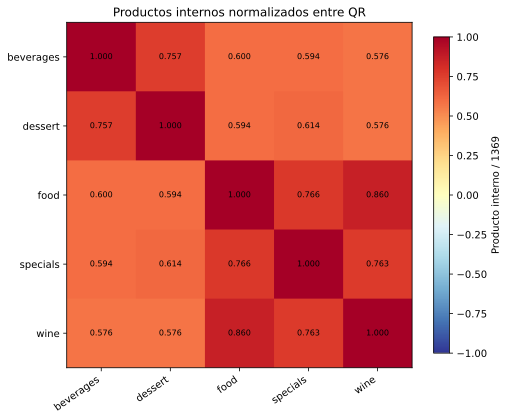
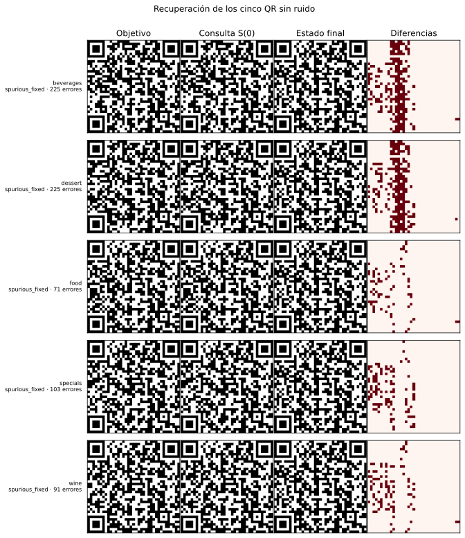
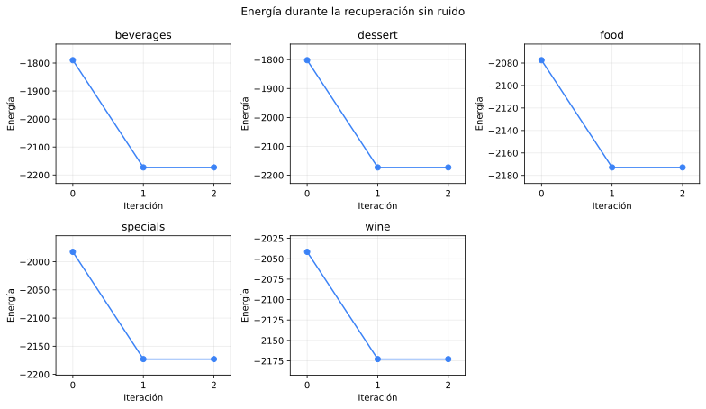
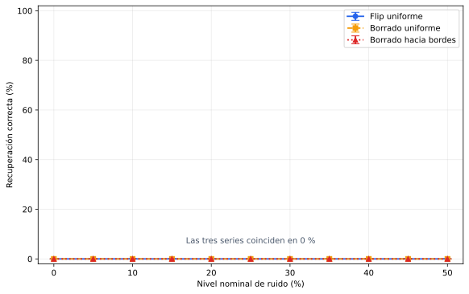
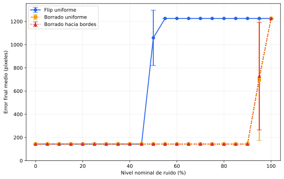
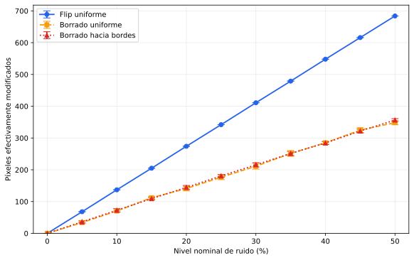
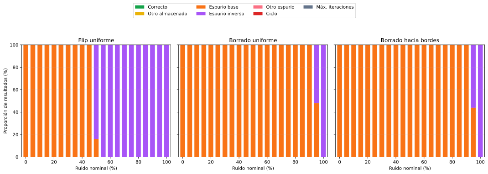
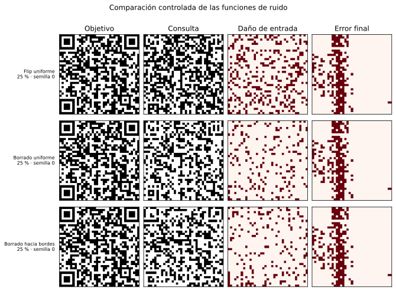
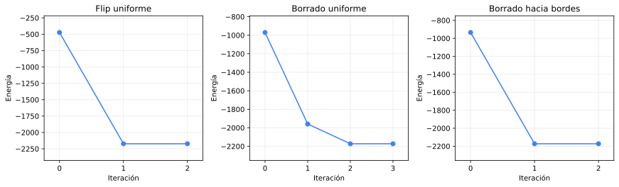

# Análisis inicial de los QR para Hopfield

## Representación

Los cinco códigos QR se cargan como matrices binarias de 37×37 y se convierten
a representación bipolar: negro `+1` y blanco `-1`. Cada patrón se aplana en
un vector de 1369 componentes. La carga es determinista y no usa semillas ni
hiperparámetros.

## Matriz de Gram

Se calcula `G = XXᵀ` usando enteros de 64 bits y se normaliza dividiendo por
1369. La diagonal normalizada vale 1 porque cada patrón se compara consigo
mismo. Para patrones bipolares, un valor fuera de la diagonal cercano a cero
indicaría mayor cercanía a la ortogonalidad.

- producto interno normalizado medio fuera de la diagonal: **0.670**;
- mínimo absoluto: **0.576** en
  **beverages–wine**, **dessert–wine**;
- máximo absoluto: **0.860** entre
  **food** y **wine**.

Todos los productos internos son positivos y altos. Por lo tanto, estos QR no
son cercanos a ser ortogonales: comparten muchos más píxeles con el mismo signo
que con signo opuesto. Esta observación anticipa interferencia al almacenar los
cinco, pero por sí sola no demuestra el comportamiento dinámico; la prueba de
recuperación que aparece debajo comprueba esa hipótesis.

## Balance de píxeles

- **beverages**: 710 negros, 659 blancos (51.9 % negros).
- **dessert**: 720 negros, 649 blancos (52.6 % negros).
- **food**: 710 negros, 659 blancos (51.9 % negros).
- **specials**: 704 negros, 665 blancos (51.4 % negros).
- **wine**: 706 negros, 663 blancos (51.6 % negros).

El balance es cercano a 50 % en los cinco casos. Por eso, los productos
internos altos no se explican simplemente por una mayoría global de blanco o
negro, sino por posiciones coincidentes entre los QR, incluidas sus estructuras
compartidas. No se modifica ni se centra la entrada: se conserva la
codificación bipolar pedida para Hopfield.

## Recuperación sin ruido

Se entrenó una única red mediante la regla de Hebb almacenando simultáneamente
los cinco vectores. Luego cada QR original se usó como consulta, sin modificar
ningún píxel. El límite de 100 iteraciones funciona sólo como
resguardo y no fue alcanzado. Esta prueba tampoco usa semillas.

- patrones que permanecieron estables: **0/5**;
- recuperaciones correctas: **0/5**;
- estados finales distintos encontrados: **1**;
- destinos: **beverages→espurio**, **dessert→espurio**, **food→espurio**, **specials→espurio**, **wine→espurio**.

La primera actualización lleva cada consulta al estado espurio y la segunda
confirma que ese estado no cambia; por eso todas las filas registran dos
iteraciones.

- **beverages**: `spurious_fixed`, 2 iteraciones, 225 píxeles de error, energía -1789.7 → -2172.9.
- **dessert**: `spurious_fixed`, 2 iteraciones, 225 píxeles de error, energía -1801.8 → -2172.9.
- **food**: `spurious_fixed`, 2 iteraciones, 71 píxeles de error, energía -2077.4 → -2172.9.
- **specials**: `spurious_fixed`, 2 iteraciones, 103 píxeles de error, energía -1982.5 → -2172.9.
- **wine**: `spurious_fixed`, 2 iteraciones, 91 píxeles de error, energía -2041.5 → -2172.9.

En los cinco recorridos la energía disminuye durante la primera actualización
y permanece constante al confirmar el punto fijo. Esta observación describe
estas trayectorias concretas; no se usa para cambiar la regla de actualización.

El chequeo reproducible confirma que ninguno de los QR originales es un punto
fijo cuando se almacenan los cinco juntos. Todos convergen al mismo estado
fijo espurio. Por lo tanto, un barrido de ruido sobre esta red no puede
interpretarse aisladamente como robustez frente a perturbaciones: ya existe
interferencia con 0 % de ruido. El barrido siguiente conserva igualmente los
cinco patrones, como exige la consigna, y esta línea de base se mantiene visible
al interpretar sus resultados.

## Consultas deterioradas

Se comparan tres funciones sugeridas en clase sobre los mismos niveles y
semillas:

1. **Flip uniforme:** se eligen exactamente `round(nivel × 1369)` posiciones
   sin reemplazo y se invierte su signo.
2. **Borrado uniforme:** se elige la misma cantidad de posiciones de manera
   uniforme y se las lleva a blanco (`-1`). Un píxel ya blanco no cambia.
3. **Borrado hacia bordes:** también lleva las posiciones elegidas a blanco,
   pero su peso de selección decrece linealmente con la distancia al borde. En
   una imagen 37×37 el peso sin normalizar es `19 - distancia_al_borde`.

El diseño usa niveles de 0 %, 5 %, 10 %, 15 %, 20 %, 25 %, 30 %, 35 %, 40 %, 45 %, 50 %,
semillas 0, 1, 2, 3, 4, 5, 6, 7, 8, 9 y un máximo de
100 iteraciones como resguardo. El 0 % corresponde a las
cinco consultas deterministas ya analizadas; para cada nivel positivo se
evalúan los cinco QR con 10 semillas. En total se ejecutan
1500 consultas aleatorias más las cinco consultas base.

El nivel es **nominal**: indica cuántas posiciones se seleccionan. En el flip
todas cambian; en los borrados sólo cambian efectivamente las que eran negras.
Por eso también se informa el error real de entrada y no se supone que tres
ruidos con el mismo porcentaje nominal tengan igual cantidad de alteraciones.

Para las curvas se calcula primero cada métrica sobre los cinco QR de una
semilla y después se muestran media y desvío estándar entre semillas. Las
barras están acotadas al rango válido de cada métrica. No se conectan semillas
como si fueran una secuencia temporal y no se elige un nivel de ruido óptimo.
Cuando el desvío es cero, la barra coincide con el marcador y no tiene longitud
visible; esto ocurre en toda la curva de recuperación.

- **Flip uniforme**: a 50 % nominal modifica en promedio 684.0 píxeles; recuperación 0.0 %, error final 1058.5 píxeles. No hubo recuperaciones correctas en ningún nivel positivo.
- **Borrado uniforme**: a 50 % nominal modifica en promedio 348.3 píxeles; recuperación 0.0 %, error final 143.0 píxeles. No hubo recuperaciones correctas en ningún nivel positivo.
- **Borrado hacia bordes**: a 50 % nominal modifica en promedio 356.5 píxeles; recuperación 0.0 %, error final 143.0 píxeles. No hubo recuperaciones correctas en ningún nivel positivo.

En **1458** corridas el destino fue el mismo espurio de
0 %; en **42** fue su inverso y en
**0** apareció otro destino. El inverso apareció en:
**Flip uniforme al 50 % (42 de 50 corridas)**. En las demás condiciones se
conserva el espurio base. Esto explica cualquier salto del error final sin
confundirlo con una recuperación.

Las 1500 corridas presentaron **0** trayectorias
con algún aumento de energía. Las trayectorias completas quedan en CSV para no
seleccionar conclusiones a partir de un único ejemplo.

## Comparación visual controlada

Para mostrar cómo actúa cada función sin elegir casos por su resultado, se usa
la primera etiqueta en el orden del dataset (**beverages**), el
nivel positivo central configurado (**25 %**)
y la menor semilla (**0**). La selección se fija antes de
mirar el estado final.

Como la recuperación base es 0/5, una eventual mejora al agregar ruido no
significa que la red sea robusta: significa que alguna perturbación desplazó
la consulta desde el atractor espurio hacia otro atractor. El análisis de
capacidad mediante subconjuntos se reserva para la sección de limitaciones,
después de completar el caso obligatorio con los cinco QR.

## Limitaciones observadas e hipótesis de capacidad

### Qué muestran los resultados actuales

La red se entrenó con los cinco QR simultáneamente, tal como pide la consigna.
Sin embargo, ninguno de los cinco patrones originales permanece estable al ser
usado como consulta sin ruido: todos convergen al mismo punto fijo espurio.
Además, ninguna de las 1500 consultas deterioradas recupera su QR
objetivo. La mayor parte converge al mismo espurio encontrado sin ruido y, en
los casos restantes, a su inverso.

Este comportamiento es coherente con la interferencia anticipada por la matriz
de Gram. Los productos internos normalizados fuera de la diagonal están entre
0.576 y 0.860, con
media 0.670: los QR comparten una fracción
importante de sus píxeles y, por lo tanto, no constituyen patrones cercanos a
la ortogonalidad. Al sumar sus productos externos, la regla de Hebb introduce
términos cruzados que modifican los mínimos de energía de la red.

Que la energía no aumente durante las actualizaciones confirma que la dinámica
implementada desciende —o se mantiene— sobre la función de energía. No
garantiza, en cambio, que el mínimo alcanzado sea una memoria deseada. En este
caso, el punto fijo espurio es un atractor válido de la dinámica, aunque no
coincida con ninguno de los cinco QR almacenados.

### Capacidad teórica frente a capacidad efectiva

En clase se presentó como referencia una capacidad del orden de 0.15 N
patrones para una red de N neuronas. Para estos QR, N = 1369, lo que
daría aproximadamente 205 patrones bajo
condiciones favorables. Ese valor es una guía teórica, no una garantía
independiente de los datos: supone patrones suficientemente separados y no
contempla por sí solo la fuerte correlación observada aquí.

Por eso, que la red falle con solo cinco patrones no contradice esa referencia.
Muestra que la **capacidad efectiva** para este conjunto particular de QR es
menor que cinco cuando se usa la regla de Hebb implementada. Con los resultados
actuales todavía no puede determinarse cuántos QR sí puede almacenar ni si el
resultado depende principalmente de la cantidad o de la combinación elegida.

### Contraste de capacidad sin ruido

El [barrido exhaustivo de capacidad](../hopfield-qr-capacidad/README.md)
entrena una red para cada uno de los 31 subconjuntos no vacíos de los cinco QR.
Los cinco patrones individuales y los diez pares son completamente estables;
en cambio, ninguna combinación de tres, cuatro o cinco conserva uno de sus
originales como punto fijo. La capacidad efectiva observada es entonces de dos
QR para esta familia, codificación, regla de aprendizaje y dinámica, no una
capacidad universal de una red de 1369 neuronas.

El par más correlacionado también es estable, por lo que el peor producto
interno aislado no explica el corte. Los 15 subconjuntos válidos quedan como
candidatos para estudiar posteriormente la robustez frente al ruido sin
confundirla con una falla que ya existe en la memoria sin perturbar.

## Archivos generados

- `generated/matriz_gram.csv`: productos internos crudos;
- `generated/matriz_gram_normalizada.csv`: productos internos divididos por 1369;
- `generated/similitud_pares.csv`: los diez pares y sus píxeles diferentes;
- `generated/balance_pixeles.csv`: cantidad de módulos negros y blancos;
- `generated/recuperacion_sin_ruido.csv`: resultado de cada consulta original;
- `generated/energia_sin_ruido.csv`: energía y error en cada iteración;
- `generated/corridas_ruido.csv`: una fila por consulta deteriorada;
- `generated/energia_corridas_ruido.csv`: energía de todas las iteraciones;
- `generated/resumen_ruido.csv`: medias y desvíos entre semillas;
- `generated/resumen_ruido_por_qr.csv`: agregados sin ocultar diferencias entre QR;
- `generated/casos_ruido_controlado.csv`: casos de la comparación visual;
- `generated/matriz_gram_normalizada.svg`: visualización del Gram;
- `generated/recuperacion_sin_ruido.svg`: objetivos, consultas y estados finales;
- `generated/energia_sin_ruido.svg`: trayectorias de energía;
- cuatro gráficos agregados para comparar ruido;
- `generated/consultas_ruido_controlado.svg` y
  `generated/energia_ruido_controlado.svg`: casos fijados sin selección por
  resultado.
