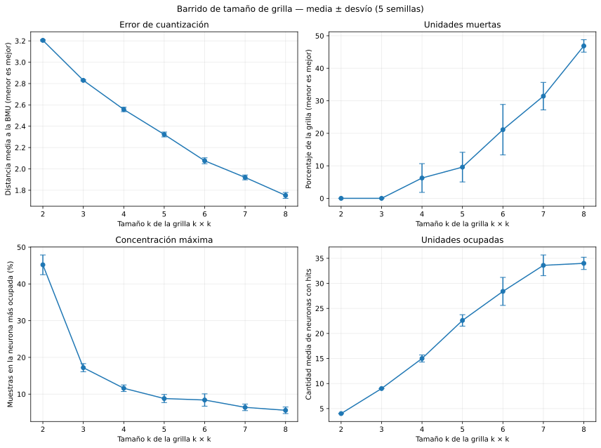
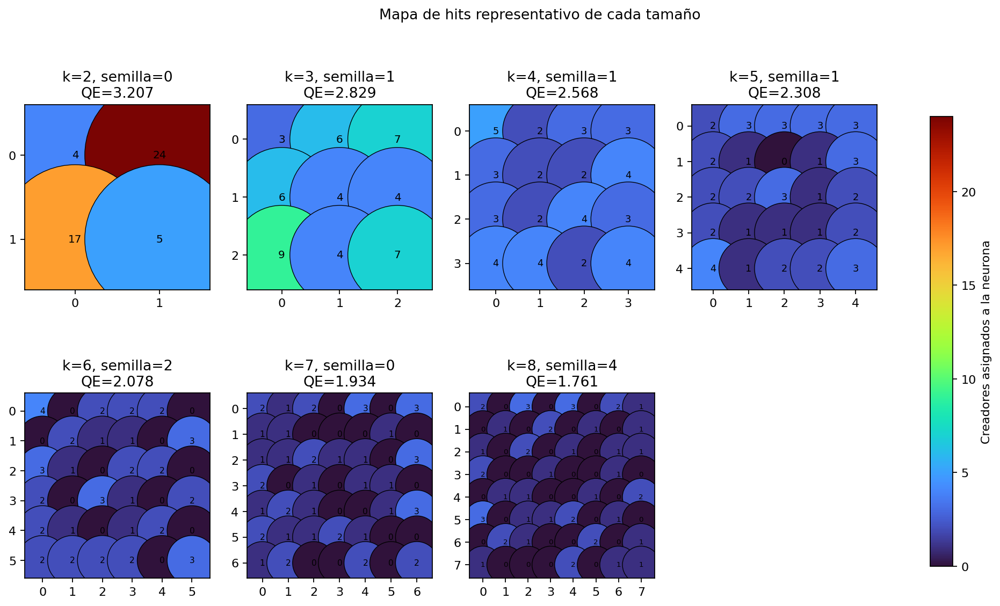
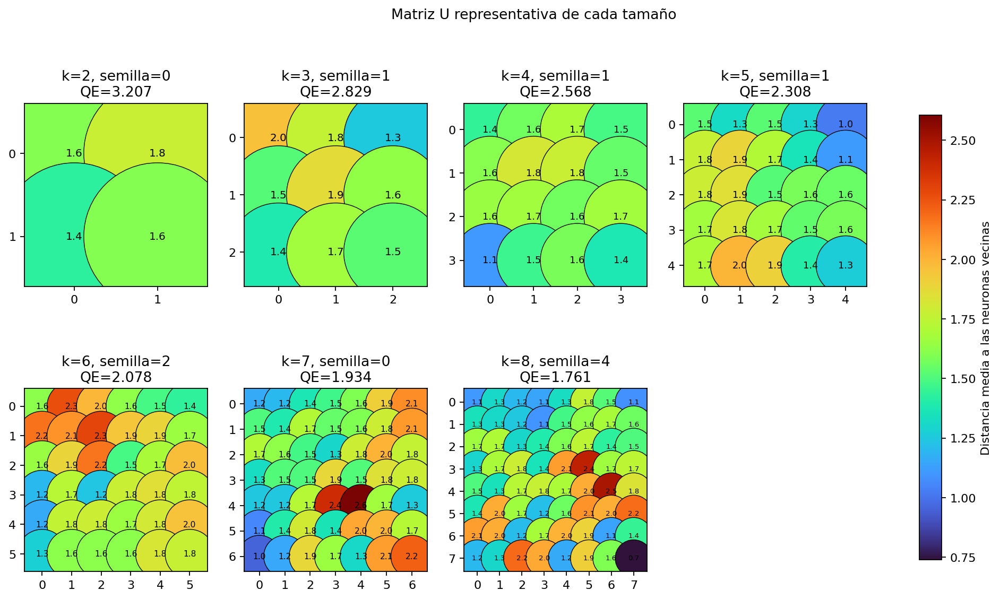

# Experimento 1: tamaño de la grilla de Kohonen

Se compararon grillas desde `2 × 2` hasta `8 × 8`, con cinco semillas por
tamaño. Cada una de las 35 corridas está definida en un JSON independiente.
Se mantuvieron fijos las épocas, las tasas, el radio final, la inicialización y
la mezcla. El radio inicial se normalizó al diámetro de cada grilla para que al
comenzar todas puedan actualizar el mapa completo.

| k | Error de cuantización | Unidades muertas (%) | Máximo de hits (%) |
| ---: | ---: | ---: | ---: |
| 2 | 3.2049 ± 0.0060 | 0.0 ± 0.0 | 45.2 ± 2.7 |
| 3 | 2.8298 ± 0.0059 | 0.0 ± 0.0 | 17.2 ± 1.1 |
| 4 | 2.5570 ± 0.0208 | 6.2 ± 4.4 | 11.6 ± 0.9 |
| 5 | 2.3228 ± 0.0227 | 9.6 ± 4.6 | 8.8 ± 1.1 |
| 6 | 2.0762 ± 0.0277 | 21.1 ± 7.8 | 8.4 ± 1.7 |
| 7 | 1.9202 ± 0.0224 | 31.4 ± 4.2 | 6.4 ± 0.9 |
| 8 | 1.7518 ± 0.0275 | 46.9 ± 1.9 | 5.6 ± 0.9 |

## Una corrida representativa por tamaño

Para visualizar cada `k` sin elegir una semilla arbitraria, se tomó la corrida
cuyo error de cuantización queda más cerca de la mediana de sus cinco semillas.
La selección sólo decide qué mapa mostrar: las curvas anteriores siguen usando
las 35 corridas.

| k | Semilla | Error de cuantización | Corrida |
| ---: | ---: | ---: | --- |
| 2 | 0 | 3.2072 | `grid-k02-seed-00` |
| 3 | 1 | 2.8291 | `grid-k03-seed-01` |
| 4 | 1 | 2.5685 | `grid-k04-seed-01` |
| 5 | 1 | 2.3079 | `grid-k05-seed-01` |
| 6 | 2 | 2.0783 | `grid-k06-seed-02` |
| 7 | 0 | 1.9342 | `grid-k07-seed-00` |
| 8 | 4 | 1.7610 | `grid-k08-seed-04` |

En el mapa de hits, el número y el color de cada círculo indican cuántos
creadores ganaron esa neurona. Un `0` identifica una unidad muerta.

La matriz U usa la misma disposición, pero el color representa la distancia
media entre los pesos de una neurona y los de sus vecinas ortogonales. Valores
altos pueden señalar separaciones entre regiones del mapa.

## Cómo se toma la decisión

El error de cuantización mide, en el espacio estandarizado, la distancia media
entre cada creador y su BMU. Es una métrica auxiliar derivada de la misma
distancia euclídea usada por el algoritmo; no fue presentada como criterio
único en las clases. Agregar neuronas suele reducirla, por lo que no esperamos
necesariamente un pico. Buscamos el punto a partir del cual su mejora se vuelve
pequeña mientras aumentan las unidades muertas o la solución se fragmenta.

Las barras muestran un desvío muestral alrededor de la media de cinco semillas.
Así se evita elegir un `k` por una inicialización afortunada. Este barrido sirve
para descartar extremos y conservar dos candidatos. La decisión final exige
entrenar esos candidatos con los demás hiperparámetros y revisar sus mapas de
hits, matrices U y mapas por variable; este informe no fija todavía un `k`.

## Lectura preliminar

Las grillas `2 × 2` y `3 × 3` quedan demasiado concentradas: su neurona más
ocupada reúne en promedio 45,2 % y 17,2 % de los creadores. En `4 × 4` y
`5 × 5` esa concentración baja a 11,6 % y 8,8 %, manteniendo las unidades
muertas en 6,2 % y 9,6 %. Al pasar a `6 × 6`, la concentración apenas mejora
0,4 puntos porcentuales, pero las unidades muertas saltan a 21,1 %. Desde allí
siguen aumentando hasta 46,9 % en `8 × 8`.

Por este compromiso, `k = 4` y `k = 5` quedan como candidatos para la siguiente
etapa. No se declara todavía un ganador: hay que comprobar si la conclusión se
mantiene al variar la tasa, el radio y las épocas, y después inspeccionar los
mapas resultantes.

Los valores de todas las corridas están en `generated/corridas.csv` y los
promedios por tamaño en `generated/resumen_por_k.csv`.
