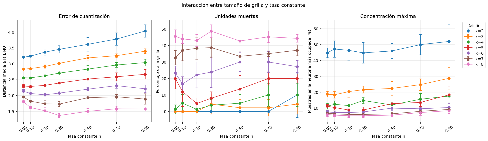
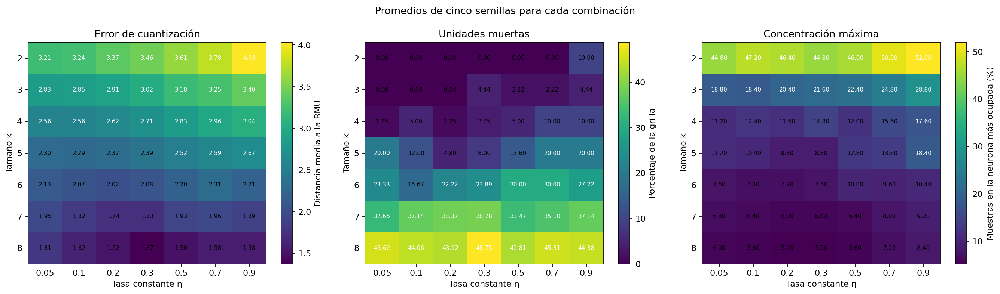

# Experimento 2: tamaño de grilla por tasa constante

Se evaluaron todos los pares entre `k = 2, ..., 8` y tasas constantes
`η = 0.05, 0.1, 0.2, 0.3, 0.5, 0.7, 0.9`, con cinco semillas por combinación:
245 corridas independientes. Se mantuvieron fijos las 150 épocas, el radio
decreciente desde el diámetro de la grilla hasta 1, la inicialización por
muestras y la mezcla del orden de presentación.

Este diseño permite observar la interacción entre `k` y `η`: el primer barrido
de grilla, realizado con tasa decreciente `0.5 → 0.05`, no alcanzaba para
descartar que otro tamaño mejorara al cambiar la tasa.

## Mejor error de cuantización dentro de cada tamaño

La tabla muestra el mínimo error medio encontrado para cada `k`, pero no elige
la configuración únicamente por esa cifra. Las unidades muertas y la
concentración de hits permiten detectar soluciones demasiado fragmentadas o
demasiado agrupadas.

| k | η | Error de cuantización | Unidades muertas (%) | Máximo de hits (%) |
| ---: | ---: | ---: | ---: | ---: |
| 2 | 0.05 | 3.2075 ± 0.0080 | 0.0 ± 0.0 | 44.8 ± 3.0 |
| 3 | 0.05 | 2.8331 ± 0.0057 | 0.0 ± 0.0 | 18.8 ± 1.8 |
| 4 | 0.1 | 2.5568 ± 0.0047 | 5.0 ± 5.2 | 12.4 ± 2.2 |
| 5 | 0.1 | 2.2858 ± 0.0385 | 12.0 ± 8.9 | 10.4 ± 1.7 |
| 6 | 0.2 | 2.0213 ± 0.0409 | 22.2 ± 7.9 | 7.2 ± 1.1 |
| 7 | 0.3 | 1.7303 ± 0.0764 | 38.8 ± 5.9 | 6.0 ± 0.0 |
| 8 | 0.3 | 1.3715 ± 0.0632 | 48.8 ± 3.9 | 5.2 ± 1.1 |

## Lectura de los resultados

Las tasas altas (`0.5`, `0.7` y `0.9`) empeoran el error y, en general, también
la estabilidad: con una tasa constante los pesos continúan siguiendo con fuerza
cada muestra hasta el final. La zona útil se concentra entre `0.05` y `0.2`
para las grillas que todavía mantienen una ocupación razonable.

- Para `k = 4`, `η = 0.05` y `η = 0.1` tienen prácticamente el mismo error;
  `0.05` deja menos unidades muertas y menor concentración máxima.
- Para `k = 5`, `η = 0.1` minimiza el error, pero `η = 0.2` reduce las unidades
  muertas de 12,0 % a 4,8 % y la concentración de 10,4 % a 8,8 %, a cambio de
  un aumento pequeño del error.
- Para `k = 6`, `η = 0.1` conserva mejor ocupación que `0.2` con el mismo máximo
  medio de hits y queda como control para no descartar ese tamaño antes de
  estudiar la disminución de la tasa.
- `k = 2` y `k = 3` siguen concentrando demasiado; `k = 7` y `k = 8` mantienen
  entre aproximadamente 33 % y 49 % de unidades muertas aun en sus mejores
  zonas. La tasa no corrige esas limitaciones estructurales.

Por lo tanto, continúan `k = 4` con `η = 0.05`, `k = 5` con `η = 0.2` y
`k = 6` con `η = 0.1`. Son tres puntos de partida para comparar una tasa
constante contra una decreciente; todavía no constituyen una selección final.

## Criterio para continuar

Una tasa pequeña puede requerir más iteraciones para organizar el mapa; una
tasa cercana a 1 hace que los pesos sigan demasiado cada muestra y puede
aumentar la variabilidad. Se conservarán las regiones de tasa que tengan buen
error, ocupación razonable y poca dispersión entre semillas. Después se
comparará tasa constante contra tasa decreciente sólo sobre varios candidatos,
sin dar por definitivo un único `k`.

Los resultados de las 245 corridas están en `generated/corridas.csv` y los
promedios por combinación en `generated/resumen_k_tasa.csv`.
