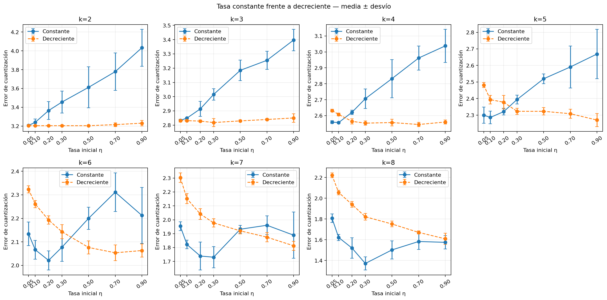
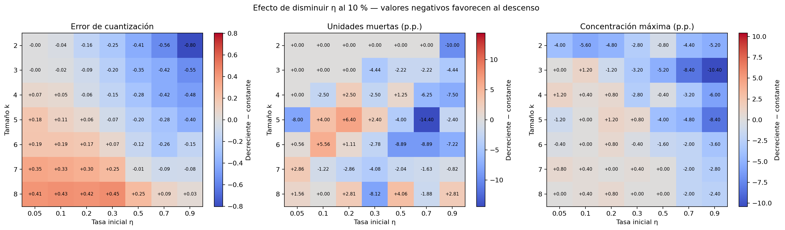

# Experimento 3: tasa constante frente a decreciente

Se compararon los mismos 245 pares de `k`, tasa inicial y semilla con dos
schedules: tasa constante y disminución lineal hasta el 10 % del valor inicial.
En total se entrenaron 490 redes con 150 épocas. El radio mantuvo en ambos casos
su descenso desde el diámetro de la grilla hasta 1, por lo que la única
diferencia experimental es la evolución de la tasa.

Los siguientes mapas muestran `decreciente − constante` para cada indicador.
Un valor negativo favorece al descenso; uno positivo favorece mantener la tasa.

## Mínimo error dentro de cada tamaño y schedule

| Schedule | k | Tasa | Error | Unidades muertas (%) | Máximo de hits (%) |
| --- | ---: | ---: | ---: | ---: | ---: |
| constant | 2 | 0.05 → 0.05 | 3.2075 ± 0.0080 | 0.0 ± 0.0 | 44.8 ± 3.0 |
| constant | 3 | 0.05 → 0.05 | 2.8331 ± 0.0057 | 0.0 ± 0.0 | 18.8 ± 1.8 |
| constant | 4 | 0.1 → 0.1 | 2.5568 ± 0.0047 | 5.0 ± 5.2 | 12.4 ± 2.2 |
| constant | 5 | 0.1 → 0.1 | 2.2858 ± 0.0385 | 12.0 ± 8.9 | 10.4 ± 1.7 |
| constant | 6 | 0.2 → 0.2 | 2.0213 ± 0.0409 | 22.2 ± 7.9 | 7.2 ± 1.1 |
| constant | 7 | 0.3 → 0.3 | 1.7303 ± 0.0764 | 38.8 ± 5.9 | 6.0 ± 0.0 |
| constant | 8 | 0.3 → 0.3 | 1.3715 ± 0.0632 | 48.8 ± 3.9 | 5.2 ± 1.1 |
| decay | 2 | 0.1 → 0.01 | 3.2044 ± 0.0032 | 0.0 ± 0.0 | 41.6 ± 0.9 |
| decay | 3 | 0.3 → 0.03 | 2.8182 ± 0.0281 | 0.0 ± 0.0 | 18.4 ± 1.7 |
| decay | 4 | 0.7 → 0.07 | 2.5448 ± 0.0128 | 3.8 ± 3.4 | 12.4 ± 1.7 |
| decay | 5 | 0.9 → 0.09 | 2.2699 ± 0.0393 | 17.6 ± 6.7 | 10.0 ± 1.4 |
| decay | 6 | 0.7 → 0.07 | 2.0536 ± 0.0334 | 21.1 ± 9.1 | 7.6 ± 0.9 |
| decay | 7 | 0.9 → 0.09 | 1.8128 ± 0.0326 | 36.3 ± 2.7 | 6.4 ± 0.9 |
| decay | 8 | 0.9 → 0.09 | 1.6089 ± 0.0545 | 47.2 ± 3.2 | 6.0 ± 0.0 |

Esta tabla sólo localiza mínimos de error. En particular, los mínimos de
`k = 5`, `k = 7` y `k = 8` con descenso dejan muchas unidades muertas; no se
seleccionan automáticamente.

## Lectura de la interacción

- En `k = 4`, el descenso vuelve competitivas las tasas iniciales altas. La
  región `0.3 → 0.03` logra error `2.5533` con sólo `1.25 %` de unidades
  muertas; `0.7 → 0.07` baja el error a `2.5448`, pero aumenta las unidades
  muertas a `3.75 %`. La constante `0.05` sigue siendo un control fuerte por su
  buena ocupación y estabilidad.
- En `k = 5`, `0.7 → 0.07` logra un compromiso cercano a la constante `0.2`:
  errores `2.3082` frente a `2.3207`, unidades muertas `5.6 %` frente a `4.8 %`
  y la misma concentración máxima de `8.8 %`. El mínimo `0.9 → 0.09` reduce el
  error, pero eleva las unidades muertas a `17.6 %`.
- En `k = 6`, el descenso no domina a las tasas constantes bajas. La constante
  `0.1` conserva `16.7 %` de unidades muertas; los mejores descensos quedan
  alrededor de `20–21 %`. Se mantiene como control de una grilla más grande.
- `k = 2` y `k = 3` continúan demasiado concentrados. `k = 7` y `k = 8`
  continúan demasiado fragmentados incluso cuando el descenso mejora su error.

Por lo tanto no se elige aún una única configuración. Para estudiar el radio y
las épocas se conservan regiones representativas de `k = 4`, `k = 5` y `k = 6`,
incluyendo alternativas constantes y decrecientes. Así se mantiene visible la
interacción sin volver a arrastrar combinaciones claramente dominadas.

Los datos están en `generated/corridas.csv`, los promedios en
`generated/resumen_schedules.csv` y las diferencias emparejadas por combinación
en `generated/diferencias_decay_menos_constante.csv`.
