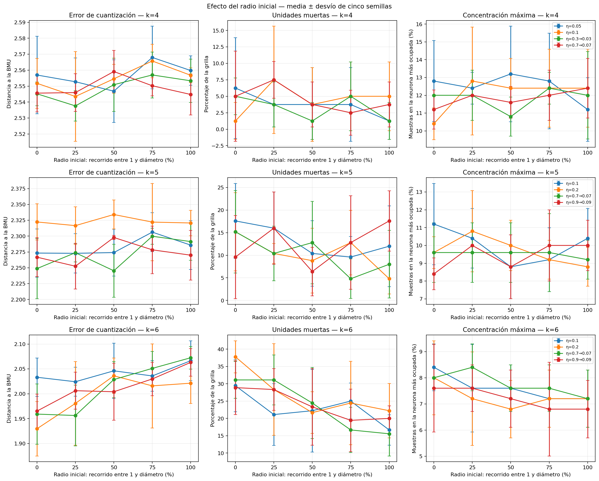
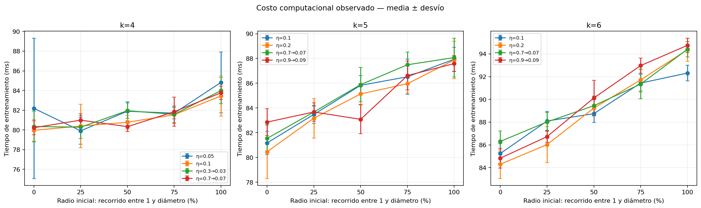

# Experimento 4: radio inicial

Se compararon `k = 4`, `k = 5` y `k = 6`, cuatro perfiles de tasa por tamaño,
cinco radios iniciales y cinco semillas: 300 corridas. Los radios recorren 0 %,
25 %, 50 %, 75 % y 100 % del trayecto entre el vecindario local `R = 1` y el
diámetro de cada grilla. Todos terminan en `R = 1` mediante descenso lineal;
el primer nivel permanece constante porque comienza y termina en 1.

## Mínimo error dentro de cada perfil de tasa

| k | Schedule | Tasa | Nivel de radio | Radio | Error | Muertas (%) | Máximo de hits (%) | Tiempo (s) |
| ---: | --- | ---: | ---: | ---: | ---: | ---: | ---: | ---: |
| 4 | constant | 0.05 → 0.05 | 50% | 2.621 → 1 | 2.5468 | 3.8 | 13.2 | 0.0819 |
| 4 | constant | 0.1 → 0.1 | 25% | 1.811 → 1 | 2.5435 | 7.5 | 12.8 | 0.0804 |
| 4 | decay | 0.3 → 0.03 | 25% | 1.811 → 1 | 2.5376 | 3.8 | 12.0 | 0.0803 |
| 4 | decay | 0.7 → 0.07 | 100% | 4.243 → 1 | 2.5448 | 3.8 | 12.4 | 0.0838 |
| 5 | constant | 0.1 → 0.1 | 25% | 2.164 → 1 | 2.2728 | 16.0 | 10.4 | 0.0835 |
| 5 | constant | 0.2 → 0.2 | 25% | 2.164 → 1 | 2.3165 | 10.4 | 10.8 | 0.0832 |
| 5 | decay | 0.7 → 0.07 | 50% | 3.328 → 1 | 2.2453 | 12.8 | 9.6 | 0.0859 |
| 5 | decay | 0.9 → 0.09 | 25% | 2.164 → 1 | 2.2524 | 16.0 | 10.0 | 0.0837 |
| 6 | constant | 0.1 → 0.1 | 25% | 2.518 → 1 | 2.0242 | 21.1 | 7.6 | 0.0881 |
| 6 | constant | 0.2 → 0.2 | 0% | 1.000 → 1 | 1.9297 | 37.8 | 8.0 | 0.0843 |
| 6 | decay | 0.7 → 0.07 | 25% | 2.518 → 1 | 1.9563 | 31.1 | 8.4 | 0.0880 |
| 6 | decay | 0.9 → 0.09 | 0% | 1.000 → 1 | 1.9652 | 28.9 | 7.6 | 0.0848 |

La tabla no selecciona automáticamente esos mínimos: el radio organiza la
topología del mapa y debe juzgarse también mediante matrices U y mapas de hits.
Esas figuras se generarán sólo para las configuraciones representativas, no
para las 300 corridas.

## Lectura de los resultados

- En `k = 4` las diferencias de error son pequeñas. Dos compromisos especialmente
  estables son la tasa constante `η = 0.1` con `R = 1` (1,25 % de unidades
  muertas) y el descenso `0.3 → 0.03` con radio inicial a mitad del recorrido
  (también 1,25 %). Se conservan ambos para la inspección visual.
- En `k = 5` el radio interactúa con la tasa. Con `η = 0.1`, comenzar a mitad
  del recorrido mantiene prácticamente el mínimo error y reduce las unidades
  muertas de 17,6 % a 10,4 %. Con `η = 0.2`, comenzar en el diámetro completo
  las reduce a 4,8 %. Las alternativas decrecientes también dejan candidatos
  y deben decidirse mirando la estructura del mapa.
- En `k = 6`, los radios locales producen errores bajos a costa de entre 28,9 %
  y 37,8 % de unidades muertas. Los radios amplios bajan esa fracción hasta
  aproximadamente 15,6–22,2 %, aunque el tamaño sigue peor ocupado que `k = 4`
  y `k = 5`. Se conserva sólo como caso de frontera para la comparación visual.

Por lo tanto, el barrido no justifica elegir el mínimo error aislado. Primero
se filtran soluciones con ocupación razonable y estabilidad entre semillas;
luego se comparan sus mapas de hits y matrices U.

## Performance computacional

La consigna usa “performance” principalmente para pedir una justificación de
la calidad del modelo. Además se registró el tiempo de entrenamiento de cada
corrida como dato auxiliar. Es una medición dependiente de la máquina y no se
usa como criterio principal; permite comparar el costo cuando dos alternativas
producen resultados equivalentes.

Los tiempos medios por configuración estuvieron entre
`79.9` y `94.8` ms. La diferencia
es demasiado pequeña para compensar una peor ocupación o una estructura menos
interpretable. Sí se tendrá en cuenta si dos configuraciones resultan
equivalentes en calidad. Para esta implementación, el trabajo por época crece
principalmente con la cantidad de muestras, variables y neuronas, es decir,
aproximadamente con `N × d × k²`; el radio no cambia ese orden de complejidad.

Los resultados individuales están en `generated/corridas.csv` y los promedios
por configuración en `generated/resumen_radio.csv`.
