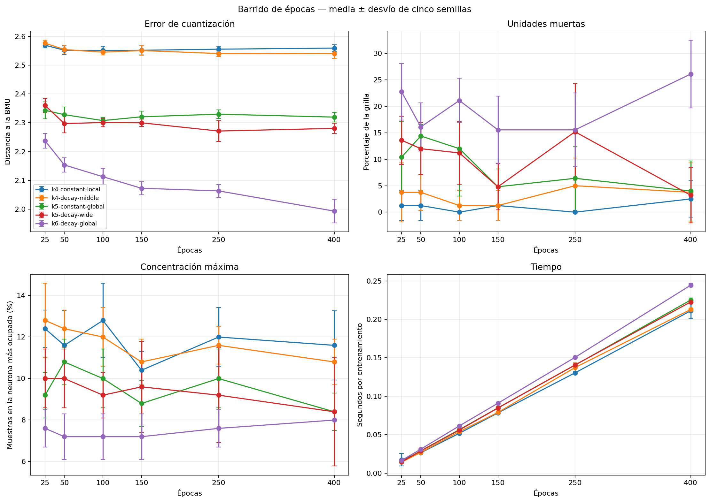

# Experimento 5: cantidad de épocas

Se compararon cinco configuraciones finalistas con `25`, `50`, `100`, `150`,
`250` y `400` épocas y cinco semillas: 150 corridas independientes. En cada
corrida, la tasa y el radio recorren su schedule completo durante la cantidad
de épocas indicada; los puntos no son checkpoints de un mismo entrenamiento.

## Región de 150 a 400 épocas

| Configuración | Épocas | Error | Muertas (%) | Máximo de hits (%) | Tiempo (s) |
| --- | ---: | ---: | ---: | ---: | ---: |
| k4-constant-local | 150 | 2.5518 ± 0.0157 | 1.2 ± 2.8 | 10.4 ± 0.9 | 0.078 |
| k4-constant-local | 250 | 2.5556 ± 0.0098 | 0.0 ± 0.0 | 12.0 ± 1.4 | 0.130 |
| k4-constant-local | 400 | 2.5593 ± 0.0114 | 2.5 ± 3.4 | 11.6 ± 1.7 | 0.211 |
| k4-decay-middle | 150 | 2.5509 ± 0.0167 | 1.2 ± 2.8 | 10.8 ± 1.1 | 0.079 |
| k4-decay-middle | 250 | 2.5404 ± 0.0099 | 5.0 ± 5.2 | 11.6 ± 0.9 | 0.137 |
| k4-decay-middle | 400 | 2.5397 ± 0.0167 | 3.8 ± 5.6 | 10.8 ± 1.1 | 0.213 |
| k5-constant-global | 150 | 2.3207 ± 0.0201 | 4.8 ± 3.3 | 8.8 ± 1.1 | 0.085 |
| k5-constant-global | 250 | 2.3298 ± 0.0145 | 6.4 ± 6.1 | 10.0 ± 1.4 | 0.140 |
| k5-constant-global | 400 | 2.3196 ± 0.0166 | 4.0 ± 5.7 | 8.4 ± 0.9 | 0.225 |
| k5-decay-wide | 150 | 2.2998 ± 0.0125 | 4.8 ± 4.4 | 9.6 ± 2.2 | 0.085 |
| k5-decay-wide | 250 | 2.2712 ± 0.0357 | 15.2 ± 9.1 | 9.2 ± 2.3 | 0.141 |
| k5-decay-wide | 400 | 2.2805 ± 0.0174 | 3.2 ± 5.2 | 8.4 ± 2.6 | 0.223 |
| k6-decay-global | 150 | 2.0725 ± 0.0228 | 15.6 ± 6.4 | 7.2 ± 1.1 | 0.091 |
| k6-decay-global | 250 | 2.0634 ± 0.0221 | 15.6 ± 7.0 | 7.6 ± 0.9 | 0.151 |
| k6-decay-global | 400 | 1.9931 ± 0.0407 | 26.1 ± 6.4 | 8.0 ± 0.0 | 0.244 |

La cantidad de épocas no se elige por el menor error aislado. Se busca una
meseta razonable en calidad y estabilidad, evitando pagar más tiempo por una
mejora pequeña o por una ocupación peor.

## Decisión

Se conservan **150 épocas**. Es el primer presupuesto donde las cinco
configuraciones muestran simultáneamente una ocupación razonable: las dos
variantes `k = 4` promedian 1,2 % de unidades muertas; las dos `k = 5`, 4,8 %;
y el control `k = 6`, 15,6 %. También mantienen concentraciones máximas entre
7,2 % y 10,8 %.

Entrenar hasta 400 épocas cuesta aproximadamente 2,6–2,7 veces más. En `k = 4`
el error ya está en una meseta y la ocupación no mejora consistentemente. En
`k = 5` aparecen pequeñas mejoras aisladas, pero con mayor variabilidad o sin
una reducción consistente del error. En `k = 6`, el error baja de 2,0725 a
1,9931, pero las unidades muertas suben de 15,6 % a 26,1 %: representa mejor a
las neuronas usadas mientras desaprovecha una parte mayor de la grilla.

Por lo tanto, extender el entrenamiento no aporta una mejora conjunta que
justifique cambiar el valor usado hasta ahora. El siguiente experimento puede
comparar inicializaciones manteniendo 150 épocas y los demás hiperparámetros
seleccionados.

Los resultados individuales están en `generated/corridas.csv` y los promedios
en `generated/resumen_epocas.csv`.
