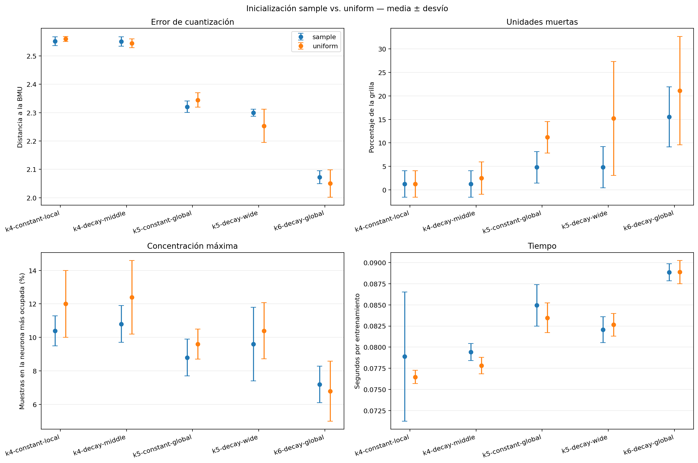

# Experimento 6: inicialización

Se compararon inicializaciones `sample` y `uniform` en las cinco configuraciones
finalistas, manteniendo 150 épocas y cinco semillas: 50 corridas. `sample`
comienza cada neurona en un creador real; `uniform` sortea cada peso entre el
mínimo y el máximo estandarizado de su variable.

| Configuración | Inicialización | Error | Muertas (%) | Máximo de hits (%) | Tiempo (s) |
| --- | --- | ---: | ---: | ---: | ---: |
| k4-constant-local | sample | 2.5518 ± 0.0157 | 1.2 ± 2.8 | 10.4 ± 0.9 | 0.079 |
| k4-constant-local | uniform | 2.5596 ± 0.0089 | 1.2 ± 2.8 | 12.0 ± 2.0 | 0.076 |
| k4-decay-middle | sample | 2.5509 ± 0.0167 | 1.2 ± 2.8 | 10.8 ± 1.1 | 0.079 |
| k4-decay-middle | uniform | 2.5441 ± 0.0157 | 2.5 ± 3.4 | 12.4 ± 2.2 | 0.078 |
| k5-constant-global | sample | 2.3207 ± 0.0201 | 4.8 ± 3.3 | 8.8 ± 1.1 | 0.085 |
| k5-constant-global | uniform | 2.3443 ± 0.0253 | 11.2 ± 3.3 | 9.6 ± 0.9 | 0.083 |
| k5-decay-wide | sample | 2.2998 ± 0.0125 | 4.8 ± 4.4 | 9.6 ± 2.2 | 0.082 |
| k5-decay-wide | uniform | 2.2533 ± 0.0582 | 15.2 ± 12.1 | 10.4 ± 1.7 | 0.083 |
| k6-decay-global | sample | 2.0725 ± 0.0228 | 15.6 ± 6.4 | 7.2 ± 1.1 | 0.089 |
| k6-decay-global | uniform | 2.0502 ± 0.0479 | 21.1 ± 11.6 | 6.8 ± 1.8 | 0.089 |

## Diferencia pareada: uniform menos sample

Los valores negativos favorecen a `uniform` en las tres métricas de calidad.

| Configuración | Δ error | Δ muertas (pp) | Δ máximo de hits (pp) |
| --- | ---: | ---: | ---: |
| k4-constant-local | +0.0078 | +0.0 | +1.6 |
| k4-decay-middle | -0.0068 | +1.2 | +1.6 |
| k5-constant-global | +0.0236 | +6.4 | +0.8 |
| k5-decay-wide | -0.0464 | +10.4 | +0.8 |
| k6-decay-global | -0.0222 | +5.6 | -0.4 |

Las diferencias se calcularon por semilla antes de promediar. Si `uniform`
resulta mejor de forma consistente, este experimento no basta para fijarla:
habrá que revalidar su interacción con tasa y radio en una región acotada.

## Decisión

Se conserva **`sample`**. `uniform` no mejora conjuntamente las métricas en
ninguna de las cinco configuraciones:

- en `k = 4` mantiene o aumenta las unidades muertas y sube la concentración
  máxima en 1,6 puntos porcentuales;
- en `k = 5` constante empeora error, ocupación y concentración;
- en `k = 5` decreciente reduce el error en 0,0464, pero agrega 10,4 puntos de
  unidades muertas y presenta mucha más variabilidad;
- en `k = 6` reduce el error en 0,0222 y la concentración en 0,4 puntos, pero
  agrega 5,6 puntos de unidades muertas y también aumenta la dispersión.

Las reducciones aisladas del error con `uniform` provienen de mapas que usan
menos neuronas, por lo que no justifican reabrir ahora los barridos de tasa y
radio. `sample` además comienza en regiones donde existen datos reales, una
ventaja pertinente para sólo 50 creadores.

Los resultados individuales están en `generated/corridas.csv`, los promedios
en `generated/resumen_inicializacion.csv` y las diferencias pareadas en
`generated/diferencias_uniform_menos_sample.csv`.
