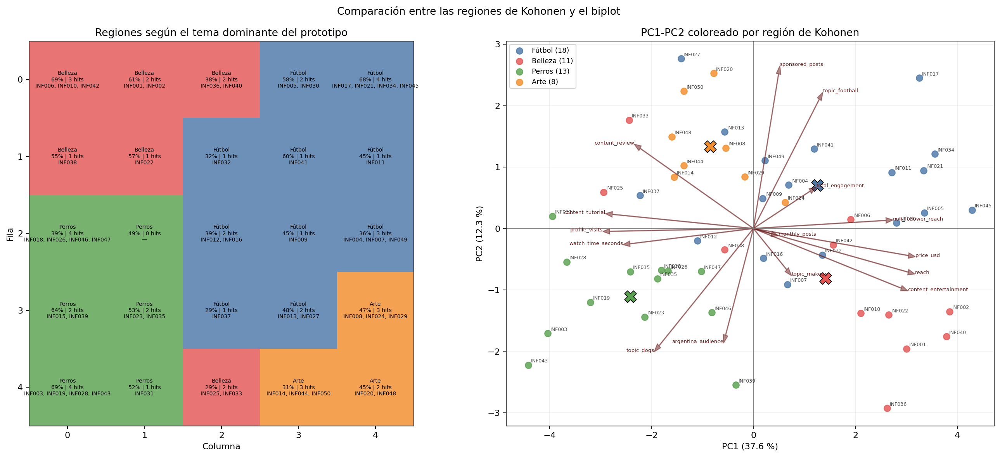

# Experimento 7: interpretación de las candidatas

Se comparan las cuatro candidatas `k = 4` y `k = 5` con 150 épocas e
inicialización `sample`. Para cada configuración se eligió la semilla más
central respecto de error, unidades muertas y concentración máxima; no se
eligió la mejor corrida.

| Configuración | Semilla | Error | Ocupadas | Máximo de hits |
| --- | ---: | ---: | ---: | ---: |
| k4-constant-local | 4 | 2.5494 | 16/16 | 5 |
| k4-decay-middle | 3 | 2.5515 | 16/16 | 5 |
| k5-constant-global | 2 | 2.3249 | 24/25 | 4 |
| k5-decay-wide | 1 | 2.3110 | 23/25 | 4 |

Todos los mapas de una misma variable comparten escala entre configuraciones.
Las 15 entradas se muestran como pesos estandarizados; arte, showcase y alcance
argentino se reconstruyen en unidades originales, mientras que followers es un
promedio observado y no participa del entrenamiento. Una rotación o reflexión
de la grilla no cambia su significado: se comparan regiones, no coordenadas.

## Resolución temática

| Configuración | Ocupadas | Tema dominante medio (%) | Máx. fútbol | Máx. belleza | Máx. perros | Máx. arte |
| --- | ---: | ---: | ---: | ---: | ---: | ---: |
| k4-constant-local | 16 | 41.4 | 54.1 | 48.1 | 59.1 | 37.5 |
| k4-decay-middle | 16 | 44.5 | 59.1 | 58.6 | 59.6 | 39.2 |
| k5-constant-global | 24 | 48.7 | 68.1 | 68.9 | 68.8 | 46.9 |
| k5-decay-wide | 23 | 49.9 | 69.3 | 71.5 | 70.7 | 55.2 |

Las dos grillas `k = 5` generan prototipos temáticos más especializados: el
tema dominante ronda 49 %, frente a 41–45 % en `k = 4`. La resolución adicional
no se limita a bajar el error: separa zonas continuas de fútbol, belleza,
perros y arte, junto con gradientes de alcance, respuesta y contenido.

## Decisión

Se elige **`k5-constant-global`**: grilla `5 × 5`, tasa constante `0.2`, radio
inicial igual al diámetro y descenso hasta 1, 150 épocas e inicialización
`sample`. Frente a `k = 4`, reduce el error cerca de 9 % y conserva 24 de 25
neuronas ocupadas en la corrida representativa. Frente a `k5-decay-wide`, pierde
menos de 1 % en error, pero tiene menor concentración y variabilidad entre
semillas, una sola celda vacía en el mapa mostrado y regiones algo más limpias.

La semilla 2 sólo se usa para visualizar el caso central; la decisión se apoya
en las cinco semillas y no fija una “semilla óptima”.

### Regiones comerciales visibles en la configuración elegida

| Campaña | Neurona | Hits | Creadores | Afinidad temática (%) | Alcance argentino estimado | Engagement/1000 | Visitas/1000 | Precio USD |
| --- | --- | ---: | --- | ---: | ---: | ---: | ---: | ---: |
| futbol | (0, 4) | 4 | `INF017;INF021;INF034;INF045` | 68.1 | 70530 | 72.2 | 10.5 | 3984 |
| belleza | (0, 0) | 3 | `INF006;INF010;INF042` | 68.9 | 88954 | 64.0 | 12.0 | 3600 |
| perros | (4, 0) | 4 | `INF003;INF019;INF028;INF043` | 68.8 | 3846 | 63.9 | 23.9 | 159 |
| arte | (3, 4) | 3 | `INF008;INF024;INF029` | 46.9 | 26970 | 67.4 | 18.2 | 1467 |

Estas celdas son puntos de partida interpretativos, no un ranking automático:
para recomendar creadores concretos todavía deben leerse sus valores reales y
compararse con el baseline de followers.

## Regiones de la grilla y comparación con PCA

Para hacer reproducible la noción de región, cada neurona se etiqueta con el
tema de mayor porcentaje en su prototipo. Las celdas vecinas con la misma
etiqueta forman zonas temáticas. Esta regla produce una zona de belleza en el
extremo superior izquierdo, fútbol hacia la parte superior y central derecha,
perros en el sector inferior izquierdo y arte en el inferior derecho. Hay
**4 celdas de transición** cuya afinidad máxima
es menor que 35 %; no deben leerse como ejemplos puros aunque se les asigne la
etiqueta dominante.

| Región | Creadores | PC1 (media ± DE) | PC2 (media ± DE) | Tres variables relativamente altas | Tres relativamente bajas |
| --- | ---: | ---: | ---: | --- | --- |
| Fútbol | 18 | +1.25 ± 1.94 | +0.70 ± 0.97 | `topic_football_pct:0.846;non_follower_reach_pct:0.704;content_entertainment_pct:0.338` | `profile_visits_per_1000:-0.531;content_tutorial_pct:-0.504;topic_dogs_pct:-0.494` |
| Belleza | 11 | +1.42 ± 2.36 | -0.81 ± 1.33 | `topic_makeup_pct:1.325;average_reach:0.868;price_usd:0.750` | `content_review_pct:-0.561;topic_football_pct:-0.482;profile_visits_per_1000:-0.413` |
| Perros | 13 | -2.41 ± 1.33 | -1.11 ± 0.75 | `topic_dogs_pct:1.338;average_watch_time_seconds:0.843;profile_visits_per_1000:0.839` | `sponsored_posts_pct:-0.797;average_reach:-0.794;price_usd:-0.756` |
| Arte | 8 | -0.84 ± 0.79 | +1.34 ± 0.72 | `sponsored_posts_pct:1.067;content_review_pct:0.513;profile_visits_per_1000:0.398` | `non_follower_reach_pct:-0.728;argentina_audience_pct:-0.561;content_entertainment_pct:-0.559` |

Las variables de las dos últimas columnas son medias z-score de los creadores
de cada región: describen diferencias relativas al catálogo, no porcentajes ni
un ranking. En conjunto, las regiones reflejan cuatro perfiles:

- **Fútbol:** perfiles de mayor escala, precio, alcance fuera de seguidores y
  contenido de entretenimiento; quedan mayormente hacia PC1 positivo y PC2
  positivo.
- **Belleza:** también tiende a PC1 positivo por escala y precio, pero se
  desplaza hacia PC2 negativo frente a fútbol por audiencia argentina y la
  oposición temática entre maquillaje y fútbol.
- **Perros:** se concentra hacia PC1 y PC2 negativos, con menor escala y precio,
  pero mayor profundidad, visitas y contenido tutorial.
- **Arte:** ocupa una zona intermedia, principalmente con PC1 negativo y PC2
  positivo; es la región menos extrema en PC1-PC2 y por eso presenta mayor
  solapamiento visual.

PC1 y PC2 explican juntas **49.90 %**
de la varianza. El **70.0 %** de
los creadores queda más cerca, en ese plano, del centro de su propia región de
Kohonen que de los otros tres centros. Es una comparación descriptiva, no una
métrica usada para entrenar ni elegir la red. Hay coincidencia parcial y
coherente, pero no identidad: Kohonen organizó las 15 variables y el biplot
sólo muestra 49,90 % de esa información.

## Lectura de la Matriz U

La Matriz U de cada celda promedia las distancias euclídeas entre su prototipo
y los de sus vecinas ortogonales, siempre sobre las 15 variables
estandarizadas. Un valor alto indica un cambio multivariado pronunciado y se
interpreta como una posible frontera; no significa por sí solo que la neurona
o el entrenamiento sean malos.

En la grilla elegida hay 40 pares de vecinas:
13 cruzan entre etiquetas temáticas. La
distancia media es **1.62** dentro de una
región y **1.89** al cruzar una región.
Entre las aristas del cuartil superior (distancia ≥
1.91),
**50.0 %** cruza una etiqueta.

| Vecinas | Regiones | Distancia | Cruza región |
| --- | --- | ---: | --- |
| (1,1)–(2,1) | makeup → dogs | 3.04 | Sí |
| (1,2)–(2,2) | football → football | 2.76 | No |
| (1,0)–(2,0) | makeup → dogs | 2.53 | Sí |
| (0,2)–(0,3) | makeup → football | 2.27 | Sí |
| (2,1)–(2,2) | dogs → football | 2.25 | Sí |

La relación no tiene que ser perfecta: una frontera puede deberse a alcance,
precio, formato o respuesta comercial aunque ambas neuronas compartan tema; y
una transición temática puede ser gradual en las otras variables. Por eso la
Matriz U se interpreta junto con los mapas por variable y no como un mapa de
clases verdaderas.

Los valores completos están en `generated/perfiles_neuronas.csv`; las
asignaciones, en `generated/asignaciones_finalistas.csv`; y el criterio para
elegir las semillas, en `generated/seleccion_representantes.csv`. Los resúmenes
cuantitativos están en `generated/resumen_interpretabilidad.csv` y
`generated/regiones_campanas.csv`. El cruce con PCA queda en
`generated/regiones_kohonen_pca.csv`, y las 40 distancias entre vecinas, en
`generated/fronteras_matriz_u.csv`.
