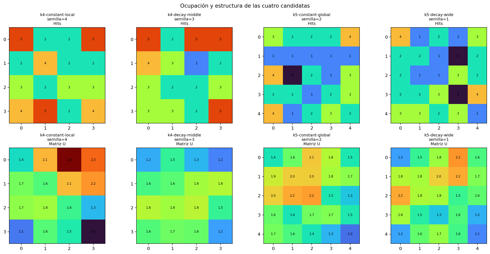
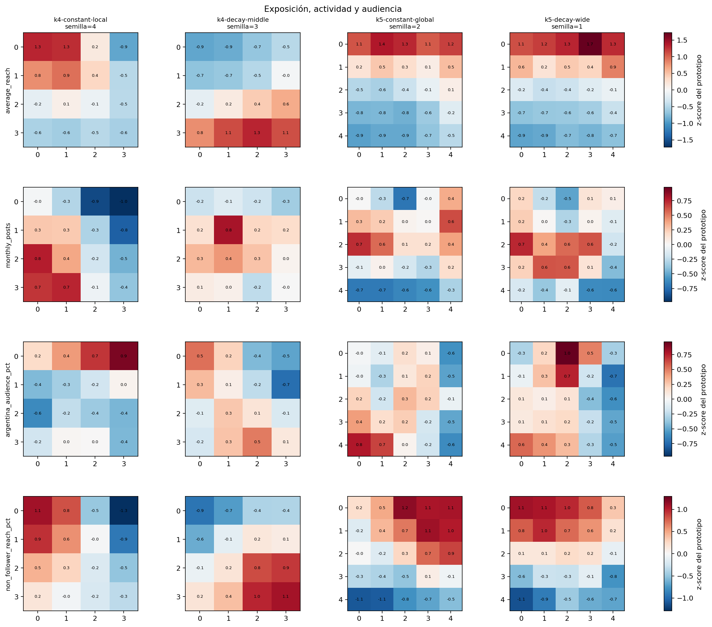
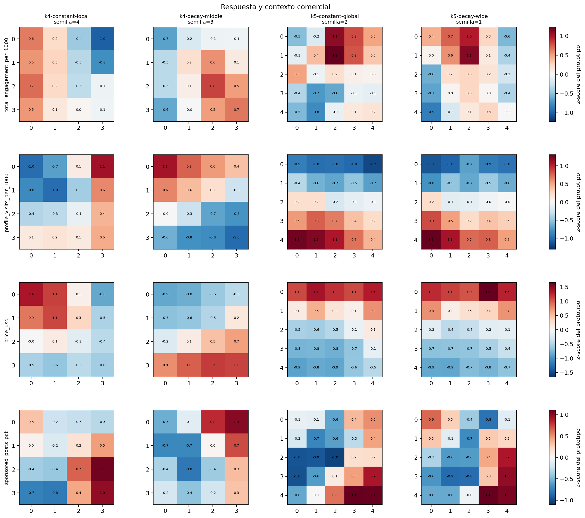
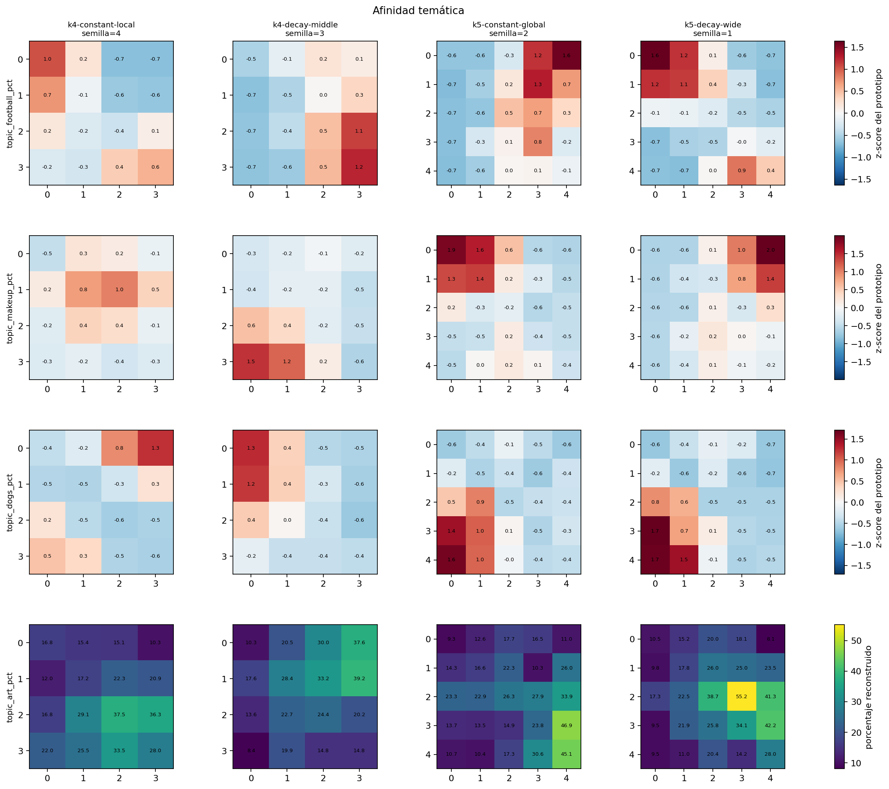
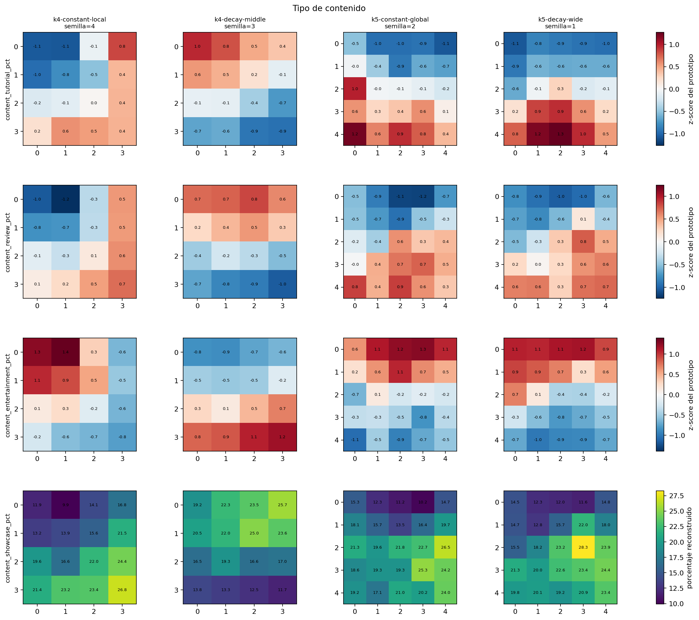
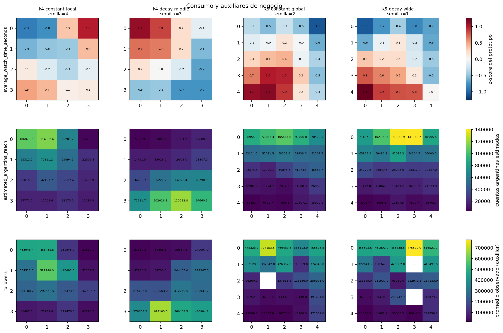
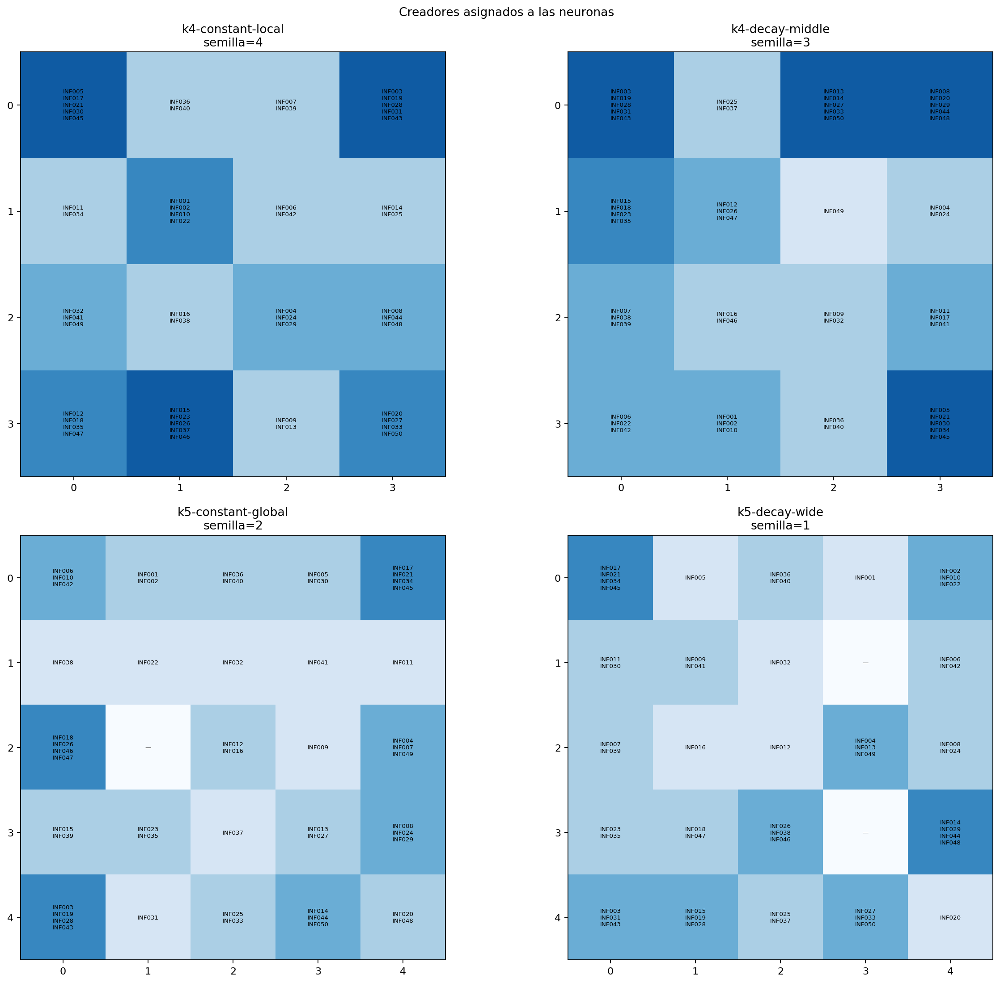

# Experimento 7: interpretación de las candidatas

Se comparan las cuatro candidatas `k = 4` y `k = 5` con 150 épocas e
inicialización `sample`. Para cada configuración se eligió la semilla más
central respecto de error, unidades muertas y concentración máxima; no se
eligió la mejor corrida.

| Configuración | Semilla | Error | Ocupadas | Máximo de hits |
| --- | ---: | ---: | ---: | ---: |
| k4-constant-local | 4 | 2.5494 | 16/16 | 5 |
| k4-decay-middle | 3 | 2.5515 | 16/16 | 5 |
| k5-constant-global | 2 | 2.3249 | 24/25 | 4 |
| k5-decay-wide | 1 | 2.3110 | 23/25 | 4 |

Todos los mapas de una misma variable comparten escala entre configuraciones.
Las 15 entradas se muestran como pesos estandarizados; arte, showcase y alcance
argentino se reconstruyen en unidades originales, mientras que followers es un
promedio observado y no participa del entrenamiento. Una rotación o reflexión
de la grilla no cambia su significado: se comparan regiones, no coordenadas.

## Resolución temática

| Configuración | Ocupadas | Tema dominante medio (%) | Máx. fútbol | Máx. belleza | Máx. perros | Máx. arte |
| --- | ---: | ---: | ---: | ---: | ---: | ---: |
| k4-constant-local | 16 | 41.4 | 54.1 | 48.1 | 59.1 | 37.5 |
| k4-decay-middle | 16 | 44.5 | 59.1 | 58.6 | 59.6 | 39.2 |
| k5-constant-global | 24 | 48.7 | 68.1 | 68.9 | 68.8 | 46.9 |
| k5-decay-wide | 23 | 49.9 | 69.3 | 71.5 | 70.7 | 55.2 |

Las dos grillas `k = 5` generan prototipos temáticos más especializados: el
tema dominante ronda 49 %, frente a 41–45 % en `k = 4`. La resolución adicional
no se limita a bajar el error: separa zonas continuas de fútbol, belleza,
perros y arte, junto con gradientes de alcance, respuesta y contenido.

## Decisión

Se elige **`k5-constant-global`**: grilla `5 × 5`, tasa constante `0.2`, radio
inicial igual al diámetro y descenso hasta 1, 150 épocas e inicialización
`sample`. Frente a `k = 4`, reduce el error cerca de 9 % y conserva 24 de 25
neuronas ocupadas en la corrida representativa. Frente a `k5-decay-wide`, pierde
menos de 1 % en error, pero tiene menor concentración y variabilidad entre
semillas, una sola celda vacía en el mapa mostrado y regiones algo más limpias.

La semilla 2 sólo se usa para visualizar el caso central; la decisión se apoya
en las cinco semillas y no fija una “semilla óptima”.

### Regiones comerciales visibles en la configuración elegida

| Campaña | Neurona | Hits | Creadores | Afinidad temática (%) | Alcance argentino estimado | Engagement/1000 | Visitas/1000 | Precio USD |
| --- | --- | ---: | --- | ---: | ---: | ---: | ---: | ---: |
| futbol | (0, 4) | 4 | `INF017;INF021;INF034;INF045` | 68.1 | 70530 | 72.2 | 10.5 | 3984 |
| belleza | (0, 0) | 3 | `INF006;INF010;INF042` | 68.9 | 88954 | 64.0 | 12.0 | 3600 |
| perros | (4, 0) | 4 | `INF003;INF019;INF028;INF043` | 68.8 | 3846 | 63.9 | 23.9 | 159 |
| arte | (3, 4) | 3 | `INF008;INF024;INF029` | 46.9 | 26970 | 67.4 | 18.2 | 1467 |

Estas celdas son puntos de partida interpretativos, no un ranking automático:
para recomendar creadores concretos todavía deben leerse sus valores reales y
compararse con el baseline de followers.

Los valores completos están en `generated/perfiles_neuronas.csv`; las
asignaciones, en `generated/asignaciones_finalistas.csv`; y el criterio para
elegir las semillas, en `generated/seleccion_representantes.csv`. Los resúmenes
cuantitativos están en `generated/resumen_interpretabilidad.csv` y
`generated/regiones_campanas.csv`.
