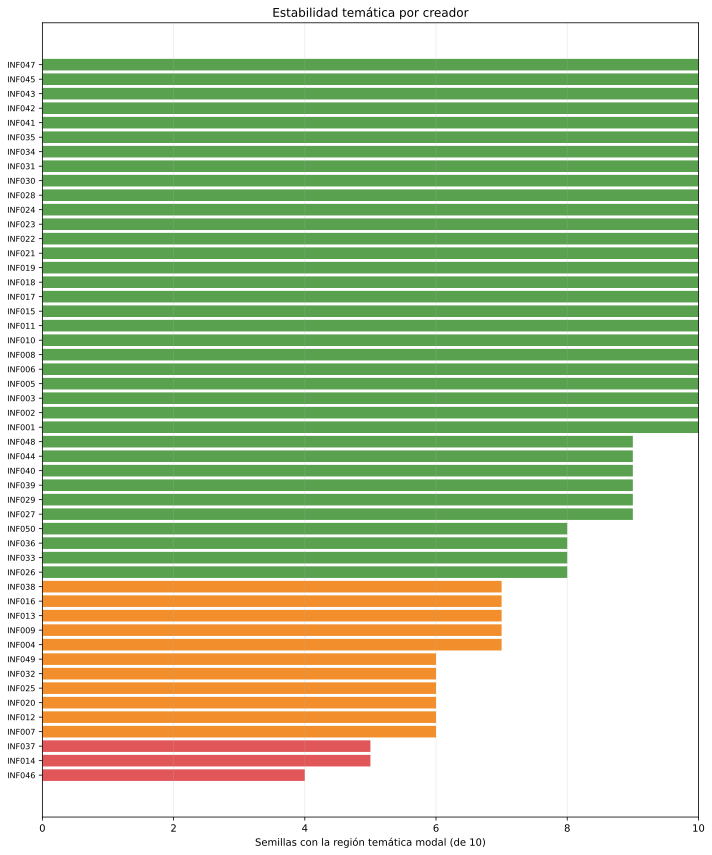
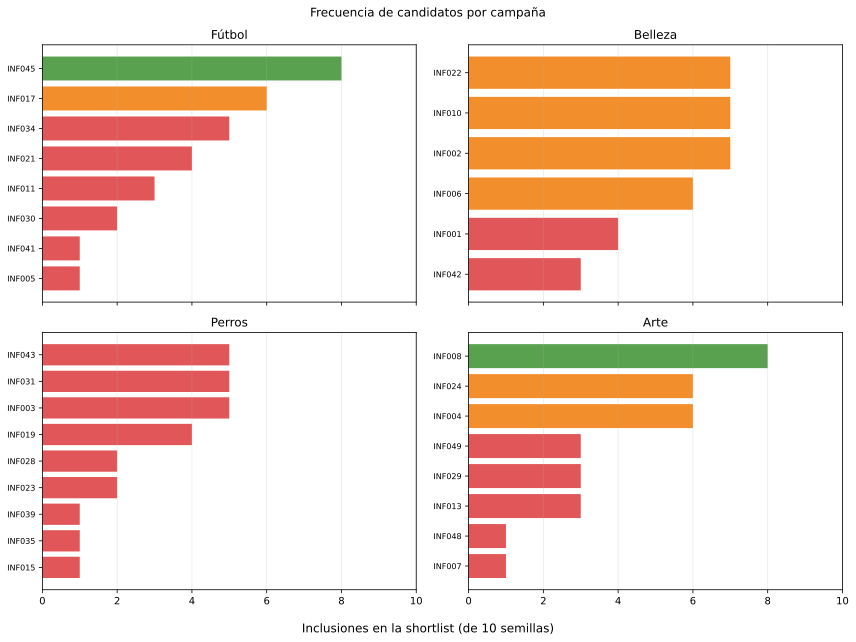

# Estabilidad de la configuración final de Kohonen

## Protocolo

- Configuración: grilla `5 x 5`, tasa constante `0.2`, radio `5.657 -> 1.0`, `150` épocas e inicialización `sample`.
- Semillas: `0, 1, 2, 3, 4, 5, 6, 7, 8, 9`.
- Región temática: tema dominante del prototipo de la BMU de cada creador.
- Celda de transición: afinidad temática máxima menor que `35 %`.
- Clasificación predefinida: estable `8-10`, fronterizo `6-7` e inestable `0-5` apariciones.

Las coordenadas de la grilla pueden rotarse o reflejarse entre semillas. Por eso
no se comparan coordenadas: se compara el significado temático del prototipo.
Este conteo es un diagnóstico descriptivo adicional, no una métrica usada para
entrenar o volver a elegir automáticamente los hiperparámetros.

## Estabilidad temática

De los 50 creadores, **36** son estables,
**11** fronterizos y **3**
inestables según su región temática modal. Esto equivale a
**72 %** estables y
**94 %**
entre estables y fronterizos. Los inestables son `INF014;INF037;INF046`.

Hubo 60 asignaciones a celdas de transición sobre
500 combinaciones creador-semilla
(12.0 %).

## Estabilidad de las shortlists

En cada semilla se selecciona, para cada campaña, la neurona ocupada cuyo
prototipo tiene mayor afinidad con el tema correspondiente. La frecuencia indica
cuántas veces aparece cada creador; no es un ranking de calidad comercial.

| Campaña | Tamaño medio | Afinidad media (%) | Shortlists distintas | Estables | Fronterizos | Inestables |
| --- | ---: | ---: | ---: | ---: | ---: | ---: |
| Fútbol | 3.0 | 67.1 | 10 | 1 | 1 | 6 |
| Belleza | 3.4 | 69.4 | 9 | 0 | 4 | 2 |
| Perros | 2.6 | 70.4 | 10 | 0 | 0 | 9 |
| Arte | 3.1 | 50.8 | 9 | 1 | 2 | 5 |

| Campaña | Candidatos estables | Candidatos fronterizos |
| --- | --- | --- |
| Fútbol | `INF045` | `INF017` |
| Belleza | `ninguno` | `INF002;INF006;INF010;INF022` |
| Perros | `ninguno` | `ninguno` |
| Arte | `INF008` | `INF004;INF024` |

Las 40 celdas elegidas tienen como tema dominante el de su
campaña en 40 casos. Sin embargo, cada campaña produjo entre
9 y 10 conjuntos
distintos en las 10 semillas. La semántica general se conserva, pero
la partición interna de cada región entre neuronas no.

## Decisión metodológica

La inestabilidad de la shortlist estricta no alcanza para descartar la
configuración: sólo 3 de 50 creadores
son regionalmente inestables y las celdas elegidas conservan el tema esperado.
El siguiente análisis no debe tratar una única neurona como selector definitivo.
Debe partir de la región temática completa y comparar dentro de ella las
variables originales y los objetivos de cada campaña.

No se reabre todavía el barrido de hiperparámetros. La comparación con las
configuraciones finalistas queda condicionada a que la selección por región
completa también resulte inestable o cambie las conclusiones comerciales.

## Archivos reproducibles

- `generated/corridas.csv`: calidad y ocupación de las diez corridas;
- `generated/shortlists_semillas.csv`: una fila por campaña y semilla;
- `generated/estabilidad_creadores.csv`: región y transición agregadas;
- `generated/candidatos_shortlist.csv`: frecuencia y clase por campaña;
- `generated/resumen_campanas.csv`: resumen agregado de las cuatro campañas.

Las 10 redes se regeneran desde un único JSON. No se guarda una
carpeta ni un conjunto de mapas por semilla.
