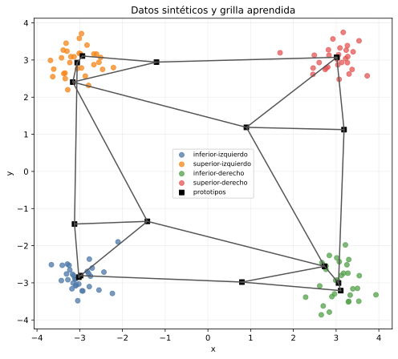
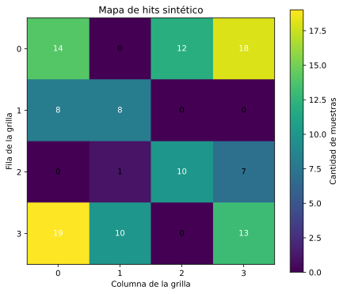
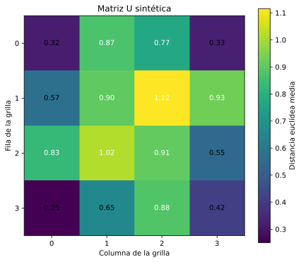

# Validación sintética de Kohonen

**Resultado: APROBADA.**

Se generaron cuatro nubes gaussianas bidimensionales, con 30 muestras por
grupo y centros en los cuatro cuadrantes. Las etiquetas se usan únicamente
para verificar la implementación; no participan del entrenamiento.

## Configuración

- Grilla: `4 x 4`.
- Épocas: `150`.
- Tasa: `0.5` → `0.05`.
- Radio: `4.24264` → `1`.
- Inicialización: `sample`.
- Semilla de Kohonen: `7`.

## Comprobaciones

| Comprobación | Resultado |
| --- | ---: |
| Todas las muestras tienen BMU | True (120/120) |
| Misma semilla reproduce los pesos | True |
| Pesos y matriz U finitos | True |
| Pureza de las neuronas ocupadas | 1.000 |
| Distancia media dentro del mismo grupo | 0.645 |
| Distancia media entre grupos | 2.802 |
| Máximo error entre un centro y su prototipo más cercano | 0.153 |

La pureza sólo se usa en este caso porque conocemos las etiquetas verdaderas.
No será una métrica disponible para seleccionar la red sobre los creadores. La
separación se considera recuperada cuando la pureza es al menos 0,95, las
muestras del mismo grupo quedan más cerca en la grilla que las de grupos
distintos y cada centro tiene un prototipo a distancia máxima 1.

## Conclusión

El caso controlado confirma que la
implementación asigna las muestras de forma reproducible y recupera una
estructura conocida antes de aplicarla al dataset real. Los valores completos
están en `generated/metricas.csv`, `generated/muestras.csv` y
`generated/prototipos.csv`.
