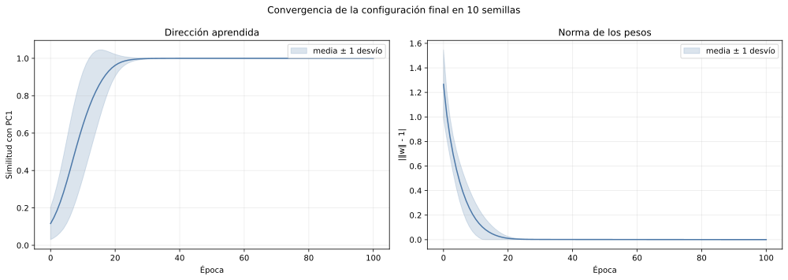
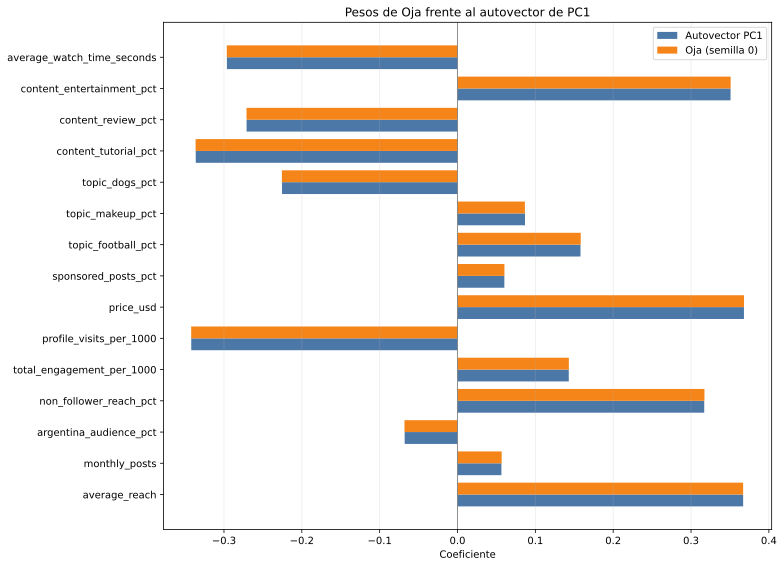
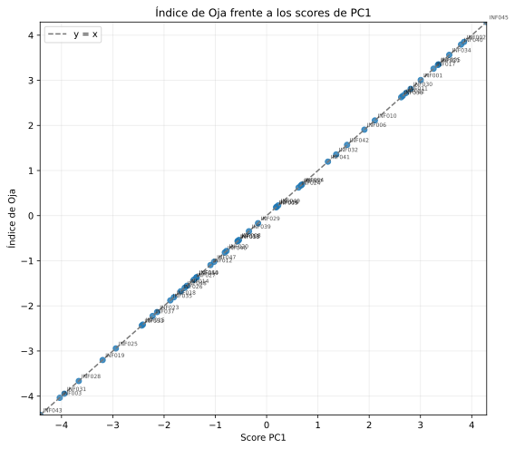
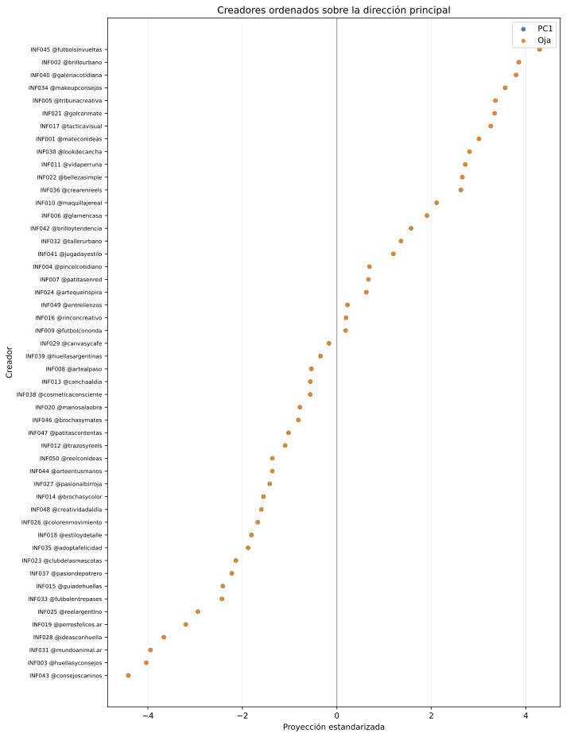

# Índice de creadores mediante la regla de Oja

## Configuración final

- Variables: las mismas 15 entradas y el mismo orden que PCA.
- Estandarización: z-score muestral mediante `Standardizer`.
- Tasa: descenso lineal de `0.001` a `0.0001`.
- Épocas: **100**.
- Orden: barajado reproducible por época.
- Estabilidad: 10 semillas (0, 1, 2, 3, 4, 5, 6, 7, 8, 9).

La corrida representativa es la semilla **0**, elegida por
ser la más cercana a las medianas de similitud, correlación y error de norma.
No se eligió la semilla con el mejor resultado.

## Convergencia y comparación con PCA

| Evidencia en 10 semillas | Media | Desvío | Mínimo | Máximo |
| --- | ---: | ---: | ---: | ---: |
| Similitud de dirección | 0.999999847 | 0.000000099 | 0.999999638 | 0.999999935 |
| Correlación índice-PC1 | 0.999999962 | 0.000000029 | 0.999999896 | 0.999999989 |
| Error de norma | 0.000446147 | 0.000000083 | 0.000445980 | 0.000446268 |

Oja converge a los **coeficientes del autovector** de PC1. No debe compararse
con la tabla de cargas de PCA, porque las cargas incorporan además la raíz del
autovalor. Después de alinear el signo, la máxima diferencia absoluta entre un
peso representativo de Oja y el autovector es
0.000341.

El índice se calcula para cada creador como `Z @ w_Oja`. Su correlación con los
scores de PC1 en la corrida representativa es
0.999999962; la diferencia absoluta máxima entre
ambas proyecciones es 0.002905.

## ¿Qué representa este índice?

Es la posición de cada creador sobre la dirección de **máxima variabilidad** de
las 15 variables estandarizadas. Resume principalmente la oposición ya
identificada en PC1: valores altos se asocian con mayor alcance, precio,
descubrimiento por no seguidores y entretenimiento; valores bajos se asocian
con más visitas al perfil, tutoriales, reviews, tiempo de reproducción y
contenido de perros.

No representa ventas, adopciones, retorno de inversión ni calidad general. Es
un resumen descriptivo no supervisado. PC1 explica 37.63 %
de la varianza: usar solamente el índice deja fuera el 62.37 %
restante y los ejes temáticos más específicos de otras componentes.

## ¿Cómo se puede interpretar?

El signo se alineó con la orientación usada en el informe de PCA para facilitar
la comparación, pero podría invertirse sin cambiar la solución. Por eso
“positivo” no significa “bueno” y “negativo” no significa “malo”. Los extremos
describen dos perfiles opuestos y los valores cercanos a cero, perfiles menos
extremos respecto de este eje.

Mayores índices de la corrida representativa:

| ID | Creador | Índice Oja |
| --- | --- | ---: |
| INF045 | @futbolsinvueltas | +4.2916 |
| INF002 | @brillourbano | +3.8510 |
| INF040 | @galeriacotidiana | +3.7922 |
| INF034 | @makeupconsejos | +3.5641 |
| INF005 | @tribunacreativa | +3.3547 |

Menores índices:

| ID | Creador | Índice Oja |
| --- | --- | ---: |
| INF043 | @consejoscaninos | -4.4173 |
| INF003 | @huellasyconsejos | -4.0369 |
| INF031 | @mundoanimal.ar | -3.9469 |
| INF028 | @ideasconhuella | -3.6650 |
| INF019 | @perrosfelices.ar | -3.1999 |

## ¿Sería correcto elegir automáticamente el valor más alto?

**No.** El máximo identifica al creador más extremo en la dirección positiva de
PC1, no al mejor para cualquier campaña. En este caso, precio tiene una de las
cargas positivas más importantes: un índice alto puede implicar también mayor
costo. Además, una campaña de perros, fútbol, belleza o arte necesita afinidad
temática y un formato adecuado; una única proyección no conserva toda esa
información ni incorpora un resultado supervisado de ventas o adopciones.

El índice sirve para ordenar y comparar creadores sobre el eje general de
escala/descubrimiento frente a profundidad/interés. La decisión final debe
combinarlo con la región de Kohonen, los ejes temáticos, audiencia argentina,
objetivo de la campaña, costo y saturación comercial. Elegir siempre el máximo
convertiría una descripción de variabilidad en una función de utilidad que el
modelo nunca aprendió.

## Archivos generados

- `generated/metricas_semillas.csv`: estabilidad y corrida representativa;
- `generated/pesos_comparados.csv`: pesos de Oja y autovector de PC1;
- `generated/indices.csv`: índice, score y posiciones de cada creador;
- cuatro SVG para convergencia, pesos y proyecciones.
