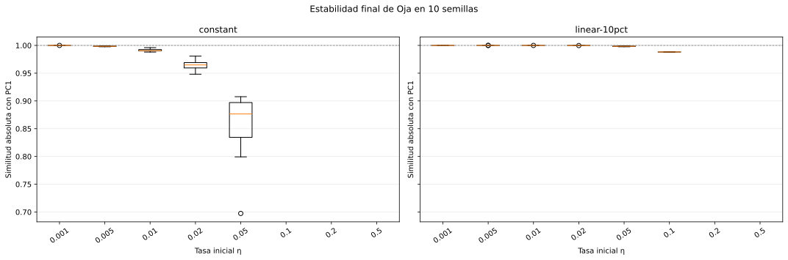
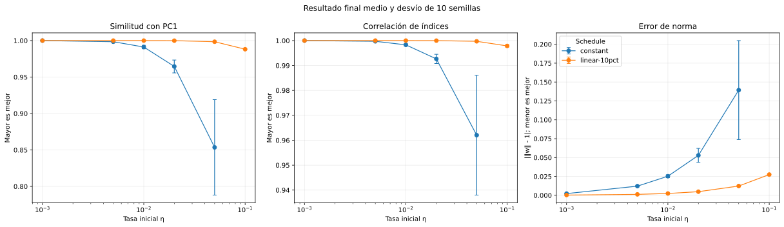
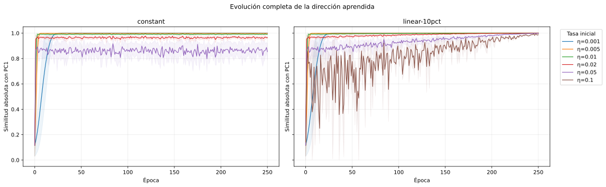

# Oja: etapa 1 - tasa de aprendizaje

## Protocolo

- Datos: las 15 variables base de `docs/decisiones.md`.
- Preprocesamiento: el mismo z-score muestral (`ddof=1`) que PCA.
- Épocas fijas: **250**.
- Tasas iniciales: `0.001`, `0.005`, `0.01`, `0.02`, `0.05`, `0.1`, `0.2`, `0.5`.
- Schedules: tasa constante y descenso lineal hasta el 10 %.
- Semillas: 0, 1, 2, 3, 4, 5, 6, 7, 8, 9 (10 por configuración).
- Orden: barajado en cada época mediante el generador de cada semilla.
- Total: **160 corridas**.

PC1 se calcula sólo como referencia de evaluación. Su primer autovalor es
5.644207 y explica 37.63 %
de la varianza. No interviene en las actualizaciones de Oja.

## Resultados finales

| Schedule | η inicial | Exitosas | Similitud con PC1 | Correlación de índices | Error de norma |
| --- | ---: | ---: | ---: | ---: | ---: |
| constant | 0.001 | 10/10 | 0.999987 ± 0.000006 | 0.999998 ± 0.000001 | 0.002321 ± 0.000008 |
| constant | 0.005 | 10/10 | 0.998426 ± 0.000556 | 0.999706 ± 0.000109 | 0.012166 ± 0.000442 |
| constant | 0.01 | 10/10 | 0.991158 ± 0.002409 | 0.998287 ± 0.000473 | 0.025320 ± 0.001958 |
| constant | 0.02 | 10/10 | 0.964531 ± 0.008803 | 0.992649 ± 0.001855 | 0.052919 ± 0.009251 |
| constant | 0.05 | 10/10 | 0.853580 ± 0.065434 | 0.962036 ± 0.024045 | 0.139332 ± 0.065540 |
| constant | 0.1 | 0/10 | sin corridas convergentes | sin corridas convergentes | sin corridas convergentes |
| constant | 0.2 | 0/10 | sin corridas convergentes | sin corridas convergentes | sin corridas convergentes |
| constant | 0.5 | 0/10 | sin corridas convergentes | sin corridas convergentes | sin corridas convergentes |
| linear-10pct | 0.001 | 10/10 | 1.000000 ± 0.000000 | 1.000000 ± 0.000000 | 0.000337 ± 0.000000 |
| linear-10pct | 0.005 | 10/10 | 0.999999 ± 0.000001 | 1.000000 ± 0.000000 | 0.001288 ± 0.000002 |
| linear-10pct | 0.01 | 10/10 | 0.999988 ± 0.000005 | 0.999998 ± 0.000001 | 0.002462 ± 0.000008 |
| linear-10pct | 0.02 | 10/10 | 0.999888 ± 0.000053 | 0.999979 ± 0.000012 | 0.004846 ± 0.000044 |
| linear-10pct | 0.05 | 10/10 | 0.998425 ± 0.000559 | 0.999706 ± 0.000109 | 0.012315 ± 0.000440 |
| linear-10pct | 0.1 | 2/10 | 0.988158 ± 0.000342 | 0.997860 ± 0.000485 | 0.027494 ± 0.000563 |
| linear-10pct | 0.2 | 0/10 | sin corridas convergentes | sin corridas convergentes | sin corridas convergentes |
| linear-10pct | 0.5 | 0/10 | sin corridas convergentes | sin corridas convergentes | sin corridas convergentes |

La similitud es el coseno absoluto entre el peso de Oja y el autovector de PC1,
por lo que trata como equivalentes ambos signos. La correlación se calcula luego
de alinear el signo. El error de norma es `abs(||w|| - 1)`.

Los boxplots comparan las semillas sin conectarlas como si fueran una serie
temporal.

Cada punto es el promedio de las semillas y sus barras muestran un desvío
estándar. Las configuraciones divergentes permanecen contabilizadas en las
tablas y no se convierten en resultados numéricos artificiales.

## Lectura y recorte para la etapa 2

No aparece un máximo interior seguido por una caída: con 250 épocas, la menor
tasa evaluada ya alcanza el techo de la similitud y la calidad empeora al
aumentar `eta`. Esto no deja un extremo del rango sin explicar. `eta = 0.001`
ya supera 0.99999 alrededor de la época 50; probar tasas todavía menores sólo
evaluaría una convergencia más lenta hacia una métrica que no puede superar 1.

Las tasas constantes entre 0.005 y 0.05 permanecen finitas, pero terminan con
menor similitud, mayor dispersión y una norma más alejada de 1. Las constantes
desde 0.1 divergen en las 10 semillas. El descenso lineal estabiliza tasas de
hasta 0.05, pero con 0.1 sólo convergen 2 de 10 semillas, y desde 0.2 divergen
todas. Por lo tanto, el schedule ayuda a reducir la oscilación final, pero no
rescata de forma confiable una tasa inicial excesiva.

Se proponen tres finalistas para estudiar épocas:

| Schedule | η inicial | Época 5 | Época 25 | Época 50 | Época 100 | Época 250 | Motivo |
| --- | ---: | ---: | ---: | ---: | ---: | ---: | --- |
| linear-10pct | 0.001 | 0.344265 | 0.996616 | 0.999993 | 0.999995 | 1.000000 | mayor precisión y menor error de norma |
| linear-10pct | 0.005 | 0.994964 | 0.998874 | 0.999249 | 0.999656 | 0.999999 | convergencia temprana con precisión final casi perfecta |
| constant | 0.001 | 0.347054 | 0.997924 | 0.999988 | 0.999985 | 0.999987 | control estable para aislar el efecto del schedule |

El descenso con `eta = 0.001` representa la mejor aproximación final; el
descenso con `eta = 0.005` permite estudiar si se puede llegar antes a una
solución equivalente; y la constante `eta = 0.001` funciona como control para
medir si el descenso aporta una mejora material.

Se muestra la trayectoria completa antes de considerar cualquier ampliación de
las últimas épocas. La elección de finalistas para el barrido de épocas debe
considerar conjuntamente nivel final, velocidad, dispersión y divergencias; no
se cierra automáticamente en este informe.

## Archivos generados

- `generated/corridas.csv`: resultado final de cada corrida;
- `generated/resumen_tasas.csv`: agregados por tasa y schedule;
- `generated/evolucion_agregada.csv`: media, desvío y extremos por época;
- tres SVG comparativos, sin imágenes redundantes por semilla.
