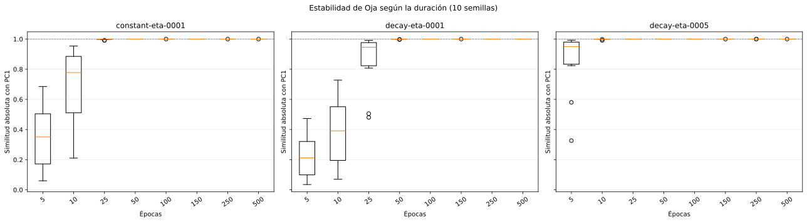
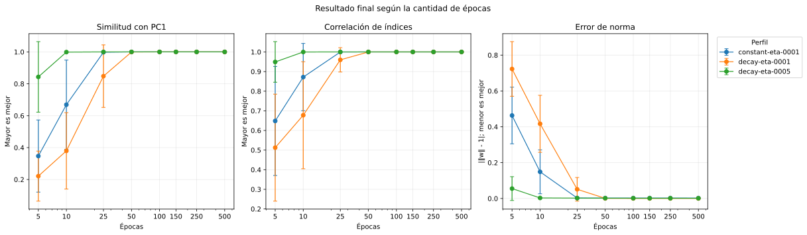

# Oja: etapa 2 - cantidad de épocas

## Protocolo

- Datos y z-score: los mismos 15 atributos y `Standardizer` que PCA.
- Duraciones: `5`, `10`, `25`, `50`, `100`, `150`, `250`, `500` épocas.
- Semillas: 0, 1, 2, 3, 4, 5, 6, 7, 8, 9 (10 por combinación).
- Orden: barajado reproducible en cada época.
- Total: **240 corridas independientes**.

Perfiles provenientes de la etapa 1:

- `decay-eta-0001`: `0.001` -> `0.0001`.
- `decay-eta-0005`: `0.005` -> `0.0005`.
- `constant-eta-0001`: `0.001` -> `0.001`.

Cada duración se entrena desde cero. Esto es necesario porque en los perfiles
decrecientes la pendiente depende de la cantidad total de épocas.

PC1 explica 37.63 % de la varianza y se
usa sólo como referencia de evaluación.

## Resultados

| Perfil | Épocas | Exitosas | Similitud con PC1 | Correlación de índices | Error de norma |
| --- | ---: | ---: | ---: | ---: | ---: |
| constant-eta-0001 | 5 | 10/10 | 0.347054 ± 0.226234 | 0.648377 ± 0.277741 | 0.463167 ± 0.158089 |
| constant-eta-0001 | 10 | 10/10 | 0.668981 ± 0.279702 | 0.871798 ± 0.171537 | 0.148677 ± 0.122414 |
| constant-eta-0001 | 25 | 10/10 | 0.997924 ± 0.003308 | 0.999593 ± 0.000623 | 0.002575 ± 0.000447 |
| constant-eta-0001 | 50 | 10/10 | 0.999988 ± 0.000006 | 0.999998 ± 0.000001 | 0.002313 ± 0.000007 |
| constant-eta-0001 | 100 | 10/10 | 0.999985 ± 0.000006 | 0.999997 ± 0.000001 | 0.002310 ± 0.000012 |
| constant-eta-0001 | 150 | 10/10 | 0.999990 ± 0.000005 | 0.999998 ± 0.000001 | 0.002312 ± 0.000009 |
| constant-eta-0001 | 250 | 10/10 | 0.999987 ± 0.000006 | 0.999998 ± 0.000001 | 0.002321 ± 0.000008 |
| constant-eta-0001 | 500 | 10/10 | 0.999989 ± 0.000009 | 0.999998 ± 0.000002 | 0.002314 ± 0.000017 |
| decay-eta-0001 | 5 | 10/10 | 0.221190 ± 0.156806 | 0.512415 ± 0.272517 | 0.722734 ± 0.152349 |
| decay-eta-0001 | 10 | 10/10 | 0.379518 ± 0.239432 | 0.677611 ± 0.272638 | 0.416728 ± 0.159048 |
| decay-eta-0001 | 25 | 10/10 | 0.847991 ± 0.195978 | 0.959741 ± 0.061970 | 0.051235 ± 0.066003 |
| decay-eta-0001 | 50 | 10/10 | 0.999320 ± 0.001061 | 0.999857 ± 0.000210 | 0.000647 ± 0.000113 |
| decay-eta-0001 | 100 | 10/10 | 1.000000 ± 0.000000 | 1.000000 ± 0.000000 | 0.000446 ± 0.000000 |
| decay-eta-0001 | 150 | 10/10 | 1.000000 ± 0.000000 | 1.000000 ± 0.000000 | 0.000390 ± 0.000000 |
| decay-eta-0001 | 250 | 10/10 | 1.000000 ± 0.000000 | 1.000000 ± 0.000000 | 0.000337 ± 0.000000 |
| decay-eta-0001 | 500 | 10/10 | 1.000000 ± 0.000000 | 1.000000 ± 0.000000 | 0.000291 ± 0.000000 |
| decay-eta-0005 | 5 | 10/10 | 0.843167 ± 0.221064 | 0.949004 ± 0.103347 | 0.055256 ± 0.066294 |
| decay-eta-0005 | 10 | 10/10 | 0.998816 ± 0.002725 | 0.999750 ± 0.000574 | 0.003040 ± 0.000265 |
| decay-eta-0005 | 25 | 10/10 | 0.999993 ± 0.000004 | 0.999999 ± 0.000001 | 0.002072 ± 0.000004 |
| decay-eta-0005 | 50 | 10/10 | 0.999996 ± 0.000003 | 0.999999 ± 0.000001 | 0.001694 ± 0.000003 |
| decay-eta-0005 | 100 | 10/10 | 0.999997 ± 0.000001 | 0.999999 ± 0.000000 | 0.001455 ± 0.000002 |
| decay-eta-0005 | 150 | 10/10 | 0.999998 ± 0.000001 | 1.000000 ± 0.000000 | 0.001366 ± 0.000002 |
| decay-eta-0005 | 250 | 10/10 | 0.999999 ± 0.000001 | 1.000000 ± 0.000000 | 0.001288 ± 0.000002 |
| decay-eta-0005 | 500 | 10/10 | 0.999998 ± 0.000002 | 1.000000 ± 0.000000 | 0.001223 ± 0.000003 |

Cada caja resume 10 semillas. Las semillas no se conectan entre sí porque no
constituyen una secuencia temporal.

Los puntos representan promedios y las barras un desvío estándar. La elección
final debe buscar el comienzo de una meseta estable, no el mayor decimal de una
corrida aislada.

## Decisión

Se elige **`decay-eta-0001` con 100 épocas**, es decir, un descenso lineal de
`0.001` a `0.0001`. En las 10 semillas obtuvo una similitud media de
0.999999847, con mínimo
0.999999638, y una correlación media entre el
índice de Oja y PC1 de 0.999999962. El error medio
de norma fue 0.000446147.

Las 50 épocas todavía muestran una peor semilla de 0.997114, mientras que a las
100 todas superan 0.9999996. Extender el mismo perfil de 100 a 500 épocas mejora
la similitud media sólo 1.24e-07 y reduce el error de norma en
0.000156. Esa diferencia no justifica multiplicar por cinco
el entrenamiento.

El perfil `decay-eta-0005` converge antes, pero mantiene una norma más alejada
de 1. La tasa constante `0.001` entra en una meseta desde 50 épocas, aunque su
error de norma permanece alrededor de 0.00231, frente a 0.00045 para la opción
elegida. La decisión se apoya así en estabilidad, dirección, proyecciones y
norma, no en el mejor valor de una semilla aislada.

## Archivos generados

- `generated/corridas.csv`: las 240 corridas individuales;
- `generated/resumen_epocas.csv`: promedios, desvíos, medianas y extremos;
- dos SVG comparativos, sin gráficos redundantes por semilla.
