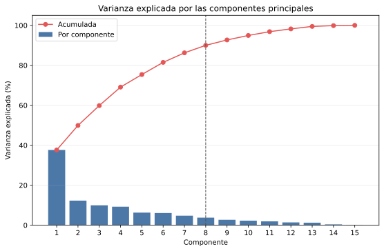
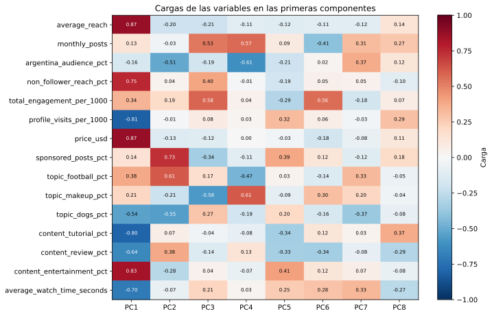
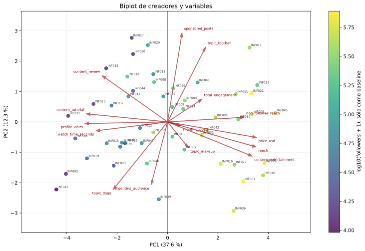

# PCA del catálogo de creadores

Este informe aplica PCA a 50 creadores y a las 15
variables base acordadas en `docs/decisiones.md`. Los identificadores, nombres y
`followers` no intervienen en el ajuste. `followers` se usa solamente como
baseline visual en el biplot.

## Procedimiento

1. Se leen las 15 variables en el orden documentado.
2. Se ajusta un z-score por columna con media y desvío muestral (`ddof=1`).
3. Se calcula la covarianza de la matriz estandarizada, equivalente a la matriz
   de correlaciones de las variables originales.
4. Se obtienen y ordenan sus autovalores y autovectores.
5. Se proyecta cada creador sobre todas las componentes.

La orientación de cada autovector se fija haciendo positiva su carga de mayor
magnitud. Esto sólo estabiliza la presentación: invertir simultáneamente cargas
y scores no cambia la solución de PCA.

## Varianza explicada

Según el criterio acordado en clase, el menor número que alcanza al menos
90 % de varianza acumulada es **8 componentes**,
con 90.00 %.
Se adopta este corte porque supera el 80 % y se acerca al 90 % solicitado, sin
conservar automáticamente las 15 componentes.

| Componente | Varianza | Acumulada | Tres cargas de mayor magnitud |
| --- | ---: | ---: | --- |
| PC1 | 37.63 % | 37.63 % | `price_usd` (+0.874), `average_reach` (+0.872), `content_entertainment_pct` (+0.833) |
| PC2 | 12.28 % | 49.90 % | `sponsored_posts_pct` (+0.728), `topic_football_pct` (+0.611), `topic_dogs_pct` (-0.552) |
| PC3 | 9.94 % | 59.85 % | `total_engagement_per_1000` (+0.580), `topic_makeup_pct` (-0.576), `monthly_posts` (+0.529) |
| PC4 | 9.26 % | 69.10 % | `topic_makeup_pct` (+0.613), `argentina_audience_pct` (-0.613), `monthly_posts` (+0.568) |
| PC5 | 6.29 % | 75.39 % | `content_entertainment_pct` (+0.409), `sponsored_posts_pct` (+0.389), `content_tutorial_pct` (-0.337) |
| PC6 | 6.09 % | 81.48 % | `total_engagement_per_1000` (+0.561), `monthly_posts` (-0.412), `content_review_pct` (-0.339) |
| PC7 | 4.77 % | 86.24 % | `argentina_audience_pct` (+0.375), `topic_dogs_pct` (-0.368), `average_watch_time_seconds` (+0.335) |
| PC8 | 3.76 % | 90.00 % | `content_tutorial_pct` (+0.370), `content_review_pct` (-0.294), `profile_visits_per_1000` (+0.292) |

## Cargas e interpretación

Las cargas son correlaciones entre cada variable estandarizada y cada
componente. Valores con magnitud alta son los que más ayudan a interpretar el
eje. El signo indica direcciones opuestas dentro del eje, no que una dirección
sea mejor que la otra.

La tabla anterior permite formular nombres de negocio para las componentes,
pero esos nombres deben revisarse junto con el biplot y las campañas. No se
adopta automáticamente una componente sólo por superar un umbral numérico.

Lectura objetiva de las direcciones con cargas de magnitud al menos 0,45. Si
ninguna carga de un signo alcanza ese valor, se muestra la mayor de ese signo:

- **PC1:** dirección positiva asociada con `price_usd`, `average_reach`, `content_entertainment_pct`, `non_follower_reach_pct`; dirección negativa asociada con `profile_visits_per_1000`, `content_tutorial_pct`, `average_watch_time_seconds`, `content_review_pct`, `topic_dogs_pct`.
- **PC2:** dirección positiva asociada con `sponsored_posts_pct`, `topic_football_pct`; dirección negativa asociada con `topic_dogs_pct`, `argentina_audience_pct`.
- **PC3:** dirección positiva asociada con `total_engagement_per_1000`, `monthly_posts`; dirección negativa asociada con `topic_makeup_pct`.
- **PC4:** dirección positiva asociada con `topic_makeup_pct`, `monthly_posts`; dirección negativa asociada con `argentina_audience_pct`, `topic_football_pct`.
- **PC5:** dirección positiva asociada con `content_entertainment_pct`; dirección negativa asociada con `content_tutorial_pct`.
- **PC6:** dirección positiva asociada con `total_engagement_per_1000`; dirección negativa asociada con `monthly_posts`.
- **PC7:** dirección positiva asociada con `argentina_audience_pct`; dirección negativa asociada con `topic_dogs_pct`.
- **PC8:** dirección positiva asociada con `content_tutorial_pct`; dirección negativa asociada con `content_review_pct`.

PC1 ofrece la oposición más clara: perfiles de mayor escala, costo,
descubrimiento y entretenimiento frente a perfiles de mayor profundidad e
interés posterior. Las componentes siguientes separan ejes temáticos,
comerciales y de actividad más específicos. Las últimas componentes retenidas
son más específicas y tienen cargas más repartidas, pero permiten conservar el
porcentaje de información acordado.

## Proyección de los creadores

El biplot muestra PC1 y PC2, que juntas explican
49.90 % de la varianza. Los puntos
cercanos tienen perfiles parecidos sólo respecto de este plano. Las flechas
representan las cargas y fueron reescaladas únicamente para poder dibujarlas
junto con los scores. El color usa `followers` como referencia externa y no
afecta PCA.

## Decisión adoptada

Se conservan **8 componentes**, que reúnen
**90.00 %** de la
varianza. La comparación de engagement confirmó además las 15 variables base.
Esta reducción describe la representación PCA: Kohonen y Oja reciben las 15
variables estandarizadas, y Oja se compara específicamente con PC1.

## Archivos generados

- `generated/varianza_explicada.csv`: autovalores y proporciones de varianza;
- `generated/cargas.csv`: correlación de cada variable con cada componente;
- `generated/autovectores.csv`: coeficientes de las combinaciones lineales;
- `generated/scores.csv`: proyección de cada creador;
- `generated/estandarizacion.csv`: medias y desvíos reutilizables;
- `generated/varianza_explicada.svg`, `generated/cargas.svg` y
  `generated/biplot.svg`: visualizaciones del análisis.
