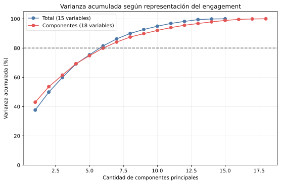
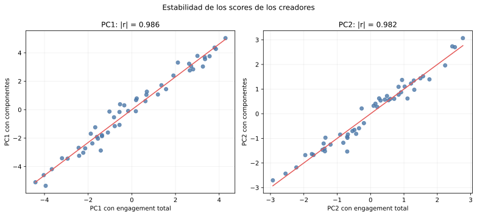

# Comparación de representaciones del engagement

Este experimento compara dos PCA sobre los mismos 50 creadores y con el mismo
z-score por variable:

- **Variante A:** 15 variables y `total_engagement_per_1000`.
- **Variante B:** elimina el total y agrega likes, comentarios, guardados y
  compartidos; contiene 18 variables y se usa sólo como diagnóstico.

No se comparan los porcentajes como si una variante fuera automáticamente
mejor. La variante B otorga cuatro dimensiones al bloque de engagement y, por
eso, cambia el peso relativo de esa familia.

## Resultado general

| Evidencia | Variante A | Variante B |
| --- | ---: | ---: |
| Variables | 15 | 18 |
| Varianza de PC1 | 37.63 % | 42.99 % |
| Varianza acumulada PC1-PC2 | 49.90 % | 53.59 % |
| Componentes para superar 80 % | 6 | 7 |

La variante B necesita 7 componentes para
alcanzar 84.11 %.
La variante A necesita 6 para alcanzar
81.48 %.
Esto no define una ganadora porque parten de 18 y 15 dimensiones distintas.

## Estabilidad de los perfiles

- Correlación absoluta entre scores de PC1: **0.986**.
- Correlación absoluta entre scores de PC2: **0.982**.
- Correlación de distancias en el plano PC1-PC2: **0.965**.
- Correlación de distancias usando las componentes que superan el umbral:
  **0.950**.

Los valores cercanos a 1 indican que los perfiles globales y las relaciones de
proximidad entre creadores cambian poco al separar el engagement. Se usa valor
absoluto para los scores porque el signo de una componente es arbitrario.

## Información adicional de la variante B

| Variable | PC1 | PC2 | PC3 | PC4 | PC5 | PC6 |
| --- | ---: | ---: | ---: | ---: | ---: | ---: |
| `likes_per_1000` | +0.780 | +0.052 | -0.032 | +0.254 | -0.234 | +0.304 |
| `comments_per_1000` | -0.773 | +0.206 | -0.145 | +0.016 | -0.338 | +0.133 |
| `saves_per_1000` | -0.838 | +0.136 | -0.117 | +0.087 | +0.093 | -0.051 |
| `shares_per_1000` | +0.665 | -0.108 | -0.167 | +0.242 | -0.408 | +0.315 |

La variante B muestra una oposición importante en PC1: likes tiene carga
positiva (+0.780)
y guardados tiene carga negativa
(-0.838).
El total no puede mostrar esa composición. Compartidos y comentarios también
aparecen en componentes posteriores, pero esas componentes explican menos
varianza y no alteran mucho la geometría general de los creadores.

En los datos originales, el engagement total correlaciona
+0.725 con likes, +0.025 con
comentarios, -0.068 con guardados y
+0.723 con compartidos. Por eso el total refleja
principalmente la variación de likes y compartidos, mientras que comentarios y
guardados aportan información de composición que conviene conservar como
auxiliar.

El PCA completo de la variante B se encuentra en
`variante-componentes/generated/`, con cargas, scores, autovectores y biplot.

## Recomendación para discutir

La evidencia favorece conservar **engagement total** como entrada principal:

1. mantiene el conjunto en 15 variables, dentro del rango sugerido en clase;
2. PC1, PC2 y las distancias entre creadores permanecen casi iguales;
3. evita que engagement tenga cuatro veces más columnas que otras familias;
4. facilita interpretar Kohonen y Oja.

Los cuatro componentes deben permanecer como variables auxiliares. Sirven para
describir regiones de Kohonen o revisar una campaña que valore específicamente
guardados, comentarios o compartidos. Si una necesidad comercial futura exige
esa distinción, se puede reabrir la selección.

Esta es una recomendación del análisis y queda pendiente de confirmación antes
de fijar las entradas definitivas de Kohonen y Oja.
