# TP5 — Ejercicio 1B: Denoising autoencoder

Este documento cuenta el ejercicio 1B de punta a punta: qué es un denoising
autoencoder, cómo se evaluó, cómo se llegó a la arquitectura elegida y qué tan
bien elimina el ruido. Continúa el ejercicio 1A (`ej1saint.md`).

---

## 1. Qué es un denoising autoencoder

Un **denoising autoencoder (DAE)** es un autoencoder entrenado para **limpiar**
datos. La red y el entrenamiento son los mismos que en el 1A: lo único que
cambia es qué se le da como entrada y qué se le pide como salida.

| | Entrada | Salida esperada |
|---|---|---|
| Autoencoder (1A) | la letra limpia `x` | la misma letra limpia `x` |
| **DAE (1B)** | **la letra con ruido `x̃`** | **la letra limpia `x`** |

En el 1A la red aprendía a **copiar**. En el 1B aprende a **corregir**: recibe
una letra estropeada y tiene que devolver la original.

### El ruido: bit-flip

Las letras son píxeles blancos y negros, así que el ruido natural es el
**bit-flip**: cada píxel se invierte con probabilidad `p`, independientemente de
los demás. Es el ruido "sal y pimienta" de la teórica aplicado a imágenes
binarias. Con `p = 0,10` se invierten en promedio 3,5 de los 35 píxeles; con
`p = 0,30`, unos 10,5.

Ejemplo real con la `a` y `p = 0,10` (3 píxeles invertidos):

```text
 original        con ruido        lo que debería devolver el DAE
  .....            .....            .....
  .###.            .###.            .###.
  ....#            #.#.#   <- 2     ....#
  .##.#            ..#.#   <- 1     .##.#
  #..##            #..##            #..##
  #..##            #..##            #..##
  .##.#            .##.#            .##.#
```

### Por qué funciona

Por el **cuello de botella**. Todo lo que entra tiene que resumirse en pocos
números, y ahí entra "qué letra es y cómo se dibuja", pero no "qué píxeles
sueltos se dieron vuelta". El ruido es aleatorio y no tiene estructura, así que
la red no tiene dónde guardarlo y lo descarta. Es lo que dice la teórica: el
encoder y el decoder "intentan preservar el contenido de información más
relevante".

### Tres reglas del entrenamiento

1. **El objetivo siempre es la letra limpia.** Si se le pidiera devolver la
   versión con ruido, aprendería a copiar el ruido.
2. **Ruido nuevo en cada época.** Así la red no memoriza 32 versiones
   estropeadas fijas, sino que ve miles de variantes de cada letra y aprende la
   regla general.
3. **Se evalúa con ruido que la red nunca vio**, generado con semillas
   independientes de las del entrenamiento.

### El límite natural

Con 32 letras, eliminar ruido es en la práctica **reconocer cuál de las 32 es y
volver a dibujarla limpia**. Si el ruido es tan grande que la `a` estropeada se
parece más a otra letra, la red va a devolver la otra letra, bien dibujada pero
equivocada. Por eso se espera un funcionamiento muy bueno con poco ruido que se
degrade a medida que `p` crece.

---

## 2. Consigna

1. Plantear una arquitectura de red conveniente para esta tarea y explicar la
   elección.
2. Distorsionar las entradas en diferentes niveles y estudiar la capacidad del
   autoencoder de eliminar el ruido.

---

## 3. Cómo se mide

Para cada letra con ruido se registra:

| Métrica | Qué es |
|---|---|
| **Error de entrada** | píxeles distintos entre la letra con ruido y la limpia |
| **Error de salida** | píxeles distintos entre la salida binarizada de la red y la limpia |
| **Mejora** | error de entrada menos error de salida |
| **Recuperación exacta** | porcentaje de casos en que la salida es idéntica a la letra limpia |
| **Casos empeorados** | porcentaje de casos en que la salida tiene más errores que la entrada |

Si el error de salida es menor que el de entrada, la red eliminó ruido.

**Protocolo de evaluación.** Cada modelo se evalúa con **100 corrupciones
distintas de cada una de las 32 letras** (3.200 casos) en cinco niveles:

| `p` | Papel en el estudio |
|---:|---|
| 0 | control: la red no debería estropear letras limpias |
| 0,05 | ruido bajo |
| 0,10 | ruido medio |
| 0,20 | ruido alto |
| 0,30 | ruido extremo, donde la letra empieza a ser irreconocible |

Todos los modelos de una comparación se evalúan sobre exactamente los mismos
casos, así las diferencias se deben al modelo y no a la suerte del sorteo.

---

## 4. Recorrido experimental

### Cómo se decide en cada paso

Se cambió **una cosa por vez**. En cada paso se compararon la opción vigente y
una o más alternativas sobre los mismos casos de evaluación, con estas reglas:

1. **Se mira la curva completa**, los cinco niveles de ruido. Los más
   informativos son `p = 0,10` y `p = 0,20`: con `p = 0,05` casi todas las
   opciones son casi perfectas y `p = 0,30` es un caso extremo.
2. **Dos señales**: el **error de salida** dice cuánto ruido se eliminó; la
   **recuperación exacta**, cuántas letras quedaron perfectas. Si las dos
   coinciden, la decisión es clara; si no, se explica qué se priorizó.
3. **El control limpio (`p = 0`) no puede empeorar**: una red que estropea
   letras sanas no sirve, aunque corrija bien las ruidosas.
4. **Una semilla sirve para descartar; para aceptar hacen falta tres.** Las
   barras de error de los gráficos son el desvío entre semillas.
5. **Ante un empate, la opción más simple** (menos parámetros o menos cómputo).

En los gráficos de cada paso, la izquierda muestra el error de salida (la línea
punteada es el error de la entrada, `35·p`: lo que habría sin DAE) y la derecha
la recuperación exacta. La opción elegida está en azul.

### Paso 0 — Pilotos: la red del 1A con ruido

**Qué se probó.** La red del 1A tal cual (`35-45-2-45-35`, `tanh`, BCE, GD con
tasa 0,1), entrenada con ruido `p = 0,10`. Así el único cambio respecto del 1A
era la tarea. Una semilla, evaluación con `p = 0,10`:

| Épocas | Tasa | Error entrada | Error salida | Recuperación exacta |
|---:|---:|---:|---:|---:|
| 2.000 | 0,10 | 3,47 | 3,58 | 28,1 % |
| 10.000 | 0,10 | 3,47 | 3,28 | 34,0 % |
| 10.000 | **0,03** | 3,47 | **1,30** | **70,5 %** |

**Qué se observó.** Con 2.000 épocas la red **empeoraba** las letras: la salida
tenía más errores que la entrada. Quintuplicar las épocas ayudó poco. Bajar la
tasa a 0,03 redujo el error de salida a la tercera parte.

**Por qué.** En el 1A la entrada era siempre la misma y el gradiente no cambiaba
entre épocas. Con ruido, cada época ve letras distintas y el gradiente varía;
con pasos grandes la red salta de un lado a otro sin asentarse.

### Paso 1 — Tasa de aprendizaje

**Qué se probó.** Para no quedarse con 0,03 por casualidad, se compararon 0,01,
0,03 y 0,05 con la misma semilla y los mismos casos.

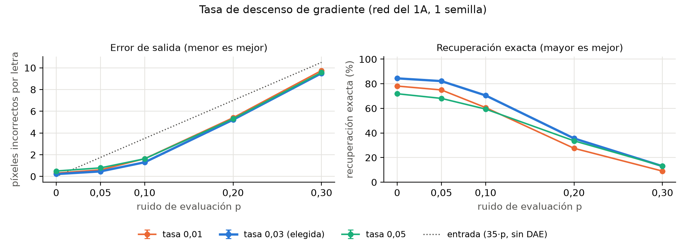

**Decisión: 0,03.** Tiene el menor error de salida en los cinco niveles y la
mayor recuperación exacta hasta `p = 0,20` (con `p = 0,10`: 70,5 % contra
60,6 % con 0,01 y 59,4 % con 0,05). Con 0,01 aprende demasiado lento para
10.000 épocas; con 0,05 vuelve a aparecer la inestabilidad. Se confirmó con 3
semillas: 73,4 ± 2,6 % de recuperación exacta con `p = 0,10`.

### Paso 2 — Corrupciones por letra en cada época

**Qué se probó.** Hasta acá cada época veía 1 versión con ruido de cada letra
(`K = 1`). La hipótesis: con 4 versiones (`K = 4`) el gradiente sería un
promedio más estable.

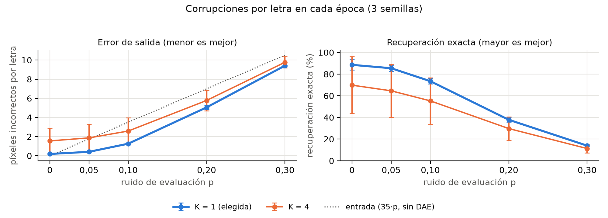

**Decisión: se mantiene `K = 1`.** `K = 4` fue peor en todos los niveles y mucho
más variable: con `p = 0,10`, 2,58 ± 1,39 errores de salida contra 1,26 ± 0,04
(el desvío se multiplicó por más de 30) y 55,3 % de recuperación exacta contra
73,4 %. Además cuesta cuatro veces más ejemplos por época.

### Paso 3 — Arquitectura

**Qué se probó.** La red del 1A se eligió para reconstruir letras limpias con
latente 2, no para limpiar ruido. Se compararon tres redes con el mismo
entrenamiento:

| Arquitectura | Capas | Parámetros | Hipótesis |
|---|---|---:|---|
| Base (la del 1A) | `35-45-2-45-35` | 3.457 | punto de partida |
| Ancha | `35-60-2-60-35` | 4.597 | más capacidad en una sola capa |
| Profunda | `35-45-15-2-15-45-35` | 4.717 | comprimir en dos pasos |

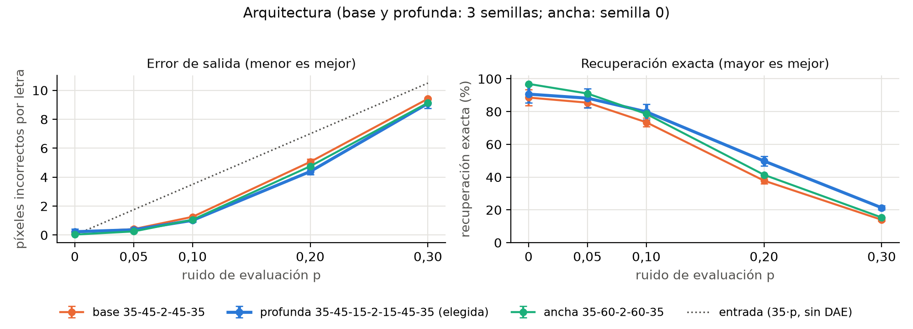

**Decisión: la profunda.** Con la semilla 0 las dos alternativas superaron a la
base. La ancha fue un poco mejor sin ruido y con `p = 0,05`, pero desde
`p = 0,10` la profunda fue claramente mejor (82,8 % contra 78,6 % con
`p = 0,10`; 52,2 % contra 41,4 % con `p = 0,20`). Como el objetivo es limpiar
ruido, pasó la profunda a 3 semillas, donde superó a la base en todos los
niveles con ruido: con `p = 0,10`, de 73,4 % a 79,9 %; con `p = 0,20`, de
37,8 % a 49,8 %.

La ancha y la profunda tienen casi la misma cantidad de parámetros. Que gane la
profunda indica que importa **cómo** se comprime, no solo cuántos pesos hay: con
una capa intermedia de 15, la red tiene un paso más para separar "qué letra es"
de "qué es ruido".

### Paso 4 — Mezclar letras limpias con letras con ruido

**Qué se probó.** La red profunda todavía estropeaba algunas letras **limpias**
(90,6 % exactas con `p = 0`). La razón: con `p = 0,10`, la probabilidad de que
una corrupción no cambie ningún píxel es `0,9^35 ≈ 2,5 %`, así que la red casi
nunca veía una letra intacta. Se cambió el lote de cada época a 32 letras
limpias más 32 con ruido nuevo, todas con la letra limpia como objetivo.

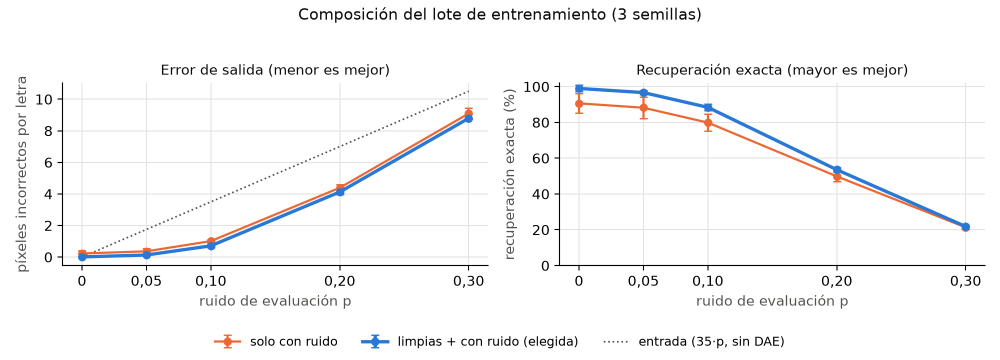

**Decisión: lote mixto.** Mejoró los cinco niveles y redujo la variabilidad.
Con `p = 0` pasó de 90,6 % a 99,0 % de recuperación exacta (el control dejó de
empeorar), y con `p = 0,10`, de 79,9 % a 88,4 %.

### Paso 5 — Tasa decreciente

**Qué se probó.** Que la tasa bajara de forma exponencial de 0,03 a 0,003 a lo
largo de las 10.000 épocas: pasos grandes al principio para avanzar, pasos
chicos al final para asentarse.

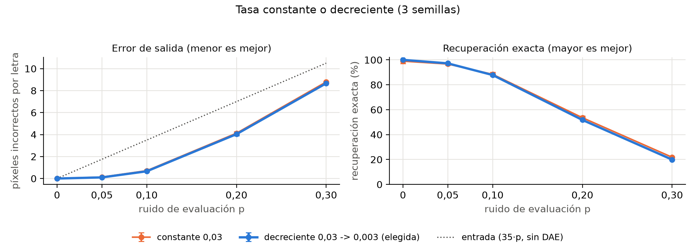

**Decisión: tasa decreciente, por estabilidad.** Es la decisión con menos
diferencia visible: las curvas medias casi se superponen. El error de salida
bajó un poco en los cinco niveles (con `p = 0,10`, de 0,713 a 0,659) y la
recuperación exacta quedó prácticamente igual (88,4 % contra 87,8 %). Lo que
cambió fue la **variabilidad entre semillas**: con `p = 0,10`, el desvío del
error bajó de 0,112 a 0,002 píxeles, es decir, el resultado dejó de depender de
la inicialización. Esa estabilidad fue el motivo de la elección.

### Paso 6 — Dimensión del espacio latente

**Qué se probó.** El latente de 2 dimensiones es una exigencia del 1A, no del
1B. Se probó un cuello de 5, que da más espacio para separar las 32 letras y sus
variantes con ruido. Agrega solo 93 parámetros (2 %).

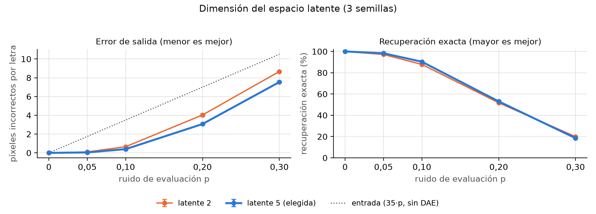

**Decisión: latente 5.** Redujo el error de salida en todos los niveles: con
`p = 0,10`, de 0,66 a 0,40; con `p = 0,20`, de 4,04 a 3,07. La recuperación
exacta subió hasta `p = 0,20` (con `p = 0,10`, de 87,8 % a 90,4 %). Con
`p = 0,30` bajó un poco (19,9 % contra 18,5 %), pero con 1,1 píxeles menos de
error por letra y menos casos empeorados. El costo es mínimo.

### Paso 7 — Niveles de ruido en el entrenamiento

**Qué se probó.** Hasta acá se entrenaba solo con `p = 0,10`. Para cubrir la
curva entera se cambió el lote a: letras limpias, más una versión con
`p = 0,05`, otra con `p = 0,10` y otra con `p = 0,20`. No se incluyó `0,30` para
no entrenar con letras que ya son casi irreconocibles (esto se revisa en la
sección 8).

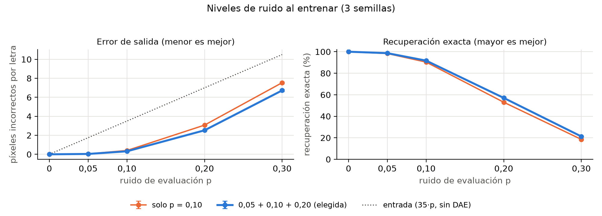

**Decisión: entrenamiento multinivel.** Mejoró los cinco niveles, **incluido
`p = 0,30`, que no se usó para entrenar**. Con `p = 0,20` el error bajó de 3,07
a 2,53 y la recuperación exacta subió de 53,0 % a 57,1 %. El costo es el doble
de ejemplos por época (128 en lugar de 64).

### Paso 8 — Activación de las capas ocultas

**Qué se probó.** Reemplazar `tanh` por Leaky ReLU en las capas ocultas:

```text
f(h) = h        si h >= 0
       0,01 h   si h < 0
```

La hipótesis: `tanh` se satura para valores grandes (el mismo problema de
gradientes chicos que se discutió en el 1A con la sigmoide); Leaky ReLU no se
satura del lado positivo y conserva un gradiente pequeño del lado negativo.

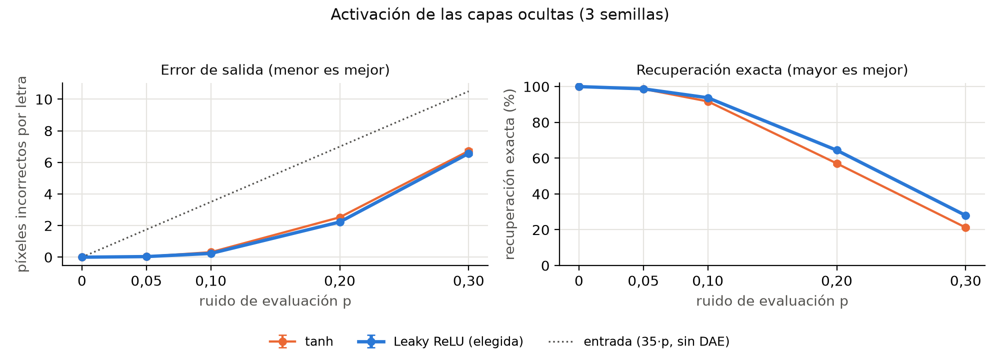

**Decisión: Leaky ReLU.** Empató con `p = 0` y `p = 0,05` y mejoró los tres
niveles altos: con `p = 0,10`, de 91,7 % a 93,8 %; con `p = 0,20`, de 57,1 % a
64,4 %; con `p = 0,30`, de 21,2 % a 28,0 %.

### Paso 9 — Optimizador

**Qué se probó.** En el DAE el gradiente cambia en cada época por el ruido. Adam
adapta el tamaño del paso de cada peso según cómo vienen variando sus
gradientes, así que podía manejar mejor esa variación. Se comparó el descenso
con tasa decreciente contra Adam con tasas 0,001 y 0,003, con una semilla.

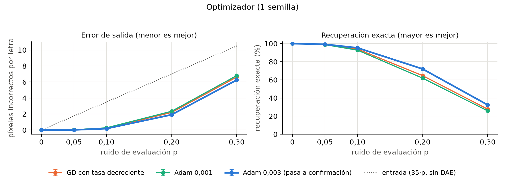

**Resultado.** Adam 0,001 quedó por debajo del descenso de gradiente; Adam 0,003
lo superó en todos los niveles (con `p = 0,20`, 72,0 % contra 64,7 %). Adam
0,003 pasó a la elección de tasa.

### Paso 10 — Tasa de Adam

**Qué se probó.** Con una semilla se compararon 0,001, 0,002, 0,003 y 0,005.
La recuperación mejoró a medida que subía la tasa (con `p = 0,20`: 61,9 %,
67,3 %, 72,0 % y 74,5 %). Las dos mejores, 0,003 y 0,005, se compararon con 3
semillas.

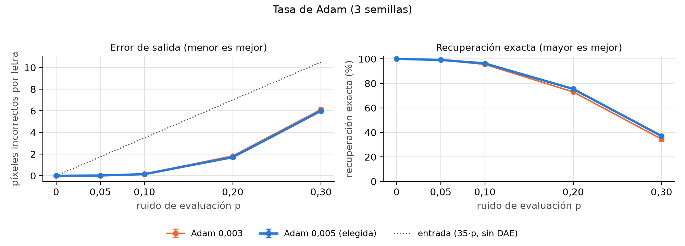

**Decisión: Adam 0,005.** Empató con `p = 0,05` y fue mejor en los tres niveles
altos, con barras de error que no se superponen: con `p = 0,10`, 96,3 ± 0,3 %
contra 95,6 ± 0,4 %; con `p = 0,20`, 75,5 ± 0,9 % contra 73,1 ± 1,0 %; con
`p = 0,30`, 37,1 ± 1,5 % contra 34,6 ± 1,7 %.

---

## 5. Modelo final

| Hiperparámetro | Valor |
|---|---|
| Arquitectura | `35 -> 45 -> 15 -> 5 -> 15 -> 45 -> 35` (4.810 parámetros) |
| Activaciones | Leaky ReLU (pendiente 0,01) en las ocultas, lineal en el latente, logística en la salida |
| Pérdida | BCE |
| Optimizador | Adam, tasa 0,005 (`beta1 = 0,9`, `beta2 = 0,999`) |
| Lote por época | 32 limpias + 32 con `p = 0,05` + 32 con `p = 0,10` + 32 con `p = 0,20`, ruido nuevo en cada época |
| Entrenamiento | 10.000 épocas |

**Por qué esta arquitectura (consigna 1B.1):** cada elemento salió de una
comparación de la sección 4.

- **Profunda** (45 -> 15 -> 5), paso 3: con casi los mismos parámetros que una
  red ancha de una sola capa, comprimir en dos pasos limpia mejor el ruido.
- **Latente 5** en lugar de 2, paso 6: el 1B no exige poder graficar el latente,
  y más dimensiones dan lugar para que las versiones con ruido de cada letra no
  se mezclen con las de otras.
- **Leaky ReLU**, paso 8: mejora la recuperación con ruido alto respecto de
  `tanh`.
- **Entrenamiento con letras limpias y varios niveles de ruido**, pasos 4 y 7:
  la red no estropea lo que ya está bien y corrige tanto ruido leve como fuerte.
- **Adam 0,005**, pasos 9 y 10: maneja mejor que el descenso de gradiente un
  gradiente que cambia en cada época por el ruido.

---

## 6. Resultados: cuánto ruido elimina

La configuración final se entrenó con **10 semillas** sin volver a ajustar nada.
Cada modelo se evaluó con 3.200 casos por nivel: 32.000 casos por nivel en
total.

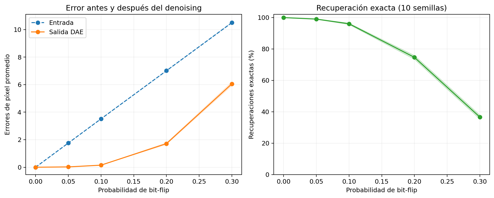

La izquierda muestra cuántos píxeles mal tiene la entrada (azul) y cuántos la
salida (naranja). La derecha, el porcentaje de letras recuperadas exactamente.
Las bandas sombreadas son el desvío entre semillas; son tan finas que casi no se
ven.

| `p` | Error de entrada | Error de salida | Recuperación exacta | Casos empeorados |
|---:|---:|---:|---:|---:|
| 0 | 0 | 0,000 ± 0,000 | 100,00 ± 0,00 % | 0,00 % |
| 0,05 | 1,76 | 0,024 ± 0,004 | 99,06 ± 0,14 % | 0,20 % |
| 0,10 | 3,51 | 0,151 ± 0,018 | 96,06 ± 0,47 % | 0,68 % |
| 0,20 | 7,01 | 1,715 ± 0,082 | 74,65 ± 1,24 % | 5,94 % |
| 0,30 | 10,51 | 6,059 ± 0,158 | 36,58 ± 1,31 % | 16,93 % |

Hay tres regímenes:

- **Hasta `p = 0,10`, funciona muy bien.** El error baja de 3,5 a 0,15 píxeles
  y el 96 % de las letras sale perfecta. Las letras limpias nunca se estropean.
- **Con `p = 0,20`, funciona pero con fallas.** El error baja de 7 a 1,7
  píxeles y el 75 % sale perfecta. Casi siempre mejora la letra, aunque no
  siempre la deja completa.
- **Con `p = 0,30`, solo ayuda en promedio.** El error baja de 10,5 a 6 píxeles,
  pero solo el 37 % sale perfecta y el 17 % de los casos termina peor que como
  entró. Con un tercio de los píxeles invertidos, muchas letras ya se parecen más
  a otra que a la original.

**Una referencia útil.** Con `p = 0,10`, un clasificador ideal que comparara la
letra con ruido contra las 32 originales y eligiera la más parecida acertaría
alrededor del 98 %: algunas corrupciones quedan más cerca de otra letra, o
empatadas. El DAE, con 96 %, está cerca de ese techo.

### Casos representativos

Para no elegir ejemplos favorables a ojo, las categorías se definieron antes de
mirar las imágenes:

- **Fácil** (`p = 0,10`): una letra que termina perfecta; entre esas, la que
  entró con más píxeles alterados.
- **Difícil** (`p = 0,20`): mejora pero no llega a perfecta; un caso típico.
- **Fallido** (`p = 0,30`): la salida tiene más errores que la entrada; un caso
  típico, no el peor.

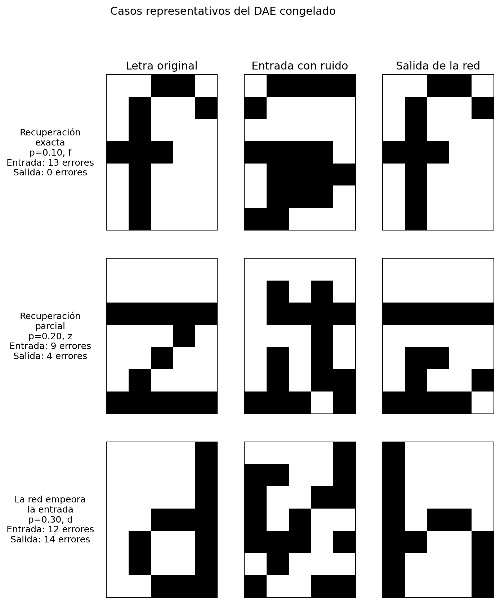

- La `f` entra con 13 píxeles mal y sale perfecta.
- La `z` pasa de 9 a 4 errores: se eliminó ruido, pero no alcanzó para
  reconstruirla completa.
- La `d` pasa de 12 a 14 errores: la red la "corrigió" hacia una `h`. Es el
  límite natural del que se habló en la sección 1: con tanto ruido, la entrada
  se parecía más a otra letra.

### Dificultad por carácter

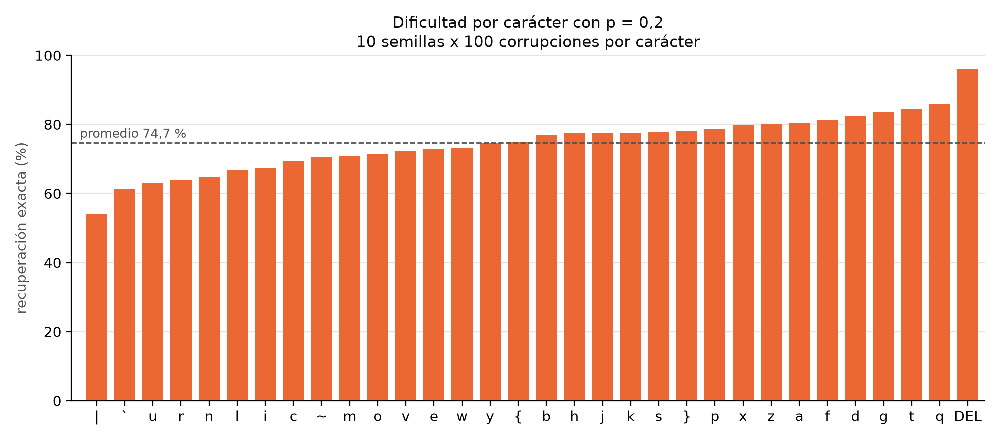

Con `p = 0,20`, `DEL` se recupera el 96 % de las veces y `|`, solo el 54 %.

- `DEL` (todo negro) es muy distinto de las demás letras: aunque se inviertan
  varios píxeles, sigue siendo claramente "casi todo negro".
- `|`, `` ` ``, `u`, `r` y `n` son las más difíciles. Una interpretación
  compatible con los resultados, aunque no demostrada: tienen pocos píxeles
  encendidos o se parecen a otras letras (`r`, `n`, `m`, `h` comparten trazos),
  así que unos pocos píxeles invertidos alcanzan para confundirlas.

---

## 7. Qué cambia en el espacio latente

El DAE final usa latente 5 y no se puede graficar. Para ver qué cambia, se
entrenó una **variante con latente 2** y el resto de la receta final igual, y se
la comparó con el autoencoder del 1A. A cada red se le pasaron 100 versiones con
ruido (`p = 0,10`) de cada letra y se graficó dónde cae el código de cada una.

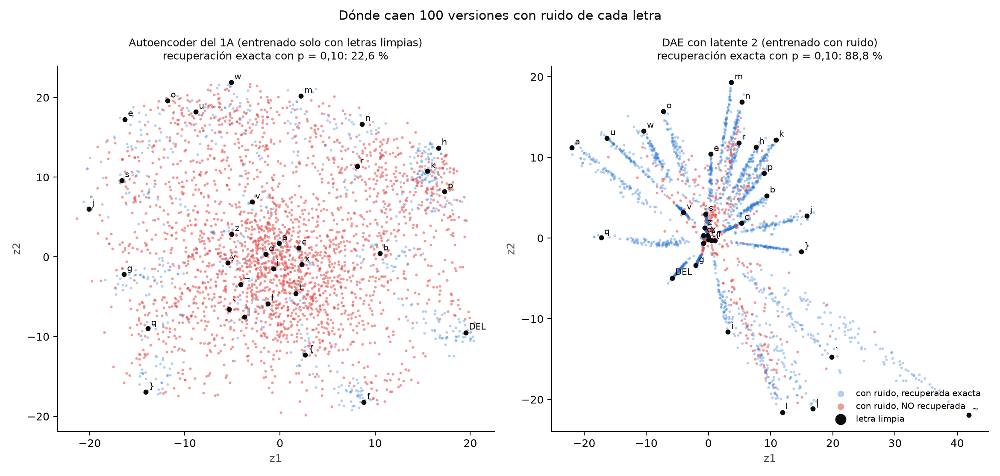

- Los **puntos negros** son las 32 letras limpias: `encode(letra original)`.
- Los **puntos de color** son letras con ruido: azul si la red devuelve la
  letra limpia exacta, rojo si no.

**Cómo se decide qué letra es.** No se mira la distancia en el latente: el punto
se pasa por el decoder, se binariza la salida y se compara con la letra
original. Alrededor de cada letra hay una **región** de puntos que el decoder
dibuja como esa letra; su forma y tamaño los determina el decoder.

- **En el autoencoder del 1A**, las letras con ruido quedan desparramadas por
  todo el plano y casi todo es rojo: solo se recupera el 22,6 %. La red se
  entrenó solo con los 32 puntos exactos, y una letra con 3 o 4 píxeles cambiados
  cae en una zona que nunca vio.
- **En el DAE**, las versiones con ruido de cada letra quedan agrupadas, y el
  decoder aprendió a dibujar **toda esa región** como la letra limpia: se
  recupera el 88,8 %.
- **Las regiones tienen forma de rayo.** Cada letra limpia queda en la punta y
  sus versiones con ruido caen a lo largo del rayo, más cerca del centro. Los
  errores se concentran en el centro, donde se tocan las regiones de muchas
  letras. Es una observación sobre esta corrida, no una propiedad garantizada.

En el DAE las regiones **aparecen solas**, como efecto de entrenar con ruido. El
VAE del ejercicio 2 las construye **a propósito**: su encoder devuelve una
distribución en lugar de un punto.

---

## 8. ¿Y si se entrena también con `p = 0,30`?

El modelo final nunca vio letras con `p = 0,30` durante el entrenamiento (paso 7).
Para ver cómo reacciona, se entrenó la misma receta agregando al lote un bloque
más de corrupciones con `p = 0,30`:

```text
final:     limpias + p 0,05 + p 0,10 + p 0,20          (128 ejemplos por época)
con 0,30:  limpias + p 0,05 + p 0,10 + p 0,20 + p 0,30 (160 ejemplos por época)
```

Las dos variantes se entrenaron con las mismas 10 semillas y se evaluaron sobre
exactamente los mismos casos. La variante "sin 0,30" es el modelo final y
reprodujo exactamente los números publicados en la sección 6.

El gráfico compara los dos modelos en los tres niveles de ruido más altos. En
cada panel, la barra azul es el modelo final (entrenado sin `p = 0,30`) y la
naranja el entrenado también con `p = 0,30`; la rayita negra es el desvío entre
las 10 semillas.

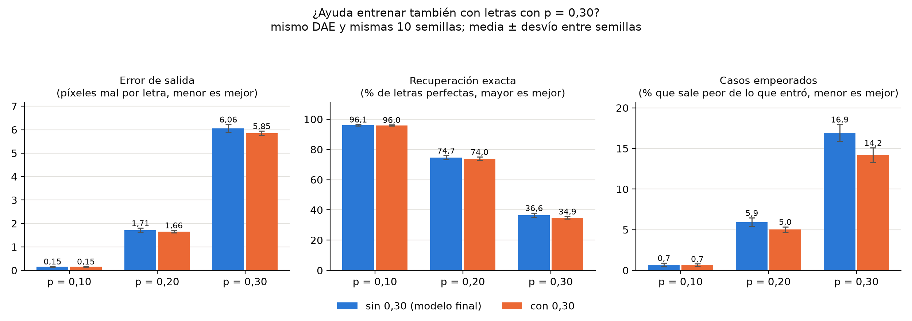

| `p` | Métrica | Sin 0,30 (final) | Con 0,30 | Semillas en que mejora con 0,30 |
|---:|---|---:|---:|---:|
| 0,20 | Error de salida | 1,715 | 1,657 | 8 de 10 |
| 0,20 | Recuperación exacta | 74,7 % | 74,0 % | 3 de 10 |
| 0,20 | Casos empeorados | 5,9 % | 5,0 % | 10 de 10 |
| 0,30 | Error de salida | 6,059 | 5,849 | 9 de 10 |
| 0,30 | Recuperación exacta | 36,6 % | 34,9 % | 1 de 10 |
| 0,30 | Casos empeorados | 16,9 % | 14,2 % | 10 de 10 |

Con `p` hasta 0,10 no cambia nada.

**Qué pasa.** Entrenar con `p = 0,30` produce un efecto mixto pero muy
consistente entre semillas:

- **Menos errores y menos casos empeorados.** La red se equivoca menos
  píxeles en promedio y estropea menos letras.
- **Menos letras perfectas.** La recuperación exacta baja en casi todas las
  semillas.

Una interpretación compatible con los resultados, aunque no demostrada: con
`p = 0,30` muchas corrupciones ya se parecen más a otra letra que a la original,
y aun así se le pide a la red que las devuelva como la original. Esos ejemplos
contradictorios la vuelven más **cautelosa**: en los casos dudosos produce
salidas "intermedias", que tienen menos píxeles mal que una letra equivocada
completa pero tampoco son la letra exacta.

**Decisión: se mantiene el modelo final.** La ganancia aparece solo en el
régimen extremo y es chica (0,2 píxeles por letra con `p = 0,30`). A cambio se
pierden letras perfectas también en `p = 0,20`, que es uno de los niveles
informativos. Además el lote crece de 128 a 160 ejemplos, así que parte del
efecto podría deberse a entrenar con más ejemplos y no solo al nivel de ruido.
Si el objetivo fuera minimizar el daño con ruido muy alto, esta variante sería
preferible.

---

## 9. Resumen del recorrido

El gráfico resume cómo fue mejorando la recuperación exacta con cada decisión
aceptada en la sección 4. Cada paso agrega su cambio al anterior.

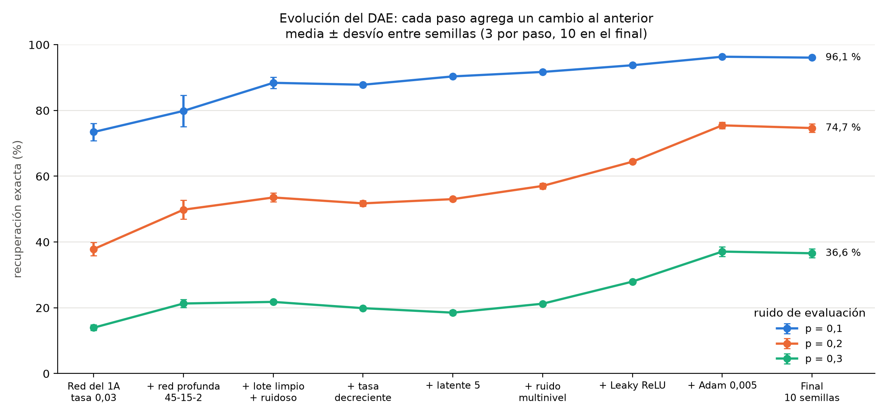

La recuperación exacta con `p = 0,10` pasó de 73 % a 96 %, y con `p = 0,20`,
de 38 % a 75 %. Los saltos más grandes los dieron la arquitectura profunda, el
lote con letras limpias, Leaky ReLU y Adam. La tasa decreciente no mejora la
media: su aporte fue la estabilidad entre semillas, que en este gráfico no se ve.

---

## 10. Conclusiones

- Un DAE es el mismo autoencoder entrenado con **entrada con ruido y objetivo
  limpio**. Aprende a eliminar ruido porque el cuello de botella solo tiene lugar
  para la estructura de las letras, no para píxeles aleatorios.
- La red del 1A, entrenada con ruido sin más cambios, **empeoraba** las letras.
  Lo primero que hizo falta fue **bajar la tasa**: con ruido el gradiente cambia
  en cada época y la tasa del 1A era demasiado grande.
- La arquitectura conveniente para el 1B es **profunda y con latente 5**
  (`35-45-15-5-15-45-35`). La red del 1A estaba pensada para dibujar un latente
  de 2 dimensiones, no para limpiar ruido.
- Entrenar con **letras limpias y varios niveles de ruido** hace que la red no
  estropee letras sanas y que generalice a niveles de ruido que no vio.
- El modelo final, confirmado con 10 semillas:
  - elimina el ruido de forma **muy confiable hasta `p = 0,10`** (96 % exactas);
  - funciona con fallas en **`p = 0,20`** (75 % exactas);
  - en **`p = 0,30`** solo mejora el promedio (37 % exactas, 17 % empeoradas).
- Agregar `p = 0,30` al entrenamiento reduce los errores y los casos empeorados
  con ruido alto, pero baja la cantidad de letras perfectas: es un trade-off, no
  una mejora clara.
- La degradación es gradual y casi idéntica entre semillas. El límite no es
  solo de la red: con mucho ruido, una letra estropeada se parece más a otra que
  a la original.
- En el latente, entrenar con ruido convierte los 32 puntos aislados del 1A en
  **regiones** que el decoder dibuja como cada letra.

---

## Reproducibilidad

| Qué | Cómo se regenera |
|---|---|
| Un entrenamiento del DAE final | `uv run python -m sia_tp5.denoising_experiment configs/dae_adam_lr005_seed0.json` (semillas 0 a 9) |
| Curva y casos finales | `uv run python -m sia_tp5.denoising_final_analysis configs/dae_final_analysis.json` |
| Gráficos de decisiones, evolución y dificultad | `uv run python -m sia_tp5.report_figures_1b` |
| Latente AE contra DAE | `uv run python -m sia_tp5.latent_regions` |
| Entrenar con `p = 0,30` | `uv run python -m sia_tp5.dae_training_noise_study` |

Las tablas completas de cada paso están en `ejercicio_1b.md` y en
`dae/experiments/`; los resultados finales, en `dae/final/`.
