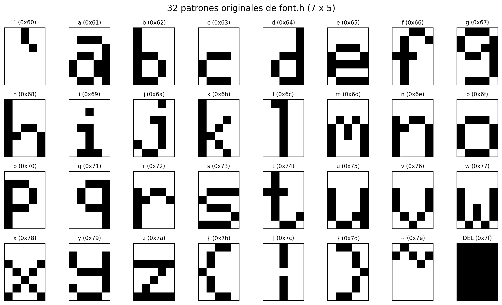
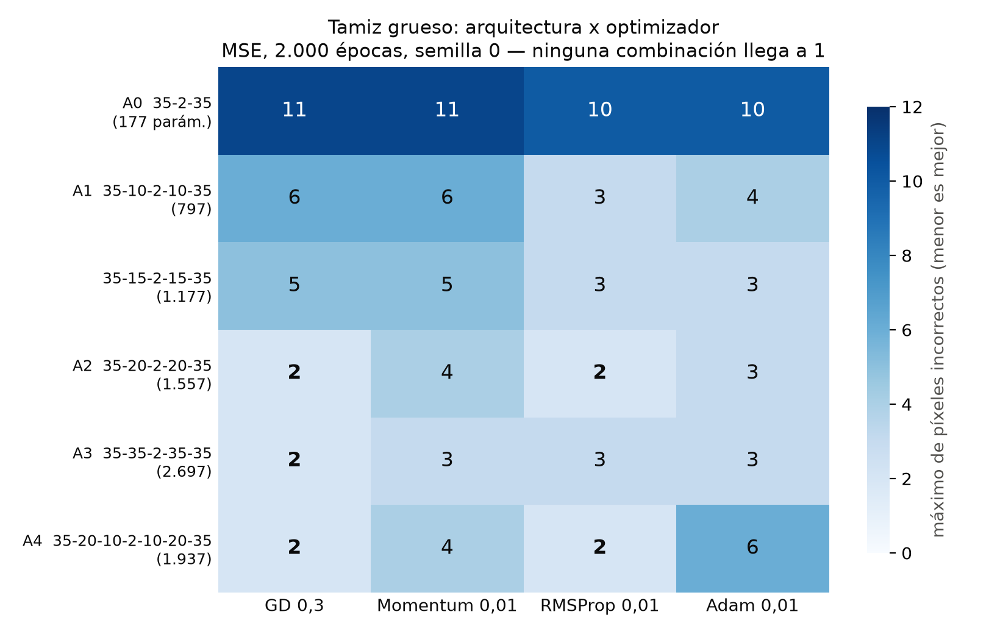
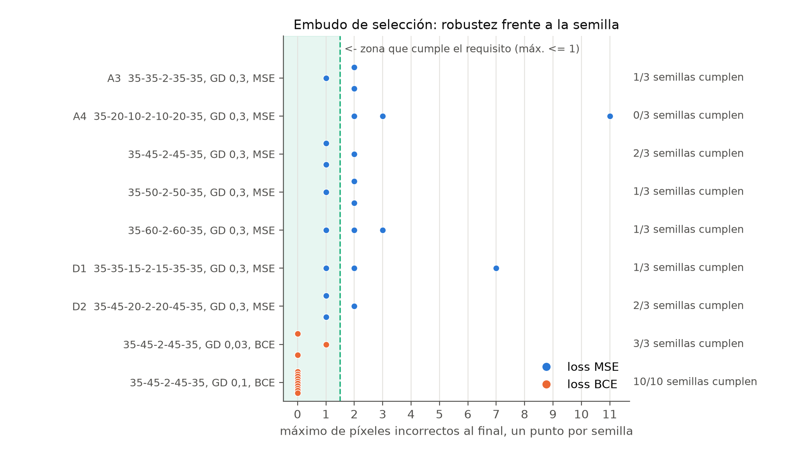
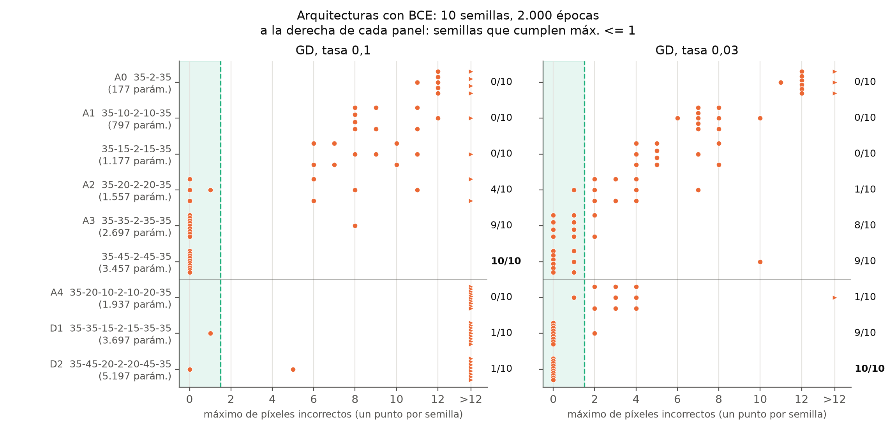
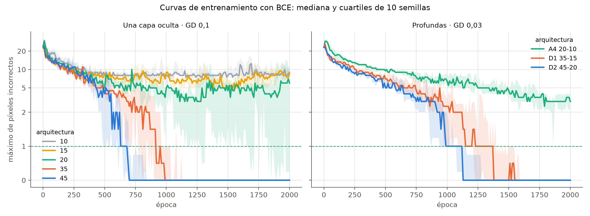
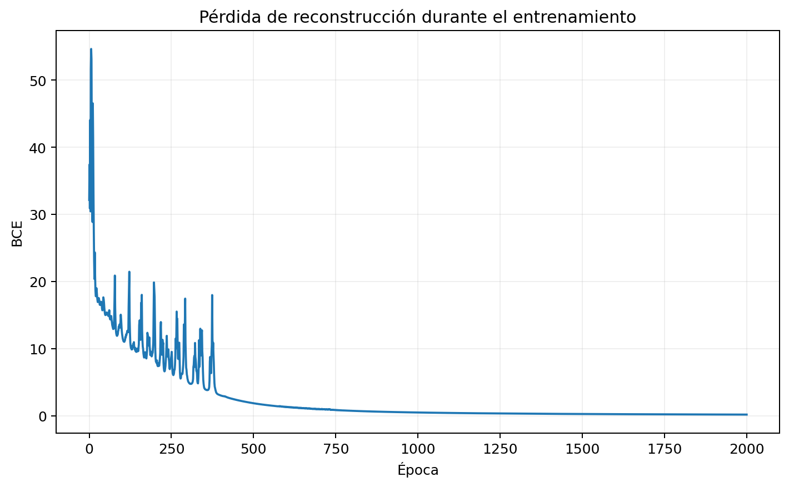
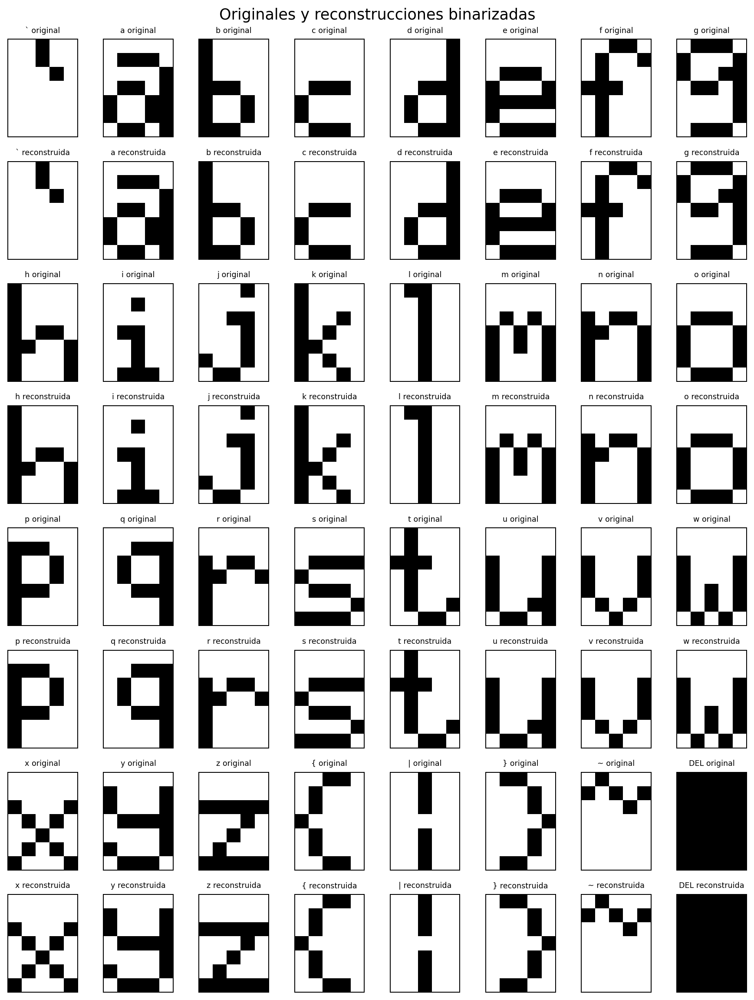
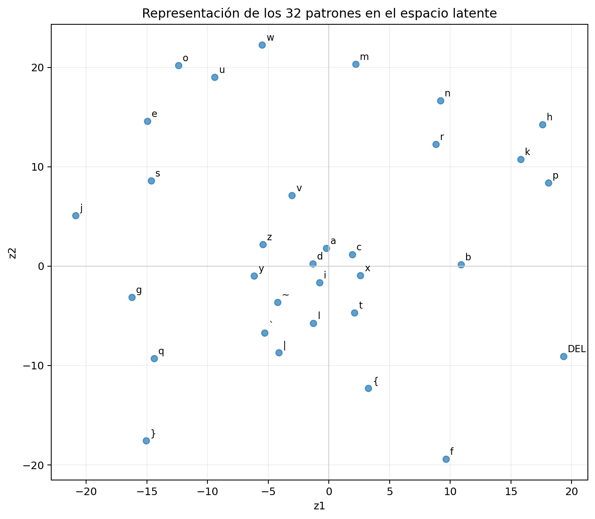
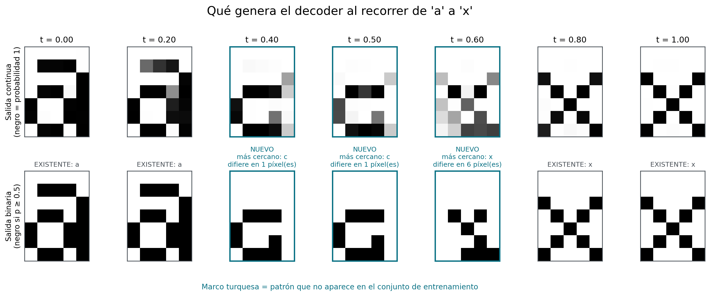

# TP5 — Ejercicio 1A: Autoencoder básico

Este documento cuenta el ejercicio 1A de punta a punta: qué pide la consigna,
los conceptos necesarios para entenderlo, cómo se llegó a cada decisión y qué
muestran los resultados. Es la base para la presentación.

---

## 1. Ideas base: qué es un autoencoder

Un **autoencoder** es un perceptrón multicapa al que se le pide algo
aparentemente trivial: que su salida sea igual a su entrada. Para cada patrón
`x`, la salida esperada es el mismo `x`.

La gracia está en la forma de la red. En el medio hay una capa muy angosta, el
**cuello de botella** o **espacio latente**:

```text
            ENCODER                                DECODER
x (35 píxeles) -> capa oculta -> z (2 números) -> capa oculta -> x' (35 valores)
```

- El **encoder** comprime los 35 píxeles a un código `z` de solo 2 números.
- El **decoder** intenta reconstruir los 35 píxeles a partir de esos 2 números.
- Como toda la información tiene que pasar por `z`, la red no puede copiar la
  entrada píxel por píxel: está obligada a aprender una representación compacta
  de los datos.

Se entrena como cualquier MLP: se mide la diferencia entre `x` y `x'` con una
función de pérdida y se ajustan **todos** los pesos (encoder y decoder juntos)
con backpropagation. No hacen falta etiquetas: es aprendizaje no supervisado.

Según la teórica, si todas las activaciones fueran lineales, el autoencoder
aprendería lo mismo que PCA. Con activaciones no lineales funciona como una
**reducción de dimensionalidad no lineal**, más flexible que PCA.

Una vez entrenado, cada mitad sirve por separado:

- `encode(x)` da la posición de un patrón en el espacio latente (ejercicio 1A.3);
- `decode(z)` permite elegir un punto `z` cualquiera y ver qué genera la red
  (ejercicio 1A.4).

### Neuronas, capas y números

Cada neurona recibe todas las salidas de la capa anterior, calcula una suma
ponderada más un sesgo, le aplica su activación y produce **un solo número**.
Ese número se envía a todas las neuronas de la capa siguiente, pero es el mismo
valor copiado. Por eso una capa de `k` neuronas produce `k` números.

Para la red final `35 -> 45 -> 2 -> 45 -> 35`:

| Capa | Neuronas | Entradas por neurona | Qué produce |
|---|---:|---:|---|
| Entrada | 35 | — | los 35 píxeles de una letra |
| Oculta del encoder | 45 | 35 | 45 números |
| **Latente** | **2** | 45 | **2 números: `(z1, z2)`** |
| Oculta del decoder | 45 | 2 | 45 números |
| Salida | 35 | 45 | 35 probabilidades, una por píxel |

El 35 de la entrada y la salida es el **tamaño de cada letra** (7 x 5 píxeles).
El 32 es la **cantidad de letras** y no aparece en la arquitectura: la red mira
una letra por vez. Con 100 letras de 7 x 5 la red seguiría siendo `35 -> ... -> 35`.

---

## 2. Consigna

1. Plantear un encoder y un decoder que representen las entradas en un espacio
   latente de **dimensión 2**.
2. Estudiar arquitecturas y técnicas de optimización hasta aprender los
   **32 patrones de 7x5 con un error máximo de 1 píxel**.
3. Graficar los datos de entrada en el espacio latente.
4. Mostrar cómo la red puede generar una **letra nueva** que no está en el
   conjunto de entrenamiento.

### Dataset

`font.h` contiene 32 caracteres (de `` ` `` a `DEL`) dibujados en 7 filas por 5
columnas. Cada fila es un número hexadecimal cuyos 5 bits indican qué píxeles
están encendidos. Cada sprite se aplana en un vector de **35 valores binarios**:
el dataset es una tabla de 32 filas (letras) por 35 columnas (píxeles).



Aplanar la imagen no pierde información (se puede volver a armar la grilla),
pero la red ya no "sabe" qué píxeles son vecinos: tiene que aprenderlo de los
datos.

### Criterio de éxito

La salida es continua: cada uno de los 35 valores está entre 0 y 1 y se lee como
la probabilidad de que el píxel esté encendido. Para **evaluar**, se binariza con
umbral 0,5 y se cuentan los píxeles distintos al original.

Se exige el **peor caso**: cada uno de los 32 patrones debe tener como máximo un
píxel incorrecto. Un promedio menor que 1 no alcanza, porque podría esconder una
letra muy mal reconstruida.

El umbral se usa solo para medir, nunca dentro del entrenamiento: la función
escalón tiene derivada cero (o indefinida), así que backpropagation no podría
aprender nada a través de ella.

---

## 3. Conceptos que intervienen en las decisiones

### Función de pérdida: MSE contra BCE

La pérdida mide qué tan lejos está `x'` de `x`.

- **MSE** (error cuadrático medio), la de la teórica: `||x - x'||²`.
- **BCE** (entropía cruzada binaria), pensada para salidas que son
  probabilidades de algo binario, como un píxel:
  `BCE = -Σ [x log(x') + (1 - x) log(1 - x')]`.

La diferencia está en el gradiente, y para entenderla hace falta la idea de
**saturación**. La salida de cada píxel pasa por una sigmoide, que aplasta
cualquier número al rango (0, 1):

```text
salida
 1 ┤                    ___________   <- zona saturada (casi 1, plana)
   │                  /
0.5┤                /                 <- zona sensible (empinada)
   │              /
 0 ┤ ___________/                     <- zona saturada (casi 0, plana)
   └──────────────────────────── h
```

Una neurona está **saturada** cuando su salida está pegada a 0 o a 1. Ahí la
curva es casi plana: su pendiente, `x'(1 - x')`, es casi cero.

- Con **MSE**, el gradiente es (salvo una constante) el error multiplicado por
  esa pendiente: `(x' - x) · x'(1 - x')`. Si la neurona está saturada, la
  pendiente anula todo.
- Con **BCE**, la pendiente se cancela con la derivada del logaritmo y el
  gradiente queda `x' - x`: proporcional al error.

Ejemplo: un píxel que debería estar encendido (`x = 1`) y la red está muy segura
de que está apagado.

| | Saturado y equivocado (`x' ≈ 0,002`) | Equivocado sin saturar (`x' ≈ 0,27`) |
|---|---:|---:|
| Gradiente con MSE | ≈ 0,005 | ≈ 0,29 |
| Gradiente con BCE | ≈ 2,0 | ≈ 1,5 |
| BCE corrige... | ~400 veces más fuerte | ~5 veces más fuerte |

Con MSE, **cuanto más segura y equivocada está la red, menos se corrige**. BCE
hace lo contrario. Si el píxel está saturado y es **correcto**, las dos dan un
gradiente casi cero, que es lo deseable.

### Optimizadores

Todos actualizan los pesos en contra del gradiente; cambian en cómo eligen el
paso.

| Optimizador | Idea |
|---|---|
| Descenso de gradiente (GD) | Paso proporcional al gradiente actual. |
| Momentum | Suma una fracción del paso anterior: acumula dirección y reduce el zigzag. |
| RMSProp | Divide el paso por el tamaño reciente de los gradientes: cada peso tiene su propia escala. |
| Adam | Combina Momentum y RMSProp, con corrección del sesgo inicial. |

Los parámetros internos quedaron fijos (`alpha = 0,9` en Momentum, `gamma = 0,9`
en RMSProp, `beta1 = 0,9` y `beta2 = 0,999` en Adam); solo se calibró la tasa.
Todo se implementó a mano a partir del MLP del TP3, sin librerías que entrenen la
red.

### Semillas

La semilla fija la inicialización aleatoria de los pesos. Dos entrenamientos
idénticos con distinta semilla pueden terminar muy distinto. Por eso **una
semilla sirve para descartar, pero para elegir hace falta repetir con varias**.

---

## 4. Recorrido experimental

### Controles previos

Antes de buscar la arquitectura se verificó que la implementación fuera
correcta:

1. **Gradientes numéricos.** Los gradientes de backpropagation coincidieron con
   los calculados por diferencias finitas en una red diminuta.
2. **Memorizar una sola letra.** La red `35-15-2-15-35` aprendió la letra `a`
   (de 16 píxeles incorrectos a 0 en 12 épocas). Si no pudiera copiar un único
   patrón, no tendría sentido intentar con 32.

La red `35-15-2-15-35` fue un punto de partida chico y simétrico para verificar
que el código aprendía. Su tamaño no fue una decisión de diseño: la arquitectura
final salió de las comparaciones que siguen.

### Punto de partida: entrenar más no alcanza

La primera corrida sobre los 32 patrones usó `35-15-2-15-35`, MSE, Adam 0,01 y
20.000 épocas. Terminó con **7 píxeles incorrectos** en el peor patrón y solo 17
de 32 patrones dentro del límite.

El máximo de errores llegó a 3 cerca de la época 3.500 y después **empeoró**
hasta 7. De ahí salieron dos reglas que se mantuvieron en todo el TP:

- más épocas no siempre mejoran el modelo;
- se evalúa siempre el **estado final** tras un presupuesto común. Elegir el
  mejor punto intermedio de una corrida sería hacer trampa con la selección.

### Estrategia: un embudo

La arquitectura y el optimizador interactúan: una tasa que va bien en una red
puede ser inestable en otra. Probar todas las combinaciones sería carísimo, así
que se usó un embudo:

1. calibrar pocas tasas por optimizador;
2. cruzar arquitecturas con los perfiles que sobrevivieron;
3. repetir con más semillas solo lo prometedor;
4. refinar donde los datos mostraban una tendencia;
5. cambiar la pérdida y volver a comparar arquitecturas;
6. confirmar el modelo final con 10 semillas.

### Paso 1 — Calibración de tasas

Sobre `35-15-2-15-35` y `35-35-2-35-35`, con MSE, 2.000 épocas y semilla 0, se
probaron tres tasas por optimizador:

| Optimizador | Tasas |
|---|---|
| GD | 0,01; 0,1; 1,0 (y luego 0,3; 0,5) |
| Momentum | 0,01; 0,05; 0,2 (y luego 0,1) |
| RMSProp | 0,0001; 0,001; 0,01 |
| Adam | 0,0001; 0,001; 0,01 |

Ninguna corrida divergió y ninguna cumplió el requisito.

- Las tasas muy chicas (GD 0,01, RMSProp y Adam 0,0001) seguían mejorando pero
  quedaron muy lejos dentro del presupuesto: son lentas, no incapaces.
- GD 1,0 y Momentum 0,2 fueron inestables en la red de 15 neuronas pero
  funcionaron en la de 35. Es la primera evidencia de **interacción
  arquitectura-tasa**.

Pasaron al paso siguiente **GD 0,3, Momentum 0,01, RMSProp 0,01 y Adam 0,01**.

### Paso 2 — Tamiz de arquitecturas por optimizador

Se cruzaron seis arquitecturas con esos cuatro perfiles (MSE, 2.000 épocas,
semilla 0). A0 no tiene capas ocultas, las del medio varían el ancho y A4 es
profunda:



- **A0** queda en 10-11 errores con cualquier optimizador. Comprimir 35 píxeles a
  2 números directamente no alcanza: las capas ocultas son imprescindibles.
- **A1 (10) y 15 neuronas** mejoran mucho, pero siguen lejos (3 a 6 errores).
- **A2, A3 y A4** llegan a máximo 2: la capacidad está cerca de lo necesario.
- **GD** es el optimizador más parejo. **Adam** se desestabiliza en la red
  profunda A4: llegó a un buen punto y terminó con 6 errores.

### Pasos 3 y 4 — Más semillas y refinamiento (con MSE)

Las combinaciones prometedoras se repitieron con las semillas 1 y 2, y se
refinaron ancho, épocas y profundidad. En el gráfico, cada punto es el máximo de
errores final de una semilla:



- **A4 + GD** parecía tan buena como A2 con la semilla 0, pero con la semilla 2
  terminó con 11 errores. Una sola semilla habría llevado a una conclusión
  equivocada.
- **A3 + GD** fue la más estable de ese tamiz. Momentum y Adam quedaron detrás de
  GD en las tres semillas y se retiraron del refinamiento.
- **Ancho 45** + GD 0,3 cumplió en 2 de 3 semillas: el mejor resultado con MSE.
- **Más épocas no lo arreglaron**: con 4.000 épocas la pérdida siguió bajando,
  pero ninguna semilla cambió su cantidad de errores.
- **Más ancho tampoco**: 50 y 60 neuronas cumplieron solo en 1 de 3.
- **Más profundidad**: se probaron dos redes profundas.
  - **D1** (`35-35-15-2-15-35-35`, 3.697 parámetros) tiene casi los mismos
    parámetros que la de ancho 45 pero repartidos en más capas. Fue inestable:
    una semilla cumplió y después terminó con 7 errores.
  - **D2** (`35-45-20-2-20-45-35`, 5.197 parámetros) es la de 45 con una capa
    extra de 20 de cada lado. Cumplió en 2 de 3, igual que ancho 45, con un 50 %
    más de parámetros.

Con MSE se llegó a un techo: nada cumplía en todas las semillas.

### Paso 5 — Cambio de pérdida: BCE

Los píxeles son binarios y la salida es una sigmoide, así que BCE es la pérdida
natural (ver sección 3). Se implementó, se verificó su gradiente numéricamente
y se recalibró la tasa sobre la red de ancho 45: cambiar la pérdida cambia la
escala del gradiente, así que no se podía reutilizar la tasa de MSE.

| Tasa (GD, BCE) | Máximo de errores (semilla 0) | Interpretación |
|---:|---:|---|
| 0,01 | 6 | demasiado lenta |
| 0,03 | 0 | viable |
| **0,1** | **0** | viable y más rápida |
| 0,3 | 22 | inestable |

Las dos filas naranjas del gráfico anterior son esta misma red con BCE: con tasa
0,1, las 32 letras salieron perfectas en todas las semillas.

### Paso 6 — ¿Con BCE alcanza una red más chica?

El ancho 45 había ganado **con MSE**. Al cambiar la pérdida, la pregunta natural
es si con BCE alcanza una red más chica o si otra arquitectura es mejor. Se
volvieron a correr las nueve arquitecturas con BCE, dos tasas (0,1 y 0,03) y
**10 semillas** cada una: 180 corridas de 2.000 épocas.



- **Hasta 15 neuronas ninguna cumple**, en ninguna semilla ni tasa. Falta
  capacidad, no es un problema de la pérdida.
- **20 neuronas (A2)** cumple en 4 de 10: está en el límite.
- **35 neuronas (A3)** cumple en 9 de 10. En la semilla 5 llegó a 0 errores, pero
  en las últimas 55 épocas se desestabilizó y terminó con 8.
- **45 neuronas** es la única de una capa oculta que cumple en **10 de 10**, con
  0 errores en todas, usando tasa 0,1.
- **Las profundas** fallan con tasa 0,1 porque es demasiado grande para ellas.
  Con 0,03, D2 también cumple 10 de 10 y D1 9 de 10. D2 empata con la de 45 pero
  tiene un 50 % más de parámetros.

Con 3 semillas, A2 y A3 habían parecido perfectas. Con 10 aparecieron sus
fallas: es otra muestra de por qué no se elige con pocas repeticiones.

**¿Alcanzan 2.000 épocas para todas?** Comparar arquitecturas con un mismo
presupuesto supone que todas tuvieron tiempo de aprender. Las curvas por época
(mediana y cuartiles de las 10 semillas) lo confirman:



- Las que cumplen llegan a 0 errores y se mantienen: 45 neuronas antes de la
  época 700, 35 cerca de la 1.000 y las profundas D2 y D1 con tasa 0,03 entre las
  épocas 1.130 y 1.380.
- Las angostas (10, 15 y 20 neuronas) y A4 se **estancan** muy por encima de 1
  error desde la mitad del entrenamiento: no les faltan épocas, les falta
  capacidad.

**Decisión:** la red de ancho 45 con BCE y tasa 0,1. Es la única de una capa
oculta que cumple en todas las semillas, y entre las que empatan (45 y D2) es la
más simple.

---

## 5. Modelo final

| Hiperparámetro | Valor |
|---|---|
| Arquitectura | `35 -> 45 -> 2 -> 45 -> 35` (3.457 parámetros) |
| Activaciones | `tanh` en las ocultas, lineal en el latente, logística en la salida |
| Pérdida | BCE |
| Optimizador | Descenso de gradiente, tasa 0,1 |
| Entrenamiento | full-batch (los 32 patrones por actualización), 2.000 épocas, sin parada anticipada |
| Inicialización | uniforme en [-0,5; 0,5] |
| Semilla de la corrida publicada | 0 (elegida por convención, no por ser la mejor) |

El latente es **lineal** para que `z` pueda tomar cualquier valor real y no
quede limitado a [-1, 1] como pasaría con `tanh`.

**Resultado:** **0 píxeles incorrectos en los 32 patrones** en las 10 semillas.
El requisito se cumplió por primera vez entre las épocas 407 y 928, según la
semilla, y cada entrenamiento tardó menos de medio segundo. La corrida
publicada (semilla 0) terminó con BCE 0,177.



La curva es muy ruidosa durante las primeras ~400 épocas (la tasa 0,1 da pasos
grandes y la red salta entre configuraciones) y después baja de forma suave y
sostenida.



Cada par de filas muestra el original arriba y la reconstrucción binarizada
abajo: son idénticos para los 32 caracteres.

---

## 6. Espacio latente (1A.3)

Cada punto es `encode(x)` para uno de los 32 patrones: las coordenadas
`(z1, z2)` que la red asignó a ese carácter.



- **Los 32 códigos son distintos y están separados.** Si dos letras cayeran en
  el mismo punto, el decoder no podría distinguirlas.
- **Hay cierta organización.** Los caracteres con un trazo vertical largo a la
  izquierda (`b`, `h`, `k`, `n`, `p`, `r`) quedan a la derecha; `o`, `u` y `w`,
  de contorno redondeado, arriba a la izquierda; `DEL` (todo negro) y `f` quedan
  alejados del resto. Es una observación sobre esta corrida, no una regla.
- **Los ejes no tienen significado.** Otra semilla podría rotar, reflejar o
  estirar el mapa entero y reconstruir igual de bien. Solo importan las
  posiciones relativas dentro de una misma corrida.
- **La escala es grande** (de -20 a 20) porque el latente es lineal y el
  autoencoder básico no tiene nada que limite el tamaño de los códigos.
- **El espacio entre puntos no está garantizado.** El entrenamiento solo
  restringe al decoder en esos 32 puntos. Qué genera en las zonas vacías no se
  controla. Este es el problema que resuelve el VAE del ejercicio 2.

---

## 7. Generar una letra nueva (1A.4)

Para generar, se elige un punto `z` que no sea el código de ninguna letra y se
lo pasa por el decoder. Se usó la **interpolación lineal** entre dos códigos:

```text
z(t) = (1 - t) · z_a + t · z_b,   con t entre 0 y 1
```

En `t = 0` se está sobre la letra `a`, en `t = 1` sobre `x`, y en el medio se
recorre el segmento que las une.



- La fila de arriba es la salida continua (los grises son probabilidades
  intermedias); la de abajo, la binarizada.
- En `t = 0,4` y `t = 0,5` aparece un **patrón nuevo** (marco turquesa): no
  coincide con ninguno de los 32. Su vecino más cercano es `c`, a 1 píxel de
  distancia (distancia de Hamming 1). Es una `c` con un píxel extra en la parte
  inferior derecha.
- En `t = 0,6` aparece otro patrón nuevo, a 6 píxeles de `x`, que ya no se
  parece a ningún carácter.
- La salida binaria **no cambia de forma continua**: se queda en `a` hasta
  `t = 0,2` y salta cuando alguna probabilidad cruza el 0,5.

**Por qué `a-x`.** Primero se probó `m-n`, pero todos sus puntos intermedios se
binarizaban como `m` o como `n`: un punto nuevo del latente no garantiza una
letra nueva. Una vez elegido `a-x`, no se siguieron probando pares en busca de
un resultado más vistoso.

El autoencoder básico **puede** producir patrones nuevos, y algunos tienen forma
de carácter. **No garantiza** que todo el espacio latente produzca letras
válidas ni que las transiciones sean suaves.

---

## 8. Conclusiones

- Un autoencoder `35-45-2-45-35` con BCE y descenso de gradiente (tasa 0,1)
  reconstruye **exactamente** los 32 patrones con un latente de dimensión 2, en
  10 de 10 semillas.
- Hacen falta capas ocultas, y con suficiente ancho: sin ellas quedan 10-11
  errores, y hasta 15 neuronas no se cumple el requisito ni con BCE.
- Arquitectura, optimizador y tasa **interactúan**: la tasa 0,1 es ideal para
  la red de 45 y demasiado grande para las profundas.
- Con MSE, más épocas, más ancho o más profundidad no alcanzaron: el techo fue
  cumplir en 2 de 3 semillas.
- **El cambio decisivo fue la pérdida.** BCE corrige con fuerza los píxeles
  saturados y equivocados, que MSE casi no corrige.
- Después del cambio de pérdida se volvió a comparar arquitecturas. La de 45
  sigue siendo la mejor: la de 35 falla en 1 de 10 semillas y D2 empata con más
  parámetros.
- Repetir con varias semillas cambió conclusiones varias veces (A4 + GD, D1, A2
  y A3 con BCE). Una sola semilla, o tres, sirven para descartar, no para elegir.
- El espacio latente separa los 32 caracteres, pero sus ejes no tienen
  significado y las zonas vacías no están controladas.
- Interpolando entre `a` y `x` se generan patrones nuevos, uno de ellos a un
  píxel de `c`. Con un autoencoder común, generar es posible pero no está
  garantizado.

---

## Reproducibilidad

| Qué | Cómo se regenera |
|---|---|
| Modelo final | `uv run python -m sia_tp5.experiment configs/ae_final_bce_width45_seed0.json` |
| Comparación de arquitecturas con BCE | `uv run python -m sia_tp5.calibration configs/bce_architecture_comparison_seeds0_9.json` |
| Interpolación `a-x` | `uv run python -m sia_tp5.latent_interpolation configs/latent_interpolation_ax.json` |
| Gráficos comparativos | `uv run python -m sia_tp5.report_figures_1a` |

Las tablas intermedias de los pasos 1 a 5 están en `ejercicio_1a.md`. El resumen
de las 180 corridas del paso 6 está en `ejs-figs/1a-bce-arquitecturas.csv`.
