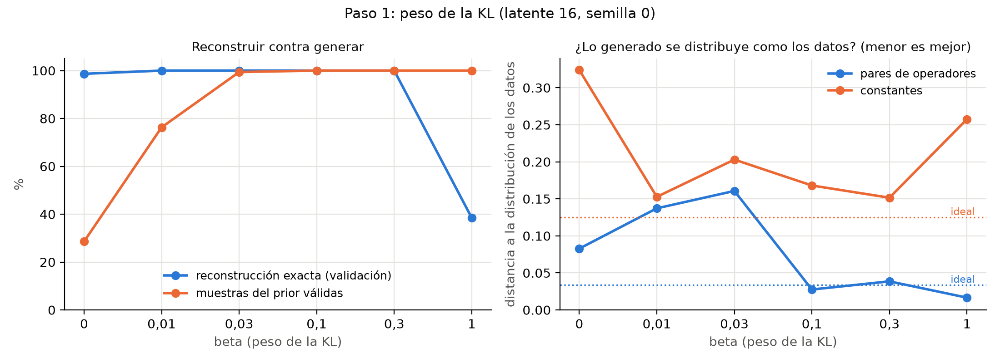
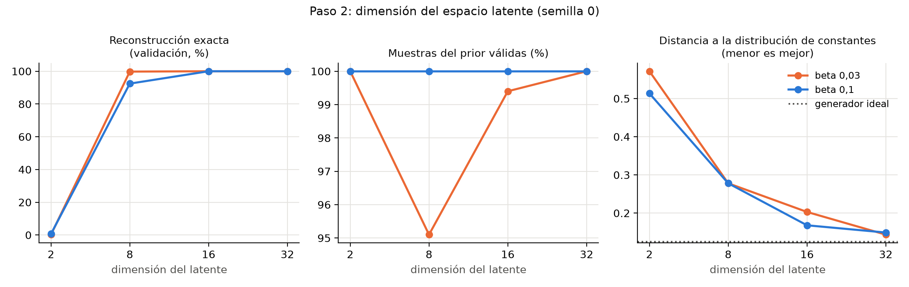
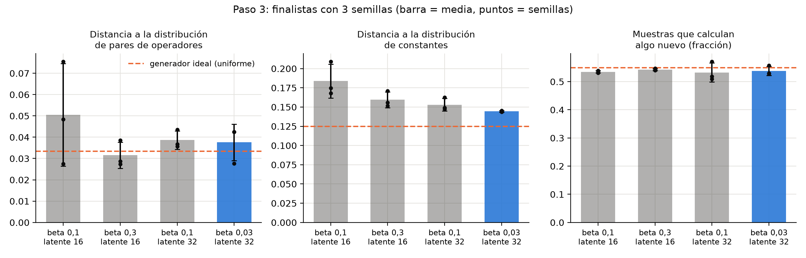
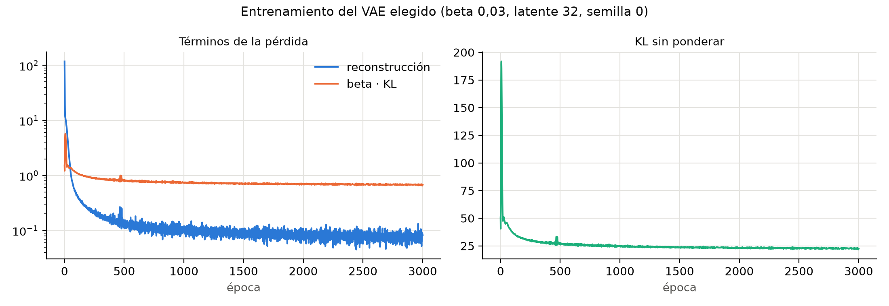
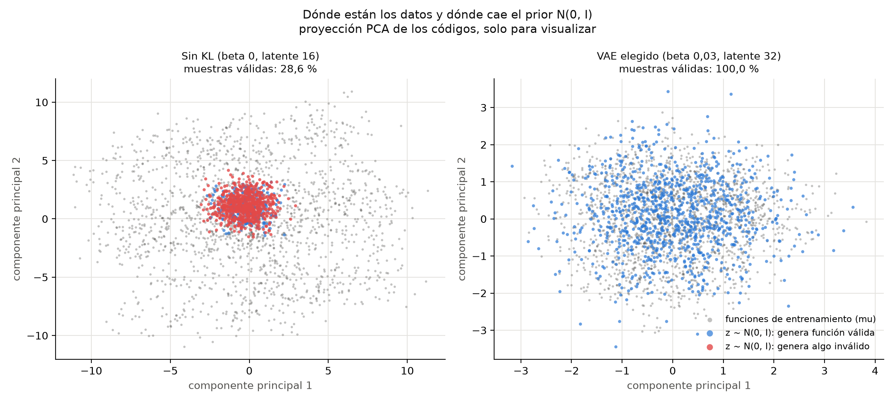

# TP5 — Ejercicio 2: Autoencoder variacional (VAE)

Este documento cuenta el ejercicio 2 de punta a punta: qué problema resuelve un
VAE, qué dataset se eligió y por qué, cómo se eligió el modelo y qué genera.
Continúa los ejercicios 1A (`ej1saint.md`) y 1B (`ej1bsaint.md`).

---

## 1. Qué problema resuelve el VAE

En el 1A se vio que el espacio latente de un autoencoder común tiene **huecos**:
el entrenamiento solo garantiza los puntos donde caen los datos. Si se elige un
`z` cualquiera y se lo pasa por el decoder, lo más probable es que salga algo
inválido. Para **generar** eso no sirve: se quiere poder sortear cualquier `z` y
obtener algo que pertenezca a la familia de los datos.

El **autoencoder variacional** cambia tres cosas para que el latente quede lleno.

**1. El encoder devuelve una nube en lugar de un punto.** Para cada entrada
produce dos vectores:

- `mu`: el centro de la nube;
- `log_var`: el logaritmo de la varianza, es decir, el ancho de la nube en cada
  dimensión.

**2. Durante el entrenamiento se sortea un punto dentro de la nube**
(reparametrización):

```text
z = mu + sigma · epsilon,    sigma = exp(0,5 · log_var),    epsilon ~ N(0, I)
```

El azar queda en `epsilon`, que no depende de los pesos, así que el gradiente
puede pasar por `mu` y `sigma` con backpropagation común. Como el decoder recibe
un punto distinto cada vez, aprende a reconstruir la entrada desde cualquier
lugar de su nube, no solo desde el centro.

**3. La pérdida suma un término de regularización, la KL:**

```text
pérdida = reconstrucción + beta · KL
KL = -0,5 · Σ (1 + log_var - mu² - exp(log_var))
```

La KL mide cuánto se aleja cada nube de una normal estándar `N(0, I)`. Funciona
como un resorte que tira de todas las nubes hacia el origen y las ensancha, así
que las nubes de distintas entradas **se solapan y cubren el espacio**.

**Generar** es entonces sortear `z ~ N(0, I)` y pasarlo por el decoder.

**La tensión central** que hay que resolver es el valor de `beta`:

- **beta chico:** la KL casi no actúa. Reconstruye bien, pero quedan huecos, como
  en un autoencoder común, y las muestras salen inválidas.
- **beta grande:** las nubes se aplastan sobre `N(0, I)` y dejan de llevar
  información de la entrada. Reconstruye mal.

---

## 2. Consigna

1. Elegir o construir un dataset nuevo.
2. Modificar el autoencoder con un esquema variacional que resuelva el problema
   de la representación en el espacio latente.
3. Generar una muestra nueva que se pueda juzgar como perteneciente al conjunto
   de datos presentado.

---

## 3. Dataset: funciones de Python

### Por qué este dataset

Se buscó un dataset donde "pertenecer a la familia" se pudiera **verificar
objetivamente**, y no a ojo como con imágenes. Se eligieron funciones de Python
con esta plantilla:

```python
def f(x): return (x+47)*83
```

- Dos operadores en `{+, -, *}` y dos constantes enteras de 0 a 99, escritas en
  dos columnas (el 3 se escribe ` 3`). Todas las funciones tienen 26 caracteres.
- Hay `3 · 100 · 3 · 100 = 90.000` funciones posibles. Se sortearon 2.700:
  **1.800 de entrenamiento, 450 de validación y 450 de test**, con los 9 pares de
  operadores igualmente representados en cada parte.

### Representación

Cada uno de los 26 caracteres se codifica como un **vector one-hot** de 25
posiciones (los 25 caracteres que pueden aparecer): un 1 en el carácter que
corresponde y 0 en el resto. Cada función queda como un vector de
`26 · 25 = 650` valores.

La salida del decoder se separa en 26 grupos de 25 y aplica un **softmax** en
cada grupo: así cada posición elige exactamente un carácter. La pérdida de
reconstrucción es la **entropía cruzada** de cada posición, sumada sobre las 26.
Es la generalización de la BCE del ejercicio 1 a 25 opciones por posición, en
lugar de 2.

### Cómo se juzga si una muestra pertenece

Cada función generada se clasifica con cuatro criterios independientes:

1. **Compila:** Python la acepta como código válido (sin ejecutarla).
2. **Pertenece a la familia:** respeta exactamente la plantilla, con operadores
   de `{+, -, *}` y constantes entre 0 y 99.
3. **Es nueva en texto:** no está entre las 2.700 del dataset.
4. **Calcula algo nuevo:** toda función de la familia equivale a `f(x) = a·x + b`.
   Es "nueva semánticamente" si su par `(a, b)` no aparece en el dataset. Es más
   exigente que el texto: `(x+3)+4` y `(x+5)+2` son textos distintos pero calculan
   lo mismo.

---

## 4. Implementación y controles previos

El VAE se implementó con NumPy a partir del autoencoder del ejercicio 1, de forma
incremental:

1. Encoder con dos ramas, `mu` y `log_var`, todavía usando `z = mu`.
2. Reparametrización con `epsilon` y la KL en cero.
3. Gradientes de las dos ramas verificados con diferencias finitas.
4. KL con peso configurable, registrando reconstrucción y KL por separado.
5. Muestreo de `z ~ N(0, I)` y decodificación.

Se probó primero con un dataset de juguete de 6 barras de 3x3: desde el prior,
el 58,7 % de las muestras fue exactamente una barra válida.

**Control de capacidad.** Antes del VAE se entrenó un autoencoder común
`650-256-16-256-650` sobre las funciones. Reconstruyó exactamente el 99,6 % del
test. Así, si el VAE falla, no es por falta de capacidad de la red ni por la
representación, sino por la parte variacional.

---

## 5. Cómo se mide cada modelo

Al final del entrenamiento (sin elegir épocas intermedias) se mide:

| Medida | Qué dice |
|---|---|
| **Reconstrucción exacta** en validación, con `z = mu` | si el VAE sigue siendo un buen autoencoder |
| **Muestras válidas**: se sortean 1.000 `z ~ N(0, I)` fijos y se cuenta cuántos generan una función de la familia | si el latente está "lleno" |
| **Distribución de las muestras**: qué tan parecida es la frecuencia de pares de operadores y de constantes a la de los datos | si genera "como los datos" o se concentra en algunos tipos |
| **Novedad** en texto y semántica | si inventa o copia |
| **KL** y dimensiones del latente que se usan | si hubo colapso |

### Referencia: un generador ideal

El dataset se armó sorteando funciones de la familia **de manera uniforme**. Por
eso el generador ideal es uno que sortea funciones uniformemente de las 90.000.
Calculando sus métricas sobre 1.000 muestras (promedio de 50 sorteos):

| Métrica | Generador ideal |
|---|---:|
| Muestras válidas | 100 % |
| Nuevas en texto | 96,8 % |
| Calculan algo nuevo | 55,0 % |
| Distancia a la distribución de pares de operadores | 0,033 |
| Distancia a la distribución de constantes | 0,125 |

Las distancias son **distancia de variación total**: 0 si las frecuencias
coinciden exactamente y 1 si no se solapan nada. No llegan a 0 en el ideal porque
1.000 muestras no reparten las 100 constantes de forma perfecta.

Esta referencia cambia cómo se leen los resultados: **más novedad no es mejor**.
Un modelo que calcula algo nuevo en el 64 % de las muestras no es más creativo
que el ideal, sino que genera de más ciertos tipos de función. Lo que se busca
es parecerse al ideal.

---

## 6. Recorrido experimental

### Regla de decisión

Se cambió una cosa por vez, con red `650-256-z-256-650`, `tanh`, Adam con tasa
0,005 y 3.000 épocas. La regla para elegir, fijada antes de correr las semillas
de confirmación:

1. **Requisitos en todas las semillas:** al menos 90 % de reconstrucción exacta
   en validación y al menos 99 % de muestras válidas.
2. Entre las que cumplen, gana **la que genere con la distribución más parecida a
   la de los datos**.
3. Si hay empate dentro del desvío entre semillas, gana el latente más chico.

La propuesta inicial era "maximizar las muestras válidas y nuevas". Se cambió
después del paso 1, al ver con la referencia del generador ideal que la novedad
por encima del ideal indicaba un sesgo, no una mejora.

### Paso 1 — Peso de la KL (beta)

Latente 16, semilla 0. Incluye beta = 0 como control: el mismo modelo sin
regularización.



| beta | Reconstrucción (val.) | Muestras válidas | KL |
|---:|---:|---:|---:|
| 0 | 98,7 % | **28,6 %** | 242,8 |
| 0,01 | 100 % | 76,3 % | 22,5 |
| 0,03 | 100 % | 99,4 % | 19,8 |
| 0,1 | 100 % | 100 % | 16,6 |
| 0,3 | 100 % | 100 % | 13,2 |
| 1 | **38,4 %** | 100 % | 2,5 |

**Izquierda: reconstruir contra generar.**

- **Sin KL**, solo el 28,6 % de las muestras es válido: el latente tiene huecos,
  como en el 1A. Es la demostración directa de qué aporta la KL.
- **beta 0,01** todavía deja una de cada cuatro muestras inválida.
- **beta 1** aplasta las nubes y la reconstrucción cae al 38 %.
- **Entre 0,03 y 0,3** reconstruye todo y casi todo lo generado es válido.

**Derecha: ¿lo que se genera se parece a los datos?** Distancia entre las
muestras válidas y la distribución de los datos (sección 5); las líneas
punteadas son el generador ideal.

- Que una muestra sea válida no alcanza. **beta 0,03** genera un 99,4 % de
  funciones válidas, pero con la distribución de pares de operadores más lejos
  del ideal de todas (0,16 contra 0,03): genera de más algunos pares.
- **beta 1** acierta los pares de operadores, pero se aleja en las constantes
  (0,26): al perder información, el decoder repite algunas constantes.
- **beta 0,1 y 0,3** quedan cerca del ideal en las dos medidas.

La KL de la tabla no es una decisión, sino un resultado: mide, después de
entrenar, cuánto se alejan las nubes de `N(0, I)`. Que baje al subir beta es
esperable, porque beta es justamente cuánto se la castiga. Sirve como
diagnóstico: con beta 0 vale 243 (nubes lejísimos del prior, de ahí los
huecos) y con beta 1 vale 2,5 (nubes casi iguales al prior, de ahí que no
reconstruya).

**Decisión:** beta 0 y 0,01 se descartan por generar inválido, y beta 1 por no
reconstruir. Entre los restantes, beta 0,1 tiene la mejor distribución; beta
0,03 genera con sesgo, pero se lo conserva para ver si un latente más grande lo
corrige. Pasan al paso 2 beta 0,03 y 0,1; beta 0,3 se confirma directamente en
el paso 3.

### Paso 2 — Dimensión del latente

Latentes 2, 8, 16 y 32 con beta 0,03 y 0,1, semilla 0.



- **Latente 2** no reconstruye casi nada (menos del 1 %): dos números no
  alcanzan para describir 26 caracteres. Genera funciones válidas, pero muy
  concentradas (distancia de constantes 0,51 a 0,57).
- **Latente 8** reconstruye, pero la distribución de constantes queda lejos del
  ideal (0,28).
- **Latentes 16 y 32** reconstruyen todo y se acercan al ideal; 32 un poco más.

**Decisión:** pasan al paso 3 beta 0,1 y 0,3 con latente 16, y beta 0,03 y 0,1
con latente 32. beta 0,03 con latente 16 no pasa: genera un 64,5 % de funciones
semánticamente nuevas (el ideal es 55 %) y su distribución de pares de operadores
está muy lejos del ideal (0,16 contra 0,03).

### Paso 3 — Finalistas con 3 semillas



Los cuatro finalistas cumplen los requisitos en las tres semillas: 100 % de
reconstrucción y 100 % de muestras válidas. La diferencia está en la
distribución:

| Finalista | Dist. pares de operadores | Dist. constantes |
|---|---:|---:|
| beta 0,1, latente 16 | 0,050 ± 0,024 | 0,184 ± 0,022 |
| beta 0,3, latente 16 | 0,032 ± 0,006 | 0,160 ± 0,010 |
| beta 0,1, latente 32 | 0,039 ± 0,004 | 0,153 ± 0,008 |
| **beta 0,03, latente 32** | 0,038 ± 0,009 | **0,144 ± 0,001** |
| *generador ideal* | *0,033* | *0,125* |

- En **pares de operadores** todos quedan dentro del ruido del ideal: no
  discrimina.
- En **constantes**, que es la medida más exigente (100 valores posibles por
  posición), **beta 0,03 con latente 32** es la más cercana al ideal y la más
  estable entre semillas. Su ventaja sobre las demás es mayor que el desvío
  entre semillas, así que no hay empate.

**Decisión: beta 0,03, latente 32.**

---

## 7. Modelo final

| Hiperparámetro | Valor |
|---|---|
| Arquitectura | `650 -> 256 -> (mu: 32, log_var: 32) -> z: 32 -> 256 -> 650` |
| Activaciones | `tanh` en las ocultas, lineal en `mu` y `log_var`, softmax por posición en la salida |
| Pérdida | entropía cruzada por posición + 0,03 · KL |
| Optimizador | Adam, tasa 0,005 |
| Entrenamiento | full-batch con las 1.800 funciones de entrenamiento, 3.000 épocas |
| Inicialización | uniforme en [-0,25; 0,25] |



La reconstrucción baja rápido durante las primeras ~300 épocas y después sigue
bajando lento, con ruido porque cada época sortea un `epsilon` distinto. La KL
sube al principio (el encoder separa las entradas para poder reconstruirlas) y
después la regularización la va bajando hasta estabilizarse en ~22.

---

## 8. Resultados con 10 semillas

El modelo elegido se entrenó con 10 semillas sin cambiar nada. El test se
evaluó una sola vez, recién en este paso.

| Medida | Media ± desvío | Generador ideal |
|---|---:|---:|
| Reconstrucción exacta en validación | 100 % ± 0 | — |
| **Reconstrucción exacta en test** | **100 % ± 0** | — |
| **Muestras del prior válidas** | **100 % ± 0** | 100 % |
| Muestras nuevas en texto | 96,4 % ± 0,6 | 96,8 % |
| Muestras que calculan algo nuevo | 54,4 % ± 1,5 | 55,0 % |
| Funciones distintas entre 1.000 muestras | 993,5 ± 2,9 | 995,2 |
| Distancia a la distribución de pares de operadores | 0,043 ± 0,011 | 0,033 |
| Distancia a la distribución de constantes | 0,145 ± 0,006 | 0,125 |
| KL | 22,3 ± 0,3 | — |

Las 10 semillas reconstruyen perfectamente las 450 funciones de test, que nunca
vieron, y **todas las muestras del prior pertenecen a la familia**. La novedad y
la diversidad coinciden con las del generador ideal: el VAE genera funciones
**como las del dataset**, no copias ni un subconjunto sesgado. La única
diferencia medible con el ideal es una leve preferencia en las constantes
(0,145 contra 0,125).

---

## 9. Generación (consigna 2c)

### Muestras del prior

Las primeras 12 muestras de `z ~ N(0, I)` del modelo de semilla 0, en el orden
en que salieron, sin elegir:

| # | Función generada | Pertenece | Nueva en texto | Calcula algo nuevo |
|---:|---|:-:|:-:|:-:|
| 0 | `def f(x): return (x+10)*88` | sí | sí | sí |
| 1 | `def f(x): return (x*74)+30` | sí | no | no |
| 2 | `def f(x): return (x-89)+ 8` | sí | sí | no |
| 3 | `def f(x): return (x-93)*31` | sí | sí | sí |
| 4 | `def f(x): return (x+14)-58` | sí | sí | no |
| 5 | `def f(x): return (x*85)-13` | sí | sí | sí |
| 6 | `def f(x): return (x-69)*18` | sí | sí | sí |
| 7 | `def f(x): return (x* 5)*59` | sí | sí | no |
| 8 | `def f(x): return (x*35)+71` | sí | sí | sí |
| 9 | `def f(x): return (x- 6)-90` | sí | sí | no |
| 10 | `def f(x): return (x+19)*32` | sí | sí | sí |
| 11 | `def f(x): return (x+97)+48` | sí | sí | no |

Las 12 son funciones válidas de la familia y 11 no están en el dataset. Por
ejemplo, `def f(x): return (x+10)*88` calcula `f(x) = 88x + 880`, una función
que no aparece entre las 2.700. Las que son nuevas en texto pero no en lo que
calculan son esperables: hay muchas formas de escribir la misma suma, como
`(x-89)+ 8` y `(x-81)+ 0`.

### Por qué el VAE sí puede generar y el autoencoder común no



Cada gráfico proyecta los códigos sobre sus dos componentes principales (PCA,
como en la teórica de autoencoders lineales), solo para poder dibujarlos. Los
puntos grises son las funciones de entrenamiento (`mu`); los de color, 1.000
puntos sorteados de `N(0, I)`, azules si generan una función válida y rojos si
no.

- **Sin KL**, los datos ocupan una región mucho más grande (desvío de `mu` de
  4,9) que la que cubre `N(0, I)`, y además dejan huecos. Los puntos del prior
  caen en una zona chica del centro, que el decoder no aprendió a decodificar:
  el 71 % sale inválido.
- **Con KL**, los datos quedan comprimidos sobre la misma región que el prior
  (desvío de `mu` de 0,86) y la cubren sin huecos. Cualquier punto que se sortee
  cae en una zona "conocida" y el 100 % genera una función válida.

Es la versión explícita de lo que en el 1B aparecía como efecto secundario del
ruido: en lugar de puntos aislados, el latente queda cubierto por regiones que
el decoder sabe interpretar.

### Interpolación entre dos funciones generadas

Se tomaron las dos primeras muestras del prior que calculan algo nuevo (las 0 y
3 de la tabla) y se recorrió la recta entre sus códigos,
`z(t) = (1 - t)·z_a + t·z_b`:

| `t` | Función | ¿En el dataset? |
|---:|---|:-:|
| 0,0 | `def f(x): return (x+10)*88` | no |
| 0,3 | `def f(x): return (x+13)*36` | no |
| 0,4 | `def f(x): return (x+93)*36` | no |
| 0,7 | `def f(x): return (x-93)*36` | no |
| 0,8 | `def f(x): return (x-93)*30` | no |
| 1,0 | `def f(x): return (x-93)*31` | no |

Se muestran solo los valores de `t` donde la función cambia. **Todos los puntos
del recorrido son funciones válidas y ninguna está en el dataset**. Los cambios
son graduales: en cada paso cambia una sola parte (una constante, después un
operador, después otra constante). En el autoencoder del 1A, en cambio, la
interpolación pasaba por patrones que no eran ninguna letra.

---

## 10. Conclusiones

- El **VAE** resuelve el problema del espacio latente del autoencoder común: el
  encoder devuelve una distribución, se entrena sorteando dentro de ella, y la
  **KL** lleva todas las distribuciones a cubrir `N(0, I)`. Generar es sortear
  `z ~ N(0, I)` y decodificar.
- La comparación con **beta = 0** lo demuestra: el mismo modelo sin KL reconstruye
  bien pero solo el 28,6 % de lo que genera es válido.
- **beta** controla el equilibrio entre reconstruir y generar. Con 0,01 quedan
  huecos; con 1 la reconstrucción cae al 38 %. El rango útil está entre 0,03 y
  0,3.
- El latente necesita espacio suficiente: con 2 dimensiones no se reconstruye,
  con 8 se genera con sesgo, con 32 se genera como los datos.
- El modelo elegido (beta 0,03, latente 32), con 10 semillas, reconstruye el
  100 % del test, genera un 100 % de funciones válidas y reproduce la novedad y
  la diversidad de un generador ideal de la familia.
- Las muestras son nuevas y verificablemente pertenecen al conjunto: compilan,
  respetan la plantilla y muchas calculan funciones que no estaban en el
  dataset.
- **Más novedad no es mejor.** Medir contra un generador ideal mostró que un
  exceso de funciones nuevas indicaba un sesgo del modelo.

---

## Reproducibilidad

| Qué | Cómo se regenera |
|---|---|
| Todas las corridas del estudio (pasos 1 a 4) | `uv run python -m sia_tp5.vae_code_study configs/vae_code_study.json` |
| Gráficos, test, muestras e interpolación | `uv run python -m sia_tp5.report_figures_2` |

El resumen de todas las corridas está en `ejs-figs/2-vae-estudio.csv`, la
referencia del generador ideal en `ejs-figs/2-vae-estudio.referencia.json` y los
resultados finales en `ejs-figs/2-final.json`. La especificación del dataset está
en `vae/python-code-dataset.md` y el control de capacidad en
`vae/code-ae-capacity.md`.
