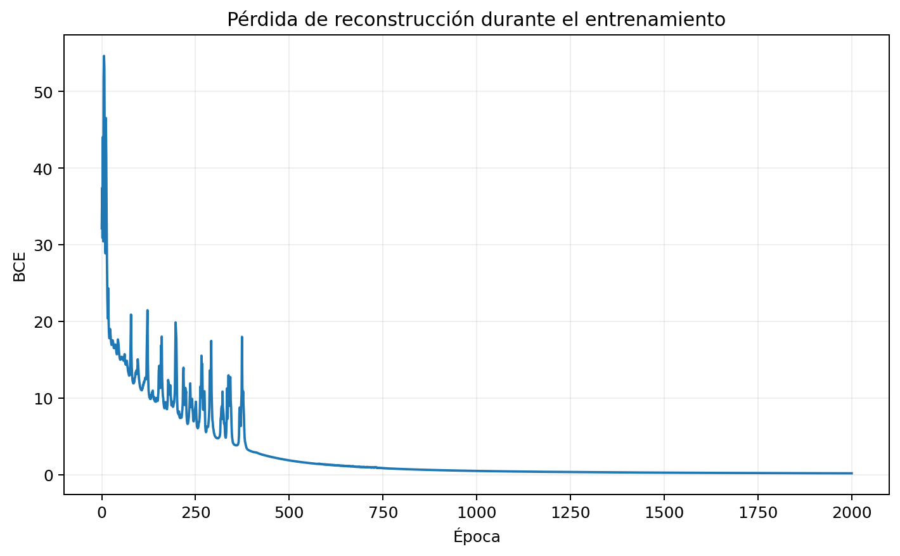
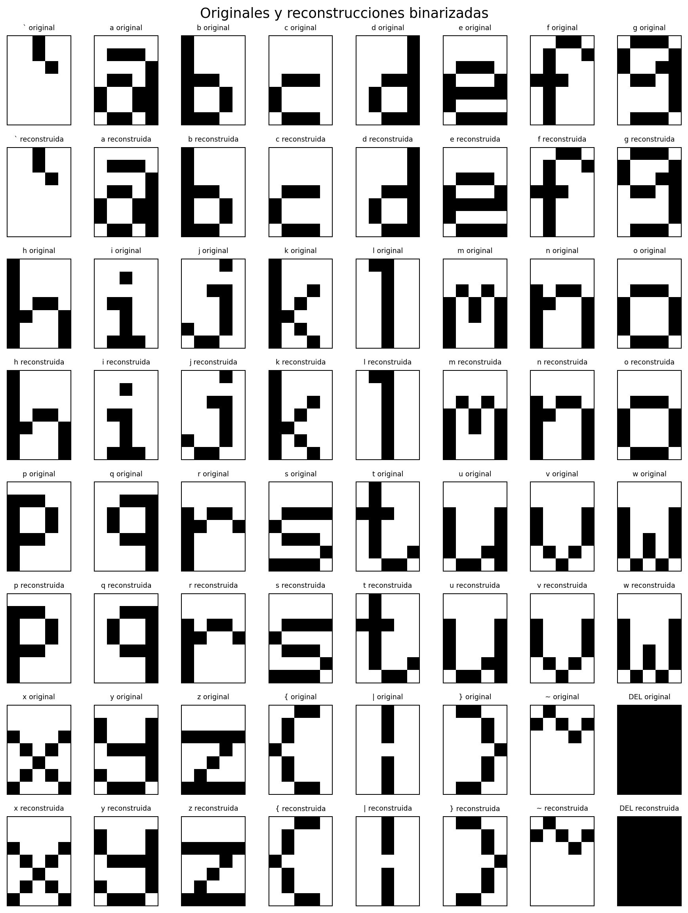
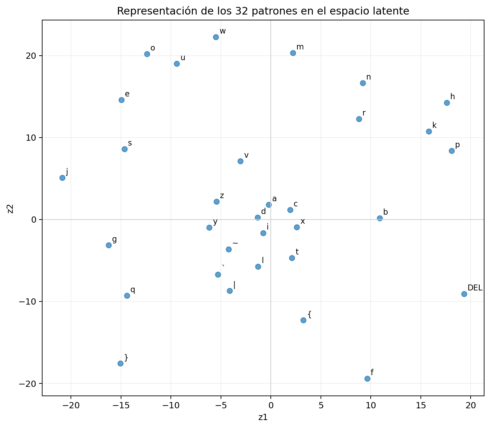
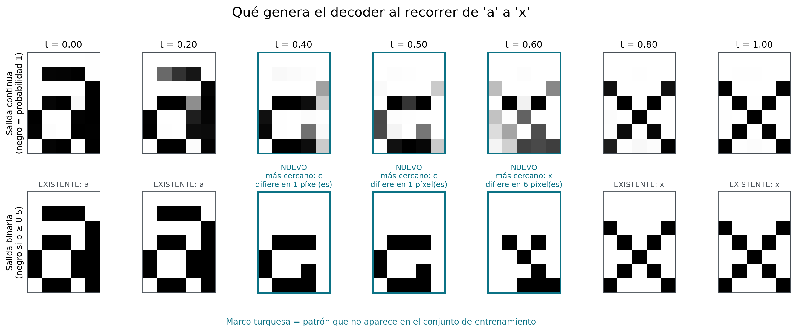

# Ejercicio 1.a - Autoencoder básico: arquitectura, optimización y espacio latente

## Objetivo y criterio de éxito

El objetivo de esta parte es estudiar arquitecturas y técnicas de optimización
que permitan representar los 32 patrones binarios de `font.h`, de 7 x 5
píxeles, en un espacio latente de dimensión 2.

Una reconstrucción se convierte a valores binarios con umbral 0.5 únicamente
para evaluarla. El modelo cumple el requisito si **cada uno de los 32 patrones**
tiene como máximo un píxel incorrecto. No alcanza con que el promedio sea menor
que uno, porque podría ocultar un patrón reconstruido con muchos errores.

Las salidas continuas y la loss se conservan durante el entrenamiento. Aplicar
el umbral dentro de backpropagation eliminaría la información sobre cuánto se
acerca una salida al objetivo: la función escalón tiene derivada cero fuera del
salto y no está definida en el salto.

## Implementación y controles previos

El autoencoder fue implementado con NumPy a partir del MLP propio del TP3. La
implementación permite acceder por separado a:

```text
encode: 35 píxeles -> (z1, z2)
decode: (z1, z2) -> 35 salidas continuas
```

Antes de entrenar los 32 patrones se realizaron dos controles:

1. Backpropagation se comparó contra gradientes numéricos en una red diminuta.
2. La arquitectura provisional `35 -> 15 -> 2 -> 15 -> 35` memorizó una única
   letra `a`: pasó de 16 píxeles incorrectos a cero en 12 épocas con Adam y tasa
   0.01.

Estos controles verifican que el flujo básico funciona, pero no demuestran que
la arquitectura tenga capacidad para aprender los 32 patrones.

## Primera corrida sobre los 32 patrones

Se mantuvo la configuración de la prueba mínima para cambiar una sola cosa: la
cantidad de muestras.

```text
Arquitectura: 35 -> 15 -> 2 -> 15 -> 35
Activaciones: tanh -> lineal -> tanh -> logística
Loss: MSE
Optimizador: Adam
Tasa: 0.01
Semilla: 0
Presupuesto: 20.000 épocas
```

La corrida no cumplió el requisito:

| Métrica final | Resultado |
|---|---:|
| Máximo de píxeles incorrectos | 7 |
| Promedio de píxeles incorrectos | 2,0625 |
| Patrones exactos | 7 de 32 |
| Patrones con como máximo un error | 17 de 32 |

La trayectoria mostró que el modelo había sido mejor antes del final:

| Época | Loss | Máximo de errores |
|---:|---:|---:|
| 0 | 4,497 | 21 |
| 100 | 2,011 | 11 |
| 1.000 | 0,506 | 3 |
| 3.493 | 0,446 | 3 |
| 10.000 | 0,484 | 4 |
| 20.000 | 1,032 | 7 |

Este resultado motivó dos decisiones metodológicas:

- no asumir que más épocas siempre mejoran el modelo;
- guardar la trayectoria completa y distinguir convergencia lenta de
  inestabilidad posterior.

No se seleccionará retrospectivamente el mejor checkpoint de una única
semilla. En los experimentos de selección se evalúa el estado final después de
un presupuesto común. El mínimo observado se registra solo para diagnosticar si
una tasa nunca aprendió, todavía seguía mejorando o aprendió y luego empeoró.

## Por qué estudiar conjuntamente arquitectura y optimizador

La capacidad de una arquitectura y la facilidad para optimizarla no son
independientes. Una tasa puede ser estable en una red y excesiva en otra; una
red profunda puede ser más sensible al método de optimización. Por eso no se
hará un estudio exhaustivo de arquitecturas con un único optimizador ni un
producto cartesiano de todos los hiperparámetros.

Se usa un embudo:

1. calibrar pocas tasas sobre dos arquitecturas ancla;
2. descartar tasas divergentes o claramente ineficientes;
3. cruzar arquitecturas representativas con perfiles viables;
4. refinar solo donde los resultados muestran una frontera o tendencia;
5. confirmar pocos finalistas con más semillas.

## Optimizadores implementados

- **Descenso de gradiente:** utiliza el gradiente actual.
- **Momentum:** agrega una fracción del cambio anterior para acumular dirección
  y reducir zigzag.
- **RMSProp:** divide cada paso por una escala basada en gradientes cuadrados
  recientes.
- **Adam:** combina promedio del gradiente, adaptación por segundo momento y
  corrección del sesgo inicial.

Los parámetros internos se mantuvieron fijos para no multiplicar el espacio de
búsqueda: `alpha=0.9` para Momentum, `gamma=0.9` para RMSProp y
`beta1=0.9`, `beta2=0.999` para Adam. En esta etapa solo se calibró la tasa.

## Calibración inicial de tasas

Se usaron dos arquitecturas ancla:

```text
anchor-15: 35 -> 15 -> 2 -> 15 -> 35
anchor-35: 35 -> 35 -> 2 -> 35 -> 35
```

Cada combinación se entrenó durante exactamente 2.000 épocas con semilla 0.
Esta única semilla sirve para eliminar valores claramente inviables; no permite
elegir un optimizador final.

Las tasas iniciales fueron:

| Optimizador | Tasas |
|---|---|
| Descenso | 0,01; 0,1; 1,0 |
| Momentum | 0,01; 0,05; 0,2 |
| RMSProp | 0,0001; 0,001; 0,01 |
| Adam | 0,0001; 0,001; 0,01 |

Las 24 corridas terminaron en 11,3 segundos y ninguna divergió. Ninguna alcanzó
un máximo de un píxel; el mejor máximo observado fue 3.

### Tasas demasiado lentas para el presupuesto

`GD 0.01`, `RMSProp 0.0001` y `Adam 0.0001` terminaron con máximos de entre 12 y
17 errores en ambas arquitecturas. Sus curvas continuaban descendiendo: no se
concluye que sean incapaces, sino que quedaron dominadas en eficiencia por tasas
mayores del mismo optimizador para un presupuesto común.

### Tasas inestables y evidencia de interacción

Momentum 0.2 con `anchor-15` alcanzó una loss mínima de 0,521 en la época 1.032,
pero terminó con loss 1,769 y 22 errores máximos. GD 1.0 mostró una inestabilidad
menor: mínimo 0,500 en la época 683 y final 0,625 con 8 errores máximos.

Sin embargo, con `anchor-35` esas mismas tasas continuaron mejorando hasta el
final: GD 1.0 terminó con máximo 3 y Momentum 0.2 con máximo 4. Por lo tanto, no
pueden clasificarse como universalmente malas; su estabilidad depende de la
arquitectura.

RMSProp y Adam con tasas 0.001 y 0.01 fueron estables en ambas anclas. La tasa
0.01 produjo menor loss y más patrones dentro del límite en este presupuesto,
por lo que se conserva para el tamiz. La tasa 0.001 queda como alternativa si
los entrenamientos más largos revelan inestabilidad.

## Refinamiento de GD y Momentum

La calibración dejó intervalos ambiguos. Se agregaron GD 0.3 y 0.5 entre la tasa
estable 0.1 y la agresiva 1.0, y Momentum 0.1 entre 0.05 y 0.2. Se mantuvieron
las dos anclas, la semilla 0 y las 2.000 épocas.

| Arquitectura | Optimizador | Tasa | Loss final | Loss mínima (época) | Máximo final | Patrones <= 1 error |
|---|---|---:|---:|---:|---:|---:|
| anchor-15 | GD | 0,3 | 0,521 | 0,519 (1.999) | 3 | 25 |
| anchor-15 | GD | 0,5 | 0,405 | 0,395 (1.944) | 4 | 26 |
| anchor-15 | Momentum | 0,1 | 0,532 | 0,501 (1.330) | 5 | 24 |
| anchor-35 | GD | 0,3 | 0,167 | 0,167 (2.000) | 2 | 29 |
| anchor-35 | GD | 0,5 | 0,253 | 0,250 (1.958) | 2 | 28 |
| anchor-35 | Momentum | 0,1 | 0,411 | 0,411 (2.000) | 6 | 24 |

GD 0.3 ofrece el compromiso más estable entre ambas anclas: termina cerca de su
mínimo y obtiene máximos de 3 y 2. GD 0.5 no mejora consistentemente el error
binario y presenta un pequeño deterioro final. Momentum 0.1 tampoco resuelve la
interacción observada.

Momentum todavía no se descarta como optimizador: la calibración usa una sola
semilla y el protocolo exige más de una para retirar una opción. Se conserva
Momentum 0.01, que fue estable en ambas anclas y obtuvo máximo 3 en la red ancha.

## Perfiles que pasan al tamiz de arquitecturas

Los perfiles provisionales son:

```text
GD 0.3
Momentum 0.01
RMSProp 0.01
Adam 0.01
```

Se cruzarán primero con semilla 0 contra arquitecturas representativas:

```text
A0: 35 -> 2 -> 35
A1: 35 -> 10 -> 2 -> 10 -> 35
A2: 35 -> 20 -> 2 -> 20 -> 35
A3: 35 -> 35 -> 2 -> 35 -> 35
A4: 35 -> 20 -> 10 -> 2 -> 10 -> 20 -> 35
```

La semilla 0 funciona como tamiz barato. Solo las combinaciones prometedoras se
repetirán con semillas 1 y 2. Si el ancho continúa mejorando, se ampliará el
rango por encima de 35; si aparece una frontera entre éxito y fracaso, se
probarán valores intermedios. Si la profundidad ayuda, se compararán perfiles
internos adicionales y, cuando sea posible, arquitecturas con cantidades de
parámetros parecidas.

## Resultado del tamiz grueso con semilla 0

Las 20 combinaciones se entrenaron durante 2.000 épocas. La tanda terminó en 9
segundos, sin divergencias y sin generar modelos o figuras individuales. Ninguna
combinación alcanzó todavía el máximo requerido de un píxel.

Cantidad de parámetros de cada arquitectura:

| Arquitectura | Capas | Parámetros |
|---|---|---:|
| A0 | `35 -> 2 -> 35` | 177 |
| A1 | `35 -> 10 -> 2 -> 10 -> 35` | 797 |
| A2 | `35 -> 20 -> 2 -> 20 -> 35` | 1.557 |
| A3 | `35 -> 35 -> 2 -> 35 -> 35` | 2.697 |
| A4 | `35 -> 20 -> 10 -> 2 -> 10 -> 20 -> 35` | 1.937 |

Máximo de píxeles incorrectos al final:

| Arquitectura | GD 0,3 | Momentum 0,01 | RMSProp 0,01 | Adam 0,01 |
|---|---:|---:|---:|---:|
| A0 | 11 | 11 | 10 | 10 |
| A1 | 6 | 6 | 3 | 4 |
| A2 | **2** | 4 | **2** | 3 |
| A3 | **2** | 3 | 3 | 3 |
| A4 | **2** | 4 | **2** | 6 |

Cantidad de patrones con como máximo un error:

| Arquitectura | GD 0,3 | Momentum 0,01 | RMSProp 0,01 | Adam 0,01 |
|---|---:|---:|---:|---:|
| A0 | 2 | 3 | 2 | 2 |
| A1 | 19 | 10 | 25 | 22 |
| A2 | **30** | 20 | 26 | 26 |
| A3 | 29 | 22 | 29 | 27 |
| A4 | **30** | 23 | **30** | 20 |

### Interpretación provisional

- A0 funciona como control útil: el bottleneck directo no tiene capacidad
  suficiente bajo ninguno de los cuatro perfiles. Las capas ocultas aportan una
  mejora grande, no solo marginal.
- A1 todavía queda detrás de A2-A4. RMSProp es el mejor perfil para esta red,
  pero su máximo sigue siendo 3.
- A2 logra máximo 2 con GD y RMSProp. GD deja 30 de 32 patrones dentro del
  límite con menos parámetros que A3 y A4.
- A3 reduce más la loss con GD, pero deja 29 patrones dentro del límite, uno
  menos que A2. Aumentar ancho de 20 a 35 no mejora de forma monotónica la
  métrica discreta.
- A4 logra máximo 2 y 30 patrones dentro del límite tanto con GD como con
  RMSProp. Su profundidad puede aportar capacidad, pero todavía debe separarse
  este efecto del aumento en cantidad de parámetros.
- Momentum queda por detrás de otro optimizador en cada arquitectura de esta
  semilla. Se conservará una combinación fuerte para semillas adicionales antes
  de descartarlo definitivamente.
- Adam es competitivo en A1-A3, pero en A4 alcanza su mínimo en la época 1.583
  y luego empeora hasta máximo 6. La combinación profundidad-Adam 0.01 presenta
  una inestabilidad que no aparece con GD o RMSProp.

### Combinaciones propuestas para semillas 1 y 2

Se promueven las combinaciones que permiten confirmar ancho, profundidad e
interacción sin repetir las 20 completas:

```text
A2 + GD 0.3
A3 + GD 0.3
A4 + GD 0.3
A2 + RMSProp 0.01
A4 + RMSProp 0.01
A3 + Momentum 0.01
A3 + Adam 0.01
```

Son 7 combinaciones por 2 semillas adicionales: 14 corridas. A3 se usa como
control para Momentum y Adam porque fue su arquitectura más competitiva entre
las redes anchas. Momentum y Adam no se promoverán a todas las arquitecturas si
siguen dominados en esas repeticiones.

## Confirmación acotada con semillas 1 y 2

Las 14 corridas adicionales terminaron en 7,1 segundos, sin divergencias. Al
agregar la semilla 0 del tamiz se obtienen tres repeticiones por combinación:

| Arquitectura | Optimizador | Máximo por semilla 0/1/2 | Patrones <= 1 por semilla | Peor máximo |
|---|---|---|---|---:|
| A2 | GD 0,3 | 2 / 4 / 3 | 30 / 28 / 29 | 4 |
| A2 | RMSProp 0,01 | 2 / 4 / 3 | 26 / 26 / 28 | 4 |
| A3 | GD 0,3 | **2 / 2 / 1** | **29 / 30 / 32** | **2** |
| A3 | Momentum 0,01 | 3 / 2 / 3 | 22 / 25 / 23 | 3 |
| A3 | Adam 0,01 | 3 / 3 / 3 | 27 / 25 / 29 | 3 |
| A4 | GD 0,3 | 2 / 3 / 11 | 30 / 26 / 9 | 11 |
| A4 | RMSProp 0,01 | 2 / 4 / 2 | 30 / 28 / 28 | 4 |

### Consecuencias de repetir semillas

- A3 + GD es la combinación más estable y la única que alcanzó el requisito en
  alguna repetición: la semilla 2 reconstruyó los 32 patrones con máximo 1. Las
  semillas 0 y 1 quedaron en máximo 2, por lo que todavía no hay cumplimiento
  consistente.
- A4 + GD parecía comparable en semilla 0, pero en semilla 2 empeoró después de
  aprender y terminó con máximo 11. Esta combinación es demasiado sensible a la
  inicialización para promoverla.
- A4 + RMSProp es mucho más estable que A4 + GD, pero no supera a A3 + GD y no
  alcanza el requisito en ninguna semilla.
- A2 no conserva la ventaja aparente de semilla 0: con GD y RMSProp termina con
  máximos 4 y 3 en las otras repeticiones.
- Momentum queda dominado por GD en A3 para las tres semillas. Se retira del
  refinamiento actual; esto descarta el perfil Momentum 0.01 bajo este protocolo,
  no demuestra que Momentum sea universalmente incapaz.
- Adam 0.01 es estable en A3, pero queda fijo en máximo 3 y también es dominado
  por GD 0.3. No se promoverá al refinamiento de arquitectura.

### Próximo refinamiento propuesto

El ancho 20 de A2 queda detrás del ancho 35 de A3 en varias semillas, y A3 aún
queda a un píxel de cumplir en dos de tres repeticiones. Conviene estudiar la
frontera de ancho usando GD 0.3:

```text
35 -> 25 -> 2 -> 25 -> 35
35 -> 30 -> 2 -> 30 -> 35
35 -> 45 -> 2 -> 45 -> 35
35 -> 50 -> 2 -> 50 -> 35
```

Los anchos 25 y 30 refinan el intervalo 20-35. Los anchos 45 y 50 verifican si
la mejora continúa por encima del tamaño de entrada. Se ejecutará primero
semilla 0 como tamiz; solo los anchos competitivos pasarán a semillas 1 y 2.
A4 + RMSProp se conserva como alternativa secundaria, pero no justifica por
ahora ampliar la familia profunda.

## Refinamiento local de tasas sobre A3

Antes de atribuir la ventaja únicamente a la arquitectura, se revisó si la
comparación entre optimizadores estaba condicionada por haber usado una sola
tasa representativa. Sobre A3 (`35 -> 35 -> 2 -> 35 -> 35`), con semilla 0 y
2.000 épocas, se probaron tasas vecinas sin repetir las ya medidas:

| Optimizador | Tasa | Loss final | Máximo final | Patrones <= 1 error |
|---|---:|---:|---:|---:|
| GD | 0,2 | 0,376 | 3 | 28 |
| GD | 0,3 | 0,167 | 2 | 29 |
| GD | 0,4 | 0,191 | 2 | 30 |
| RMSProp | 0,003 | 0,270 | 2 | 28 |
| RMSProp | 0,01 | 0,235 | 3 | 29 |
| RMSProp | 0,03 | 0,281 | 2 | 29 |
| Adam | 0,003 | 0,194 | 2 | 29 |
| Adam | 0,01 | 0,345 | 3 | 27 |
| Adam | 0,03 | 0,469 | 4 | 26 |

Esto corrigió una conclusión demasiado fuerte: Adam 0,01 quedaba dominado,
pero Adam 0,003 es competitivo en esta semilla; RMSProp también cambia su error
máximo al variar la tasa. GD 0,3 sigue teniendo la menor loss y GD 0,4 deja un
patrón adicional dentro del límite. Ninguna tasa nueva cumple todavía. Por eso
la conclusión válida no es que solo GD sirve, sino que la región de GD es la
principal y RMSProp/Adam merecen un control acotado al cambiar el ancho.

## Tamiz local de ancho y optimizador

Se eligieron anchos 30 y 45 para mirar una reducción y una ampliación alrededor
de A3 sin hacer un barrido denso. Se cruzaron con GD 0,3, GD 0,4, RMSProp 0,03 y
Adam 0,003, primero con semilla 0:

| Ancho | Optimizador | Tasa | Loss final | Máximo final | Patrones <= 1 error |
|---:|---|---:|---:|---:|---:|
| 30 | GD | 0,3 | 0,285 | 3 | 29 |
| 30 | GD | 0,4 | 0,334 | 3 | 27 |
| 30 | RMSProp | 0,03 | 0,281 | 3 | 28 |
| 30 | Adam | 0,003 | 0,303 | 3 | 26 |
| 45 | GD | 0,3 | **0,100** | **1** | **32** |
| 45 | GD | 0,4 | 0,170 | 3 | 30 |
| 45 | RMSProp | 0,03 | 0,281 | 2 | 28 |
| 45 | Adam | 0,003 | 0,410 | 3 | 24 |

El ancho 30 no mejora A3. El ancho 45 con GD 0,3 es la primera configuración
que cumple el requisito en este tamiz. El resultado de GD 0,4 muestra que no
basta con aumentar el ancho o la tasa de manera monotónica: existe interacción
entre ambos. Como una sola semilla no alcanza para seleccionar un modelo, se
promovió GD 0,3 en ancho 45 y se conservaron controles de RMSProp y Adam para no
confundir arquitectura con optimizador.

## Confirmación local con semillas 1 y 2

Se hicieron ocho corridas nuevas. Combinadas con la semilla 0 ya disponible,
dan tres repeticiones por alternativa:

| Ancho | Optimizador | Tasa | Máximo por semilla 0/1/2 | Patrones <= 1 por semilla | Cumplimientos |
|---:|---|---:|---|---|---:|
| 45 | GD | 0,3 | **1 / 2 / 1** | **32 / 30 / 32** | **2 de 3** |
| 45 | RMSProp | 0,03 | 2 / 2 / 1 | 28 / 31 / 32 | 1 de 3 |
| 35 | RMSProp | 0,03 | 2 / 4 / 2 | 29 / 29 / 30 | 0 de 3 |
| 35 | Adam | 0,003 | 2 / 2 / 4 | 29 / 23 / 29 | 0 de 3 |

GD 0,3 con ancho 45 es el finalista principal: cumple en dos semillas y en la
restante queda con máximo 2 y 30 de 32 patrones dentro del límite. RMSProp 0,03
también se beneficia del ancho 45 y cumple en una semilla, pero queda detrás de
GD. En ancho 35, RMSProp y Adam no justifican ampliar el estudio actual.

Las pérdidas de GD 0,3 siguieron bajando hasta la época 2.000 en las tres
semillas; no hay evidencia de que el resultado final esté penalizado por un
deterioro tardío. Las dos corridas de GD que cumplieron cruzaron por primera vez
el requisito alrededor de las épocas 962 y 899 y aún lo cumplían al final. En
RMSProp hay pequeñas oscilaciones cerca del mínimo, pero no explican la ventaja
de GD. Esto permite estudiar ahora el presupuesto de épocas sin usar el mejor
checkpoint como selección encubierta.

## Presupuesto de 4.000 épocas para el finalista

Se volvió a entrenar ancho 45 + GD 0,3 desde la misma inicialización de cada
semilla, cambiando únicamente el presupuesto de 2.000 a 4.000 épocas. Se evaluó
el modelo final, no el mejor checkpoint intermedio:

| Semilla | Loss a 2.000 | Loss a 4.000 | Máximo a 2.000 | Máximo a 4.000 | Patrones <= 1 a 2.000 / 4.000 |
|---:|---:|---:|---:|---:|---|
| 0 | 0,100 | 0,070 | 1 | 1 | 32 / 32 |
| 1 | 0,192 | 0,179 | 2 | 2 | 30 / 30 |
| 2 | 0,146 | 0,133 | 1 | 1 | 32 / 32 |

Las tres losses siguieron bajando y su mínimo quedó en la época 4.000, por lo
que no apareció deterioro tardío. Sin embargo, duplicar el cómputo no cambió
ninguna métrica discreta: las semillas 0 y 2 conservaron el cumplimiento y la
semilla 1 siguió con dos patrones fuera del límite y máximo 2. La mejora de loss
en esa semilla además fue pequeña durante la segunda mitad del entrenamiento.

Por lo tanto, 4.000 épocas no resuelven la variabilidad. No se concluye que un
presupuesto todavía mayor jamás pueda funcionar, pero continuar duplicándolo
ahora tiene menor valor esperado que probar un pequeño aumento de capacidad. El
próximo refinamiento razonable es ancho 50 y 60 con GD 0,3, usando primero las
mismas tres semillas o un tamiz acotado que preserve la comparación.

## Aumento de ancho a 50 y 60

Se compararon los anchos 50 y 60 con el mismo optimizador, tasa, semillas y
presupuesto de 4.000 épocas usado para ancho 45. Así, el único cambio deliberado
es la capacidad de las capas ocultas:

| Ancho | Parámetros | Máximo por semilla 0/1/2 | Patrones <= 1 por semilla | Cumplimientos |
|---:|---:|---|---|---:|
| 45 | 3.457 | **1 / 2 / 1** | **32 / 30 / 32** | **2 de 3** |
| 50 | 3.837 | 1 / 2 / 2 | 32 / 30 / 31 | 1 de 3 |
| 60 | 4.597 | 1 / 2 / 3 | 32 / 31 / 28 | 1 de 3 |

Todas las losses alcanzaron su mínimo en la época 4.000, por lo que las
diferencias no se explican por deterioro tardío. Ancho 50 no corrige la semilla
1 y pierde el cumplimiento de la semilla 2. Ancho 60 obtiene una loss muy baja
en semilla 0, pero empeora la métrica discreta de semilla 2 hasta máximo 3.

La conclusión es que aumentar capacidad por encima de 45 no mejora de forma
monotónica la reconstrucción ni la robustez frente a la inicialización. No se
promueven anchos todavía mayores: con la evidencia actual solo aumentarían el
cómputo y la cantidad de parámetros sin una tendencia favorable. Ancho 45
sigue siendo el mejor compromiso observado, aunque todavía no cumple en todas
las semillas.

## Comparación controlada de profundidad

El resultado de A4 no alcanzaba para descartar profundidad porque esa red
también era bastante más angosta y tenía menos parámetros. Se evaluaron dos
arquitecturas profundas con GD 0,3, 4.000 épocas y semillas 0, 1 y 2:

```text
D1: 35 -> 35 -> 15 -> 2 -> 15 -> 35 -> 35
D2: 35 -> 45 -> 20 -> 2 -> 20 -> 45 -> 35
```

| Arquitectura | Parámetros | Máximo por semilla 0/1/2 | Patrones <= 1 por semilla | Cumplimientos |
|---|---:|---|---|---:|
| Ancho 45 | 3.457 | 1 / 2 / 1 | 32 / 30 / 32 | 2 de 3 |
| D1 | 3.697 | 7 / 1 / 2 | 29 / 32 / 30 | 1 de 3 |
| D2 | 5.197 | **1 / 1 / 2** | **32 / 32 / 30** | **2 de 3** |

D1, que permite una comparación de parámetros cercana con ancho 45, es menos
robusta. En semilla 0 alcanzó por primera vez el requisito en la época 2.975,
pero luego la loss subió desde un mínimo de 0,140 hasta 0,202 y el máximo de
errores terminó en 7. Elegir el checkpoint intermedio habría ocultado una
inestabilidad real.

D2 demuestra que la profundidad no es intrínsecamente mala: cumple en dos de
tres semillas y logra máximo 1 en las semillas 0 y 1. Sin embargo, no supera
todavía al ancho 45 en cantidad de cumplimientos, usa aproximadamente 50 % más
parámetros y también falla con máximo 2 en una repetición. La evidencia permite
conservar D2 como segundo finalista, no declarar un ganador entre ambas con solo
tres semillas.

## Cambio de MSE a entropía cruzada binaria

La salida representa 35 píxeles binarios mediante probabilidades producidas por
una sigmoide. Por eso se implementó BCE como alternativa seleccionable, sin
eliminar MSE:

```text
BCE(x, x_hat) = -sum[x log(x_hat) + (1-x) log(1-x_hat)]
```

Las probabilidades se recortan solo al calcular el logaritmo para evitar
`log(0)`. Con la salida `x_hat = sigmoid(2 beta h)`, la derivada respecto de la
preactivación se simplifica a:

```text
dBCE/dh = 2 beta (x_hat - x)
```

Esto evita el factor adicional `x_hat(1-x_hat)` que aparece al combinar MSE con
sigmoide y que puede debilitar la corrección de una salida saturada pero
equivocada. El gradiente de BCE fue validado mediante diferencias finitas y la
loss se probó con probabilidades saturadas. La suite completa quedó en 25 tests.

### Calibración de la tasa para BCE

No se reutilizó automáticamente GD 0,3 porque cambiar la loss cambia la escala
del gradiente. Sobre ancho 45, semilla 0 y 2.000 épocas se probaron tasas
logarítmicamente separadas:

| Tasa | Loss BCE final | Máximo final | Patrones <= 1 | Interpretación |
|---:|---:|---:|---:|---|
| 0,01 | 6,365 | 6 | 13 | demasiado lenta |
| 0,03 | 1,117 | 0 | 32 | viable |
| 0,1 | **0,177** | **0** | **32** | viable y más rápida |
| 0,3 | 144,296 | 22 | 0 | inestable |

Las losses de esta tabla solo se comparan entre corridas BCE; su magnitud no es
comparable directamente con MSE. Las tasas 0,03 y 0,1 pasaron a semillas 1 y 2.

### Confirmación de BCE

| Tasa | Máximo por semilla 0/1/2 | Patrones <= 1 | Resultado final |
|---:|---|---|---|
| 0,03 | 0 / 1 / 0 | 32 / 32 / 32 | cumple 3 de 3 |
| 0,1 | **0 / 0 / 0** | **32 / 32 / 32** | reconstrucción exacta 3 de 3 |

Como BCE 0,1 superó claramente a MSE y al requisito, se completó la confirmación
predefinida con semillas 3 y 4. Ambas también terminaron con máximo 0. El
resultado consolidado es, por lo tanto:

```text
35 -> 45 -> 2 -> 45 -> 35
BCE, GD 0.1, 2.000 épocas
máximo final por semillas 0/1/2/3/4: 0 / 0 / 0 / 0 / 0
```

Las cinco semillas cruzaron el requisito de máximo 1 entre las épocas 582 y
770, y terminaron reconstruyendo exactamente los 32 patrones. No hace falta
refinar más la tasa para satisfacer la consigna: hacerlo agregaría cómputo sin
cambiar la decisión actual.

### Verificación independiente con diez semillas

Después de congelar la configuración se agregaron las semillas 5 a 9 como
verificación, no como una nueva etapa de selección. Las cinco terminaron con
máximo 0 y los 32 patrones exactos. El resultado consolidado para semillas 0 a
9 es:

```text
máximo de píxeles incorrectos: 0 / 0 / 0 / 0 / 0 / 0 / 0 / 0 / 0 / 0
cumplimiento del requisito: 10 de 10
reconstrucción exacta: 10 de 10
```

El primer cumplimiento del requisito ocurrió entre las épocas 438 y 770 según
la inicialización. Esta variación justifica haber usado varias semillas, pero no
cambia la decisión: todas llegan con margen al objetivo dentro de 2.000 épocas.

## Corrida final reproducible

Se fijó la semilla 0 como representante convencional, no por ser la mejor, y se
entrenó nuevamente la configuración elegida durante exactamente 2.000 épocas.
La parada anticipada quedó desactivada para que el modelo guardado coincida con
el presupuesto usado en la verificación.

La corrida final obtuvo BCE 0,177, máximo 0, error medio 0 y los 32 patrones
exactos. Conserva:

- configuración completa y métricas;
- pesos del modelo;
- historia de épocas 0 a 2.000;
- curva de BCE;
- originales y reconstrucciones binarizadas;
- coordenadas latentes en CSV y su gráfico etiquetado.

La curva presenta oscilaciones durante las primeras centenas de épocas y luego
desciende de forma sostenida. El espacio latente ocupa un rango amplio porque la
capa de dos dimensiones es lineal y el autoencoder básico no regulariza ni fija
la escala de los códigos. Por eso el origen y los ejes no tienen un significado
semántico impuesto de antemano.

La configuración reproducible es `configs/ae_final_bce_width45_seed0.json` y
los artefactos generados quedan en `results/ae-final-bce-width45-seed0/`.
Los artefactos seleccionados para versionar con el informe se publicaron en
`docs/`: `ae-final-loss.png`, `ae-final-reconstructions.png`,
`ae-final-latent.png`, `ae-final-metrics.json` y `ae-final-latent.csv`.

### Curva de entrenamiento



### Reconstrucciones finales



### Mapa latente final



## Movimiento en el espacio latente

El gráfico latente contiene un punto por patrón. Cada coordenada se obtiene
aplicando el encoder al vector de 35 píxeles:

```text
x -> encoder -> z = (z1, z2)
```

Los ejes no tienen un significado semántico impuesto. Otra semilla podría
rotar, reflejar, trasladar o cambiar la escala de toda la representación y aun
así reconstruir correctamente. Por eso las distancias y vecindades se
interpretan solo dentro de esta corrida reproducible.

Aunque el decoder acepta matemáticamente cualquier par real, el entrenamiento
solo lo restringe en los 32 códigos producidos por el encoder. Un punto cercano
a esos códigos tiene mayor respaldo empírico que una región vacía, pero un
autoencoder común no garantiza que todo el plano contenga letras válidas ni que
una interpolación produzca una mezcla visual suave.

### Interpolación

Entre dos códigos `z_a` y `z_b` se define el recorrido lineal:

```text
z(t) = (1 - t) z_a + t z_b, con 0 <= t <= 1
```

El punto latente cambia continuamente con `t` y las 35 probabilidades del
decoder también son continuas. La imagen binaria, en cambio, puede permanecer
igual durante una parte del trayecto y cambiar de golpe cuando una probabilidad
cruza el umbral 0,5.

Se consideró primero el segmento `m-n` porque ambos códigos ocupan una región
superior del mapa y los glifos comparten trazos verticales. La comprobación
mostró que sus puntos intermedios se binarizan como `m` o `n`; incluso el punto
medio reproduce exactamente `n`. Esto demuestra que una coordenada nueva no
implica automáticamente un patrón nuevo.

Como caso final se congeló el segmento `a-x`. Su punto medio

```text
z_nuevo = 0,5 z_a + 0,5 z_x
```

produce el patrón:

```text
.....
.....
.....
.###.
#....
#..#.
.###.
```

La salida no coincide con ninguno de los 32 patrones de entrenamiento. Su
vecino binario más cercano es `c`, a distancia de Hamming 1. Esto satisface el
criterio objetivo de novedad, aunque no prueba que el espacio latente tenga una
semántica global ni que toda interpolación genere un glifo coherente.

### Recorrido reproducible y figura final

La utilidad `sia_tp5.latent_interpolation` carga los pesos finales, calcula los
códigos extremos, decodifica valores prefijados de `t` y compara cada salida
binarizada contra los 32 patrones. La configuración está en
`configs/latent_interpolation_ax.json`.

El recorrido produjo:

| `t` | Clasificación binaria | Vecino más cercano |
|---:|---|---|
| 0,0 | coincide con `a` | `a`, distancia 0 |
| 0,2 | coincide con `a` | `a`, distancia 0 |
| 0,4 | nuevo | `c`, distancia 1 |
| 0,5 | nuevo | `c`, distancia 1 |
| 0,6 | nuevo | `x`, distancia 6 |
| 0,8 | coincide con `x` | `x`, distancia 0 |
| 1,0 | coincide con `x` | `x`, distancia 0 |

La fila superior muestra la salida continua: blanco representa probabilidad 0,
negro representa probabilidad 1 y los grises son valores intermedios. La fila
inferior aplica el umbral 0,5: cada píxel pasa a ser blanco o negro. Los marcos
turquesa identifican automáticamente salidas que no pertenecen al conjunto de
entrenamiento. El texto “más cercano: `c`; difiere en 1 píxel” significa que el
nuevo patrón no es `c`, pero su versión binaria está a distancia de Hamming 1
de esa letra.



Los datos completos —coordenadas, 35 probabilidades, salida binaria,
coincidencias y distancias— se guardan en `docs/latent-interpolation-a-x.json`.
No se buscaron más segmentos después de congelar `a-x`, evitando seleccionar
retrospectivamente el resultado más atractivo.

## Conclusiones del autoencoder básico

Las conclusiones respaldadas por los experimentos son:

- la implementación aprende y los gradientes fueron validados;
- la arquitectura de 15 con Adam 0.01 no cumple por sí sola;
- el resultado depende de la interacción arquitectura-optimizador-tasa;
- tasas muy pequeñas son ineficientes bajo el presupuesto, no necesariamente
  incapaces;
- A0 y A1 no justifican más semillas en esta etapa;
- A3 + GD fue la región más prometedora bajo MSE, pero no cumplió de forma
  consistente;
- ancho 45 + GD 0.3 cumplió en dos de tres semillas con MSE;
- llevar ese finalista de 2.000 a 4.000 epocas reduce MSE pero no cambia el
  cumplimiento de ninguna semilla;
- los anchos 50 y 60 no superan al ancho 45 y cumplen solo en una de tres
  semillas;
- la red profunda D1 es inestable, mientras que D2 cumple en dos de tres y queda
  como segundo finalista con mayor costo;
- BCE con ancho 45 y GD 0.1 reconstruye exactamente los 32 patrones en diez de
  diez semillas a 2.000 epocas;
- ancho 45 + RMSProp 0.03 queda como alternativa secundaria;
- Momentum 0.01 y las variantes evaluadas de Adam no justifican más corridas en
  este refinamiento;
- la configuración final quedó fijada en ancho 45, BCE, GD 0.1 y 2.000 épocas;
- la corrida final con semilla 0 reconstruye los 32 patrones exactamente y deja
  guardados el modelo, las reconstrucciones y el mapa latente;
- el punto medio `a-x` genera un patrón binario nuevo y el recorrido completo
  quedó verificado y documentado en una figura reproducible.

Las configuraciones reproducibles son `configs/optimizer_calibration.json` y
`configs/optimizer_calibration_refinement.json`. Los resultados crudos quedan
en `results/optimizer-calibration-v1/` y
`results/optimizer-calibration-refinement-v1/`. El tamiz se define en
`configs/architecture_optimizer_screen_seed0.json` y sus resultados quedan en
`results/architecture-optimizer-screen-seed0-v1/`. La confirmación se define en
`configs/architecture_optimizer_confirmation_seeds12.json` y sus resultados en
`results/architecture-optimizer-confirmation-seeds12-v1/`. Los refinamientos
locales se definen en `configs/a3_optimizer_rate_refinement.json`,
`configs/width_optimizer_local_screen_seed0.json` y
`configs/local_width_optimizer_confirmation_seeds12.json`. La prueba de
presupuesto se define en `configs/width45_gd_epoch_budget_4000.json`.
El aumento de capacidad se define en `configs/width50_60_gd_4000.json`.
La comparación de profundidad se define en
`configs/deep_architecture_comparison_4000.json`.
La calibración y confirmación de BCE se definen en
`configs/bce_gd_rate_calibration_seed0.json`,
`configs/bce_gd_confirmation_seeds12.json` y
`configs/bce_gd_final_confirmation_seeds34.json`. La verificación posterior a
la selección se define en `configs/bce_gd_verification_seeds5_9.json`.
