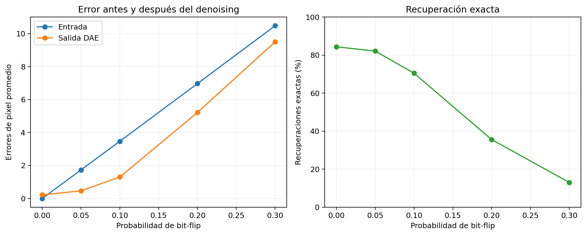
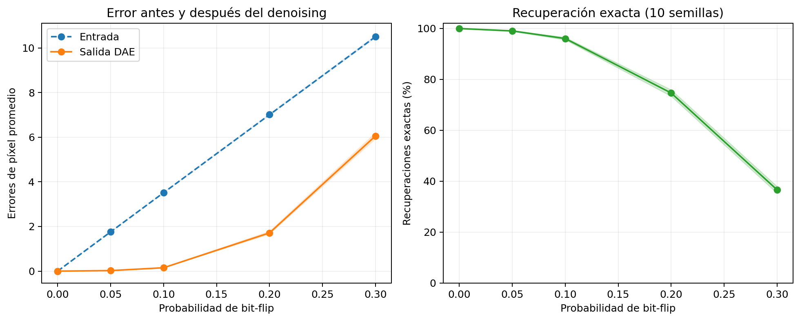
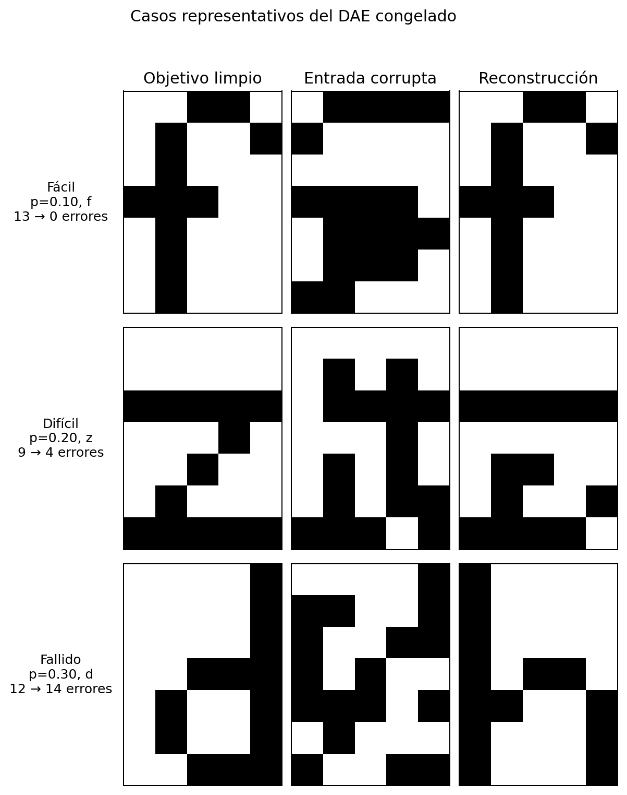

# Ejercicio 1B - Denoising autoencoder

## Objetivo y criterio de evaluación

Esta parte estudia si un autoencoder puede recibir un carácter binario
distorsionado y recuperar el patrón limpio correspondiente. No alcanza con
mostrar ejemplos favorables: se compara la distancia de Hamming de la entrada
ruidosa contra la distancia de Hamming de la salida binarizada.

Para cada caso se registran:

- errores de entrada: píxeles distintos entre la corrupción y el original;
- errores de salida: píxeles distintos entre la reconstrucción y el original;
- mejora: errores de entrada menos errores de salida;
- recuperación exacta: proporción de salidas sin ningún píxel incorrecto.

Las letras de evaluación son las mismas 32 que definen la tarea. Lo que se
mantiene fuera del entrenamiento son las realizaciones concretas del ruido: la
evaluación utiliza semillas independientes y corrupciones que nunca actualizaron
los pesos.

## Arquitectura inicial

Se conserva la arquitectura seleccionada en el ejercicio 1A:

```text
35 -> 45 -> 2 -> 45 -> 35
```

Las capas ocultas usan `tanh`, el código bidimensional es lineal y la salida es
logística. Se mantiene BCE como función de pérdida. Esta elección constituye el
punto de partida porque la arquitectura ya demostró capacidad para reconstruir
los 32 patrones limpios. Así, el primer piloto cambia la tarea de entrenamiento
sin introducir simultáneamente otra arquitectura.

Esto no presupone que la arquitectura sea la mejor para denoising. Se buscará
otra solamente si, después de estabilizar el entrenamiento, aparece evidencia de
una limitación de capacidad.

## Corrupción y entrenamiento

Se usa ruido bit-flip independiente: cada uno de los 35 píxeles se invierte con
probabilidad `p`. Durante el entrenamiento se genera una corrupción nueva en
cada época:

```text
entrada  = bit_flip(patrón_limpio, p_train)
objetivo = patrón_limpio
```

El generador pseudoaleatorio se conserva entre épocas. Por eso las corrupciones
sucesivas son diferentes, mientras que reiniciar la corrida con la misma semilla
reproduce la secuencia completa. Los tests verifican tanto esta propiedad como
que el objetivo de cada actualización permanezca limpio.

El primer protocolo fija `p_train = 0.10`. Para una imagen de 35 píxeles esto
equivale a 3,5 inversiones esperadas. Cada modelo se evalúa sobre 100
corrupciones independientes de cada letra, es decir, 3.200 casos con
`p_test = 0.10`. Las tres corridas siguientes usan la misma inicialización, las
mismas semillas de ruido y exactamente el mismo conjunto de evaluación.

## Pilotos con `p = 0.10`

| Épocas | Tasa | Error entrada | Error salida | Mejora | Recuperación exacta | Mejoró | Empeoró |
|---:|---:|---:|---:|---:|---:|---:|---:|
| 2.000 | 0,10 | 3,470 | 3,581 | -0,111 | 28,1 % | 50,6 % | 39,1 % |
| 10.000 | 0,10 | 3,470 | 3,275 | 0,195 | 34,0 % | 54,8 % | 36,2 % |
| 10.000 | 0,03 | 3,470 | **1,304** | **2,166** | **70,5 %** | **82,6 %** | **11,6 %** |

### Presupuesto de entrenamiento

Extender de 2.000 a 10.000 épocas, sin cambiar ninguna otra variable, convirtió
una degradación media de 0,111 píxeles en una mejora de 0,195. Sin embargo, el
control sin ruido continuó en 1,875 errores medios y algunas letras pasaron de
estar entre las más fáciles a estar entre las más difíciles. Por lo tanto, más
épocas ayudaron, pero no estabilizaron el entrenamiento.

### Tasa de aprendizaje

La tasa `0.1` había sido elegida para el AE limpio, donde el full-batch produce
un gradiente determinista. En el DAE, el lote cambia con cada corrupción y el
gradiente también varía. Se probó entonces `0.03` como único cambio respecto de
la corrida de 10.000 épocas.

La salida pasó de 3,275 a 1,304 errores medios y mejoró las entradas en las 32
letras al promediar sus 100 corrupciones. El control limpio bajó de 1,875 a
0,219 errores medios: 27 de los 32 patrones se reconstruyen exactamente; `` ` ``,
`d`, `l` y `|` tienen un error, mientras que `~` tiene tres. Esto respalda que el
problema principal de los dos primeros pilotos era la optimización inestable, no
una insuficiencia ya demostrada de la arquitectura.

El resultado todavía es exploratorio: corresponde a una sola inicialización y a
un único nivel de ruido. No se declara una configuración final a partir de esta
corrida.

## Curva inicial de capacidad de recuperación

Se congeló el modelo del tercer piloto y se lo evaluó sin actualizar sus pesos.
Cada nivel usa 100 corrupciones de cada uno de los 32 patrones. Se reinicia el
generador con la misma semilla en cada nivel, de modo que las comparaciones se
hacen sobre sorteos equivalentes y `p_test = 0.10` reproduce la evaluación del
piloto.

| `p_test` | Error entrada | Error salida | Mejora | Recuperación exacta | Mejoró | Empeoró |
|---:|---:|---:|---:|---:|---:|---:|
| 0,00 | 0,000 | 0,219 | -0,219 | 84,4 % | 0,0 % | 15,6 % |
| 0,05 | 1,734 | 0,464 | 1,271 | 82,2 % | 73,2 % | 8,8 % |
| 0,10 | 3,470 | 1,304 | 2,166 | 70,5 % | 82,6 % | 11,6 % |
| 0,20 | 6,967 | 5,219 | 1,748 | 35,6 % | 63,7 % | 30,8 % |
| 0,30 | 10,472 | 9,498 | 0,974 | 13,0 % | 50,7 % | 41,2 % |



El DAE elimina una proporción clara del ruido en `p = 0.05` y `p = 0.10`. En
`p = 0.20` todavía reduce 1,748 errores en promedio, pero la recuperación exacta
cae al 35,6 % y casi un tercio de los casos empeora. En `p = 0.30` la mejora
media es menor a un píxel, solo el 13,0 % se recupera exactamente y la diferencia
entre casos mejorados y empeorados es pequeña. Este nivel funciona como caso
extremo, no como evidencia de una limpieza confiable.

El control `p = 0` también es informativo: el DAE altera cinco entradas que ya
estaban limpias. Por lo tanto, una configuración posterior no debe juzgarse solo
por cuánto corrige entradas ruidosas, sino también por cuánto conserva las
limpias.

Los cinco niveles cumplen funciones diferentes: `0` es el control, `0.05` es un
caso fácil, `0.10` coincide con el ruido de entrenamiento, `0.20` es desafiante y
`0.30` muestra el comienzo de la pérdida de identificabilidad. Se conservan para
la curva descriptiva; esto no implica que todos deban usarse para seleccionar
hiperparámetros.

## Refinamiento local de la tasa

Una vez estabilizado el piloto con tasa `0.03`, se compararon `0.01`, `0.03` y
`0.05`. Se mantuvieron fijos arquitectura, BCE, 10.000 épocas, `p_train = 0.10`,
inicialización, secuencia de corrupciones de entrenamiento y los 16.000 casos de
la curva de evaluación. La tasa `0.10` no se repitió porque los pilotos previos
ya mostraron su inestabilidad.

### Error de salida promedio

| Tasa | `p=0` | `p=0.05` | `p=0.10` | `p=0.20` | `p=0.30` |
|---:|---:|---:|---:|---:|---:|
| 0,01 | 0,313 | 0,607 | 1,634 | 5,403 | 9,748 |
| **0,03** | **0,219** | **0,464** | **1,304** | **5,219** | **9,498** |
| 0,05 | 0,500 | 0,788 | 1,625 | 5,308 | 9,575 |

### Recuperación exacta

| Tasa | `p=0` | `p=0.05` | `p=0.10` | `p=0.20` | `p=0.30` |
|---:|---:|---:|---:|---:|---:|
| 0,01 | 78,1 % | 75,0 % | 60,6 % | 27,5 % | 9,0 % |
| **0,03** | **84,4 %** | **82,2 %** | **70,5 %** | **35,6 %** | 13,0 % |
| 0,05 | 71,9 % | 68,1 % | 59,4 % | 33,6 % | **13,1 %** |

La tasa `0.03` obtiene el menor error de salida en los cinco niveles. También
logra la mayor recuperación exacta desde `p = 0` hasta `p = 0.20`. La diferencia
de 0,1 puntos porcentuales a favor de `0.05` en la recuperación exacta de
`p = 0.30` no compensa su mayor error medio ni su mayor proporción de casos
empeorados en ese nivel. Por eso se selecciona **provisionalmente `0.03`**.

La selección sigue siendo exploratoria porque las tres tasas comparten una sola
inicialización. Antes de declarar una configuración final hay que comprobar que
la ventaja se mantenga con otras semillas.

## Confirmación de la tasa entre semillas

Se mantuvieron `eta = 0.03`, la arquitectura, las 10.000 épocas y
`p_train = 0.10`. Se entrenaron los modelos con semillas 0, 1 y 2. Cada semilla
cambia tanto la inicialización como la secuencia de corrupciones de entrenamiento;
los 16.000 casos de evaluación permanecen fijos para realizar una comparación
pareada entre modelos.

| `p_test` | Error entrada | Error salida | Mejora | Recuperación exacta | Casos empeorados |
|---:|---:|---:|---:|---:|---:|
| 0,00 | 0,000 | 0,188 ± 0,083 | -0,188 ± 0,083 | 88,5 ± 4,8 % | 11,5 ± 4,8 % |
| 0,05 | 1,734 | 0,411 ± 0,046 | 1,323 ± 0,046 | 85,4 ± 3,0 % | 7,2 ± 1,4 % |
| 0,10 | 3,470 | 1,258 ± 0,040 | 2,212 ± 0,040 | 73,4 ± 2,6 % | 11,2 ± 0,4 % |
| 0,20 | 6,967 | 5,056 ± 0,194 | 1,910 ± 0,194 | 37,8 ± 2,0 % | 29,9 ± 1,3 % |
| 0,30 | 10,472 | 9,416 ± 0,073 | 1,056 ± 0,073 | 13,9 ± 0,9 % | 41,2 ± 0,3 % |

Los valores son media y desvío estándar muestral entre tres entrenamientos.
En `p = 0.10`, las tres semillas quedan entre 1,233 y 1,304 errores de salida, y
entre 70,5 % y 75,3 % de recuperación exacta. La forma de la curva también se
mantiene: limpieza fuerte hasta `p = 0.10`, degradación clara en `p = 0.20` y
beneficio pequeño en el extremo `p = 0.30`.

La baja dispersión confirma **`eta = 0.03` para este protocolo de entrenamiento**.
Esto confirma la tasa, no demuestra todavía que una corrupción por letra y la
arquitectura actual sean globalmente óptimas.

## Cantidad de corrupciones por actualización

El protocolo confirmado usa una corrupción nueva de cada letra en cada
actualización (`K = 1`), es decir, 32 ejemplos. Se comparó contra `K = 4`: cuatro
corrupciones independientes por letra y 128 ejemplos por actualización. Se
mantuvieron arquitectura, tasa `0.03`, `p_train = 0.10`, 10.000 actualizaciones
y semillas 0, 1 y 2.

La hipótesis era que promediar cuatro variantes reduciría la variabilidad del
gradiente. La reducción del ruido de cada actualización no produjo, sin embargo,
un entrenamiento más estable entre inicializaciones.

### Error de salida, media y desvío entre semillas

| `K` | `p=0` | `p=0.05` | `p=0.10` | `p=0.20` | `p=0.30` |
|---:|---:|---:|---:|---:|---:|
| **1** | **0,188 ± 0,083** | **0,411 ± 0,046** | **1,258 ± 0,040** | **5,056 ± 0,194** | **9,416 ± 0,073** |
| 4 | 1,552 ± 1,349 | 1,868 ± 1,421 | 2,582 ± 1,389 | 5,778 ± 1,069 | 9,771 ± 0,575 |

En `p = 0.10`, las tres corridas con `K = 1` quedaron entre 1,233 y 1,304
errores. Con `K = 4`, la semilla 2 mejoró hasta 1,026, pero las semillas 0 y 1
subieron a 3,026 y 3,696. El promedio empeoró, el desvío creció más de treinta
veces y la recuperación exacta media bajó de 73,4 % a 55,3 %.

Por lo tanto, **se conserva `K = 1`**. La conclusión está acotada a la tasa y al
presupuesto estudiados: no afirma que `K = 4` sea siempre perjudicial, sino que
no funciona como una mejora directa del protocolo actual. Además requiere cuatro
veces más ejemplos por actualización.

## Comparación de arquitecturas

Con el protocolo estabilizado se estudió finalmente si la arquitectura elegida
para el AE limpio seguía siendo conveniente para denoising. Se mantuvieron el
latente bidimensional, BCE, tasa `0.03`, 10.000 actualizaciones,
`p_train = 0.10` y `K = 1`.

El tamiz con semilla 0 comparó:

| Nombre | Capas | Parámetros | Hipótesis |
|---|---|---:|---|
| Baseline | `35-45-2-45-35` | 3.457 | Arquitectura del ejercicio 1A |
| Ancha | `35-60-2-60-35` | 4.597 | Más capacidad alrededor del cuello |
| Profunda | `35-45-15-2-15-45-35` | 4.717 | Compresión y expansión graduales |

Las dos candidatas mejoraron al baseline en los niveles ruidosos. La profunda
fue la mejor desde `p = 0.10`, mientras la ancha obtuvo una ventaja pequeña en
la conservación limpia y en `p = 0.05`. Como el objetivo central es recuperar
entradas distorsionadas, la profunda pasó a confirmación con semillas 0, 1 y 2.

### Baseline contra arquitectura profunda, tres semillas

Error de salida promedio:

| Arquitectura | `p=0` | `p=0.05` | `p=0.10` | `p=0.20` | `p=0.30` |
|---|---:|---:|---:|---:|---:|
| Baseline | **0,188 ± 0,083** | 0,411 ± 0,046 | 1,258 ± 0,040 | 5,056 ± 0,194 | 9,416 ± 0,073 |
| **Profunda** | 0,229 ± 0,180 | **0,363 ± 0,178** | **1,013 ± 0,116** | **4,389 ± 0,203** | **9,093 ± 0,339** |

Recuperación exacta promedio:

| Arquitectura | `p=0` | `p=0.05` | `p=0.10` | `p=0.20` | `p=0.30` |
|---|---:|---:|---:|---:|---:|
| Baseline | 88,5 % | 85,4 % | 73,4 % | 37,8 % | 13,9 % |
| **Profunda** | **90,6 %** | **88,2 %** | **79,9 %** | **49,8 %** | **21,3 %** |

La arquitectura profunda reduce el error medio 19,5 % en `p = 0.10` y 13,2 %
en `p = 0.20`. También disminuye la proporción de casos empeorados en todos los
niveles. En el control limpio su error medio es 0,042 píxeles mayor, pero la
recuperación exacta sube de 88,5 % a 90,6 %: los pocos errores restantes están
más concentrados en algunos patrones.

El costo es pasar de 3.457 a 4.717 parámetros, un incremento de 36,4 %. La mejora
se repite en tres semillas y es especialmente clara en ruido medio, por lo que
se selecciona **`35-45-15-2-15-45-35` como arquitectura conveniente para el
DAE**. La arquitectura ancha se conserva como resultado del tamiz, pero no se
confirma porque la profunda fue superior en el objetivo principal.

## Entrenamiento con entradas limpias y ruidosas

Aunque la arquitectura profunda mejoró la curva, todavía alteraba algunos
patrones sin ruido. Con `p_train = 0.10`, la probabilidad de que los 35 bits de
una corrupción permanezcan intactos es solo `0.9^35`, aproximadamente 2,5 %.
Por eso una letra completamente limpia aparece pocas veces por azar.

Se probó un lote mixto en cada actualización:

```text
32 entradas limpias  -> 32 objetivos limpios
32 entradas ruidosas -> 32 objetivos limpios
```

La mitad ruidosa se vuelve a generar en cada época. Este protocolo se comparó
contra el entrenamiento exclusivamente ruidoso usando la arquitectura profunda,
10.000 actualizaciones, tasa `0.03` y semillas 0, 1 y 2.

### Resultados agregados

Error de salida promedio:

| Entrenamiento | `p=0` | `p=0.05` | `p=0.10` | `p=0.20` | `p=0.30` |
|---|---:|---:|---:|---:|---:|
| Solo ruidoso | 0,229 ± 0,180 | 0,363 ± 0,178 | 1,013 ± 0,116 | 4,389 ± 0,203 | 9,093 ± 0,339 |
| **Limpio + ruidoso** | **0,010 ± 0,018** | **0,132 ± 0,019** | **0,713 ± 0,112** | **4,123 ± 0,159** | **8,790 ± 0,023** |

Recuperación exacta promedio:

| Entrenamiento | `p=0` | `p=0.05` | `p=0.10` | `p=0.20` | `p=0.30` |
|---|---:|---:|---:|---:|---:|
| Solo ruidoso | 90,6 % | 88,2 % | 79,9 % | 49,8 % | 21,3 % |
| **Limpio + ruidoso** | **99,0 %** | **96,7 %** | **88,4 %** | **53,5 %** | **21,8 %** |

La mezcla mejora los cinco niveles, reduce la dispersión y disminuye la
proporción de casos empeorados. El efecto es especialmente fuerte en el control,
`p = 0.05` y `p = 0.10`, sin pagar una degradación en ruido alto. Se selecciona
por lo tanto **entrenamiento limpio + ruidoso**.

El 99 % se alcanza en promedio para entradas limpias y se aproxima en
`p = 0.05`. En `p = 0.10`, el 88,4 % todavía queda por debajo de la referencia
de un clasificador por patrón más cercano, por lo que existe margen para estudiar
un schedule de tasa o un cuello latente mayor. Eso sería una nueva etapa
experimental, no una condición necesaria para demostrar que el DAE elimina
ruido.

## Decaimiento de la tasa

Se probó un decaimiento exponencial desde `0.03` en la primera actualización
hasta `0.003` en la número 10.000. La hipótesis era conservar pasos grandes al
principio y reducir la oscilación alrededor de una solución al final. Se mantuvo
fijo el lote limpio + ruidoso y se repitieron las semillas 0, 1 y 2.

### Error de salida promedio

| Tasa | `p=0` | `p=0.05` | `p=0.10` | `p=0.20` | `p=0.30` |
|---|---:|---:|---:|---:|---:|
| Constante `0.03` | 0,010 ± 0,018 | 0,132 ± 0,019 | 0,713 ± 0,112 | 4,123 ± 0,159 | 8,790 ± 0,023 |
| **Exponencial** | **0,000 ± 0,000** | **0,101 ± 0,003** | **0,659 ± 0,002** | **4,037 ± 0,147** | **8,664 ± 0,013** |

El schedule reduce el error medio y la proporción de casos empeorados en los
cinco niveles. También reduce fuertemente la dispersión entre entrenamientos: en
`p = 0.10`, el desvío del error baja de 0,112 a 0,002 píxeles.

### Recuperación exacta promedio

| Tasa | `p=0` | `p=0.05` | `p=0.10` | `p=0.20` | `p=0.30` |
|---|---:|---:|---:|---:|---:|
| Constante `0.03` | 99,0 % | 96,7 % | **88,4 %** | **53,5 %** | **21,8 %** |
| Exponencial | **100,0 %** | **97,2 %** | 87,8 % | 51,8 % | 19,9 % |

El schedule produce menos píxeles incorrectos, pero distribuidos entre una
cantidad levemente mayor de patrones en los niveles medios y altos. Por eso no
domina a la tasa constante si el único criterio es la recuperación exacta. Para
el objetivo general de eliminar la mayor cantidad de ruido y obtener resultados
estables, se selecciona el **decaimiento exponencial**; la tasa constante se
conserva como alternativa si se prioriza estrictamente la cantidad de patrones
perfectos en `p >= 0.10`.

El experimento no alcanza 99 % exacto en `p = 0.10`. En los mismos casos, un
selector ideal por distancia de Hamming entre los 32 patrones obtiene alrededor
de 98,2 %, debido a empates y corrupciones más cercanas a otra letra. Por eso 99 %
no es una meta esperable en ese nivel bajo el modelo de ruido actual. Aumentar el
latente puede estudiar cuánto de la brecha restante corresponde a capacidad del
DAE.

## Dimensión del espacio latente

La exigencia de un espacio bidimensional pertenece al ejercicio 1A. El inciso
1B pide una arquitectura conveniente para denoising, por lo que se estudió si
ampliar el cuello de 2 a 5 dimensiones permite separar mejor las regiones
correspondientes a cada letra y sus corrupciones.

Se compararon:

```text
35 -> 45 -> 15 -> 2 -> 15 -> 45 -> 35   (4.717 parámetros)
35 -> 45 -> 15 -> 5 -> 15 -> 45 -> 35   (4.810 parámetros)
```

Se mantuvieron el lote limpio + ruidoso, el schedule `0.03 -> 0.003`, las 10.000
actualizaciones y las semillas 0, 1 y 2. El aumento del latente agrega solo 93
parámetros, aproximadamente 2 %.

### Error de salida promedio

| Latente | `p=0` | `p=0.05` | `p=0.10` | `p=0.20` | `p=0.30` |
|---:|---:|---:|---:|---:|---:|
| 2 | 0,000 | 0,101 ± 0,003 | 0,659 ± 0,002 | 4,037 ± 0,147 | 8,664 ± 0,013 |
| **5** | **0,000** | **0,049 ± 0,006** | **0,400 ± 0,019** | **3,073 ± 0,031** | **7,538 ± 0,097** |

### Recuperación exacta promedio

| Latente | `p=0` | `p=0.05` | `p=0.10` | `p=0.20` | `p=0.30` |
|---:|---:|---:|---:|---:|---:|
| 2 | 100,0 % | 97,2 % | 87,8 % | 51,8 % | **19,9 %** |
| **5** | **100,0 %** | **98,3 %** | **90,4 %** | **53,0 %** | 18,5 % |

El latente 5 reduce el error medio en todos los niveles, baja la proporción de
casos empeorados y aumenta la recuperación exacta hasta `p = 0.20`. En
`p = 0.30` obtiene menos patrones totalmente exactos, pero también 1,126 píxeles
incorrectos menos por salida y reduce los casos empeorados de 35,5 % a 22,9 %.

Por lo tanto, se selecciona **`35-45-15-5-15-45-35`** como arquitectura final
del DAE. El cambio no busca preservar la visualización bidimensional de 1A, sino
mejorar la capacidad de recuperación requerida por 1B.

## Mezcla de niveles de ruido durante el entrenamiento

El protocolo anterior entrenaba cada letra con una copia limpia y una
corrupción en `p_train = 0.10`. Para cubrir mejor la curva sin entrenar con el
nivel extremo `0.30`, se comparó contra un lote multinivel:

```text
32 entradas limpias          -> objetivos limpios
32 corrupciones con p = 0.05 -> objetivos limpios
32 corrupciones con p = 0.10 -> objetivos limpios
32 corrupciones con p = 0.20 -> objetivos limpios
```

Los tres bloques ruidosos se regeneran en cada época. Arquitectura, schedule,
10.000 actualizaciones y semillas 0, 1 y 2 permanecieron fijos. El lote pasa de
64 a 128 ejemplos por actualización, por lo que esta mejora tiene un costo de
cómputo mayor.

### Error de salida promedio

| Ruido de entrenamiento | `p=0` | `p=0.05` | `p=0.10` | `p=0.20` | `p=0.30` |
|---|---:|---:|---:|---:|---:|
| Solo `0.10` | 0,000 | 0,049 ± 0,006 | 0,400 ± 0,019 | 3,073 ± 0,031 | 7,538 ± 0,097 |
| **Multinivel** | **0,000** | **0,039 ± 0,003** | **0,318 ± 0,012** | **2,526 ± 0,014** | **6,724 ± 0,118** |

### Recuperación exacta promedio

| Ruido de entrenamiento | `p=0` | `p=0.05` | `p=0.10` | `p=0.20` | `p=0.30` |
|---|---:|---:|---:|---:|---:|
| Solo `0.10` | 100,0 % | 98,3 % | 90,4 % | 53,0 % | 18,5 % |
| **Multinivel** | **100,0 %** | **98,7 %** | **91,7 %** | **57,1 %** | **21,2 %** |

La mezcla mejora los cinco niveles evaluados, incluyendo `p = 0.30`, que no
participa del entrenamiento. En `p = 0.20` reduce el error 17,8 % y los casos
empeorados de 12,2 % a 8,3 %. En `p = 0.10`, las tres semillas quedan entre
91,7 % y 91,8 % de recuperación exacta.

Se selecciona por lo tanto el **entrenamiento multinivel limpio + `0.05` +
`0.10` + `0.20`**. El resultado se acerca al 99 % en ruido bajo sin usar las
corrupciones concretas de evaluación durante las actualizaciones.

## Activación de las capas ocultas

Con arquitectura y entrenamiento ya fijados se comparó `tanh` contra Leaky ReLU
con pendiente negativa `0.01`. El código latente permaneció lineal y la salida
logística, necesaria para BCE. No se modificó la inicialización, de modo que el
único cambio experimental fue la activación de las cuatro capas ocultas.

Leaky ReLU se define como:

```text
f(h) = h        si h >= 0
       0.01 h   si h < 0
```

A diferencia de `tanh`, no se satura para valores positivos grandes y mantiene
un gradiente pequeño del lado negativo. Su derivada fue verificada contra
gradientes numéricos antes de ejecutar los experimentos.

### Error de salida promedio

| Activación | `p=0` | `p=0.05` | `p=0.10` | `p=0.20` | `p=0.30` |
|---|---:|---:|---:|---:|---:|
| `tanh` | 0,000 | **0,039 ± 0,003** | 0,318 ± 0,012 | 2,526 ± 0,014 | 6,724 ± 0,118 |
| **Leaky ReLU** | **0,000** | 0,039 ± 0,004 | **0,239 ± 0,014** | **2,228 ± 0,038** | **6,571 ± 0,089** |

### Recuperación exacta promedio

| Activación | `p=0` | `p=0.05` | `p=0.10` | `p=0.20` | `p=0.30` |
|---|---:|---:|---:|---:|---:|
| `tanh` | 100,0 % | 98,7 % | 91,7 % | 57,1 % | 21,2 % |
| **Leaky ReLU** | **100,0 %** | **98,7 %** | **93,8 %** | **64,4 %** | **28,0 %** |

Leaky ReLU queda prácticamente empatada en `p = 0.05` y mejora con claridad los
tres niveles superiores. En `p = 0.20`, por ejemplo, agrega 7,3 puntos
porcentuales de recuperación exacta. En `p = 0.30` aumenta levemente la fracción
de casos empeorados, de 16,5 % a 17,7 %, pero reduce el error medio y aumenta la
recuperación exacta en 6,7 puntos.

Se selecciona **Leaky ReLU en las capas ocultas**, manteniendo latente lineal y
salida logística.

## Tamiz de Adam para el DAE

La calibración del AE limpio no determina necesariamente el mejor optimizador
para el DAE: las corrupciones nuevas hacen que el gradiente cambie en cada
época. Adam combina una media móvil del gradiente con otra del gradiente al
cuadrado, adaptando el paso de cada parámetro.

Se realizó un tamiz con semilla 0, manteniendo arquitectura, activaciones, lote
multinivel y 10.000 actualizaciones:

- descenso con schedule `0.03 -> 0.003`, baseline vigente;
- Adam con tasa `0.001`;
- Adam con tasa `0.003`.

### Error de salida

| Optimizador | `p=0` | `p=0.05` | `p=0.10` | `p=0.20` | `p=0.30` |
|---|---:|---:|---:|---:|---:|
| Descenso + schedule | 0,000 | 0,036 | 0,228 | 2,196 | 6,615 |
| Adam `0.001` | 0,000 | 0,030 | 0,273 | 2,338 | 6,792 |
| **Adam `0.003`** | **0,000** | **0,019** | **0,176** | **1,912** | **6,249** |

### Recuperación exacta

| Optimizador | `p=0` | `p=0.05` | `p=0.10` | `p=0.20` | `p=0.30` |
|---|---:|---:|---:|---:|---:|
| Descenso + schedule | 100,0 % | 98,8 % | 93,9 % | 64,7 % | 27,7 % |
| Adam `0.001` | 100,0 % | 98,8 % | 92,8 % | 61,9 % | 25,8 % |
| **Adam `0.003`** | **100,0 %** | **99,2 %** | **95,3 %** | **72,0 %** | **32,4 %** |

Adam `0.001` se descarta porque queda por debajo del baseline en los niveles
principales. Adam `0.003` mejora los cinco niveles y supera por primera vez 99 %
exacto con ruido `p = 0.05`. Por eso se tomó como centro de un refinamiento
local antes de congelar el optimizador.

## Refinamiento y confirmación de la tasa de Adam

Se completó el tamiz local con tasas `0.001`, `0.002`, `0.003` y `0.005`,
manteniendo fija la semilla 0 y todo el protocolo restante. La tasa `0.002`
quedó entre `0.001` y `0.003`, mientras que `0.005` produjo el mejor resultado
de la semilla en los niveles `p >= 0.10`. Como la ventaja sobre `0.003` era
pequeña, ambas tasas se confirmaron con semillas 0, 1 y 2.

### Error de salida promedio en tres semillas

| Tasa Adam | `p=0` | `p=0.05` | `p=0.10` | `p=0.20` | `p=0.30` |
|---|---:|---:|---:|---:|---:|
| `0.003` | 0,000 | 0,025 ± 0,004 | 0,166 ± 0,008 | 1,826 ± 0,060 | 6,123 ± 0,098 |
| **`0.005`** | **0,000** | **0,023 ± 0,004** | **0,147 ± 0,008** | **1,713 ± 0,084** | **5,993 ± 0,065** |

### Recuperación exacta promedio en tres semillas

| Tasa Adam | `p=0` | `p=0.05` | `p=0.10` | `p=0.20` | `p=0.30` |
|---|---:|---:|---:|---:|---:|
| `0.003` | 100,0 % | **99,17 ± 0,10 %** | 95,55 ± 0,36 % | 73,06 ± 0,98 % | 34,60 ± 1,66 % |
| **`0.005`** | **100,0 %** | 99,16 ± 0,16 % | **96,34 ± 0,27 %** | **75,47 ± 0,94 %** | **37,09 ± 1,51 %** |

En `p = 0.05` las tasas están empatadas: la diferencia de recuperación es de
solo 0,01 puntos porcentuales y `0.005` tiene menor error medio. En los tres
niveles superiores, `0.005` reduce el error y aumenta consistentemente la
recuperación exacta. En `p = 0.10` alcanza **96,34 %**, frente a 95,55 % con
`0.003`; en `p = 0.20` la mejora es de 2,41 puntos y en `p = 0.30`, de 2,49.

Se selecciona por lo tanto **Adam con tasa `0.005`**. La elección no depende de
una única inicialización y no requirió cambiar la arquitectura. Los resultados
del tamiz local y la confirmación se publican en
`docs/dae/experiments/adam-rate-screen-seed0.csv` y
`docs/dae/experiments/adam-rate-confirmation.csv`.

## Confirmación final con diez semillas

Una vez seleccionada la configuración, se congelaron arquitectura,
activaciones, optimizador, tasa, lote y presupuesto. Se ampliaron únicamente
las repeticiones desde tres hasta diez semillas (`0` a `9`). Esta etapa no se
usó para volver a ajustar hiperparámetros, sino para estimar la estabilidad del
resultado elegido.

| `p_test` | Error de salida | Recuperación exacta | Rango entre semillas | Casos empeorados |
|---:|---:|---:|---:|---:|
| 0,00 | 0,000 ± 0,000 | 100,00 ± 0,00 % | 100,00–100,00 % | 0,00 ± 0,00 % |
| 0,05 | 0,024 ± 0,004 | 99,06 ± 0,14 % | 98,88–99,28 % | 0,20 ± 0,09 % |
| 0,10 | 0,151 ± 0,018 | 96,06 ± 0,47 % | 95,25–96,69 % | 0,68 ± 0,20 % |
| 0,20 | 1,715 ± 0,082 | 74,65 ± 1,24 % | 72,16–76,75 % | 5,94 ± 0,49 % |
| 0,30 | 6,059 ± 0,158 | 36,58 ± 1,31 % | 34,56–39,22 % | 16,93 ± 0,98 % |

La dispersión es baja en relación con las diferencias observadas durante la
selección. Ninguna semilla falla en la reconstrucción limpia y, en `p = 0.10`,
incluso la peor conserva 95,25 % de recuperación exacta. La degradación al
aumentar el ruido aparece en todas las semillas con la misma forma, por lo que
no se debe a una inicialización aislada.

La configuración queda **formalmente congelada**. Los valores individuales y
agregados se publican en `docs/dae/final/confirmation-seeds.csv` y
`docs/dae/final/confirmation-aggregate.csv`.

## Curva final y análisis de casos

La curva final agrega las diez semillas. La línea representa la media entre
modelos y la banda, un desvío estándar entre semillas. Cada modelo fue evaluado
con 3.200 corrupciones independientes por nivel, es decir, 32.000 casos por
punto de la curva.



Se distinguen tres regímenes:

- En `p = 0.10`, el DAE reduce el error de 3,514 a 0,151 píxeles por patrón y
  recupera exactamente 96,06 % de los casos. Es el régimen de funcionamiento
  fuerte.
- En `p = 0.20`, reduce el error de 7,010 a 1,715 y todavía recupera exactamente
  74,65 %. La salida mejora respecto de la entrada en la gran mayoría de los
  casos, aunque ya no siempre reconstruye la letra completa.
- En `p = 0.30`, reduce el error medio de 10,505 a 6,059, pero la recuperación
  exacta cae a 36,58 % y 16,93 % de los casos resultan empeorados. El modelo
  conserva utilidad promedio, pero deja de ser confiable caso por caso.

Para evitar seleccionar imágenes a ojo se fijaron las categorías antes de
graficar:

- **Fácil:** en `p = 0.10`, una entrada no limpia que termina exacta; se muestra
  el caso con más bits alterados dentro de esa categoría.
- **Difícil:** en `p = 0.20`, mejora pero no llega al objetivo; se muestra un
  caso representativo cercano a las medianas de errores de entrada y salida.
- **Fallido:** en `p = 0.30`, la salida tiene más errores que la entrada; también
  se selecciona un caso representativo, no el peor extremo.



El caso fácil es una `f` que pasa de 13 errores a reconstrucción exacta. El
difícil es una `z` que mejora de 9 a 4 errores: la red elimina ruido, pero su
prior aprendido no alcanza para identificar completamente el patrón. El caso
fallido es una `d` que pasa de 12 a 14 errores; con tanta información destruida,
la reconstrucción se desplaza hacia una forma incorrecta y agrega errores.

El agregado por carácter muestra además una dificultad persistente. `DEL`,
`q`, `t` y `g` se encuentran entre los caracteres más fáciles, mientras que
`|`, `` ` ``, `n` y `r` aparecen repetidamente entre los más difíciles. Los
patrones simples o parecidos a otros caracteres ofrecen menos evidencia para
decidir qué bits eran ruido, mientras que formas más distintivas toleran mejor
la corrupción. Esta última explicación es una interpretación compatible con
los resultados, no una propiedad demostrada de cada unidad latente.

Los datos reproducibles están en
`docs/dae/final/noise-curve-aggregate.csv`,
`docs/dae/final/label-difficulty.csv` y
`docs/dae/final/representative-cases.json`. La utilidad
`sia_tp5.denoising_final_analysis` regenera tablas y figuras desde los diez
modelos congelados.

## Cierre respecto de la consigna

La consigna pide distorsionar entradas en diferentes niveles y estudiar la
capacidad del autoencoder para eliminar el ruido. El ejercicio queda respondido
por la siguiente evidencia:

1. Se implementó bit-flip reproducible para entradas binarias y se mantuvo
   siempre la letra limpia como objetivo.
2. Durante el entrenamiento se generaron corrupciones nuevas en cada época; la
   evaluación utilizó corrupciones independientes que nunca actualizaron los
   pesos.
3. Se evaluaron cinco niveles: `p = 0`, `0.05`, `0.10`, `0.20` y `0.30`.
4. Se comparó el error antes y después del DAE, la recuperación exacta y la
   frecuencia de casos mejorados, sin cambio y empeorados.
5. La configuración final se confirmó con diez inicializaciones y semillas de
   ruido independientes.
6. La curva agregada y los casos fácil, difícil y fallido muestran tanto la
   capacidad como sus límites, en lugar de presentar solo ejemplos favorables.

La conclusión es que el DAE elimina el ruido de forma muy confiable hasta
`p = 0.10`, conserva una capacidad importante pero imperfecta en `p = 0.20` y,
en `p = 0.30`, todavía reduce el error promedio aunque deja de ser confiable en
cada caso individual. La degradación es gradual y estable entre semillas.

Por lo tanto, el **ejercicio 1B queda cerrado**. No es necesario construir una
matriz de confusión ni interpretar el espacio latente del DAE para responder la
consigna: esas preguntas describen el comportamiento interno o el tipo de
equivocación, mientras que la capacidad de quitar ruido ya fue medida
directamente.

## Extensiones opcionales si sobra tiempo

Estas tareas quedan registradas como ampliaciones y no como trabajo pendiente
para considerar completo el ejercicio:

- **Confusiones entre caracteres:** asignar cada reconstrucción incorrecta al
  patrón limpio más cercano por distancia de Hamming, registrar empates y
  construir una matriz por nivel de ruido. Esto diría hacia qué letra se mueve
  un fallo, no solo qué letras resultan difíciles.
- **Representaciones latentes:** comparar los códigos de una letra limpia, sus
  versiones corruptas y sus reconstrucciones. Como el latente final tiene cinco
  dimensiones, una proyección PCA serviría únicamente para visualizar; las
  distancias deberían analizarse en el espacio original.
- **Ruido estructurado:** reemplazar flips independientes por bloques, filas o
  columnas borradas para estudiar una corrupción distinta de la usada en la
  conclusión principal.
- **Más capacidad o nuevos optimizadores:** reabrir la búsqueda solo como un
  experimento separado y con una hipótesis explícita. Los resultados finales no
  deben utilizarse para reajustar retrospectivamente la configuración.

Si se realiza alguna extensión, se conservarán sin cambios la curva y la
configuración final actuales como resultado principal.

## Reproducción

Las configuraciones versionadas son:

- `configs/dae_pilot_p010_seed0.json`;
- `configs/dae_pilot_p010_epochs10000_seed0.json`;
- `configs/dae_pilot_p010_lr003_epochs10000_seed0.json`;
- `configs/dae_pilot_noise_curve_seed0.json`;
- `configs/dae_rate_p010_lr001_epochs10000_seed0.json`;
- `configs/dae_rate_curve_lr001_seed0.json`;
- `configs/dae_rate_p010_lr005_epochs10000_seed0.json`;
- `configs/dae_rate_curve_lr005_seed0.json`;
- `configs/dae_confirmation_lr003_seed1.json`;
- `configs/dae_confirmation_curve_seed1.json`;
- `configs/dae_confirmation_lr003_seed2.json`;
- `configs/dae_confirmation_curve_seed2.json`;
- `configs/dae_k4_lr003_seed0.json`;
- `configs/dae_k4_lr003_seed1.json`;
- `configs/dae_k4_lr003_seed2.json`;
- `configs/dae_k4_curve_seed0.json`;
- `configs/dae_k4_curve_seed1.json`;
- `configs/dae_k4_curve_seed2.json`;
- `configs/dae_arch_width60_seed0.json`;
- `configs/dae_arch_width60_curve_seed0.json`;
- `configs/dae_arch_deep45_15_seed0.json`;
- `configs/dae_arch_deep45_15_curve_seed0.json`;
- `configs/dae_arch_deep45_15_seed1.json`;
- `configs/dae_arch_deep45_15_curve_seed1.json`;
- `configs/dae_arch_deep45_15_seed2.json`;
- `configs/dae_arch_deep45_15_curve_seed2.json`;
- `configs/dae_mixed_deep_seed0.json`;
- `configs/dae_mixed_deep_curve_seed0.json`;
- `configs/dae_mixed_deep_seed1.json`;
- `configs/dae_mixed_deep_curve_seed1.json`;
- `configs/dae_mixed_deep_seed2.json`;
- `configs/dae_mixed_deep_curve_seed2.json`;
- `configs/dae_schedule_mixed_deep_seed0.json`;
- `configs/dae_schedule_mixed_deep_curve_seed0.json`;
- `configs/dae_schedule_mixed_deep_seed1.json`;
- `configs/dae_schedule_mixed_deep_curve_seed1.json`;
- `configs/dae_schedule_mixed_deep_seed2.json`;
- `configs/dae_schedule_mixed_deep_curve_seed2.json`;
- `configs/dae_latent5_schedule_seed0.json`;
- `configs/dae_latent5_schedule_curve_seed0.json`;
- `configs/dae_latent5_schedule_seed1.json`;
- `configs/dae_latent5_schedule_curve_seed1.json`;
- `configs/dae_latent5_schedule_seed2.json`;
- `configs/dae_latent5_schedule_curve_seed2.json`;
- `configs/dae_multilevel_latent5_seed0.json`;
- `configs/dae_multilevel_latent5_curve_seed0.json`;
- `configs/dae_multilevel_latent5_seed1.json`;
- `configs/dae_multilevel_latent5_curve_seed1.json`;
- `configs/dae_multilevel_latent5_seed2.json`;
- `configs/dae_multilevel_latent5_curve_seed2.json`;
- `configs/dae_leaky_multilevel_seed0.json`;
- `configs/dae_leaky_multilevel_curve_seed0.json`;
- `configs/dae_leaky_multilevel_seed1.json`;
- `configs/dae_leaky_multilevel_curve_seed1.json`;
- `configs/dae_leaky_multilevel_seed2.json`;
- `configs/dae_leaky_multilevel_curve_seed2.json`;
- `configs/dae_adam_lr001_seed0.json`;
- `configs/dae_adam_lr001_curve_seed0.json`;
- `configs/dae_adam_lr003_seed0.json`;
- `configs/dae_adam_lr003_curve_seed0.json`;
- `configs/dae_adam_lr003_seed1.json`;
- `configs/dae_adam_lr003_curve_seed1.json`;
- `configs/dae_adam_lr003_seed2.json`;
- `configs/dae_adam_lr003_curve_seed2.json`;
- `configs/dae_adam_lr002_seed0.json`;
- `configs/dae_adam_lr002_curve_seed0.json`;
- `configs/dae_adam_lr005_seed0.json`;
- `configs/dae_adam_lr005_curve_seed0.json`;
- `configs/dae_adam_lr005_seed1.json`;
- `configs/dae_adam_lr005_curve_seed1.json`;
- `configs/dae_adam_lr005_seed2.json`;
- `configs/dae_adam_lr005_curve_seed2.json`;
- `configs/dae_adam_lr005_seed3.json` a `configs/dae_adam_lr005_seed9.json`;
- `configs/dae_adam_lr005_curve_seed3.json` a
  `configs/dae_adam_lr005_curve_seed9.json`;
- `configs/dae_final_analysis.json`.

Cada corrida se ejecuta desde `tp5/` con:

```bash
PYTHONPATH=src python -m sia_tp5.denoising_experiment <configuracion>
```

Las curvas por modelo y el análisis final se regeneran con:

```bash
PYTHONPATH=src python -m sia_tp5.denoising_curve <configuracion-curva>
PYTHONPATH=src python -m sia_tp5.denoising_final_analysis configs/dae_final_analysis.json
```

Las utilidades no sobrescriben carpetas existentes, para evitar reemplazar por
accidente un resultado ya utilizado en la comparación.

Los artefactos crudos se guardan en `results/`, que está excluido de Git. Cada
carpeta contiene configuración, modelo, historia, los 3.200 casos de evaluación y
un resumen agregado. La tabla de la curva, su resumen JSON y la figura se
publican además como `docs/dae/pilot/noise-curve-seed0.*`.

## Próximo paso

Avanzar a la Etapa 6, el VAE mínimo de juguete. El DAE no se reabre salvo que se
complete primero el trabajo obligatorio restante y se elija explícitamente una
de las extensiones opcionales anteriores.
