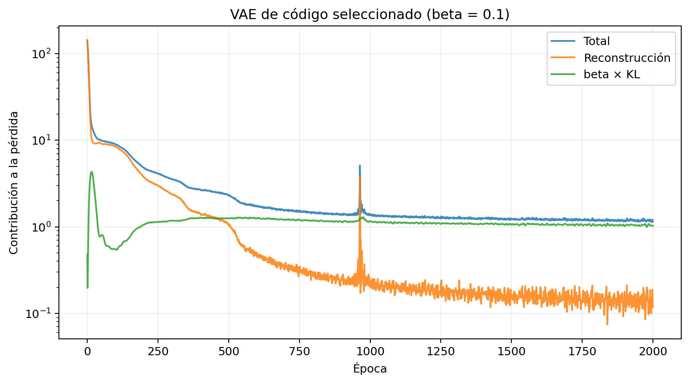

# Ejercicio 2 - Autoencoder variacional generativo

> **BORRADOR EXPLORATORIO, NO APROBADO:** la dirección general de usar funciones
> Python fue elegida por la usuaria, pero la gramática, representación,
> arquitectura y embudo descritos aquí fueron ensayados por el asistente sin el
> ping-pong de decisión correspondiente. Los resultados se conservan como
> pilotos y no constituyen todavía la solución final del ejercicio 2. En
> particular, el dataset `0-9` y la codificación ASCII descriptos en este
> borrador quedaron obsoletos: la especificación aprobada actual está en
> `docs/vae/python-code-dataset.md`.

## Dataset

Se construyó un dataset nuevo de 900 funciones Python aritméticas de longitud
fija. Cada fuente tiene la forma:

```python
def f(x): return (x+3)*7
```

Los dos operadores varían en `{+, -, *}` y las dos constantes en `0-9`. Cada
uno de los 24 caracteres se representa mediante sus siete bits ASCII, dando 168
features binarias. Se usan 720 combinaciones para entrenamiento y 180 para
prueba, con split reproducible de semilla 17. La especificación completa está en
`docs/vae/python-code-dataset.md`.

## Control determinista

Antes del VAE se entrenó un AE `168-64-8-64-168`, con `tanh`, código lineal,
salida logística, BCE y Adam `0.005`. Alcanzó reconstrucción binaria exacta de
los 720 programas de entrenamiento en 2.301 épocas.

En prueba reconstruyó exactamente 175 de 180 fuentes. Las cinco restantes
tuvieron `0,0833` bits erróneos por muestra en promedio; aun así, las 180
decodificaciones compilaron y pertenecieron a la gramática. Esto confirmó que
la arquitectura tenía capacidad suficiente antes de introducir muestreo y KL.

## Arquitectura variacional

El encoder compartido produce dos vectores de dimensión 8:

```text
mu, log_var = encoder(x)
epsilon ~ N(0,I)
z = mu + exp(0.5 * log_var) * epsilon
x_hat = decoder(z)
```

La pérdida es:

```text
loss = BCE(x, x_hat) + beta_KL * KL(q(z|x) || N(0,I))
```

El backward de ambas ramas y de KL fue verificado previamente con diferencias
finitas en el VAE de juguete.

## Selección del peso KL

Se mantuvieron arquitectura, inicialización, optimizador, épocas, split y puntos
del prior. Solo cambió `beta_KL`:

| beta KL | exactas train/test con `z=mu` | prior que compila | prior en gramática | válido y nuevo |
|---:|---:|---:|---:|---:|
| 0,01 | 720 / 180 | 52,5 % | 50,8 % | 9,6 % |
| **0,1** | **720 / 180** | **90,2 %** | **89,6 %** | **15,2 %** |
| 1,0 | 149 / 20 | 99,7 % | 99,4 % | 14,2 % |

`0,01` privilegia demasiado la reconstrucción y deja el prior poco alineado.
`1,0` produce muestras casi siempre válidas, pero pierde demasiada información
de cada entrada. El piloto sugiere `0,1` como posible compromiso: conserva reconstrucción
exacta en modo medio y mejora fuertemente la generación desde `N(0,I)`.

## Confirmación

Se confirmó `beta_KL = 0,1` con semillas de modelo 0, 1 y 2. En las tres, las
720 fuentes de entrenamiento y las 180 de prueba se reconstruyeron exactamente
al usar `z=mu`.

Sobre los mismos 1.000 puntos del prior por corrida:

| Métrica | Media ± desvío |
|---|---:|
| compila | 91,30 ± 3,58 % |
| pertenece a la gramática | 90,63 ± 3,76 % |
| válida y nueva respecto de train | 15,93 ± 1,27 % |
| fuentes distintas | 610,7 ± 13,3 |

Los resultados individuales están en `docs/vae/code-model-comparison.csv` y el
agregado en `docs/vae/code-confirmation-aggregate.csv`.



## Generación

La evaluación principal muestrea directamente `z ~ N(0,I)`; el encoder no
participa. La primera salida de la semilla fijada que pertenece a la gramática y
no estaba en entrenamiento fue:

```python
def f(x): return (x+1)+3
```

La fuente compila y su AST satisface la familia definida. Es nueva en sentido
sintáctico respecto del entrenamiento, aunque eso no garantiza una función
matemática inédita.

La selección automática también conservó fallos representativos:

```python
def f(x): return (x*6)/3  # compila, pero usa un operador fuera de la gramática
def f(x): return (x+3)+;  # no compila
```

Así, compilación y pertenencia no se confunden, y la presentación no depende de
mostrar solamente casos favorables.

## Interpolación

Se eligió objetivamente el primer par del conjunto de prueba con máxima
distancia de Hamming en la representación: `(x+6)*7` y `(x-9)-8`. Se
decodificaron nueve puntos entre sus medias latentes. Ocho produjeron programas
de la gramática; el punto medio fue sintácticamente inválido:

```python
def f(x): return (x)3)+1
```

Esto muestra una limitación central de datos discretos: el decoder es continuo,
pero el umbral y la conversión ASCII no garantizan que todo punto intermedio sea
código válido. Los casos y reglas de selección están en
`docs/vae/code-generation-analysis.json`.

## Conclusión

El VAE aprendido genera desde un prior normal programas que compilan y
pertenecen a la familia con alta frecuencia, incluyendo combinaciones no vistas
durante el entrenamiento. El peso KL controla una tensión observable entre
reconstrucción y validez del prior. La gramática estrecha hace posible una
evaluación objetiva, pero limita la diversidad semántica y no debe confundirse
con generación de código Python general.
