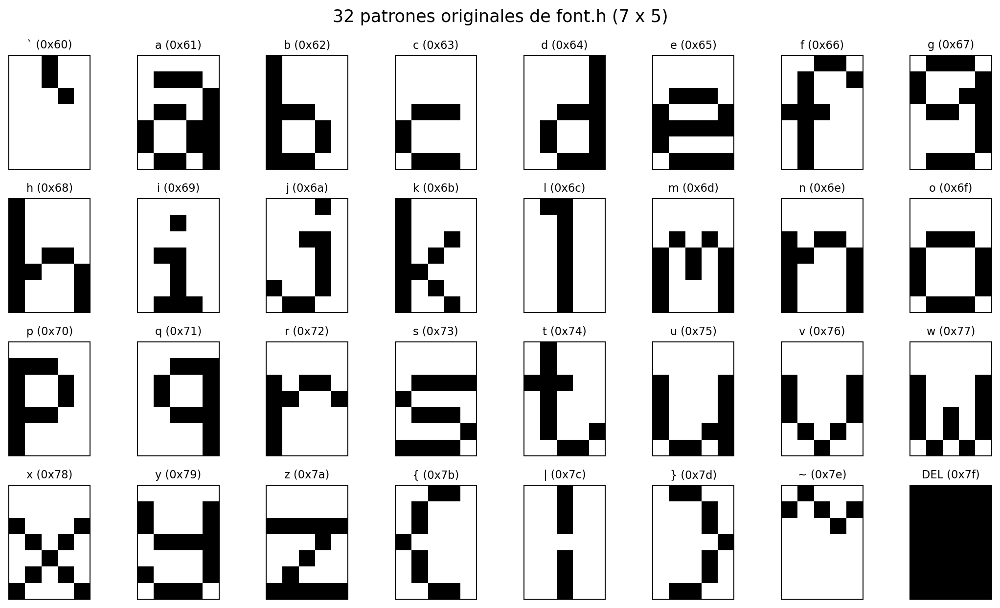
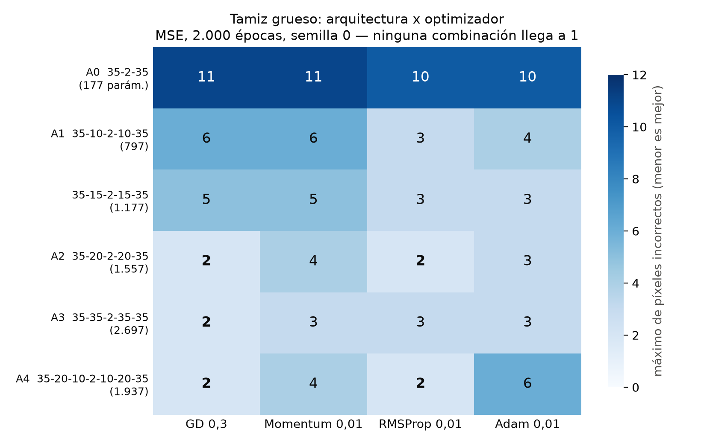
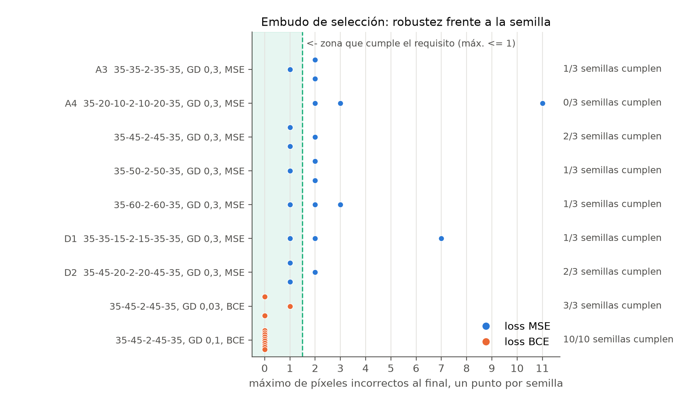
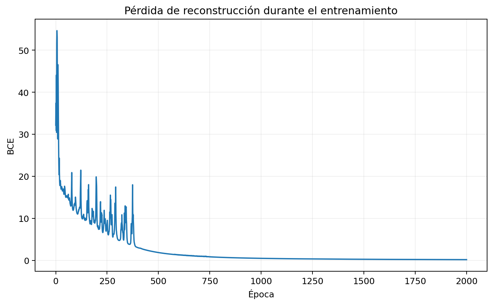
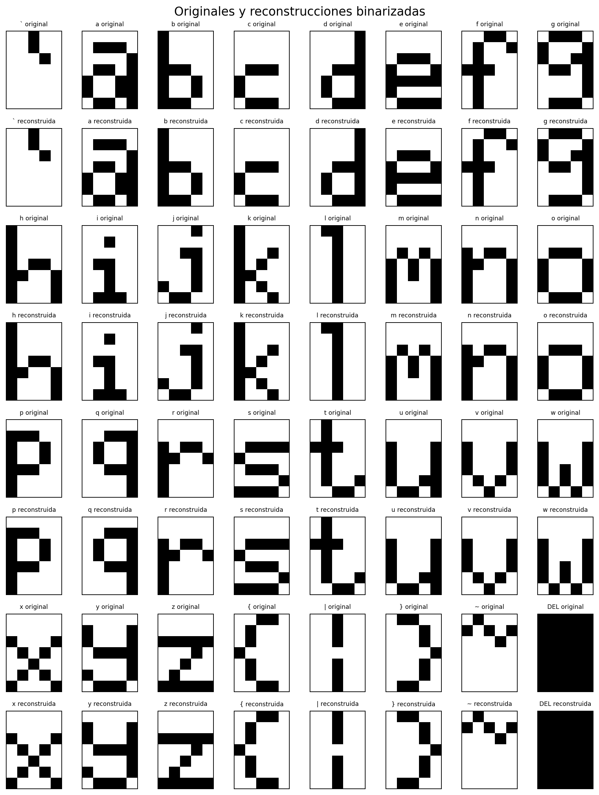
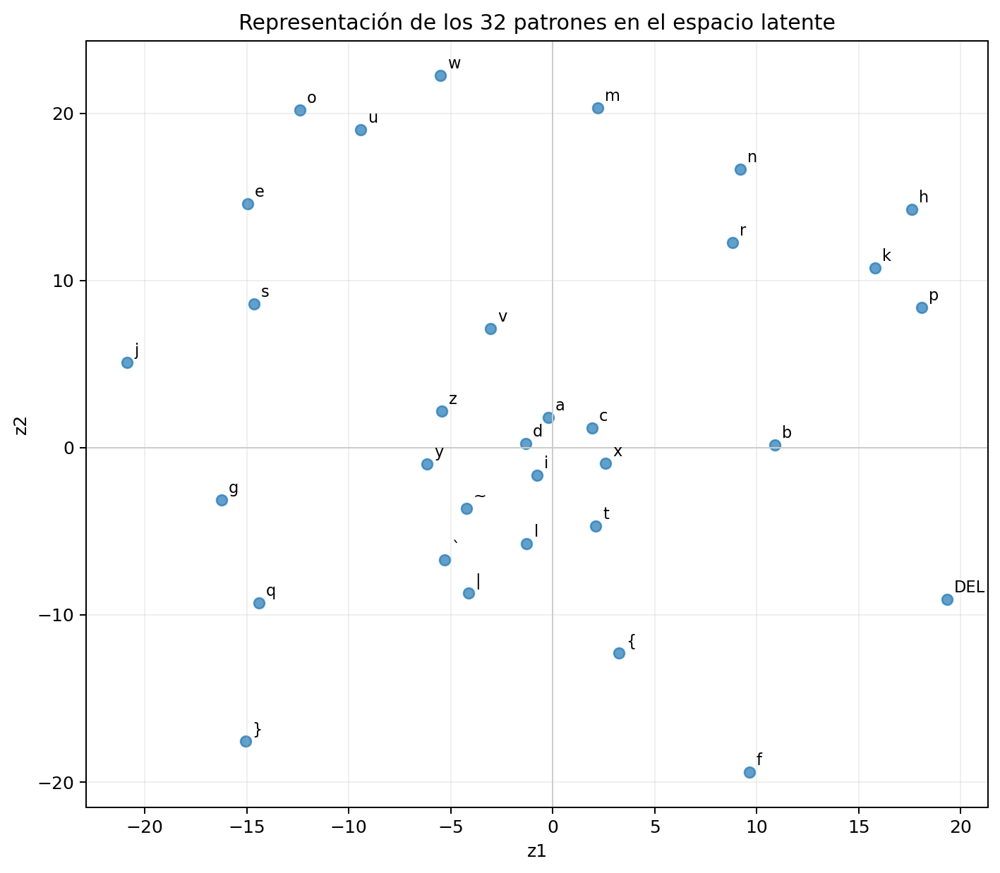
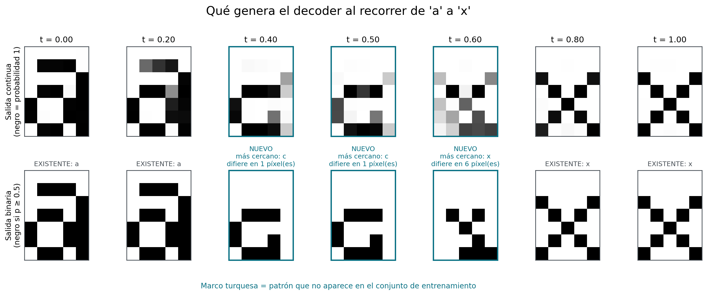

# TP5 — Autoencoders: recorrido completo, resultados y análisis

Este documento cuenta el TP de punta a punta: qué pide cada ejercicio, los
conceptos necesarios para entenderlo, cómo se llegó a cada decisión y qué
muestran los resultados. Es la base para armar la presentación.

Los detalles experimentales completos (todas las tablas intermedias) están en
`ejercicio_1a.md`, `ejercicio_1b.md` y `ejercicio_2.md`. Acá se conserva lo que
hace falta para entender y defender cada decisión.

---

## Ideas base: qué es un autoencoder

Un **autoencoder** es un perceptrón multicapa al que se le pide algo
aparentemente trivial: que su salida sea igual a su entrada. Para cada patrón
`x`, la salida esperada es el mismo `x`.

La gracia está en la forma de la red. En el medio hay una capa muy angosta, el
**cuello de botella** o **espacio latente**:

```text
           ENCODER                         DECODER
x (35 píxeles) -> capas ocultas -> z (2 números) -> capas ocultas -> x' (35 valores)
```

- El **encoder** comprime los 35 píxeles a un código `z` de solo 2 números.
- El **decoder** intenta reconstruir los 35 píxeles a partir de esos 2 números.
- Como toda la información tiene que pasar por `z`, la red no puede copiar la
  entrada píxel por píxel: está obligada a aprender una representación
  compacta de los datos.

Se entrena como cualquier MLP: se mide la diferencia entre `x` y `x'` con una
función de pérdida y se ajustan **todos** los pesos (encoder y decoder juntos)
con backpropagation. No hacen falta etiquetas: es aprendizaje no supervisado.

Según la teórica, si todas las activaciones fueran lineales, el autoencoder
aprendería lo mismo que PCA (proyectar sobre las componentes principales). Con
activaciones no lineales funciona como una **reducción de dimensionalidad no
lineal**, más flexible que PCA.

Una vez entrenado, cada mitad sirve por separado:

- `encode(x)` da la posición de un patrón en el espacio latente (lo que se
  grafica en el ejercicio 1A.3);
- `decode(z)` permite elegir un punto `z` cualquiera y ver qué genera la red
  (ejercicio 1A.4). Esa es la puerta a los modelos generativos del ejercicio 2.

---

## Ejercicio 1A — Autoencoder básico

### Qué pide la consigna

1. Plantear un encoder y un decoder que representen las entradas en un espacio
   latente de **dimensión 2**.
2. Estudiar arquitecturas y técnicas de optimización hasta aprender los
   **32 patrones de 7x5 con un error máximo de 1 píxel**.
3. Graficar los datos de entrada en el espacio latente.
4. Mostrar cómo la red puede generar una **letra nueva** que no está en el
   conjunto de entrenamiento.

### El dataset

`font.h` contiene 32 caracteres (de `` ` `` a `DEL`) dibujados en 7 filas por 5
columnas. Cada fila es un número hexadecimal cuyos 5 bits indican qué píxeles
están encendidos. Se aplana cada sprite en un vector de **35 valores
binarios**: el dataset es una matriz de 32 muestras por 35 features.



Aplanar la imagen no pierde información (se puede volver a armar la grilla),
pero la red ya no "sabe" qué píxeles son vecinos: tiene que aprenderlo de los
datos.

### Criterio de éxito

La salida de la red es continua: cada uno de los 35 valores está entre 0 y 1 y
se puede leer como la probabilidad de que el píxel esté encendido. Para
**evaluar**, se binariza con umbral 0,5 y se cuentan los píxeles distintos al
original.

Se exige el **peor caso**: cada uno de los 32 patrones debe tener como máximo un
píxel incorrecto. Un promedio menor que 1 no alcanza, porque podría esconder
una letra muy mal reconstruida.

El umbral se usa solo para medir, nunca dentro del entrenamiento: la función
escalón tiene derivada cero (o indefinida), así que backpropagation no podría
aprender nada a través de ella.

### Conceptos que intervienen en las decisiones

**Función de pérdida: MSE contra BCE.** La pérdida mide qué tan lejos está `x'`
de `x`.

- **MSE** (error cuadrático medio) es la de la teórica: `||x - x'||²`.
- **BCE** (entropía cruzada binaria) está pensada para salidas que son
  probabilidades de algo binario, como un píxel:
  `BCE = -Σ [x log(x') + (1 - x) log(1 - x')]`.

La diferencia importante está en el gradiente. Con salida sigmoide y MSE, el
gradiente incluye el factor `x'(1 - x')`, que es casi cero cuando la neurona
está saturada. Entonces, si un píxel está muy equivocado *y* saturado (por
ejemplo, la red dice 0,01 cuando debería ser 1), la corrección es mínima. Con
BCE ese factor se cancela y el gradiente queda proporcional al error,
`x' - x`: cuanto más equivocada la salida, más fuerte la corrección.

**Optimizadores.** Todos actualizan los pesos en contra del gradiente; cambian
en cómo eligen el paso.

| Optimizador | Idea |
|---|---|
| Descenso de gradiente (GD) | Paso proporcional al gradiente actual. |
| Momentum | Suma una fracción del paso anterior: acumula dirección y reduce el zigzag. |
| RMSProp | Divide el paso por el tamaño reciente de los gradientes: cada peso tiene su propia escala. |
| Adam | Combina Momentum y RMSProp, con corrección del sesgo inicial. |

Todos se implementaron a mano (a partir del MLP del TP3), sin librerías que
entrenen la red.

**Semillas.** La semilla fija la inicialización aleatoria de los pesos. Dos
entrenamientos idénticos con distinta semilla pueden terminar muy distinto. Por
eso **una semilla sirve para descartar, pero para elegir hace falta repetir con
varias**.

### Implementación y controles previos

Antes de buscar la arquitectura se verificó que la implementación fuera
correcta:

1. **Gradientes numéricos.** Los gradientes de backpropagation se compararon
   con diferencias finitas en una red diminuta y coincidieron.
2. **Memorizar una sola letra.** La red `35-15-2-15-35` aprendió la letra `a`
   (de 16 píxeles incorrectos a 0 en 12 épocas). Si no pudiera copiar un único
   patrón, no tendría sentido intentar con 32.

### Recorrido experimental

#### Punto de partida: no alcanza con entrenar más

La primera corrida sobre los 32 patrones usó `35-15-2-15-35`, MSE, Adam 0,01 y
20.000 épocas. Terminó con **7 píxeles incorrectos** en el peor patrón y solo 17
de 32 patrones dentro del límite.

Lo más llamativo fue la trayectoria: el máximo de errores llegó a 3 cerca de la
época 3.500 y después **empeoró** hasta 7. De ahí salieron dos reglas que se
mantuvieron en todo el TP:

- más épocas no siempre mejoran el modelo;
- se evalúa siempre el **estado final** tras un presupuesto común. Elegir el
  mejor punto intermedio de una corrida sería hacer trampa con la selección.

#### Estrategia: un embudo

La arquitectura y el optimizador interactúan: una tasa que va bien en una red
puede ser inestable en otra. Probar todas las combinaciones de todo sería
carísimo, así que se usó un embudo:

1. calibrar pocas tasas por optimizador sobre dos arquitecturas de referencia;
2. cruzar arquitecturas representativas con los perfiles que sobrevivieron;
3. repetir con más semillas solo lo prometedor;
4. refinar donde los datos mostraban una tendencia;
5. confirmar el finalista con muchas semillas.

#### Paso 1 — Calibración de tasas

Sobre `35-15-2-15-35` y `35-35-2-35-35`, con 2.000 épocas y semilla 0, se
probaron tres tasas por optimizador (24 corridas). Ninguna divergió y ninguna
cumplió el requisito.

- Las tasas muy chicas (GD 0,01, RMSProp y Adam 0,0001) seguían mejorando pero
  quedaron muy lejos dentro del presupuesto: son lentas, no incapaces.
- GD 1,0 y Momentum 0,2 fueron inestables en la red de 15 neuronas pero
  funcionaron en la de 35. Primera evidencia de **interacción
  arquitectura-tasa**.

Pasaron al siguiente paso **GD 0,3, Momentum 0,01, RMSProp 0,01 y Adam 0,01**.

#### Paso 2 — Tamiz de arquitecturas por optimizador

Se cruzaron seis arquitecturas con esos cuatro perfiles (MSE, 2.000 épocas,
semilla 0):



Qué se lee en el mapa:

- **A0 (sin capas ocultas)** queda en 10-11 errores con cualquier optimizador.
  Comprimir 35 píxeles a 2 números directamente, sin capas intermedias, no
  alcanza: las capas ocultas son imprescindibles.
- **A1 (10 neuronas) y la de 15 neuronas** mejoran mucho, pero siguen lejos
  (3 a 6 errores).
- **A2, A3 y A4** llegan a máximo 2: la capacidad está cerca de lo necesario.
- **GD** es el optimizador más parejo. **Adam** se desestabiliza en la red
  profunda A4: llegó a un buen punto y terminó con 6 errores.

#### Paso 3 — Repetir con más semillas

Las siete combinaciones más prometedoras se repitieron con las semillas 1 y 2.
El gráfico muestra, para cada configuración relevante del embudo, el máximo de
errores final de **cada semilla** (un punto por semilla):



- **A4 + GD** parecía tan buena como A2 con la semilla 0, pero con la semilla 2
  terminó con 11 errores. Una sola semilla habría llevado a una conclusión
  equivocada.
- **A3 + GD** fue la más estable y la primera en cumplir en alguna semilla.
- Momentum y Adam quedaron por detrás de GD en A3 en las tres semillas y se
  retiraron del refinamiento (lo que no significa que no sirvan en general).

#### Paso 4 — Refinamiento de ancho y profundidad (todavía con MSE)

- **Ancho 45** (`35-45-2-45-35`) + GD 0,3 cumplió en 2 de 3 semillas. Fue el
  mejor resultado con MSE.
- **Más épocas no lo arreglaron**: con 4.000 épocas la pérdida siguió bajando,
  pero ninguna semilla cambió su cantidad de errores.
- **Más ancho tampoco**: 50 y 60 neuronas cumplieron solo en 1 de 3. Más
  parámetros no implica mejor resultado.
- **Más profundidad**: D1 (`35-35-15-2-...`) fue inestable (una semilla
  terminó con 7 errores después de haber cumplido). D2 (`35-45-20-2-...`)
  cumplió en 2 de 3, igual que ancho 45 pero con un 50 % más de parámetros. Por
  parsimonia se prefirió ancho 45.

Con MSE se llegó a un techo: nada cumplía en todas las semillas.

#### Paso 5 — Cambio de pérdida: BCE

Los píxeles son binarios y la salida es una sigmoide, así que BCE es la pérdida
natural (ver *Conceptos*). Se implementó, se verificó su gradiente numéricamente
y se recalibró la tasa: cambiar la pérdida cambia la escala del gradiente, así
que no se podía reutilizar la tasa de MSE.

| Tasa (GD, BCE) | Máximo de errores (semilla 0) | Interpretación |
|---:|---:|---|
| 0,01 | 6 | demasiado lenta |
| 0,03 | 0 | viable |
| **0,1** | **0** | viable y más rápida |
| 0,3 | 22 | inestable |

Con BCE y tasa 0,1, el ancho 45 reconstruyó **exactamente los 32 patrones en las
10 semillas** (0 a 9). Es el salto que se ve al pie del gráfico del embudo: los
puntos naranjas quedan todos en 0. Las semillas 5 a 9 se agregaron **después**
de congelar la configuración, como verificación independiente.

**Conclusión del recorrido:** el cuello de botella no estaba en la capacidad de
la red sino en la señal de error. Con MSE, los píxeles saturados y equivocados
casi no se corregían; BCE resolvió eso.

### Modelo final

| Hiperparámetro | Valor |
|---|---|
| Arquitectura | `35 -> 45 -> 2 -> 45 -> 35` (3.457 parámetros) |
| Activaciones | `tanh` en las ocultas, lineal en el latente, logística en la salida |
| Pérdida | BCE |
| Optimizador | Descenso de gradiente, tasa 0,1 |
| Entrenamiento | full-batch (los 32 patrones por actualización), 2.000 épocas, sin parada anticipada |
| Inicialización | uniforme en [-0,5; 0,5] |
| Semilla de la corrida publicada | 0 (elegida por convención, no por ser la mejor) |

El latente es **lineal** para que `z` pueda tomar cualquier valor real y no
quede limitado a [-1, 1] como pasaría con `tanh`.

**Resultado:** BCE final 0,177, **0 píxeles incorrectos en los 32 patrones**,
en 0,5 segundos de entrenamiento. En las 10 semillas el requisito se cumplió
por primera vez entre las épocas 438 y 770.



La curva es muy ruidosa durante las primeras ~400 épocas (la tasa 0,1 da pasos
grandes y la red salta entre configuraciones) y después baja de forma suave y
sostenida.



Cada par de filas muestra el original arriba y la reconstrucción binarizada
abajo: son idénticos para los 32 caracteres.

### Espacio latente (1A.3)

Cada punto es `encode(x)` para uno de los 32 patrones: las coordenadas `(z1, z2)`
del código de dos números que la red asignó a ese carácter.



Cómo leerlo:

- **Los 32 códigos son distintos y están separados.** Si dos letras cayeran en
  el mismo punto, el decoder no podría distinguirlas.
- **Hay cierta organización.** Los caracteres con un trazo vertical largo a la
  izquierda (`b`, `h`, `k`, `n`, `p`, `r`) quedan a la derecha; `o`, `u` y `w`,
  de contorno redondeado, arriba a la izquierda; `DEL` (todo
  negro) y `f` quedan alejados del resto. Es una observación sobre esta corrida,
  no una regla.
- **Los ejes no tienen significado.** Otra semilla podría rotar, reflejar o
  estirar el mapa entero y reconstruir igual de bien. Solo importan las
  posiciones relativas dentro de una misma corrida.
- **La escala es grande** (de -20 a 20) porque el latente es lineal y el
  autoencoder básico no tiene nada que limite el tamaño de los códigos.
- **El espacio entre puntos no está garantizado.** El entrenamiento solo
  restringe al decoder en esos 32 puntos. Qué genera en las zonas vacías no se
  controla. Este es justamente el problema que resuelve el VAE del ejercicio 2.

### Generar una letra nueva (1A.4)

Para generar, se elige un punto `z` que no sea el código de ninguna letra y se
lo pasa por el decoder. Se usó la **interpolación lineal** entre dos códigos:

```text
z(t) = (1 - t) · z_a + t · z_b,   con t entre 0 y 1
```

En `t = 0` se está sobre la letra `a`, en `t = 1` sobre `x`, y en el medio se
recorre el segmento que las une.



- La fila de arriba es la salida continua (los grises son probabilidades
  intermedias); la de abajo, la binarizada.
- En `t = 0,4` y `t = 0,5` aparece un **patrón nuevo** (marco turquesa): no
  coincide con ninguno de los 32. Su vecino más cercano es `c`, a 1 píxel de
  distancia (distancia de Hamming 1). Es una `c` con un píxel extra en la parte
  inferior derecha.
- En `t = 0,6` aparece otro patrón nuevo, a 6 píxeles de `x`, que ya no se
  parece a ningún carácter.
- La salida binaria **no cambia de forma continua**. Se queda en `a` hasta
  `t = 0,2` y salta cuando alguna probabilidad cruza el 0,5.

**Por qué `a-x` y no otro par.** Primero se probó `m-n`, pero todos los puntos
intermedios se binarizaban como `m` o como `n`: un punto nuevo del latente no
garantiza una letra nueva. Una vez elegido `a-x`, no se siguieron probando pares
en busca de un resultado más vistoso.

Esto muestra lo que el autoencoder básico puede y no puede hacer al generar.
**Puede** producir patrones nuevos y algunos tienen forma de carácter.
**No garantiza** que todo el espacio latente produzca letras válidas ni que las
transiciones sean suaves.

### Conclusiones del ejercicio 1A

- Un autoencoder `35-45-2-45-35` con BCE y descenso de gradiente (tasa 0,1)
  reconstruye **exactamente** los 32 patrones con un latente de dimensión 2, en
  10 de 10 semillas.
- Hacen falta capas ocultas: sin ellas (A0) quedan 10-11 errores con cualquier
  optimizador.
- Arquitectura, optimizador y tasa **interactúan**: una tasa estable en una red
  puede desestabilizar otra.
- Más épocas, más ancho o más profundidad no garantizan mejoras. Con MSE se
  llegó a un techo de 2 de 3 semillas.
- **El cambio decisivo fue la pérdida**: BCE corrige con fuerza los píxeles
  saturados y equivocados.
- Repetir con varias semillas cambió conclusiones (A4 + GD, D1). Una sola
  semilla sirve para descartar, no para elegir.
- El espacio latente separa los 32 caracteres, pero sus ejes no tienen
  significado y las zonas vacías no están controladas.
- Interpolando entre `a` y `x` se generan patrones nuevos, uno de ellos a un
  píxel de `c`. Con un autoencoder común, generar es posible pero no está
  garantizado.

---

## Ejercicio 1B — Denoising autoencoder

*Pendiente.*

---

## Ejercicio 2 — Autoencoder variacional (VAE)

*Pendiente.*
