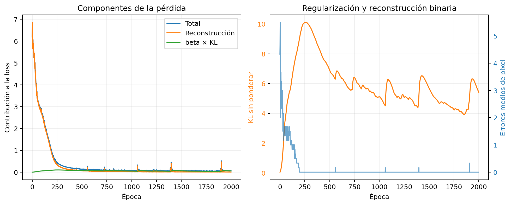
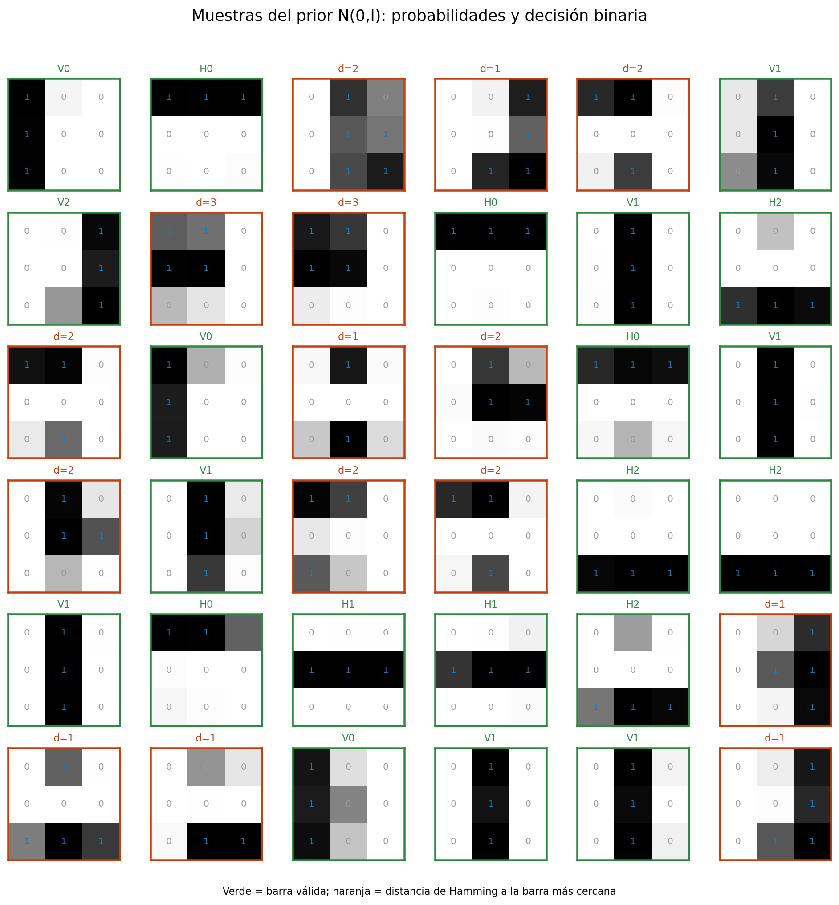

# Etapa 6 - VAE mínimo de juguete

## Propósito del checkpoint

El objetivo no es todavía resolver el ejercicio 2 sobre el dataset definitivo,
sino introducir una sola novedad por vez. El dataset de juguete contiene seis
imágenes binarias `3x3`: tres barras horizontales y tres verticales. Cada imagen
se aplana a nueve valores y sirve únicamente para comprobar el mecanismo.

La arquitectura provisional es:

```text
9 -> 8 -> (mu: 2, log_var: 2) -> z -> 8 -> 9
```

Para un lote de `m` muestras, las dimensiones son:

| Tensor | Forma | Interpretación |
|---|---:|---|
| `x` | `(m, 9)` | entradas binarias aplanadas |
| `h_encoder` | `(m, 8)` | representación compartida por las dos ramas |
| `mu` | `(m, 2)` | centro de `q(z|x)` |
| `log_var` | `(m, 2)` | logaritmo de su varianza diagonal |
| `z` | `(m, 2)` | código entregado al decoder |
| `x_hat` | `(m, 9)` | probabilidades reconstruidas |

## Primer checkpoint: dos ramas, todavía sin azar

En este checkpoint se usa deliberadamente:

```text
z = mu
```

`log_var` se calcula y tiene las dimensiones definitivas, pero aún no interviene
en la salida. Esto permite verificar primero que separar las dos ramas no rompe
el autoencoder determinista.

La consecuencia esperada para backpropagation es:

```text
dL_reconstruccion / d(mu)       != 0
dL_reconstruccion / d(log_var)  = 0
```

El segundo resultado no indica un error: cambiar `log_var` no puede modificar
la reconstrucción mientras `z = mu`. En el siguiente subpaso se reemplazará por:

```text
epsilon ~ N(0, I)
z = mu + exp(0.5 * log_var) * epsilon
```

Este primer checkpoint reconstruyó exactamente las seis barras y quedó
conservado como control mediante una prueba con `epsilon = 0`.

## Segundo checkpoint: reparametrización sin KL

El código usado por el decoder es ahora:

```text
epsilon ~ N(0, I)
desvio = exp(0.5 * log_var)
z = mu + desvio * epsilon
```

Para verificar gradientes se entrega un `epsilon` fijo y no nulo a la pasada
analítica y a todas las perturbaciones de diferencias finitas. Si se tomara una
muestra nueva en cada evaluación, la diferencia observada mezclaría el cambio
del parámetro con el azar y dejaría de aproximar una derivada.

Si `g_z` representa el gradiente que llega desde el decoder, las dos ramas
reciben:

```text
g_mu      = g_z
g_log_var = g_z * epsilon * 0.5 * exp(0.5 * log_var)
```

Por eso un `epsilon` no nulo permite que el error de reconstrucción actualice
`log_var`, aunque KL continúe temporalmente ausente. Con `epsilon = 0`, el
segundo gradiente vuelve a cero y `z = mu`.

## Verificaciones

- `mu` y `log_var` tienen forma `(6, 2)` sobre el dataset completo.
- `encode(x, epsilon)` coincide con la fórmula de reparametrización.
- `decode(encode(x, epsilon))` coincide con `predict(x, epsilon)`.
- Los gradientes reparametrizados analíticos coinciden con diferencias finitas;
  la máxima discrepancia observada es `3,74e-10`.
- Con `epsilon` no nulo, los pesos y sesgos de `log_var` reciben gradiente.
- Con `epsilon = 0`, esos gradientes son exactamente cero y `z = mu`.
- Dos modelos con iguales semillas repiten la misma secuencia de muestras, pero
  extracciones sucesivas dentro de una corrida producen códigos distintos.
- Con Adam, tasa `0.01` y semilla 0, las seis barras se reconstruyen sin errores
  de umbralización en 92 épocas.

## Tercer checkpoint: reconstrucción más KL

Para una distribución diagonal, la regularización por muestra es:

```text
KL = -0.5 * sum(1 + log_var - mu^2 - exp(log_var))
```

La pérdida total implementada es:

```text
loss_total = loss_reconstruccion + beta_KL * KL
```

Las contribuciones adicionales que KL envía hacia las ramas son:

```text
dKL / dmu      = mu
dKL / dlog_var = 0.5 * (exp(log_var) - 1)
```

El entrenador toma un `epsilon` por época y reutiliza exactamente esa matriz en
la predicción, el cálculo de las tres pérdidas y el backward. Así, cada fila de
la historia describe una sola realización del muestreo y no una mezcla de tres
muestras diferentes.

El primer piloto reproducible usa la configuración
`configs/vae_toy_kl001_seed0.json`: arquitectura `9-8-2-8-9`, BCE, Adam con tasa
`0.01`, `beta_KL = 0.01`, 2.000 épocas y semilla de modelo 0. En las últimas 100
épocas obtuvo:

| Métrica | Media |
|---|---:|
| loss total | 0,07135 |
| reconstrucción BCE | 0,01279 |
| KL sin ponderar | 5,85634 |
| aporte `beta_KL * KL` | 0,05856 |
| errores de píxel | 0,00333 |
| patrones exactos de 6 | 5,99 |

Las varianzas aprendidas quedaron entre `0,0078` y `0,1374`. Por lo tanto, este
peso pequeño privilegia fuertemente la reconstrucción y todavía permite
distribuciones bastante estrechas. El resultado valida el mecanismo y el
registro separado, pero no demuestra que `0.01` sea el peso apropiado para el
dataset final.



Los valores por época están en `toy-kl001-history.csv` y el resumen numérico en
`toy-kl001-summary.json`.

## Cuarto checkpoint: muestreo desde el prior

Una vez entrenado, el encoder no participa de la generación. Se toman puntos:

```text
z ~ N(0, I)
x_generada = decoder(z)
```

El protocolo fijó 1.000 puntos, semilla 21 y umbral `0.5`. Una salida se
considera válida si su versión binaria coincide exactamente con una de las tres
barras horizontales o tres verticales del dataset. Para las inválidas se mide
la distancia de Hamming a la barra más cercana.

| Métrica | Resultado |
|---|---:|
| muestras del prior | 1.000 |
| barras válidas | 587 |
| tasa de validez | 58,7 % |
| distancia mínima media | 0,62 píxeles |
| máxima distancia mínima | 3 píxeles |
| patrones binarios distintos | 46 |

Las seis barras aparecen entre las muestras válidas, aunque no uniformemente:
la vertical central aparece 199 veces y es la más frecuente. El `41,3 %` de
salidas inválidas y este desbalance son evidencia de que `beta_KL = 0.01` no
alinea perfectamente el posterior agregado con `N(0,I)`. No invalidan el
mecanismo: muestran precisamente la tensión que después deberá estudiarse al
seleccionar el peso KL del VAE final.



Los 1.000 casos están en `toy-prior-samples.csv` y los agregados en
`toy-prior-summary.json`. El modelo usado fue guardado en
`results/vae-toy-kl001-seed0/model.npz` y la generación se reproduce con
`configs/vae_toy_prior_seed21.json`.

## Dataset definitivo

Este checkpoint no decide el dataset del ejercicio 2. La candidata principal
continúa siendo una familia acotada de funciones aritméticas de Python generada
por una gramática, evaluable por novedad, compilación y pertenencia de su AST a
la gramática permitida. Esa decisión corresponde a la Etapa 7.
